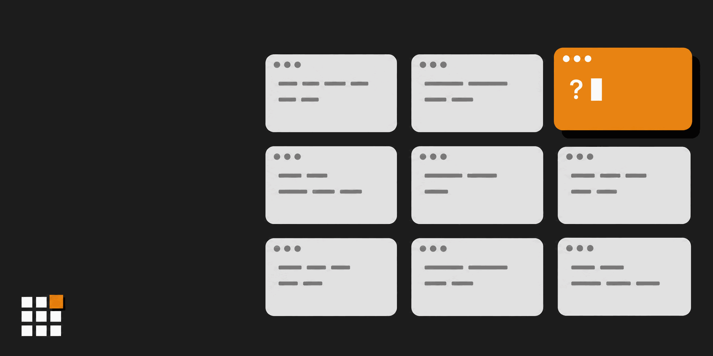
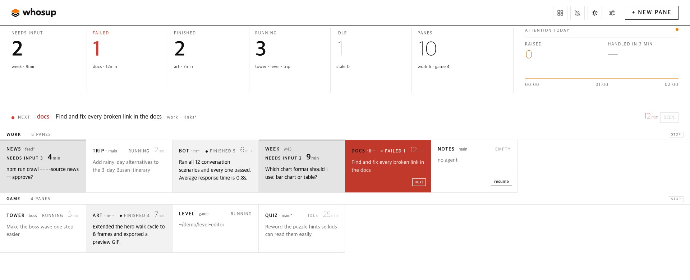
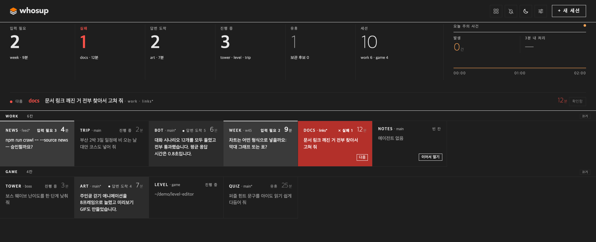

[English](README.md) | [한국어](README.ko.md) | [日本語](README.ja.md) | [中文](README.zh.md) | Español

# whosup

<p align="center">
  <picture>
    <source media="(prefers-color-scheme: dark)" srcset="assets/logo-dark.png">
    
  </picture>
</p>

> **Deja de abandonar tus sesiones de agentes.** whosup reúne todas tus sesiones de herdr en un solo tablero y te muestra qué panel te necesita ahora.

Trabajas con seis, diez, quince agentes de código en paneles de [herdr](https://herdr.dev). Unos están trabajando, otros terminaron hace una hora y uno está parado en un aviso de permisos que nunca viste. whosup reúne cada panel de cada sesión de herdr en ejecución en una sola página del navegador: qué necesita tu respuesta, qué acaba de terminar, qué sigue en marcha y qué se ha quedado en silencio. Haz clic en una celda y herdr salta a ese panel.

<p align="center">
  
</p>

[Inicio rápido](#inicio-rápido) • [¿Por qué whosup?](#por-qué-whosup) • [Qué ves](#qué-ves) • [Cómo funciona](#cómo-funciona) • [Funcionalidades](#funcionalidades) • [Ajustes](#ajustes) • [Configuración por entorno](#configuración-por-entorno) • [Requisitos](#requisitos)

---

## Inicio rápido

### 1. Instala el plugin de herdr

```bash
herdr plugin install fivetaku/whosup --yes
```

### 2. Arráncalo (o simplemente reinicia herdr)

```bash
herdr plugin action invoke fivetaku.whosup.start
```

El tablero arranca en `http://127.0.0.1:4790` y se abre una vez en tu navegador. A partir de ahí se inicia junto con herdr.

### 3. Abre más sesiones de herdr cuando quieras

```bash
herdr --session work      # cualquier nombre, cualquier terminal
```

Cada sesión en ejecución aparece sola en el tablero. No hay ninguna lista que mantener.

### En Windows

El mismo plugin funciona en Windows; sus acciones llevan el prefijo `win-` (`win-start`, `win-doctor`, …). Ver [Windows](#windows).

---

## ¿Por qué whosup?

- **Dejas de revisar paneles a mano.** La banda superior te dice cuántos paneles necesitan tu respuesta, han fallado, han terminado o siguen en marcha. La línea **next** señala el primero que debes mirar y cita la pregunta que está haciendo.
- **Un clic, el panel correcto.** Haz clic en una celda y herdr enfoca ese panel, en cualquier pestaña de cualquier sesión. En macOS también puede traer al frente tu aplicación de terminal.
- **Los reinicios no pierden conversaciones.** Tras reiniciar, herdr restaura los paneles pero no los agentes. Las celdas vacías tienen un botón **resume** que busca la conversación de Claude Code más reciente de esa carpeta y ejecuta `AGENT_CMD --resume <id>` en el panel. resume solo lee el historial de conversaciones de Claude Code; con cualquier otro agente el panel empieza una conversación nueva.
- **El color significa algo.** Blanco y negro en todas partes, naranja para lo único que debes mirar a continuación, rojo para los fallos. Nada parpadea en bucle.
- **Te avisa aunque mires a otro lado.** El título de la pestaña muestra cuántos paneles esperan, p. ej. `(3) whosup`, y el favicon enciende su celda naranja. Un panel que acaba de levantar la mano recibe un breve anillo naranja. El botón de orden de la cabecera alterna entre **by desk** (por desk) y **neglected first** (desatendidos primero), que lleva al frente de cada desk los paneles que más esperan. Activa **alerts** en la cabecera para recibir una notificación de escritorio; al pulsarla saltas a ese panel.
- **Nada que espera se pierde.** Un panel que te necesita sigue en el tablero hasta que lo atiendes: pasada la medianoche, tras reiniciar o si herdr no responde un momento. **seen** solo lo pospone 30 minutos; si sigue esperando, vuelve. Los paneles cerrados quedan en la fila **recently closed** durante 7 días y los que guardas con **stash**, hasta que los restauras; desde ahí puedes reanudarlos o restaurarlos. Un panel guardado que vuelve a trabajar regresa solo. Fija arriba los paneles que siempre miras.
- **Dice cuando no sabe.** Si whosup no llega a herdr, la cabecera muestra *disconnected · last collect HH:MM*, el título de la pestaña pasa a `(!) whosup` y el favicon se vuelve gris, en lugar de un tablero tranquilo y desactualizado.
- **Claro, oscuro y tu idioma.** El botón de la cabecera cambia el modo (auto / light / dark) y el panel **settings** cambia el idioma (English / 한국어). La interfaz no está en español, así que este README usa los nombres de los botones en inglés. Las paletas siguen las de temas reales de IDE, con un contraste de texto que cumple WCAG AA.

---

## Qué ves

<p align="center">
  <br>
  
</p>

| Área | Significado |
|---|---|
| **Banda de estado** | Contadores de paneles que necesitan respuesta · fallidos · terminados · en marcha · inactivos · total, además de los eventos de atención de hoy y cuántos se atendieron en menos de 3 minutos. Haz clic en un número para filtrar. |
| **Línea next** | El único panel que debes mirar primero y por qué: la pregunta pendiente, el fallo o la respuesta que llegó. |
| **Desks** | Una fila (desk) por sesión de herdr, una celda por panel en el orden de los paneles. Cabecera de la celda: etiqueta · rama de git (el nombre de la sesión si no hay rama) · estado, con un número 1–9 en los nueve primeros paneles en espera según el orden común (p. ej. `needs input 3`; pulsa 3 para saltar allí) · tiempo de espera (en paneles en marcha o inactivos, tiempo desde tu última petición) · etiquetas del tipo de fallo (p. ej. usage limit) y *unreachable*. Debajo, una línea de contexto. |
| **Línea de la celda** | La pregunta que hace el agente (cuadro de permisos, confirmación de confianza en la carpeta, A o B), su última frase o tu última petición, lo que más importe según el estado. |
| **resume** | En paneles vacíos tras un reinicio: retoma la conversación más reciente de esa carpeta. |
| **+ new pane** | Elige una sesión y una carpeta; whosup abre una pestaña allí, inicia tu agente y la enfoca. |

---

## Cómo funciona

```
herdr sessions (main, side, …)
   └─ pane list + agent list, every 3 s  ──►  whosup collector  ──►  SQLite (node:sqlite)
                                                                       │
browser  ◄──  http://127.0.0.1:4790  ◄──  board server  ◄─────────────┘
   │
   └─ click  ──►  pane.focus over herdr's socket  ──►  the pane
```

Un solo proceso de Node, sin paso de compilación. El hook de arranque de herdr es un comando de una sola vez: cuando herdr arranca, lanza whosup como servidor en segundo plano y termina. Después el servidor sigue funcionando por su cuenta (herdr no lo supervisa ni lo detiene); para pararlo, usa la acción `stop`. El estado de los paneles proviene de la detección de agentes de herdr (working / blocked / done / idle); el texto de la pregunta se lee de la pantalla del panel; la última petición sale del historial de conversaciones de Claude Code (`~/.claude/projects`, o `CLAUDE_PROJECTS_DIR`). Los paneles con otros agentes no muestran la última petición, y resume los empieza de cero. El recolector también escucha los eventos de herdr: cuando un panel cambia de estado se recoge al momento, sin esperar a la siguiente pasada de 3 s, y las pestañas abiertas del tablero se actualizan enseguida. Sin eventos, la pasada de 3 s sigue funcionando.

**Modelo de confianza.** El servidor solo escucha en 127.0.0.1 y no tiene inicio de sesión. Rechaza las peticiones del navegador que llegan desde otros sitios para cambiar algo (un cambio debe venir de la propia dirección del tablero y enviarse como JSON), pero cualquier programa que se ejecute en el mismo ordenador puede usar su API, incluido cambiar ajustes como `AGENT_CMD`, el comando que whosup escribe en un panel para resume y new pane. No expongas el puerto a otras personas. Además, el servidor responde 403 `local only` a cualquier petición cuya cabecera `Host` no sea `127.0.0.1`, `localhost` o `[::1]`, así que los túneles que reenvían un nombre de host público (Tailscale Serve, cloudflared, ngrok) no pueden abrir el tablero en absoluto. Para mirarlo desde otra máquina tuya, usa un reenvío de puerto que mantenga un host localhost, como `ssh -L 4790:127.0.0.1:4790 <host>` y luego `http://localhost:4790`, y arranca el servidor con `WHOSUP_READONLY=1`. El modo solo lectura bloquea cambios, no la vista: no lista las carpetas de tu directorio personal, pero todo lo que hay en el tablero sigue visible (rutas de carpeta de los paneles en los tooltips de las celdas, texto de la última petición, texto de las preguntas) y `GET /api/settings` sigue devolviendo `agent_cmd`.

---

## Funcionalidades

| Funcionalidad | Descripción |
|---|---|
| Detección automática | Todas las sesiones y paneles de herdr en ejecución, sin configuración |
| Estados de atención | needs input · failed · finished · running · idle · empty |
| Extracción de preguntas | Los cuadros de permisos, las confirmaciones de confianza en la carpeta y las preguntas "¿A o B?" se muestran tal cual |
| Salto | Clic → `pane.focus`, y en macOS la ventana de la terminal que muestra esa sesión pasa al frente. La app de terminal se detecta sola; si ninguna ventana muestra la sesión, se abre una nueva (Ghostty y Terminal) |
| Dónde abre un clic | **settings** → *Clicking a pane opens*: terminal window (por defecto), web address o both, guardado por navegador. Web address abre el panel en una terminal web para herdr en una pestaña nueva, con `{session}` y `{pane}` sustituidos; cada sesión de herdr puede tener su propia dirección (una terminal web suele tener un servidor y un puerto por sesión), y una fila de la app Herdr solo se abre en la web cuando tiene una dirección propia. La pestaña se reutiliza por fila, así que queda vinculada al tablero que la abrió: pon solo la dirección de una terminal web en la que confíes. Elígelo cuando uses el tablero desde otro dispositivo. No funciona en modo de solo lectura (ese modo bloquea todos los clics) |
| Terminales de la app Herdr | Si herdr-core (las terminales de la app de escritorio Herdr) está en marcha en este equipo, cada una de sus terminales también es una tarjeta: una fila por espacio de la app, con el estado y el texto de la pregunta tal como los informa el núcleo. Un clic salta a ese panel en la app Herdr y la trae al frente; si la app no está abierta, la terminal se abre en una ventana de terminal (`hc attach`). Cerrar, reanudar, panel nuevo y apagar o encender una fila funcionan igual que con las sesiones de herdr. No hay nada que configurar y whosup nunca arranca un núcleo que no esté en marcha. Un agente detenido en el aviso de confianza de carpeta, que el núcleo no informa, se lee de la pantalla y se muestra como pendiente de respuesta; ningún otro estado se deduce de la pantalla |
| resume | La conversación del propio panel o, si no, la más reciente de su carpeta que no esté viva en otro panel → `AGENT_CMD --resume`; el tablero muestra cuál antes de hacer clic. Solo conversaciones de Claude Code; otros agentes empiezan de cero |
| new pane | Selector de sesión y carpeta, ejecuta el comando de tu agente |
| Desks (opcional) | Declara sesiones y paneles por monitor en `desks.json`; la acción `desks-apply` crea solo lo que falta (puedes repetirla sin efectos extra) |
| Idiomas | English por defecto; 한국어 se elige en el panel **settings** o con `?lang=ko` |
| Tema | auto / light / dark (botón de la cabecera, `?theme=`), paletas basadas en temas de IDE |
| Modo solo lectura | `WHOSUP_READONLY=1` oculta los botones de acción y **+ new pane**, bloquea clics, Enter, 1–9, `n`, clics en alertas y cambios de ajustes (el panel de ajustes solo muestra la elección de idioma), y no lista carpetas. Bloquea cambios, no la vista; consulta el modelo de confianza |
| seen = posponer | **seen** en una celda en espera la oculta 30 min; **unsee** la devuelve ya |
| Fijar | Los paneles fijados van en una fila sobre todos los desks, en ambos órdenes |
| stash y recently closed | Guarda un panel inactivo; los cerrados quedan 7 días en **recently closed** y los guardados, hasta que los restauras; un panel guardado que vuelve a trabajar regresa solo |
| Un solo orden | La línea next, Enter, las teclas 1–9, las alertas y el orden de desatendidos usan el mismo orden: fallido → necesita respuesta → terminado, el que más espera primero |
| Teclado | `n` (o `ㅜ` con distribución coreana) abre new pane · Tab se mueve entre paneles y Enter o Espacio abre el que tiene el foco · sin ningún panel con foco, Enter salta al panel next, o guarda/abre si hay un panel abierto · 1–9 saltan al panel con ese número · Esc cierra el panel. `n` y 1–9 se ignoran mientras escribes en un campo |
| Re-alertas | Un panel que sigue esperando vuelve a avisar cada 15 min, hasta 4 veces; la alerta se cierra al atenderlo |
| Alertas de macOS (opcional) | El servidor puede enviar notificaciones de macOS aunque la pestaña esté cerrada; desactivado por defecto |
| Pantalla dividida (opcional, macOS) | Al hacer clic en un panel, el tablero se coloca a la izquierda de la pantalla y la terminal ocupa el resto (`split_pct`). Desactivada por defecto; necesita permiso de Accesibilidad |
| Estado honesto | Hora de la última recogida en la cabecera; *disconnected* si se detiene; los paneles de una sesión que herdr no confirma se conservan y se marcan *unreachable* |
| Panel de ajustes | **settings** en la cabecera: posponer, intervalo y límite de re-alertas, cuándo dar un panel por cerrado, aviso de desconexión, días en recently closed, días hasta marcar inactivo, alertas de macOS, plazo de unreachable, pantalla dividida, comando del agente, dónde abre un clic (solo este navegador), app de terminal. En modo solo lectura solo muestra la elección de idioma |

### Acciones del plugin

| Acción | Qué hace |
|---|---|
| `fivetaku.whosup.start` | Inicia el tablero (también se ejecuta al arrancar herdr) |
| `fivetaku.whosup.stop` | Lo detiene |
| `fivetaku.whosup.status` | URL (puerto) y PID |
| `fivetaku.whosup.open` | Abre el tablero en el navegador |
| `fivetaku.whosup.desks-apply` | Crea sesiones/paneles a partir de `desks.json` |
| `fivetaku.whosup.desks-status` | Paneles declarados frente a existentes |
| `fivetaku.whosup.autoconf` | Vuelve a comprobar esta máquina, actualiza los valores detectados y los muestra (ver [De dónde sale cada valor](#de-dónde-sale-cada-valor)) |
| `fivetaku.whosup.win-*` | Las mismas acciones en Windows (`win-start`, `win-stop`, `win-status`, `win-open`, `win-desks-apply`, `win-desks-status`, `win-autoconf`), más `win-doctor` |

---

## Ajustes

Pon líneas `KEY=value` en el `.env` dentro del directorio de configuración del plugin (`herdr plugin config-dir fivetaku.whosup`; `~/.config/whosup` si se ejecuta fuera de herdr). El archivo solo se lee cuando `start` lanza el servidor, así que tras un cambio ejecuta la acción `stop` y luego `start`. Un valor puesto aquí gana a la configuración automática; el panel de ajustes gana a ambos (ver [De dónde sale cada valor](#de-dónde-sale-cada-valor)). La acción `desks-apply` no lee `.env`; toma el comando del agente de `agent_cmd` en `desks.json`.

| Clave | Valor por defecto | Significado |
|---|---|---|
| `PORT` | 4790 | si está ocupado, se usa el siguiente puerto libre |
| `OPEN_BROWSER` | 1 | abre la pestaña una vez al arrancar herdr |
| `AGENT_CMD` | claude | comando que usan resume y new pane; pon aquí tu wrapper; el panel **settings** puede sustituirlo |
| `FRONT_APP` | automático | app de terminal de macOS que se trae al frente al saltar, p. ej. `Ghostty`. Si no se define, la elige la configuración automática (carril L4 en [las reglas](#de-dónde-sale-cada-valor)) y, si no hay ventana, Terminal abre una nueva. En Windows: vacío = automático (Windows Terminal si existe, si no una ventana de PowerShell), `PowerShell`, `Windows Terminal` u `off` (allí se acepta cualquier valor). El panel **settings** lo cambia sin reiniciar |
| `STALE_DAYS` (o `WHOSUP_STALE_DAYS`) | 3 | días sin actividad antes de marcar un panel como candidato a guardar |
| `WHOSUP_READONLY` | 0 | 1 = vista de solo lectura: sin cambios ni lista de carpetas |
| `WHOSUP_SEEN_SNOOZE_MIN` · `WHOSUP_RENOTIFY_MIN` · `WHOSUP_RENOTIFY_MAX` · `WHOSUP_GONE_MISSES` · `WHOSUP_STALE_COLLECT_SEC` · `WHOSUP_CLOSED_KEEP_DAYS` · `WHOSUP_OS_NOTIFY` · `WHOSUP_UNREACHABLE_TTL_H` · `WHOSUP_SPLIT_PCT` | 30 · 15 · 4 · 3 · 30 · 7 · 0 · 24 · 0 | valores iniciales; el panel **settings** de la cabecera los sustituye en cada ordenador |
| `WHOSUP_INTERVAL` | 3 | segundos entre recogidas |
| `CLAUDE_PROJECTS_DIR` | `~/.claude/projects` | dónde buscan resume y la última petición las conversaciones de Claude Code |
| `HERDR_BIN_PATH` (o `HERDR_BIN`) | automático | ruta del ejecutable de herdr; si no se define, se prueba `/opt/homebrew/bin`, `/usr/local/bin`, `~/.local/bin` y luego `PATH` |
| `WHOSUP_RUNTIMES` | auto | qué leer: `auto` (sesiones de herdr y terminales de herdr-core, lo que haya), `herdr` o `herdr-core` |
| `HC_SOCKET` | automático | socket de herdr-core; si no se define, se toma del `core.lock` del propio núcleo (respeta `HC_SESSION` y `XDG_STATE_HOME`) |
| `WHOSUP_CLICK_TARGET` | terminal | adónde va un clic en un navegador que aún no ha elegido: `terminal`, `web` o `both`; lo fija la tarjeta del primer arranque, y *Dónde abre un clic* en **settings** lo cambia en un navegador |
| `HERDR_APP_BIN` · `HERDR_APP_NAME` · `HC_BIN` | `herdr-app` · `Herdr` · `hc` | el comando de la app Herdr (saltar, pestaña nueva, cerrar un espacio), la app que se trae al frente en macOS y el comando para abrir una terminal de herdr-core en una ventana de terminal |

### Desks (opcional)

Si prefieres una disposición fija, por ejemplo una sesión de herdr por monitor, descríbela una vez y deja que whosup la cree:

```json
{ "agent_cmd": "claude",
  "desks": [
    { "session": "main", "note": "left monitor", "agent": true,
      "panes": [ { "label": "api", "cwd": "~/src/api" }, { "label": "web", "cwd": "~/src/web" } ] },
    { "session": "side", "panes": [ { "label": "notes", "cwd": "~/notes" } ] }
  ] }
```

Guárdalo como `desks.json` en el directorio de configuración del plugin (`herdr plugin config-dir fivetaku.whosup`; `~/.config/whosup` si se ejecuta fuera de herdr) y ejecuta `herdr plugin action invoke fivetaku.whosup.desks-apply`. Solo añade lo que falta. Abre una terminal por sesión donde prefieras (`herdr --session main`).

### Restauración de agentes

herdr puede volver a lanzar los agentes por sí mismo tras reiniciar el equipo (`[session] resume_agents_on_restore`). Si lanzas tus agentes mediante un wrapper, pon eso en `false` y usa el **resume** de whosup, para que se use tu wrapper.

---

## Configuración por entorno

### App de escritorio Herdr

whosup lee las terminales de la app de escritorio Herdr a través de herdr-core, el núcleo de la app. No hay nada que configurar si se cumple esto:

- **herdr-core está en marcha en este ordenador.** El núcleo escribe la ruta de su socket en `<state>/herdr-core/<session>/core.lock` (`<state>` es `XDG_STATE_HOME`, si no `~/.local/state`, y en Windows también `%LOCALAPPDATA%`; `<session>` es `HC_SESSION`, si no `default`); `HC_SOCKET` tiene prioridad. El núcleo cuenta como en marcha mientras su socket existe. whosup nunca arranca un núcleo.
- **`herdr-app` está en el `PATH`** (o define `HERDR_APP_BIN`): saltar, pestaña nueva y cerrar un espacio pasan por él. Sin él las tarjetas se siguen leyendo.
- **`hc` está en el `PATH`** (o define `HC_BIN`): abre una terminal en una ventana de terminal cuando la app no tiene ninguna ventana abierta.

La configuración automática (carril L6) revisa el socket y `herdr-app` al instalar y en cada arranque. Un clic en una tarjeta de la app Herdr muestra esa terminal en la app y trae la app (`HERDR_APP_NAME`, por defecto `Herdr`) al frente; sin ventana de la app, `hc attach <terminal>` se abre en una ventana de terminal.

Si sus terminales no aparecen:

- `WHOSUP_RUNTIMES` debe ser `auto` (por defecto) o incluir `herdr-core`; solo `herdr` deja fuera la app.
- `HC_SOCKET`, `HC_SESSION` y `XDG_STATE_HOME`, si los defines para whosup, deben apuntar al mismo núcleo que usa la app.
- `node scripts/doctor.mjs` muestra la línea core (su socket, o *not running*), las carpetas de estado que miró y si encontró `herdr-app`; la acción `autoconf` muestra el carril L6 con su motivo (ver [De dónde sale cada valor](#de-dónde-sale-cada-valor)).
- En Windows aún no se ha comprobado si herdr-core escucha en una named pipe.

### ovis: abrir paneles desde otro dispositivo o el móvil

[ovis](https://github.com/devswha/ovis) es un cliente web para herdr (chat, terminal en vivo, app para móvil). whosup solo encuentra un ovis en marcha y rellena su dirección; nunca lo arranca ni lo detiene.

```bash
herdr plugin install devswha/ovis --yes          # según el INSTALL.md de ovis
herdr plugin action invoke devswha.ovis.start
```

- Como plugin de herdr, ovis arranca con herdr en `http://127.0.0.1:7317` y sigue el socket de la sesión de herdr que lo arrancó.
- Un servidor ovis muestra una sesión de herdr. Para otra sesión, arranca otro servidor ovis en su propio puerto con `PORT` y `HERDR_SOCKET=~/.config/herdr/sessions/<nombre>/herdr.sock` (ver Configuration en el INSTALL.md de ovis). whosup mira los puertos 7317–7330.
- Al instalar y en cada arranque whosup revisa esos puertos (carril L7). Un puerto cuenta como ovis solo si `GET /api/health?scope=bridge` responde con los campos propios de ovis. La sesión sale de `HERDR_SOCKET` (o `HERDR_SESSION`) del proceso que escucha en ese puerto, leído con `ps` en macOS y `/proc` en Linux. Para cada sesión que lista herdr se rellena la dirección `http://127.0.0.1:<port>/?pane={pane}`.
- Si no se puede saber la sesión (en Windows, una sesión que herdr no lista, dos servidores en una sesión), no se rellena nada y el puerto aparece como "revisar". Pon esa dirección tú mismo en **settings**.
- Con o sin ovis, un clic va por defecto a la ventana de terminal. La primera vez que se abre el tablero, una tarjeta muestra lo detectado y, si un servidor ovis coincide con una sesión, pregunta adónde debe ir un clic: ventana de terminal, ovis o ambos. La tarjeta guarda tu elección en el servidor (`click_target`), donde es el valor por defecto de todos los navegadores; **settings** → *Dónde abre un clic* cambia la elección y las direcciones solo en ese navegador, y un navegador conserva lo que guardó.

La dirección rellenada es `127.0.0.1`, así que se abre en el ordenador donde corre ovis. Desde otro dispositivo, reenvía también ese puerto (`ssh -L 4790:127.0.0.1:4790 -L 7317:127.0.0.1:7317 <host>`) o cambia la dirección en **settings** por una que tu dispositivo alcance. En el móvil, el camino es la app y el relay propios de ovis (ver el README de ovis). Abrir paneles desde el tablero requiere un tablero que no sea de solo lectura.

### Windows

whosup también funciona en Windows (Node y PowerShell, sin `sh`). El plugin tiene entradas solo para Windows que herdr ejecuta con `node`, así que se instala y arranca igual; las acciones llevan el prefijo `win-`:

```powershell
herdr plugin install fivetaku/whosup --yes
herdr plugin action invoke fivetaku.whosup.win-start
herdr plugin action invoke fivetaku.whosup.win-doctor    # revisión de solo lectura de esta máquina
herdr plugin action invoke fivetaku.whosup.win-autoconf  # lo que detectó la configuración automática
```

Para arrancarlo a mano (desde la carpeta de whosup, en tu **sesión de escritorio**; no por SSH, donde las ventanas no se ven):

```powershell
node scripts\doctor.mjs                 # lo que whosup ve: Node, herdr, pipes, PowerShell, Windows Terminal, sesión de escritorio
node scripts\launch.mjs start           # igual que la acción start (también status · stop · open)
# o en primer plano; los ajustes van como variables de PowerShell (VAR=valor es sintaxis de sh y aquí no funciona):
$env:FRONT_APP='Windows Terminal'; node bin\whosup.mjs
```

- La configuración automática se ejecuta al instalar (`launch.mjs preflight`) y antes de cada arranque. Con `wt.exe` en el `PATH` elige **Windows Terminal**; si no, los clics abren una ventana de PowerShell.
- Arrancado por SSH, o en la sesión 0 de Windows (un servicio; se mira `SESSIONNAME` y luego el número de sesión del proceso — una tarea de inicio de sesión en el escritorio no tiene `SESSIONNAME` pero cuenta como escritorio), whosup se considera remoto: no abre el navegador ni trae ventanas al frente (*App de terminal* = off), porque nada se vería en el escritorio. Arráncalo desde la sesión de escritorio para tener ventanas.
- Al hacer clic en un panel, su ventana de terminal pasa al frente, o se abre una ventana de PowerShell conectada a esa sesión si ninguna la muestra. Elige **automático**, **PowerShell**, **Windows Terminal** u **off** en *App de terminal* del panel de ajustes (o define `FRONT_APP`).
- `node bin\whosup.mjs` no lee `.env`; `launch.mjs` y las acciones del plugin sí (solo líneas `KEY=value`, no se ejecuta nada).
- Necesita Node 22.13+ para Windows de [nodejs.org](https://nodejs.org) (o nvm-windows, Volta, fnm) en el `PATH`, y herdr en el `PATH` (o `HERDR_BIN_PATH`).
- Aún no comprobado en una máquina Windows: si la app de escritorio Herdr (herdr-core) escucha allí en una named pipe, y si herdr mantiene whosup en marcha después de que vuelva su hook de arranque. `win-doctor` muestra ambas cosas. En Windows se encuentran los puertos de ovis, pero no la sesión que muestra cada uno, así que aparecen como "revisar".

### De dónde sale cada valor

Cada ajuste toma el primer valor que encuentra en este orden: **panel de ajustes > variable de entorno (incluido `.env`) > detectado automáticamente > valor por defecto.** La configuración automática nunca cambia un valor que pusiste en el panel o en el entorno, y nunca escribe `.env` ni valores del panel.

- **Panel de ajustes**: se guarda en la base de datos de whosup de este ordenador y se aplica al momento. Vaciar un campo vuelve a la capa siguiente.
- **Entorno / `.env`**: líneas `KEY=value` en el `.env` del directorio de configuración del plugin (`herdr plugin config-dir fivetaku.whosup`; `~/.config/whosup` fuera de herdr). Solo se lee cuando `start` lanza el servidor, así que tras editarlo ejecuta `stop` y luego `start`.
- **Detectado automáticamente**: se vuelve a comprobar al instalar (el hook de build) y antes de cada arranque, y se escribe en `auto.json` en la carpeta de estado (la carpeta de estado del plugin en herdr; `~/.config/whosup` fuera de herdr). El servidor lo lee al arrancar si se acaba de escribir (misma plataforma, hace menos de 2 minutos); si no (p. ej. al ejecutar `bin/whosup.mjs` directamente), vuelve a detectar y reescribe el archivo, y si la detección falla arranca sin valores automáticos.

Para ver lo detectado, ejecuta la acción `autoconf` (`win-autoconf` en Windows) o `node scripts/autoconf.mjs` desde la carpeta de whosup (`--json` para JSON). Muestra cada carril con su valor y su motivo, y marca los valores en los que gana una variable de entorno. Un tablero en marcha responde `GET /api/autoconf`, y `GET /api/settings` da el origen de cada ajuste en `origins`.

| Carril | Qué se comprueba | Qué fija | Dónde se cambia |
|---|---|---|---|
| L1 | Sistema operativo | Solo informa: herdr ejecuta las entradas `sh` en macOS y Linux y las `node` en Windows; en Windows no se ofrecen alertas del sistema | — |
| L2 | Node 22.13+ con `node:sqlite` | Si Node es más antiguo, la instalación se detiene con un aviso | Actualizar Node |
| L3 | Sesión de escritorio: SSH (`SSH_CONNECTION`, `SSH_TTY`), Windows en la sesión 0 (sin `SESSIONNAME` y número de sesión 0), Linux sin `DISPLAY`/`WAYLAND_DISPLAY` | Remoto: no se abre el navegador (`OPEN_BROWSER` 0); tampoco se traen ventanas al frente (macOS y Windows, valor `off` de `FRONT_APP`) | `OPEN_BROWSER`, `FRONT_APP`, *App de terminal* |
| L4 | App de terminal. macOS: la app que muestra herdr ahora, si no un Ghostty, iTerm, WezTerm o kitty instalado. Windows: `wt.exe` en el `PATH`. Linux: no se comprueba | macOS: la app que abre una ventana nueva si ninguna muestra la sesión (al hacer clic se trae al frente la app que la muestre, y el panel indica *Auto*). Windows: el terminal a usar. Si no se encuentra, la app que muestre herdr al hacer clic, si no Terminal (macOS), o una ventana de PowerShell (Windows) | *App de terminal*, `FRONT_APP` |
| L5 | herdr: binario, versión, sesiones en marcha | Solo informa; las sesiones de herdr se leen cuando se encuentra herdr | `HERDR_BIN_PATH`, `WHOSUP_RUNTIMES` |
| L6 | App de escritorio Herdr: socket de herdr-core, comando `herdr-app` | Solo informa; sus terminales se leen mientras el núcleo está en marcha | `WHOSUP_RUNTIMES`, `HC_SOCKET`, `HERDR_APP_*` |
| L7 | ovis en 127.0.0.1:7317–7330 y la sesión de herdr que muestra cada servidor | Una dirección web por sesión; el clic sigue en la ventana de terminal | Tarjeta del primer arranque, *Dónde abre un clic* y las direcciones por sesión |
| L8 | `claude`, si no `codex`, en el `PATH`; la carpeta de conversaciones de Claude Code | El comando del agente para reanudar y panel nuevo; si reanudar puede encontrar conversaciones | Comando del agente en **settings**, `AGENT_CMD` |
| L9 | Permiso de Accesibilidad de macOS (se ve cuando un clic trae una ventana al frente) | Si falta el permiso, la pantalla dividida se marca como no disponible | Ajustes del Sistema → Privacidad y seguridad → Accesibilidad |
| L10 | Puerto libre a partir de `PORT` (4790) | Solo informa; whosup pasa solo al siguiente puerto libre | `PORT` |

---

## Requisitos

- [herdr](https://herdr.dev) 0.9.0 o superior. Las terminales de la app de escritorio Herdr (herdr-core) también se leen cuando está en marcha; basta con una de las dos
- Node.js 22.13 o superior (`node:sqlite` sin flag); sin bun, sin compilación
- curl (las acciones `start`, `status` y `open` lo usan para comprobar el estado en macOS y Linux; Windows usa el `fetch` propio de Node)
- macOS, Linux o Windows 10/11 (PowerShell 5.1+, en la sesión de escritorio; ver [Windows](#windows))

---

## Qué no es whosup

Espejo de terminal, chat y escribir desde el móvil: [ovis](https://github.com/devswha/ovis). Agentes dirigidos por kanban: herdr-board. whosup solo mira y salta.

## Licencia

MIT — consulta [LICENSE](LICENSE).

---

<div align="center">

**Mira una vez. Salta al que te necesita.**

</div>
