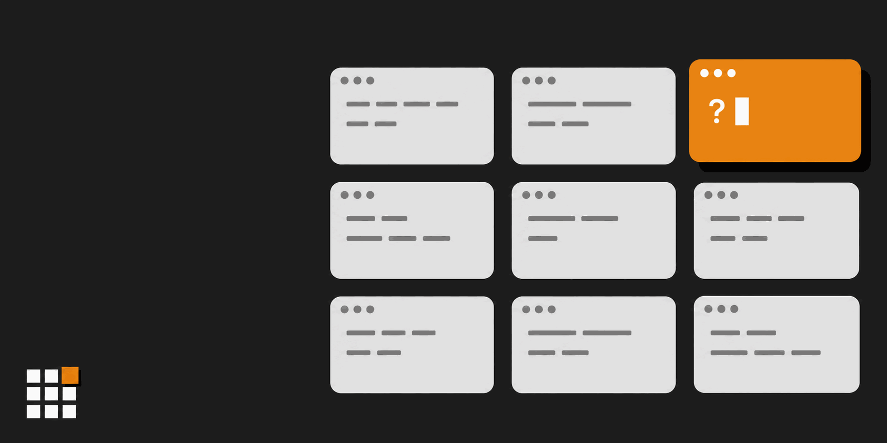
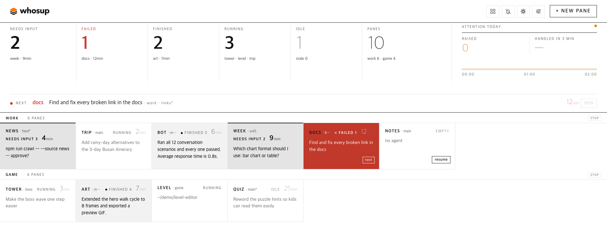
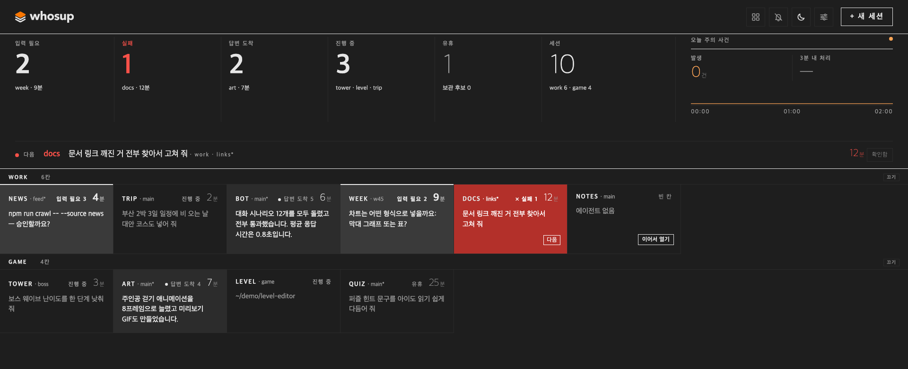

[English](README.md) | [한국어](README.ko.md) | [日本語](README.ja.md) | [中文](README.zh.md) | Español

# whosup

<p align="center">
  <picture>
    <source media="(prefers-color-scheme: dark)" srcset="assets/logo-dark.png">
    
  </picture>
</p>

> **Deja de abandonar tus sesiones de agentes.** whosup reúne todos tus desks de herdr en un solo tablero y te muestra qué sesión te necesita ahora.

Trabajas con seis, diez, quince agentes de código en panes de [herdr](https://herdr.dev). Unos están trabajando, otros terminaron hace una hora y uno está parado en un aviso de permisos que nunca viste. whosup reúne cada sesión de cada desk en ejecución en una sola página del navegador: qué necesita tu respuesta, qué acaba de terminar, qué sigue en marcha y qué se ha quedado en silencio. Haz clic en una sesión y herdr salta a ella. whosup llama *sesión* a cada pane de herdr y *desk* a cada sesión de herdr (o espacio de la app Herdr).

<p align="center">
  
</p>

[Inicio rápido](#inicio-rápido) • [¿Por qué whosup?](#por-qué-whosup) • [Qué ves](#qué-ves) • [Cómo funciona](#cómo-funciona) • [Funcionalidades](#funcionalidades) • [Ajustes](#ajustes) • [Configuración por entorno](#configuración-por-entorno) • [Requisitos](#requisitos)

---

## Inicio rápido

### 1. Ejecuta una línea

Uses lo que uses hoy, empieza aquí. Pega esta línea en una terminal y pulsa Enter (macOS y Linux):

```bash
curl -fsSL https://raw.githubusercontent.com/fivetaku/whosup/main/install.sh | sh
```

El instalador mira este ordenador y toma uno de tres caminos:

| Qué tiene este ordenador | Qué hace el instalador |
|---|---|
| herdr 0.9.0 o superior | Instala whosup como plugin de herdr. El tablero arranca cada vez que arranca herdr. |
| Sin herdr, pero con herdr-core: la app de escritorio Herdr, u otra app de escritorio que ejecuta su propio herdr-core (como la app de escritorio Ovis) | Instala whosup solo, sin herdr (la [instalación independiente](#instalación-independiente)). El tablero arranca ya y cada vez que inicias sesión. |
| Ninguno de los dos, ni la app Herdr ni la app Ovis | Pregunta dónde quieres usar tus sesiones, instala primero eso (sin permisos de administrador) y después instala whosup para ello. |

**Cuando todavía no hay nada donde ejecutar sesiones**, el instalador hace hasta dos preguntas, por número: *Desktop app* o *Terminal* y, si es una app, *Herdr* u *Ovis*. La línea bajo *Desktop app* ya nombra las apps que este ordenador puede instalar (Herdr u Ovis, o la única que puede), así que se ven desde la primera pregunta. Enter toma la opción marcada con `*`: Desktop app y después Herdr. Luego instala lo que elegiste y whosup con ello:

| Lo que eliges | Qué se instala | Dónde se puede instalar |
|---|---|---|
| Desktop app → Herdr (Enter, Enter) | La app Herdr, con su propio instalador, y después whosup solo ([instalación independiente](#instalación-independiente)) | macOS con Apple silicon; Linux en x86_64 o arm64 |
| Desktop app → Ovis | La app Ovis desde los archivos de su versión publicada (unos 175 MB), comprobada con la suma de verificación de esa versión y, en macOS, con su firma, y después whosup solo. En macOS va a `~/Applications` | macOS 13 o superior (Apple silicon o Intel); Linux en x86_64 o arm64, solo donde ya están las bibliotecas de escritorio de la app y FUSE |
| Terminal | herdr, en `~/.local/bin`, y después whosup como plugin de herdr | macOS y Linux |

Una opción que este ordenador no puede instalar no se ofrece (una línea dice por qué), y una pregunta a la que le queda una sola opción no se hace: donde no se puede instalar la app Herdr, la app es Ovis, y donde no se puede ninguna de las dos, se instala herdr. Para elegir sin que te pregunten, pon `WHOSUP_ENV=herdr-app`, `ovis-app` o `herdr` delante de `sh` (ver [Opciones del instalador](#opciones-del-instalador)). Si lo que elegiste no se puede instalar, el instalador dice qué falló y dónde conseguirlo tú mismo, y no instala nada de whosup. Cuando ya hay algo en este ordenador no se pregunta nada de esto: las dos primeras filas valen como antes.

Necesita Node 22.13 o superior. Un Node más antiguo que esté antes en tu PATH no estorba: el instalador recorre el PATH y los sitios de instalación habituales (Homebrew, nvm, fnm) y usa el primer Node que sea lo bastante nuevo. Si no hay ninguno, puede descargar un Node solo para whosup (la versión oficial Node 24 LTS de nodejs.org, en una versión fija) en `~/.local/share/whosup/node`, sin tocar el Node de tu sistema. En una terminal pregunta una vez («¿Descargar el Node propio de whosup vX en <carpeta>? (El Node de tu sistema se queda como está.)»; Enter = sí); sin terminal (un agente, un script) solo lo hace con `WHOSUP_INSTALL_NODE=1`. La descarga se comprueba con el `SHASUMS256.txt` de esa versión: si no coincide o la descarga falla, toda la instalación se detiene y no queda nada de lo descargado. Si lo rechazas, con `WHOSUP_INSTALL_NODE=0`, o si no es posible en esta máquina (un Linux con musl, por ejemplo), no se instala nada y una línea dice qué hacer, como antes. Si ya hay un Node válido, no se descarga nada. Lo que imprimen otros instaladores (el de herdr, el de una app) se pliega en una línea si terminan bien y se muestra entero si fallan. Al final imprime un resumen: qué camino tomó, la dirección del tablero y qué hacer después, dicho una sola vez. El tablero arranca en `http://127.0.0.1:4790`, o en el siguiente puerto libre si el 4790 está ocupado. Por SSH, o con `OPEN_BROWSER=0`, no se abre ningún navegador: abre tú esa dirección.

Si lo ejecutas desde una terminal, la instalación pregunta solo por lo que en este ordenador tiene más de una opción, por ejemplo dónde se abren las sesiones o qué comando ejecuta una sesión nueva. Cada pregunta dice en una línea qué decide. Enter mantiene el valor marcado con `*` (el detectado automáticamente). Un número fija el tuyo. Si respondes todas las preguntas (Enter cuenta como respuesta), el tablero no vuelve a hacerlas. Si las preguntas se cortan antes (sin respuesta a tiempo, Ctrl-C), el tablero pregunta una vez, la primera vez que lo abres (first-run setup).

### 2. Lo que pasa después depende de lo que uses

**Usas herdr.** whosup se instala como plugin de herdr.

- herdr está en marcha: el tablero arranca en cuanto termina la instalación y se abre en tu navegador.
- herdr no está en marcha: el resumen te dice qué escribir: `herdr`. El tablero arranca con él. Si la carpeta donde está herdr no está en tu PATH, el resumen escribe el comando con su ruta completa, así que funciona tal como lo escribes.
- También puedes saltarte la línea e instalar el plugin tú mismo. Hace lo mismo:

  ```bash
  herdr plugin install fivetaku/whosup --yes
  ```

A partir de ahí el tablero arranca cada vez que arranca herdr. Para arrancarlo a mano, ejecuta esto en una terminal dentro de herdr (desde una terminal fuera de herdr, añade `--session <nombre del desk>` justo después de `herdr`):

```bash
herdr plugin action invoke fivetaku.whosup.start
```

**Usas solo la app de escritorio Herdr o la app de escritorio Ovis (sin herdr).** whosup se instala solo; no se instala nada más.

- El tablero arranca enseguida, tu navegador lo abre y vuelve a arrancar cada vez que inicias sesión.
- No se pregunta por la app de terminal: no hay ningún desk de herdr cuya ventana de terminal traer al frente.
- *Herdr app sessions open in* solo se pregunta cuando está el núcleo propio de la app Herdr.
- Las sesiones de una app que ejecuta su propio núcleo (como la app de escritorio Ovis) también salen en el tablero. La instalación lo dice en una línea, por ejemplo `Sessions of <app> show on the board too.` Mientras la app está en marcha puedes abrir sesiones nuevas, cerrarlas y volver a abrirlas desde el tablero; al hacer clic en una sesión se muestra en la ventana de la app si la app conoce el enlace `ovis://` (una versión de Ovis con ese enlace, pendiente de publicarse), y si no se abre en una pestaña del navegador, porque desde fuera no se le puede decir a esa app qué sesión mostrar. Ver [Apps que ejecutan su propio núcleo](#apps-que-ejecutan-su-propio-núcleo).
- La app no tiene que estar en marcha. Si ya se usó en este ordenador, el instalador toma igualmente este camino. Arranca la app y sus sesiones salen en el tablero.
- Desde entonces usas el comando `whosup`: `whosup start`, `whosup stop`, `whosup update` y más. Ver [Instalación independiente](#instalación-independiente).

**Todavía no tienes nada.** El instalador pregunta qué quieres usar (ver la tabla de arriba), lo instala y después instala whosup.

- *Desktop app* (la app Herdr, o la app Ovis): whosup se instala solo y el tablero arranca. La app tiene que abrirse una vez para que sus sesiones salgan en el tablero: el instalador la abre por ti donde también abre el navegador, y si no, el resumen te dice que la abras. Pasa las primeras pantallas de la app y después abre una sesión nueva desde el tablero.
- *Terminal* (herdr): whosup se instala como plugin de herdr. El resumen te dice que arranques herdr; el tablero arranca con él. Si `~/.local/bin` no está en tu PATH, el resumen escribe ese comando con su ruta completa, así que funciona tal cual en esta terminal, e imprime la línea que añade la carpeta a tu PATH para las terminales que abras desde entonces.
- whosup no borra una app que instaló por ti. `whosup uninstall` lo dice en una línea, con el sitio donde está la app.

**Un agente lo instala por ti.** Pide a tu agente que ejecute la misma línea.

- Sin una terminal donde preguntar, no se pregunta nada. El tablero pregunta una vez, la primera vez que lo abres.
- En un ordenador sin nada donde ejecutar sesiones, se instala la opción por defecto sin preguntar: la app Herdr (la app Ovis donde la app Herdr no se puede instalar, herdr donde no se puede ninguna). `WHOSUP_ENV` elige otra.
- El resumen queda en la salida del comando, así que el agente puede decirte la dirección del tablero y el siguiente paso.
- A un script lanzado desde una terminal se le sigue preguntando. Añade `WHOSUP_NO_SETUP=1` para omitir las preguntas: `curl -fsSL https://raw.githubusercontent.com/fivetaku/whosup/main/install.sh | WHOSUP_NO_SETUP=1 sh`

Ejecutar la línea otra vez no cambia de camino: una instalación como plugin de herdr se queda como está (el resumen dice cómo actualizarla), y una instalación independiente se actualiza en su sitio.

De camino a tu primera sesión:

- **Permisos de macOS.** Normalmente no aparece ningún diálogo de permisos. Solo restaurar una ventana minimizada y la pantalla dividida necesitan los permisos de Accesibilidad y de Automatización; después de activar uno, reinicia whosup. Ver *Salto* en [Funcionalidades](#funcionalidades).
- **macOS y tus carpetas.** Cuando eliges para una sesión nueva una carpeta dentro de Escritorio, Documentos o Descargas, macOS pregunta si la app puede acceder a esa carpeta. Permítelo, o elige otra carpeta.
- **La pregunta de Claude Code sobre si confías en la carpeta** aparece con el cursor en "No, exit". Baja hasta "Yes, I trust this folder" y pulsa Enter. Esa pantalla es de Claude Code; whosup no puede cambiarla.
- **herdr y la app Herdr te reciben en inglés** la primera vez que arrancan. Esas pantallas de bienvenida son suyas; pulsa Enter para continuar.
- **El texto en coreano con huecos entre las letras** en algunas apps de terminal (la Terminal de macOS, por ejemplo) se debe a cómo la terminal dibuja la fuente. El texto que imprime whosup no lleva espacios de más.

### 3. Abre más sesiones de herdr (desks en whosup) cuando quieras

```bash
herdr --session work      # cualquier nombre, cualquier terminal
```

Cada desk en ejecución aparece solo en el tablero. No hay ninguna lista que mantener.

### En Windows

El instalador de una línea y la instalación independiente no funcionan en Windows. Allí instala el plugin de herdr:

```powershell
herdr plugin install fivetaku/whosup --yes
```

En Windows la instalación no pregunta nada (herdr ejecuta el paso de instalación en una consola no visible) y first-run setup pregunta la primera vez que abres el tablero; las acciones llevan el prefijo `win-` (`win-start`, `win-doctor`, …). Ver [Windows](#windows).

---

## ¿Por qué whosup?

- **Dejas de revisar sesiones a mano.** La banda superior te dice cuántas sesiones necesitan tu respuesta, han fallado, han terminado o siguen en marcha. La línea **next** señala la primera que debes mirar y cita la pregunta que está haciendo.
- **Un clic, la sesión correcta.** Haz clic en una sesión y herdr la enfoca, en cualquier pestaña de cualquier desk. En macOS también puede traer al frente tu aplicación de terminal.
- **Los reinicios no pierden conversaciones.** Tras reiniciar, herdr restaura las sesiones pero no los agentes. Las sesiones vacías tienen un botón **resume** que busca la conversación de Claude Code más reciente de esa carpeta y ejecuta `AGENT_CMD --resume <id>` en la sesión. resume solo lee el historial de conversaciones de Claude Code; con cualquier otro agente la sesión empieza una conversación nueva. Una sesión vacía sin conversación que continuar muestra **start agent** en su lugar.
- **El color significa algo.** Blanco y negro en todas partes, naranja para lo único que debes mirar a continuación, rojo para los fallos. Nada parpadea en bucle.
- **Te avisa aunque mires a otro lado.** El título de la pestaña muestra cuántas sesiones esperan, p. ej. `(3) whosup`, y el favicon enciende su celda naranja. Una sesión que acaba de levantar la mano recibe un breve anillo naranja. El botón de orden de la cabecera alterna entre **by desk** (por desk) y **neglected first** (desatendidos primero), que lleva al frente de cada desk las sesiones que más esperan. Activa **alerts** en la cabecera para recibir una notificación de escritorio; al pulsarla saltas a esa sesión.
- **Nada que espera se pierde.** Una sesión que te necesita sigue en el tablero hasta que la atiendes: pasada la medianoche, tras reiniciar o si herdr no responde un momento. **seen** solo la pospone 30 minutos; si sigue esperando, vuelve. Las sesiones cerradas quedan en la fila **recently closed** durante 7 días y las que guardas con **stash**, hasta que las restauras; desde ahí puedes reanudarlas o restaurarlas. Una sesión guardada que vuelve a trabajar regresa sola. Fija arriba las sesiones que siempre miras.
- **Dice cuando no sabe.** Si whosup no llega a herdr, la cabecera muestra *disconnected · last collect HH:MM*, el título de la pestaña pasa a `(!) whosup` y el favicon se vuelve gris, en lugar de un tablero tranquilo y desactualizado.
- **Claro, oscuro y tu idioma.** El botón de la cabecera cambia el modo (auto / light / dark) y los botones EN / 한 de first-run setup y de **settings** cambian el idioma (English por defecto, 한국어). La interfaz no está en español, así que este README usa los nombres de los botones en inglés. Las paletas siguen las de temas reales de IDE, con un contraste de texto que cumple WCAG AA.

---

## Qué ves

<p align="center">
  <br>
  
</p>

| Área | Significado |
|---|---|
| **Banda de estado** | Contadores de sesiones que necesitan respuesta · fallidos · terminados · en marcha · inactivos · total, además de los eventos de atención de hoy y cuántos se atendieron en menos de 3 minutos. Haz clic en un número para filtrar. |
| **Línea next** | La única sesión que debes mirar primero y por qué: la pregunta pendiente, el fallo o la respuesta que llegó. Cuando ninguna sesión tiene un agente en marcha, muestra en su lugar el siguiente paso (next step): abrir una sesión nueva. |
| **Desks** | Una fila por desk, con sus sesiones en el orden de los panes de herdr. Cabecera de la sesión: etiqueta · rama de git (el nombre del desk si no hay rama) · estado, con un número 1–9 en las nueve primeras sesiones en espera según el orden común (p. ej. `needs input 3`; pulsa 3 para saltar allí) · tiempo de espera (en sesiones en marcha o inactivas, tiempo desde tu última petición) · etiquetas del tipo de fallo (p. ej. usage limit) y *unreachable*. Debajo, una línea de contexto. |
| **Línea de la sesión** | La pregunta que hace el agente (cuadro de permisos, confirmación de confianza en la carpeta, A o B), su última frase o tu última petición, lo que más importe según el estado. |
| **resume** | En sesiones vacías tras un reinicio: retoma la conversación más reciente de esa carpeta. Sin conversación que continuar, el botón dice **start agent** y empieza una nueva. |
| **+ new session** | Elige un desk y una carpeta (al entrar en una carpeta de la lista, queda elegida); whosup abre una pestaña allí, inicia tu agente y la enfoca. |

---

## Cómo funciona

```
herdr sessions (main, side, …)
   └─ pane list + agent list, every 3 s  ──►  whosup collector  ──►  SQLite (node:sqlite)
                                                                       │
browser  ◄──  http://127.0.0.1:4790  ◄──  board server  ◄─────────────┘
   │
   └─ click  ──►  pane.focus over herdr's socket  ──►  the pane
```

Un solo proceso de Node, sin paso de compilación. El hook de arranque de herdr es un comando de una sola vez: cuando herdr arranca, lanza whosup como servidor en segundo plano y termina. Después el servidor sigue funcionando por su cuenta (herdr no lo supervisa ni lo detiene); para pararlo, usa la acción `stop`. El estado de las sesiones proviene de la detección de agentes de herdr (working / blocked / done / idle); el texto de la pregunta se lee de la pantalla de la sesión; la última petición sale del historial de conversaciones de Claude Code (`~/.claude/projects`, o `CLAUDE_PROJECTS_DIR`). Las sesiones con otros agentes no muestran la última petición, y resume las empieza de cero. El recolector también escucha los eventos de herdr: cuando una sesión cambia de estado se recoge al momento, sin esperar a la siguiente pasada de 3 s, y las pestañas abiertas del tablero se actualizan enseguida. Sin eventos, la pasada de 3 s sigue funcionando.

**Modelo de confianza.** El servidor solo escucha en 127.0.0.1 y no tiene inicio de sesión. Rechaza las peticiones del navegador que llegan desde otros sitios para cambiar algo (un cambio debe venir de la propia dirección del tablero y enviarse como JSON), pero cualquier programa que se ejecute en el mismo ordenador puede usar su API, incluido cambiar ajustes como `AGENT_CMD`, el comando que whosup escribe en una sesión para resume y new session. No expongas el puerto a otras personas. Además, el servidor responde 403 `local only` a cualquier petición cuya cabecera `Host` no sea `127.0.0.1`, `localhost` o `[::1]`, así que los túneles que reenvían un nombre de host público (Tailscale Serve, cloudflared, ngrok) no pueden abrir el tablero en absoluto. Para mirarlo desde otra máquina tuya, usa un reenvío de puerto que mantenga un host localhost, como `ssh -L 4790:127.0.0.1:4790 <host>` y luego `http://localhost:4790`, y arranca el servidor con `WHOSUP_READONLY=1`. El modo solo lectura bloquea cambios, no la vista: no lista las carpetas de tu directorio personal, pero todo lo que hay en el tablero sigue visible (rutas de carpeta de las sesiones en sus tooltips, texto de la última petición, texto de las preguntas) y `GET /api/settings` sigue devolviendo `agent_cmd`.

---

## Funcionalidades

| Funcionalidad | Descripción |
|---|---|
| Detección automática | Todos los desks y sesiones en ejecución, sin configuración |
| Estados de atención | needs input · failed · finished · running · idle · empty |
| Extracción de preguntas | Los cuadros de permisos, las confirmaciones de confianza en la carpeta y las preguntas "¿A o B?" se muestran tal cual |
| Salto | Clic → `pane.focus`, y en macOS la ventana de la terminal que muestra ese desk pasa al frente. La app de terminal se detecta sola; si ninguna ventana muestra el desk, se abre una nueva (Ghostty y Terminal). Permisos de macOS: mientras la app tenga una ventana en pantalla, un clic no necesita ningún permiso y no aparece ningún diálogo del sistema. Cuando la app no tiene ninguna ventana en pantalla (minimizada u oculta), whosup primero vuelve a abrir la app, que tampoco necesita permiso y restaura una ventana minimizada (sin los permisos whosup no puede saber qué ventana está minimizada, así que cuando otra ventana de la misma app está en pantalla, la minimizada se queda donde está). Solo cuando eso no trae ninguna ventana, y para la pantalla dividida, usa whosup los permisos de Accesibilidad y de Automatización (System Events), y macOS puede preguntar entonces. Si falta uno o lo denegaste, el tablero muestra un aviso (distinto de la marca roja *disconnected*): al pulsarlo dice qué no funciona, dónde activarlo (Ajustes del Sistema → Privacidad y seguridad → Accesibilidad, o Automatización → System Events, en la app que arrancó whosup, cuyo nombre aparece en el aviso) y que después hay que reiniciar whosup. Si ya diste los dos permisos, para ti no cambia nada |
| first-run setup | La primera vez que abres el tablero (salvo que first-run setup ya se haya completado en la terminal al instalar) muestra el entorno detectado (cuando ya hay algo donde ejecutar sesiones, omite lo que no encontró; **settings** lo muestra todo) y, en cada apartado, las opciones detectadas con el valor que se usa ahora ya marcado: *Sessions open in* (terminal window, web terminal o both; solo aparece cuando se detecta una terminal web que coincide con un desk, como ovis, porque si no terminal window es la única opción — first-run setup omite todo apartado con una sola opción, y **settings** lo sigue mostrando), *Terminal app* (las apps detectadas —la que muestra herdr ahora y las instaladas— y auto; solo cuando hay un desk de herdr en marcha), *Herdr app sessions open in* (Herdr app o terminal window; solo aparece cuando se detecta la app Herdr: su comando `herdr-app` o su núcleo) y *Command to run in a new session* (los agentes detectados: claude, codex). **start with these** guarda en el servidor solo las filas que elegiste tú, como valores puestos por ti en **settings**, y la detección automática ya no las cambia; una fila que no tocaste no se guarda y sigue a la detección automática; un apartado que ya fijaste en **settings** o con una variable de entorno se queda igual si no lo tocas. Por cada [app que ejecuta su propio núcleo](#apps-que-ejecutan-su-propio-núcleo) añade una línea, `Sessions of <app> show on the board too. A click opens the session in a browser tab.`, también bajo el entorno detectado en **settings**. Los botones EN / 한 de arriba cambian el idioma del tablero. Aparece una sola vez: cerrarlo con ✕ o Esc también cuenta como hecho, sin guardar nada. **open first-run setup again** en **settings** lo vuelve a mostrar. Hasta que lo confirmas, el tablero vuelve a detectar como mucho una vez cada 5 segundos, así que una terminal web que arranca después de whosup también aparece como opción |
| Dónde se abren las sesiones | **settings** → *Sessions open in*: terminal window (por defecto), web terminal o both; se guarda en el servidor y es el valor por defecto de todos los navegadores, y con *only in this browser* activado se aplica solo a ese navegador. Web terminal abre la sesión en una terminal web para herdr en una pestaña nueva, con `{session}` y `{pane}` sustituidos; cada desk puede tener su propia dirección (una terminal web suele tener un servidor y un puerto por desk), y un desk de la app Herdr solo se abre en la web cuando tiene una dirección propia. La pestaña se reutiliza por desk, así que queda vinculada al tablero que la abrió: pon solo la dirección de una terminal web en la que confíes. Elígelo cuando uses el tablero desde otro dispositivo. No funciona en modo de solo lectura (ese modo bloquea todos los clics) |
| Sesiones de la app Herdr | Si herdr-core (las terminales de la app de escritorio Herdr) está en marcha en este equipo, cada una de sus terminales también es una sesión: un desk por espacio de la app, con el estado y el texto de la pregunta tal como los informa el núcleo. Un clic salta a esa sesión en la app Herdr y la trae al frente; si la app no está abierta, la sesión se abre en una ventana de terminal (`hc attach`). Con *Herdr app sessions open in* → terminal window en **settings** (o `WHOSUP_CORE_TARGET=terminal`) se abre siempre en una ventana de terminal, aunque la app esté abierta. Cerrar, reanudar, sesión nueva y apagar o encender un desk funcionan igual que con los desks de herdr. No hay nada que configurar y whosup nunca arranca un núcleo que no esté en marcha. Un agente detenido en el aviso de confianza de carpeta, que el núcleo no informa, se lee de la pantalla y se muestra como pendiente de respuesta; ningún otro estado se deduce de la pantalla |
| Sesiones de otras apps | La detección automática encuentra las apps de escritorio que ejecutan su propio herdr-core (como la app de escritorio Ovis), y sus sesiones también salen en el tablero. Mientras la app está en marcha, sesión nueva, cerrar y reanudar funcionan desde el tablero. Si la app instalada conoce el enlace `ovis://` (una versión de Ovis con ese enlace, pendiente de publicarse), un clic muestra la sesión en la ventana de la app con ese enlace; si no, abre la sesión en una pestaña del navegador y deja la ventana de la app donde está, porque desde fuera no se le puede decir a la app qué sesión mostrar. Ver [Apps que ejecutan su propio núcleo](#apps-que-ejecutan-su-propio-núcleo) |
| resume | La conversación de la propia sesión o, si no, la más reciente de su carpeta que no esté viva en otra sesión → `AGENT_CMD --resume`; el tablero muestra cuál antes de hacer clic. Solo conversaciones de Claude Code; otros agentes empiezan de cero |
| new session | Selector de desk y carpeta, ejecuta el comando de tu agente |
| Desks (opcional) | Declara desks y sesiones por monitor en `desks.json`; la acción `desks-apply` crea solo lo que falta (puedes repetirla sin efectos extra) |
| Idiomas | English por defecto; 한국어 se elige con los botones EN / 한 de first-run setup y de **settings**, o con `?lang=ko`. La elección se guarda por navegador |
| Tema | auto / light / dark (botón de la cabecera, `?theme=`), paletas basadas en temas de IDE |
| Modo solo lectura | `WHOSUP_READONLY=1` oculta los botones de acción y **+ new session**, bloquea clics, Enter, 1–9, `n`, clics en alertas y cambios de ajustes (**settings** solo muestra la elección de idioma), y no lista carpetas. Bloquea cambios, no la vista; consulta el modelo de confianza |
| seen = posponer | **seen** en una sesión en espera la oculta 30 min; **unsee** la devuelve ya |
| Fijar | Las sesiones fijadas van en una fila sobre todos los desks, en ambos órdenes |
| stash y recently closed | Guarda una sesión inactiva; las cerradas quedan 7 días en **recently closed** y las guardadas, hasta que las restauras; una sesión guardada que vuelve a trabajar regresa sola |
| Un solo orden | La línea next, Enter, las teclas 1–9, las alertas y el orden de desatendidos usan el mismo orden: fallida → necesita respuesta → terminada, la que más espera primero |
| Teclado | `n` (o `ㅜ` con distribución coreana) abre new session · Tab se mueve entre sesiones y Enter o Espacio abre la que tiene el foco · sin ninguna sesión con foco, Enter salta a la sesión next, o guarda/abre si hay un panel abierto · 1–9 saltan a la sesión con ese número · Esc cierra el panel. `n` y 1–9 se ignoran mientras escribes en un campo |
| Re-alertas | Una sesión que sigue esperando vuelve a avisar cada 15 min, hasta 4 veces; la alerta se cierra al atenderla |
| Alertas de macOS (opcional) | El servidor puede enviar notificaciones de macOS aunque la pestaña esté cerrada; desactivado por defecto |
| Pantalla dividida (opcional, macOS) | Al hacer clic en una sesión, el tablero se coloca a la izquierda de la pantalla y la terminal ocupa el resto (`split_pct`). Desactivada por defecto; necesita los permisos de Accesibilidad y de Automatización (ver *Salto*) |
| Estado honesto | Hora de la última recogida en la cabecera; *disconnected* si se detiene; las sesiones de un desk que herdr no confirma se conservan y se marcan *unreachable* |
| settings | **settings** en la cabecera: posponer, intervalo y límite de re-alertas, cuándo dar una sesión por cerrada, aviso de desconexión, días en recently closed, días hasta marcar inactiva, alertas de macOS, plazo de unreachable, pantalla dividida, comando del agente, dónde se abren las sesiones (valor por defecto de todos los navegadores, o solo este navegador), dónde se abren las sesiones de la app Herdr, app de terminal (con la lista de apps detectadas). **re-detect** vuelve a comprobar el entorno sin reiniciar (`POST /api/autoconf/refresh`); los valores puestos por ti no cambian. En modo solo lectura solo muestra la elección de idioma |

### Acciones del plugin

| Acción | Qué hace |
|---|---|
| `fivetaku.whosup.start` | Inicia el tablero (también se ejecuta al arrancar herdr y, si herdr está en marcha, justo después de instalar) |
| `fivetaku.whosup.stop` | Lo detiene |
| `fivetaku.whosup.status` | URL (puerto) y PID |
| `fivetaku.whosup.open` | Abre el tablero en el navegador |
| `fivetaku.whosup.desks-apply` | Crea desks/sesiones a partir de `desks.json` |
| `fivetaku.whosup.desks-status` | Sesiones declaradas frente a existentes |
| `fivetaku.whosup.autoconf` | Vuelve a comprobar esta máquina, actualiza los valores detectados y los muestra (ver [De dónde sale cada valor](#de-dónde-sale-cada-valor)) |
| `fivetaku.whosup.win-*` | Las mismas acciones en Windows (`win-start`, `win-stop`, `win-status`, `win-open`, `win-desks-apply`, `win-desks-status`, `win-autoconf`), más `win-doctor` |

---

## Ajustes

Pon líneas `KEY=value` en el `.env` dentro del directorio de configuración del plugin (`herdr plugin config-dir fivetaku.whosup`; `~/.config/whosup` si se ejecuta fuera de herdr). El archivo solo se lee cuando `start` lanza el servidor, así que tras un cambio ejecuta la acción `stop` y luego `start`. Un valor puesto aquí gana a la detección automática; **settings** gana a ambos (ver [De dónde sale cada valor](#de-dónde-sale-cada-valor)). La acción `desks-apply` no lee `.env`; toma el comando del agente de `agent_cmd` en `desks.json`.

| Clave | Valor por defecto | Significado |
|---|---|---|
| `PORT` | 4790 | si está ocupado, se usa el siguiente puerto libre |
| `OPEN_BROWSER` | 1 | abre la pestaña una vez cuando arranca el tablero (al arrancar herdr o justo después de instalar) |
| `AGENT_CMD` | claude | comando que usan resume y new session; pon aquí tu wrapper; **settings** puede sustituirlo |
| `FRONT_APP` | automático | app de terminal de macOS que se trae al frente al saltar, p. ej. `Ghostty`. Si no se define, la elige la detección automática (carril L4 en [las reglas](#de-dónde-sale-cada-valor)) y, si no hay ventana, Terminal abre una nueva. En Windows: vacío = automático (Windows Terminal si existe, si no una ventana de PowerShell), `PowerShell`, `Windows Terminal` u `off` (allí se acepta cualquier valor). **settings** lo cambia sin reiniciar |
| `STALE_DAYS` (o `WHOSUP_STALE_DAYS`) | 3 | días sin actividad antes de marcar una sesión como candidata a guardar |
| `WHOSUP_READONLY` | 0 | 1 = vista de solo lectura: sin cambios ni lista de carpetas |
| `WHOSUP_SEEN_SNOOZE_MIN` · `WHOSUP_RENOTIFY_MIN` · `WHOSUP_RENOTIFY_MAX` · `WHOSUP_GONE_MISSES` · `WHOSUP_STALE_COLLECT_SEC` · `WHOSUP_CLOSED_KEEP_DAYS` · `WHOSUP_OS_NOTIFY` · `WHOSUP_UNREACHABLE_TTL_H` · `WHOSUP_SPLIT_PCT` | 30 · 15 · 4 · 3 · 30 · 7 · 0 · 24 · 0 | valores iniciales; **settings** de la cabecera los sustituye en cada ordenador |
| `WHOSUP_INTERVAL` | 3 | segundos entre recogidas |
| `CLAUDE_PROJECTS_DIR` | `~/.claude/projects` | dónde buscan resume y la última petición las conversaciones de Claude Code |
| `HERDR_BIN_PATH` (o `HERDR_BIN`) | automático | ruta del ejecutable de herdr; si no se define, se prueba `/opt/homebrew/bin`, `/usr/local/bin`, `~/.local/bin` y luego `PATH` |
| `WHOSUP_RUNTIMES` | auto | qué leer: `auto` (desks de herdr y sesiones de herdr-core, lo que haya), `herdr` o `herdr-core` |
| `HC_SOCKET` · `HC_SESSION` | automático · `default` | leer solo este núcleo de herdr-core: su socket, o su nombre (el socket se toma entonces solo del `core.lock` de ese núcleo, que respeta `XDG_STATE_HOME`). Con cualquiera de los dos, `WHOSUP_CORES` y la detección automática no añaden ningún otro núcleo. Un `HC_SESSION` que no cumple la regla de nombres de núcleo (mira `WHOSUP_CORES`) se ignora, como si no estuviera definido |
| `WHOSUP_CORES` | automático | qué otros núcleos de herdr-core leer, además del de la app Herdr (`default`): nombres de núcleo separados por comas, `all` (todos los núcleos que dejaron un `core.lock` y tienen su socket) o `none` (solo el núcleo de la app Herdr). Sin definir, la detección automática añade los núcleos de las [apps que ejecutan su propio núcleo](#apps-que-ejecutan-su-propio-núcleo). Un nombre de núcleo son letras, dígitos, `.`, `_` y `-`, hasta 80 caracteres; `.` y `..` se rechazan. Cuando dos nombres apuntan al mismo socket, ese núcleo se lee una sola vez, con el primer nombre |
| `WHOSUP_CLICK_TARGET` | terminal | dónde se abren las sesiones: `terminal`, `web` o `both`; first-run setup y *Sessions open in* en **settings** lo guardan en el servidor como valor por defecto de todos los navegadores, y con *only in this browser* activado la elección vale solo para ese navegador |
| `WHOSUP_CORE_TARGET` | app | dónde se abren las sesiones de la app Herdr: `app` o `terminal`; con `terminal` se abren siempre en una ventana de terminal con `hc attach`, aunque la app esté abierta. first-run setup y *Herdr app sessions open in* en **settings** lo cambian |
| `WHOSUP_DESK_RESUME` | on | si al encender un desk se reanudan las conversaciones que estaban en marcha antes de apagarse: `on` (siempre), `ask` (el tablero pregunta cada vez que enciendes uno), `off` (nunca). *Resume conversations when a desk starts* en **settings** lo cambia |
| `HERDR_APP_BIN` · `HERDR_APP_NAME` · `HC_BIN` | `herdr-app` · `Herdr` · `hc` | el comando de la app Herdr (saltar, pestaña nueva, cerrar un espacio), la app que se trae al frente en macOS y el comando para abrir una sesión de la app Herdr en una ventana de terminal. El nombre de la app se toma en este orden: `HERDR_APP_NAME` > el nombre que encontró la detección automática > `Herdr`. `HERDR_APP_NAME` se usa solo para la app Herdr, nunca para [el núcleo de otra app](#apps-que-ejecutan-su-propio-núcleo) |

### Desks (opcional)

Si prefieres una disposición fija, por ejemplo un desk por monitor, descríbela una vez y deja que whosup la cree:

```json
{ "agent_cmd": "claude",
  "desks": [
    { "session": "main", "note": "left monitor", "agent": true,
      "panes": [ { "label": "api", "cwd": "~/src/api" }, { "label": "web", "cwd": "~/src/web" } ] },
    { "session": "side", "panes": [ { "label": "notes", "cwd": "~/notes" } ] }
  ] }
```

Guárdalo como `desks.json` en el directorio de configuración del plugin (`herdr plugin config-dir fivetaku.whosup`; `~/.config/whosup` si se ejecuta fuera de herdr) y ejecuta `herdr plugin action invoke fivetaku.whosup.desks-apply`. Solo añade lo que falta. Abre una terminal por desk donde prefieras (`herdr --session main`).

### Restauración de agentes

herdr puede volver a lanzar los agentes por sí mismo tras reiniciar el equipo (`[session] resume_agents_on_restore`, activado por defecto en herdr). Si lanzas tus agentes mediante un wrapper, pon eso en `false` y usa el **resume** de whosup, para que se use tu wrapper. Con `false`, al encender un desk apagado desde el tablero (**start**), whosup reanuda las conversaciones que estaban en marcha en sus sesiones cuando se apagó; las sesiones en las que herdr ya relanzó un agente no se tocan. Si está activado (también cuando config.toml no lo indica), herdr recupera las conversaciones y whosup no escribe nada. *Resume conversations when a desk starts* en **settings** (`WHOSUP_DESK_RESUME`) solo decide lo que reanuda whosup. Una conversación que no se reanudó al encender queda en su sitio como una sesión vacía y aún puedes reanudarla con **resume** una a una. En los desks de la app Herdr, whosup reanuda las conversaciones sea cual sea este ajuste de herdr, y las que no se reanudaron quedan en las sesiones cerradas.

---

## Configuración por entorno

### Instalación independiente

Cuando este ordenador no tiene herdr pero sí herdr-core (la app de escritorio Herdr, u otra app que ejecuta su propio núcleo), el [instalador de una línea](#inicio-rápido) instala whosup solo. Para tomar este camino tenga lo que tenga el ordenador, ejecuta `curl -fsSL https://raw.githubusercontent.com/fivetaku/whosup/main/install.sh | WHOSUP_INSTALL_MODE=standalone sh`. Se rechaza si whosup ya está aquí como plugin de herdr, para que un ordenador no tenga dos tableros.

Dónde queda cada cosa:

| Qué | Dónde |
|---|---|
| El programa | `~/.local/share/whosup/app` (`$XDG_DATA_HOME/whosup/app` si `XDG_DATA_HOME` está definido) |
| El registro de instalación (`install.json`) | Junto al programa: `~/.local/share/whosup/install.json`. Guarda las carpetas y el Node que usa esta instalación, para que el comando `whosup` y el arranque al iniciar sesión usen siempre los mismos. Si ese Node ya no está, o ha dejado de ser 22.13 o más reciente, se busca otro |
| El comando `whosup` | `~/.local/bin/whosup` |
| Ajustes (`.env`, `setup.json`) | `~/.config/whosup` |
| Estado (base de datos, `auto.json`, registros) | `~/.local/state/whosup` (`$XDG_STATE_HOME/whosup`). Si ya ejecutabas whosup a mano desde una carpeta, se sigue usando `~/.config/whosup`, así que tu historial se mantiene |

Un `XDG_DATA_HOME` o `XDG_STATE_HOME` que no sea una ruta absoluta se ignora.

Si `~/.local/bin` no está en tu PATH, el resumen escribe el comando con su ruta completa y lo avisa. Si en `~/.local/bin` ya hay otro programa llamado `whosup`, no se toca y el resumen da el comando largo que usar en su lugar.

El instalador trata con cuidado lo que ya está ahí:

- **Otra carpeta en el sitio del programa.** Si en el sitio del programa ya hay una carpeta que no puso el instalador de whosup, no se ejecuta ni se cambia nada de lo que contiene. El instalador lo dice y termina. Mueve la carpeta a otro sitio y ejecuta otra vez el instalador.
- **Dos instalaciones a la vez.** Si otra instalación de whosup sigue en marcha, la segunda lo dice y termina sin cambiar nada, por mucho que tarde la primera (puede estar esperando en una pregunta). `whosup uninstall` y `whosup autostart on` u `off` hacen lo mismo mientras hay una instalación o una actualización en marcha.
- **Una instalación que paras a medias** (Ctrl-C, también en una pregunta de first-run setup, o una terminal cerrada) se deshace. Una instalación nueva quita lo que había colocado. Una actualización vuelve a poner la versión que había antes y arranca otra vez el tablero si estaba en marcha; si ese tablero no se pudo arrancar otra vez, el instalador lo dice y lo arrancas con `whosup start`. En los dos casos se mantienen ajustes e historial.
- **Lo que dejó una instalación sin terminar** se quita solo después de detener el tablero arrancado desde ahí y desactivar el arranque al iniciar sesión. Si no se puede, la carpeta se deja como está, y el instalador dice qué hacer y termina con error.

El comando `whosup`:

| Comando | Qué hace |
|---|---|
| `whosup start` | Arranca el tablero |
| `whosup stop` | Detiene el tablero. En Linux detiene también el servicio de usuario `whosup.service`; si ese servicio no se detiene, indica el comando que hay que escribir y termina con error |
| `whosup status` | Si el tablero está en marcha, su dirección y si arranca al iniciar sesión |
| `whosup open` | Abre el tablero en tu navegador |
| `whosup setup` | Repite first-run setup en la terminal |
| `whosup update` | Lo sustituye por la versión más reciente. Ajustes e historial se mantienen, y un tablero que estaba en marcha vuelve a arrancar |
| `whosup uninstall` | Detiene el tablero, desactiva el arranque al iniciar sesión y borra el programa y el comando `whosup`. El Node propio de whosup (`~/.local/share/whosup/node`), si el instalador descargó uno, forma parte del programa y también se borra. Ajustes e historial se mantienen. Una app que el instalador puso por ti (la app Herdr, la app Ovis) no se borra: una línea lo dice, con el sitio donde está |
| `whosup uninstall --purge` | Lo mismo, y borra también ajustes e historial: las carpetas de ajustes y de estado anotadas en el registro de instalación, ninguna otra. Solo se borran cuando el programa se ha borrado por completo |
| `whosup autostart on` · `off` · `status` | Activa o desactiva el arranque al iniciar sesión, o lo muestra |
| `whosup help` | Muestra esta lista |

**Arranque al iniciar sesión.** Una instalación independiente nueva hace que el tablero arranque cada vez que inicias sesión: un LaunchAgent (`~/Library/LaunchAgents/dev.whosup.board.plist`) en macOS, un servicio `systemd --user` (`~/.config/systemd/user/whosup.service`) en Linux. Al arrancar así no se abre ninguna pestaña del navegador. Para desactivarlo:

```bash
whosup autostart off
```

`whosup autostart on` lo vuelve a activar. Una actualización respeta lo que elegiste. En Linux sin `systemd --user`, el tablero no arranca solo al iniciar sesión; el resumen lo dice y lo arrancas con `whosup start`.

En macOS, cuando el arranque al iniciar sesión queda configurado pero no se pudo cargar en ese momento, empieza en tu próximo inicio de sesión. El resumen de la instalación, `whosup autostart on` y `whosup status` lo dicen. Si `whosup autostart off` no puede borrar el archivo del elemento de inicio de sesión, indica el archivo que queda y termina con error. Si el gestor de servicios (launchd en macOS, systemd en Linux) todavía tiene el elemento de inicio de sesión, no dice que el arranque al iniciar sesión esté desactivado: indica el comando que hay que escribir y termina con error.

**Actualizar y quitar.** `whosup update` vuelve a descargar el instalador y lo ejecuta por el camino independiente. Ejecutar otra vez el instalador de una línea hace lo mismo. Si la versión nueva no termina de instalarse, un tablero que estaba en marcha no arranca en la versión nueva, o paras la actualización a medias, se vuelve a poner la anterior. Una instalación que usa el Node propio de whosup recibe la versión fija del instalador cuando su Node es más antiguo, sin preguntar (no con `WHOSUP_INSTALL_NODE=0`). Una instalación o actualización que no termina (falla, o Ctrl-C) quita el Node que descargó y vuelve a poner el de antes. El plugin de herdr nunca descarga un Node, pero usa el Node propio de whosup como última opción cuando existe. `whosup uninstall` conserva `~/.config/whosup` y la carpeta de estado salvo que añadas `--purge`, e indica qué borró y qué conservó. Si algo no se pudo borrar, también lo indica y termina con error (código de salida 1), para que lo borres tú. Si no se pudo desactivar el arranque al iniciar sesión, o en Linux no se pudo detener el servicio de usuario, se detiene ahí y deja el programa en su sitio. Una carpeta en el sitio del programa que no puso el instalador se deja como está.

### Opciones del instalador

Ponlas delante de `sh` en la línea, por ejemplo `curl -fsSL https://raw.githubusercontent.com/fivetaku/whosup/main/install.sh | WHOSUP_NO_LOGIN_START=1 sh`. Se leen del entorno del comando de instalación, no de `.env`.

| Variable | Qué hace |
|---|---|
| `WHOSUP_INSTALL_MODE=plugin` o `standalone` | Toma ese camino tenga lo que tenga el ordenador |
| `WHOSUP_ENV=herdr-app`, `ovis-app` o `herdr` | En un ordenador sin nada donde ejecutar sesiones: instala eso sin preguntar. Si este ordenador no puede instalarlo, se imprime el motivo y no se instala nada. No se usa cuando ya hay algo o se da `WHOSUP_INSTALL_MODE`; una línea lo dice |
| `WHOSUP_ENV_TIMEOUT=<segundos>` | Cuánto pueden tardar el instalador de herdr, o el instalador de una app y cada una de sus descargas, antes de pararlos (900 por defecto) |
| `WHOSUP_REF=<rama, etiqueta o commit>` | Instala esa versión en lugar de la rama por defecto |
| `WHOSUP_NO_SETUP=1` | No pregunta nada, tampoco qué instalar (se instala la opción por defecto); el tablero pregunta la primera vez que se abre |
| `WHOSUP_NO_AUTOSTART=1` | No arranca el tablero justo después de instalar |
| `WHOSUP_NO_LOGIN_START=1` | Instalación independiente: no configura el arranque al iniciar sesión |
| `CI` | Ninguna de las tres cosas anteriores: no pregunta, no arranca y no configura el arranque al iniciar sesión |
| `WHOSUP_LANG=ko` o `en` | Idioma de lo que imprime y pregunta el instalador (si no, coreano con una configuración regional coreana e inglés en cualquier otra) |

Los interruptores están apagados con valor vacío, `0`, `false`, `no` u `off`, y encendidos con cualquier otro valor.

### Apps que ejecutan su propio núcleo

Algunas apps de escritorio ejecutan su propio herdr-core, aparte del de la app Herdr. La app de escritorio Ovis es una de ellas. whosup encuentra estas apps solo (detección automática, carril L7) y muestra sus sesiones en el tablero, en un desk propio. No hay nada que configurar.

- **Sesión nueva, cerrar y reanudar funcionan desde el tablero mientras la app está en marcha.** whosup se lo pide al servidor local de la propia app en `127.0.0.1`; no lee ni usa ningún token. Una sesión nueva se abre como pestaña en el desk que elijas, o como un desk nuevo en esa app, y whosup escribe en ella tu comando de agente. Apagar y encender el desk no está disponible para estas sesiones.
- **Con una app que conoce el enlace `ovis://`, un clic muestra la sesión en la ventana de la app.** Hace falta una versión de Ovis con el enlace `ovis://open` (pendiente de publicarse; la 0.5.3 publicada no lo tiene). whosup comprueba la app instalada (en macOS su `Info.plist`, en Linux el manejador `x-scheme-handler/ovis`, en Windows `HKCU\Software\Classes\ovis`) y abre `ovis://open?pane=<sesión>&view=terminal` con el comando del sistema (`open`, `xdg-open`, `start`): la ventana de la app pasa al frente con esa sesión elegida, al hacer clic y en la sesión que acabas de abrir desde el tablero. Si el enlace no se puede abrir, se abre en su lugar la pestaña del navegador de esa sesión. La respuesta dice qué camino se usó (`opened`: `app_link` o `browser`).
- **Si no, un clic abre la sesión en una pestaña del navegador; la ventana de la app se queda donde está.** Desde fuera no se le puede decir a la app qué sesión mostrar, así que whosup abre en su lugar la dirección de esa sesión en el servidor local de la app (`http://127.0.0.1:<puerto>/?pane=…`) y no trae al frente la ventana de la app (taparía la pestaña mostrando otra sesión). La pestaña se abre mientras no hayas fijado tú *Sessions open in*; cuando lo has hecho (en **settings**, en first-run setup o con `WHOSUP_CLICK_TARGET`), un clic sigue esa elección: con terminal window, la ventana de la app pasa al frente y dentro de ella eliges tú la sesión.
- **Si la app está cerrada**, whosup no la arranca. Sus sesiones siguen en el tablero mientras el núcleo de la app siga en marcha: puedes verlas, y un clic avisa de que la app no está en marcha y no toca ninguna ventana. Sesión nueva y reanudar dicen que arranques primero la app; cerrar sigue funcionando, terminando esa terminal en el núcleo. Arranca la app y vuelve a hacer clic. Si el núcleo también está apagado, las sesiones se marcan como *unreachable* y pasan a **recently closed** cuando se cumple el plazo de unreachable de **settings** (24 horas por defecto). Si el tablero se reinicia con la app cerrada, ya no sabe el nombre de la app: hasta que la app vuelva a estar en marcha, las sesiones aparecen con el nombre del núcleo y un clic las abre en una ventana de terminal (`hc attach`).
- **Un servidor que pide un token o un inicio de sesión** no se maneja desde el tablero, y whosup no lo rodea: sus sesiones solo se pueden ver y se puede saltar a ellas.
- **Fuera de macOS** no se puede averiguar el nombre de la app y no se trae al frente ninguna ventana de la app. Un clic abre la sesión en una ventana de terminal (`hc attach`). En macOS pasa lo mismo cuando *Herdr app sessions open in* es terminal window. Como no hay nombre de app que dar, cuando ese núcleo está apagado el tablero avisa de que el núcleo de la sesión no está en marcha.
- **Un núcleo que ya no se lee:** si elegiste tú los núcleos (`WHOSUP_CORES`, `HC_SOCKET` o `HC_SESSION`), esa elección va primero: un núcleo que queda fuera no se lee aunque tenga sesiones abiertas, y esas sesiones pasan pronto a **recently closed**. Un clic en una de ellas antes de eso no abre nada, y el tablero avisa de que ese núcleo no se puede comprobar ahora.
- **Terminal web:** cuando la terminal web de esa app se abre en `127.0.0.1` sin inicio de sesión, su dirección se rellena para ese desk, así que *Sessions open in* → web terminal puede usarla.

Cómo se encuentra: whosup pregunta solo a servidores ovis en `127.0.0.1`, en los puertos 7317–7330 y en los puertos que figuran en el registro de puentes de ovis (`~/.config/ovis/bridges`, y su nombre antiguo `~/.config/herdr-web-ui/bridges`). Del registro usa solo el puerto y el número de proceso de cada entrada. El token no se extrae, no se guarda y no se escribe en ningún sitio. Una entrada se usa solo cuando su proceso sigue en marcha y, en macOS y Linux, es el que escucha en ese puerto (cuando eso no se puede comprobar, la entrada se usa como antes). Un servidor cuenta solo cuando responde como ovis y dice que muestra herdr-core; el nombre del núcleo es el que informa ese servidor. Un servidor ovis que muestra un desk de herdr se sigue usando como terminal web de ese desk, como antes.

Mientras el tablero está en marcha, vuelve a mirar el registro cada 10 segundos y detecta de nuevo cuando el servidor de una app aparece allí, desaparece o cambia de puerto. El servidor de una app recién arrancada puede no decir todavía el nombre de su núcleo; entonces el tablero vuelve a preguntar cada 5 segundos, durante un minuto como máximo.

Límites conocidos:

- Mientras el tablero está en marcha, solo se vigila el registro. Si una app que arrancaste después del tablero no aparece pasado un minuto más o menos (por ejemplo, porque su servidor no está en el registro), pulsa **re-detect** en **settings**.
- El núcleo de un servidor ovis protegido con token no se lee automáticamente. Su puerto aparece como "por comprobar". Puedes indicar el nombre del núcleo en `WHOSUP_CORES`.
- El nombre de la app solo se averigua en macOS.
- En la configuración poco habitual en la que `herdr-app` maneja más de un núcleo, un clic no salta a la sesión dentro de la app, porque `herdr-app` no puede saber de qué núcleo es una sesión. La sesión se abre en una ventana de terminal conectada a su propio núcleo (`hc attach`).

### App de escritorio Herdr

whosup lee las sesiones de la app de escritorio Herdr a través de herdr-core, el núcleo de la app. No hay nada que configurar si se cumple esto:

- **herdr-core está en marcha en este ordenador.** El núcleo escribe la ruta de su socket en `<state>/herdr-core/<session>/core.lock` (`<state>` es `XDG_STATE_HOME`, si no `~/.local/state`, y en Windows también `%LOCALAPPDATA%`; `<session>` es `HC_SESSION`, si no `default`); `HC_SOCKET` tiene prioridad. El socket de `core.lock` va primero; un socket que la detección automática vio antes solo se usa cuando falta `core.lock` o su socket, y nunca para un núcleo que nombraste con `HC_SESSION`. El núcleo cuenta como en marcha mientras su socket existe. whosup nunca arranca un núcleo.
- **`herdr-app` está en el `PATH`** (o define `HERDR_APP_BIN`): saltar, pestaña nueva y cerrar un espacio pasan por él. Sin él las sesiones se siguen leyendo.
- **`hc` está en el `PATH`** (o define `HC_BIN`): abre una sesión en una ventana de terminal cuando la app no tiene ninguna ventana abierta, o siempre con `WHOSUP_CORE_TARGET=terminal`.

La detección automática (carril L6) revisa el socket y `herdr-app` en cada arranque; first-run setup al instalar también los revisa, para decidir qué preguntar. Un clic en una sesión de la app Herdr la muestra en la app y trae la app (`HERDR_APP_NAME`, por defecto `Herdr`) al frente; sin ventana de la app, `hc attach <terminal>` se abre en una ventana de terminal. Con *Herdr app sessions open in* → terminal window en **settings** (o `WHOSUP_CORE_TARGET=terminal`), `hc attach` se abre siempre en una ventana de terminal, aunque la app esté abierta. `node scripts/doctor.mjs` da este núcleo (`default`, o `HC_SESSION`) por en marcha solo por su propio socket; [el núcleo de otra app](#apps-que-ejecutan-su-propio-núcleo) no cuenta.

Si sus sesiones no aparecen:

- `WHOSUP_RUNTIMES` debe ser `auto` (por defecto) o incluir `herdr-core`; solo `herdr` deja fuera la app.
- `HC_SOCKET`, `HC_SESSION` y `XDG_STATE_HOME`, si los defines para whosup, deben apuntar al mismo núcleo que usa la app.
- `node scripts/doctor.mjs` muestra la línea core (su socket, o *not running*), las carpetas de estado que miró y si encontró `herdr-app`; la acción `autoconf` muestra el carril L6 con su motivo (ver [De dónde sale cada valor](#de-dónde-sale-cada-valor)).
- En Windows aún no se ha comprobado si herdr-core escucha en una named pipe.

### ovis: abrir sesiones desde otro dispositivo o el móvil

[ovis](https://github.com/devswha/ovis) es un cliente web para herdr (chat, terminal en vivo, app para móvil). whosup solo encuentra un ovis en marcha y rellena su dirección; nunca lo arranca ni lo detiene.

```bash
herdr plugin install devswha/ovis --yes          # según el INSTALL.md de ovis
herdr plugin action invoke devswha.ovis.start
```

- Como plugin de herdr, ovis arranca con herdr en `http://127.0.0.1:7317` y sigue el socket de la sesión de herdr (un desk en whosup) que lo arrancó.
- Un servidor ovis muestra un desk. Para otro desk, arranca otro servidor ovis en su propio puerto con `PORT` y `HERDR_SOCKET=~/.config/herdr/sessions/<nombre>/herdr.sock` (ver Configuration en el INSTALL.md de ovis). whosup mira los puertos 7317–7330 y los puertos del registro de puentes de ovis (ver [Apps que ejecutan su propio núcleo](#apps-que-ejecutan-su-propio-núcleo)).
- En cada arranque whosup revisa esos puertos (carril L7); first-run setup al instalar también los revisa, para decidir qué preguntar. Un puerto cuenta como ovis solo si `GET /api/health?scope=bridge` responde con los campos propios de ovis. El desk sale de `HERDR_SOCKET` (o `HERDR_SESSION`) del proceso que escucha en ese puerto, leído con `ps` en macOS y `/proc` en Linux. Para cada desk que lista herdr se rellena la dirección `http://127.0.0.1:<port>/?pane={pane}`. Cuando whosup conoce el `HERDR_SOCKET` del servidor y herdr lista un desk con el mismo nombre en otro socket (el mismo nombre en otro herdr), no se rellena nada y el puerto aparece como "por comprobar".
- Si no se puede saber el desk (en Windows, un desk que herdr no lista, dos servidores en un desk), no se rellena nada y el puerto aparece como "revisar". Pon esa dirección tú mismo en **settings**.
- Con o sin ovis, las sesiones se abren por defecto en la ventana de terminal. La primera vez que se abre el tablero (salvo que first-run setup ya se haya completado en la terminal al instalar), first-run setup muestra lo detectado y, en cada apartado, las opciones detectadas con el valor actual ya marcado; en *Sessions open in*, web terminal y both solo aparecen si un servidor ovis coincide con un desk. Hasta que confirmas con **start with these**, el tablero vuelve a detectar como mucho una vez cada 5 segundos, así que un ovis que arranca después de whosup también aparece como opción; después, **re-detect** en **settings** vuelve a comprobar sin reiniciar. Tu elección se guarda en el servidor (`click_target`), donde es el valor por defecto de todos los navegadores; **settings** → *Sessions open in* la cambia también para todos los navegadores, o solo para ese navegador si activas *only in this browser*. Las direcciones (*Web terminal address*) se guardan solo en el navegador.

La dirección rellenada es `127.0.0.1`, así que se abre en el ordenador donde corre ovis. Desde otro dispositivo, reenvía también ese puerto (`ssh -L 4790:127.0.0.1:4790 -L 7317:127.0.0.1:7317 <host>`) o cambia la dirección en **settings** por una que tu dispositivo alcance. En el móvil, el camino es la app y el relay propios de ovis (ver el README de ovis). Abrir sesiones desde el tablero requiere un tablero que no sea de solo lectura.

### Windows

whosup también funciona en Windows (Node y PowerShell, sin `sh`), solo como plugin de herdr: el instalador de una línea y la instalación independiente (comando `whosup`, arranque al iniciar sesión) son solo para macOS y Linux. El plugin tiene entradas solo para Windows que herdr ejecuta con `node`, así que se instala y arranca igual; las acciones llevan el prefijo `win-`:

```powershell
herdr plugin install fivetaku/whosup --yes
herdr plugin action invoke fivetaku.whosup.win-start
herdr plugin action invoke fivetaku.whosup.win-doctor    # revisión de solo lectura de esta máquina
herdr plugin action invoke fivetaku.whosup.win-autoconf  # lo que detectó la detección automática
```

Para arrancarlo a mano (desde la carpeta de whosup, en tu **sesión de escritorio**; no por SSH, donde las ventanas no se ven):

```powershell
node scripts\doctor.mjs                 # lo que whosup ve: Node, herdr, pipes, PowerShell, Windows Terminal, sesión de escritorio
node scripts\launch.mjs start           # igual que la acción start (también status · stop · open)
# o en primer plano; los ajustes van como variables de PowerShell (VAR=valor es sintaxis de sh y aquí no funciona):
$env:FRONT_APP='Windows Terminal'; node bin\whosup.mjs
```

- La detección automática se ejecuta antes de cada arranque. Al instalar (`launch.mjs install`) solo se comprueba Node: no se detecta, no se pregunta y no se escribe nada; `launch.mjs preflight` ejecuta la detección a mano. Con `wt.exe` en el `PATH` elige **Windows Terminal**; si no, los clics abren una ventana de PowerShell.
- Arrancado por SSH, o en la sesión 0 de Windows (un servicio; se mira `SESSIONNAME` y luego el número de sesión del proceso — una tarea de inicio de sesión en el escritorio no tiene `SESSIONNAME` pero cuenta como escritorio), whosup se considera remoto: no abre el navegador ni trae ventanas al frente (*Terminal app* = off), porque nada se vería en el escritorio. Arráncalo desde la sesión de escritorio para tener ventanas.
- Al hacer clic en una sesión, su ventana de terminal pasa al frente, o se abre una ventana de PowerShell conectada a su desk si ninguna lo muestra. Elige **auto**, **PowerShell**, **Windows Terminal** u **off** en *Terminal app* de **settings** (o define `FRONT_APP`).
- `node bin\whosup.mjs` no lee `.env`; `launch.mjs` y las acciones del plugin sí (solo líneas `KEY=value`, no se ejecuta nada).
- Necesita Node 22.13+ para Windows de [nodejs.org](https://nodejs.org) (o nvm-windows, Volta, fnm) en el `PATH`, y herdr en el `PATH` (o `HERDR_BIN_PATH`).
- Aún no comprobado en una máquina Windows: si la app de escritorio Herdr (herdr-core) escucha allí en una named pipe, y si herdr mantiene whosup en marcha después de que vuelva su hook de arranque. `win-doctor` muestra ambas cosas. Tampoco se ha comprobado allí si el tablero arranca solo justo después de instalar; si no arranca, ejecuta la acción `win-start`. En Windows la instalación no pregunta nada: herdr ejecuta el paso de instalación en una consola no visible (leído en el código de herdr, no comprobado en una máquina). En Windows se encuentran los puertos de ovis, pero no el desk que muestra cada uno, así que aparecen como "revisar".

### De dónde sale cada valor

Cada ajuste toma el primer valor que encuentra en este orden: **settings > variable de entorno (incluido `.env`) > detectado automáticamente > valor por defecto.** La detección automática nunca cambia un valor que pusiste en **settings** o en el entorno, y nunca escribe `.env` ni valores de **settings**.

- **settings**: se guarda en la base de datos de whosup de este ordenador y se aplica al momento. Vaciar un campo vuelve a la capa siguiente. Lo que eliges tú en first-run setup (**start with these**) se guarda aquí como valor puesto por ti; una fila que no tocaste no se guarda y sigue a la detección automática. Un número que escribes en first-run setup al instalar se guarda igual (ver más abajo).
- **Entorno / `.env`**: líneas `KEY=value` en el `.env` del directorio de configuración del plugin (`herdr plugin config-dir fivetaku.whosup`; `~/.config/whosup` fuera de herdr). Solo se lee cuando `start` lanza el servidor, así que tras editarlo ejecuta `stop` y luego `start`.
- **Detectado automáticamente**: se vuelve a comprobar antes de cada arranque y se escribe en `auto.json` en la carpeta de estado (la carpeta de estado del plugin en herdr; `~/.config/whosup` fuera de herdr). Al instalar no se escribe nada: allí la detección solo decide qué pregunta first-run setup. El servidor lee el archivo al arrancar si se acaba de escribir (misma plataforma, hace menos de 2 minutos); si no (p. ej. al ejecutar `bin/whosup.mjs` directamente), vuelve a detectar y reescribe el archivo, y si la detección falla arranca sin valores automáticos. **re-detect** en **settings** vuelve a comprobar sin reiniciar (`POST /api/autoconf/refresh`) y no cambia los valores puestos por ti; hasta que confirmas first-run setup, el tablero vuelve a detectar como mucho una vez cada 5 segundos, así que una terminal web iniciada después de whosup también aparece como opción.

**First-run setup al instalar.** Si instalas desde una terminal, las preguntas de first-run setup se hacen ahí mismo, solo en la primera instalación: una actualización o reinstalación no pregunta nada y no toca un tablero en marcha (si el tablero no está en marcha y herdr sí, lo arranca; si herdr no está en marcha, la instalación dice que escribas `herdr`). Enter deja el apartado en detección automática; un número se escribe en `setup.json` en el directorio de configuración del plugin, y el servidor del tablero lee ese archivo (al arrancar y mientras está en marcha) y guarda el número como valor puesto por ti. Una vez elegido al menos un número, o respondidas todas las preguntas (también solo con Enter: entonces `setup.json` guarda solo una marca de que first-run setup está hecho, sin fijar ningún valor, y esos apartados siguen la detección automática), el tablero ya no muestra first-run setup por sí solo. Una pregunta sin respuesta durante 120 segundos se queda con el valor detectado automáticamente, igual que todas las siguientes. Si no se eligió ningún número y no se respondieron todas las preguntas (nada que preguntar, sin terminal, sin ninguna entrada o se acabó el tiempo), no se guarda nada y el tablero muestra first-run setup una vez la primera vez que se abre, con lo que detecte entonces (una terminal web que arrancó más tarde también está entre las opciones). Ctrl-C en una pregunta cancela la instalación entera: la misma señal termina `herdr plugin install`, así que no se instala nada y no se guarda nada, tampoco los números ya escritos, y no se imprime nada más (si el comando de instalación sobrevive a la señal, solo se omiten las preguntas: una primera instalación pregunta entonces la primera vez que se abre el tablero, y una instalación que vuelve a preguntar deja tus ajustes como están). No se pregunta nada cuando la instalación corre en segundo plano en la terminal (`… &`) ni en Windows, donde herdr ejecuta el paso de instalación en una consola no visible. Para que vuelva a preguntar, actualiza o reinstala con `WHOSUP_SETUP=1`, o ejecuta `node scripts/setup.mjs` desde la carpeta de whosup (ahí Ctrl-C simplemente lo detiene, sin guardar nada). `WHOSUP_SETUP=1` no funciona en Windows, donde la instalación no pregunta nada: ahí ejecuta `node scripts\setup.mjs` a mano, o usa **open first-run setup again** en **settings**. Cuando vuelve a preguntar, Enter deja el apartado como está ahora (un valor que pusiste antes se mantiene). Con un tablero en marcha, los números elegidos con `node scripts/setup.mjs` le llegan sin reiniciar; los elegidos durante una actualización o reinstalación se aplican cuando el tablero se reinicia, porque el tablero en marcha puede ser la versión anterior. `WHOSUP_NO_SETUP=1` omite las preguntas y `WHOSUP_NO_AUTOSTART=1` no arranca el tablero tras la instalación; con `CI` definido no ocurre ninguna de las dos cosas. Estos interruptores están apagados con valor vacío, `0`, `false`, `no` u `off`, y encendidos con cualquier otro valor. `WHOSUP_SETUP_TIMEOUT_S` cambia los 120 segundos y `WHOSUP_LANG=ko|en` fija el idioma de las preguntas (si no, coreano con una configuración regional coreana e inglés en cualquier otra). Estas variables se leen del entorno del comando de instalación, no de `.env`.

Para ver lo detectado, ejecuta la acción `autoconf` (`win-autoconf` en Windows) o `node scripts/autoconf.mjs` desde la carpeta de whosup (`--json` para JSON). Muestra cada carril con su valor y su motivo, y marca los valores en los que gana una variable de entorno. Un tablero en marcha responde `GET /api/autoconf`, y `GET /api/settings` da el origen de cada ajuste en `origins`. En `auto.json`, `summary.options` lista las opciones detectadas: `{ terminal_apps: [{ name, showing, opens_new }], agents: [] }`. `summary.cores` lista los núcleos que se leen de [apps que ejecutan su propio núcleo](#apps-que-ejecutan-su-propio-núcleo): `[{ name, app, web }]`. `summary.herdr_core` es `{ running, view_only }` para el núcleo de la app Herdr. El `cores` de primer nivel guarda lo que el tablero usa para cada uno de esos núcleos: `{ name, app?, url?, focus }`. `focus: false` significa que a la app no se le puede indicar desde fuera qué sesión mostrar en su ventana: con una `url` (el servidor local de la app responde a este ordenador sin inicio de sesión), sesión nueva, cerrar y reanudar pasan por ese servidor, y sin ella la app se da por cerrada y solo funciona cerrar; `focus: true`, o la falta de `focus` en el núcleo de la app Herdr, significa que todo funciona como en la app Herdr.

| Carril | Qué se comprueba | Qué fija | Dónde se cambia |
|---|---|---|---|
| L1 | Sistema operativo | Solo informa: herdr ejecuta las entradas `sh` en macOS y Linux y las `node` en Windows; en Windows no se ofrecen alertas del sistema | — |
| L2 | Node 22.13+ con `node:sqlite` | Si Node es más antiguo, la instalación se detiene con un aviso | Actualizar Node |
| L3 | Sesión de escritorio: SSH (`SSH_CONNECTION`, `SSH_TTY`), Windows en la sesión 0 (sin `SESSIONNAME` y número de sesión 0), Linux sin `DISPLAY`/`WAYLAND_DISPLAY` | Remoto: no se abre el navegador (`OPEN_BROWSER` 0); tampoco se traen ventanas al frente (macOS y Windows, valor `off` de `FRONT_APP`) | `OPEN_BROWSER`, `FRONT_APP`, *Terminal app* |
| L4 | App de terminal. macOS: la app que muestra herdr ahora, si no la terminal donde se escribió el comando (`TERM_PROGRAM`, o `TERM`), si no un Ghostty, iTerm, WezTerm o kitty instalado. Windows: `wt.exe` en el `PATH`. Linux: no se comprueba | macOS: la app que abre una ventana nueva si ninguna muestra el desk (al hacer clic se trae al frente la app que lo muestre, y **settings** indica *auto*). Windows: el terminal a usar. Si no se encuentra, la app que muestre herdr al hacer clic, si no Terminal (macOS), o una ventana de PowerShell (Windows) | first-run setup, *Terminal app*, `FRONT_APP` |
| L5 | herdr: binario, versión, desks en marcha | Solo informa; los desks de herdr se leen cuando se encuentra herdr | `HERDR_BIN_PATH`, `WHOSUP_RUNTIMES` |
| L6 | App de escritorio Herdr: socket de herdr-core (el núcleo `default`, o `HC_SESSION`), comando `herdr-app` | Solo informa; sus sesiones se leen mientras el núcleo está en marcha | `WHOSUP_RUNTIMES`, `HC_SOCKET`, `HERDR_APP_*` |
| L7 | ovis en 127.0.0.1:7317–7330 y en los puertos del registro de puentes de ovis; para cada servidor, el desk o el núcleo de herdr-core que muestra | Una dirección web por desk; las sesiones se siguen abriendo en la ventana de terminal. También se leen los núcleos de [apps que ejecutan su propio núcleo](#apps-que-ejecutan-su-propio-núcleo) | first-run setup, *Sessions open in* y las direcciones por desk; `WHOSUP_CORES` |
| L8 | `claude`, si no `codex`, en el `PATH`; la carpeta de conversaciones de Claude Code | El comando del agente para reanudar y sesión nueva; si reanudar puede encontrar conversaciones | first-run setup, comando del agente en **settings**, `AGENT_CMD` |
| L9 | Permiso de Accesibilidad de macOS (se ve cuando un clic lo necesita: restaurar una ventana minimizada, pantalla dividida) | Si falta el permiso, la pantalla dividida se marca como no disponible. El tablero muestra entonces un aviso, y otro distinto cuando se denegó el permiso de Automatización | Ajustes del Sistema → Privacidad y seguridad → Accesibilidad (Automatización para el otro); después reinicia whosup |
| L10 | Puerto libre a partir de `PORT` (4790) | Solo informa; whosup pasa solo al siguiente puerto libre | `PORT` |

---

## Requisitos

- [herdr](https://herdr.dev) 0.9.0 o superior, o herdr-core (la app de escritorio Herdr, u otra app que ejecuta su propio núcleo). Basta con uno de los dos; con ambos, se leen ambos. Solo con herdr-core, usa la [instalación independiente](#instalación-independiente). Sin ninguno, el instalador de una línea instala uno por ti (la app Herdr, la app Ovis o herdr)
- Node.js 22.13 o superior (`node:sqlite` sin flag); sin bun, sin compilación. Sin él, el instalador en macOS y Linux ofrece descargar el Node propio de whosup (sin terminal: solo con `WHOSUP_INSTALL_NODE=1`); si lo rechazas, no instala nada y dice en una línea que instales o actualices Node y lo vuelvas a ejecutar
- curl (las acciones `start`, `status` y `open` lo usan para comprobar el estado en macOS y Linux; Windows usa el `fetch` propio de Node)
- macOS, Linux o Windows 10/11 (PowerShell 5.1+, en la sesión de escritorio; ver [Windows](#windows)). El instalador de una línea y la instalación independiente son solo para macOS y Linux

---

## Qué no es whosup

Espejo de terminal, chat y escribir desde el móvil: [ovis](https://github.com/devswha/ovis). Agentes dirigidos por kanban: herdr-board. whosup solo mira y salta.

## Licencia

MIT — consulta [LICENSE](LICENSE).

---

<div align="center">

**Mira una vez. Salta al que te necesita.**

</div>
