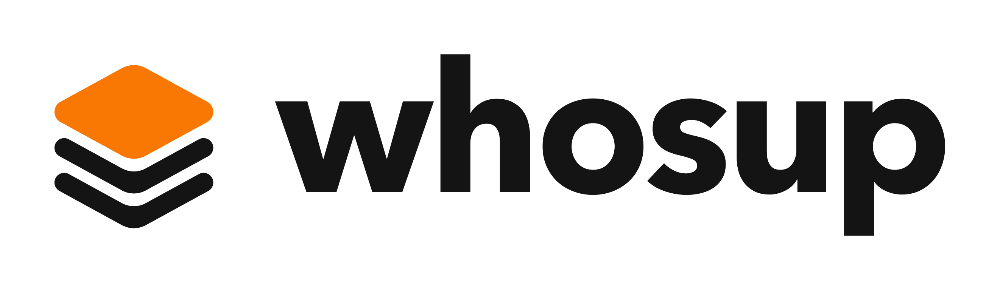
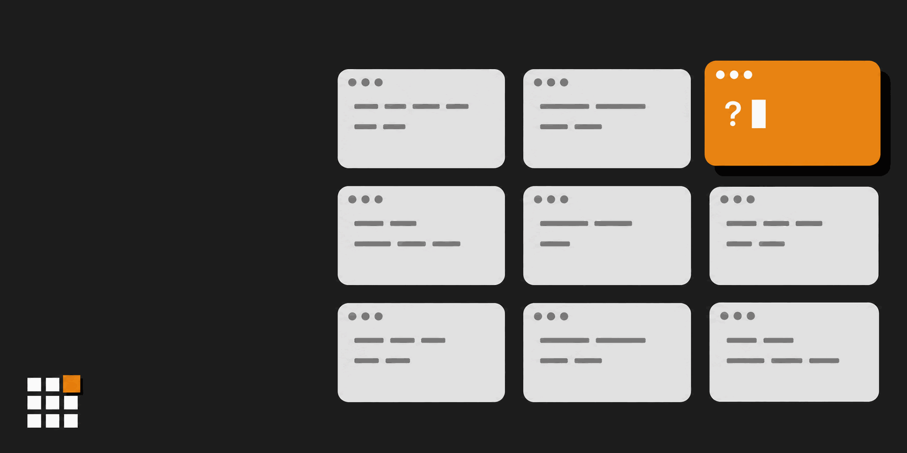
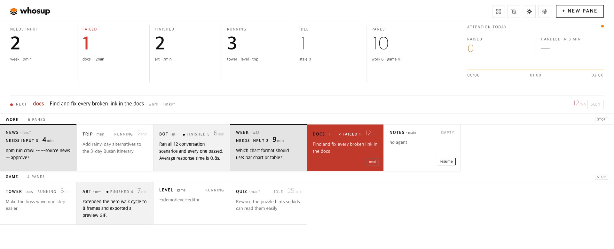
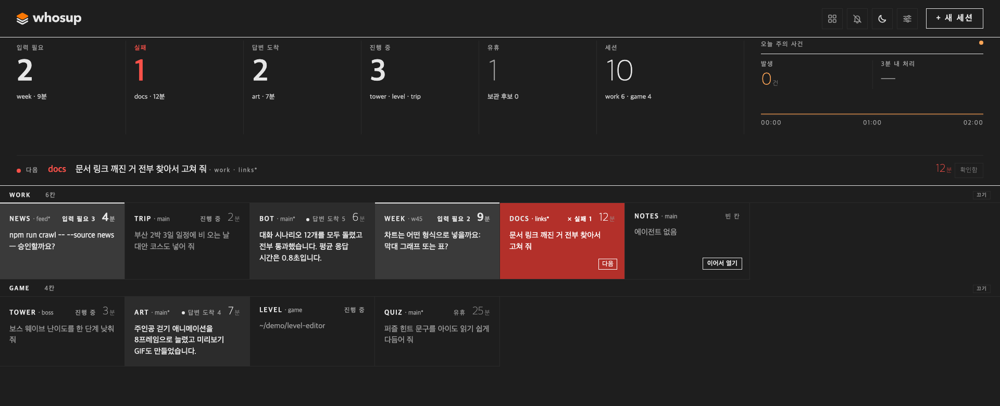

[English](README.md) | [한국어](README.ko.md) | 日本語 | [中文](README.zh.md) | [Español](README.es.md)

# whosup

<p align="center">
  <picture>
    <source media="(prefers-color-scheme: dark)" srcset="assets/logo-dark.png">
    
  </picture>
</p>

> **もうセッションを放置しない。** whosup は herdr のすべてのセッションを1枚のボードにまとめ、次に見るべきペインを教えます。

[herdr](https://herdr.dev) のペインでコーディングエージェントを6個、10個、15個と走らせていると、動いているもの、1時間前に終わったもの、気づかないまま権限確認で止まっているものが混ざります。whosup は、実行中のすべての herdr セッションのすべてのペインをブラウザの1ページにまとめます。入力待ち、いま終わったもの、まだ実行中のもの、静かになったもの。セルをクリックすると herdr がそのペインへ移動します。

<p align="center">
  
</p>

[クイックスタート](#クイックスタート) • [なぜwhosupなのか](#なぜwhosupなのか) • [画面の見方](#画面の見方) • [仕組み](#仕組み) • [機能](#機能) • [設定](#設定) • [環境別の設定](#環境別の設定) • [動作要件](#動作要件)

---

## クイックスタート

### 1. herdr プラグインをインストール

```bash
herdr plugin install fivetaku/whosup --yes
```

### 2. 起動する(または herdr を再起動するだけ)

```bash
herdr plugin action invoke fivetaku.whosup.start
```

ボードは `http://127.0.0.1:4790` で起動し、ブラウザが一度だけ開きます。以降は herdr と一緒に起動します。

### 3. herdr セッションは好きなだけ追加

```bash
herdr --session work      # 名前もターミナルも自由
```

実行中のセッションは自動でボードに表示されます。管理するリストはありません。

### Windows の場合

同じプラグインが Windows でも動きます。アクション名の先頭に `win-` が付きます(`win-start`、`win-doctor`、…)。[Windows](#windows) を参照してください。

---

## なぜwhosupなのか

- **ペインを見回らなくて済みます。** 上部のバンドに、入力待ち・失敗・完了・実行中のペイン数が出ます。**next** 行は最初に見るべきペインを1つ示し、そのエージェントが尋ねている質問も引用します。
- **1クリックで目的のペインへ。** セルをクリックすると、どのセッションのどのタブにあっても herdr がそのペインにフォーカスします。macOS ではターミナルアプリも前面に出せます。
- **再起動しても会話は失われません。** 再起動後、herdr はペインを復元しますがエージェントは復元しません。空のセルには **resume** ボタンが出て、そのフォルダの最新の Claude Code の会話を探し、ペイン内で `AGENT_CMD --resume <id>` を実行します。resume が読むのは Claude Code の会話履歴だけで、ほかのエージェントは新しい会話として始まります。
- **色には意味があります。** 基本は白黒、次に見るべき1つだけオレンジ、失敗は赤。点滅し続けるものはありません。
- **別のウィンドウにいても知らせます。** タブのタイトルに待っているペイン数が `(3) whosup` のように出て、ファビコンのオレンジのマスが点きます。いま手を挙げたセルにはオレンジの枠が一度だけ走ります。ヘッダーの並び替えボタンで **by desk**(デスク順)と **neglected first**(放置順)を切り替えます。放置順では長く待っているペインが各デスクの先頭に集まります。ヘッダーの **alerts** をオンにするとデスクトップ通知が届き、クリックでそのペインへ移動します。
- **待っているペインを見失いません。** あなたを待つペインは対応するまでボードに残ります。日付が変わっても、再起動しても、herdr が一時的に応答しなくても同じです。**seen** は30分だけ先送りし、その後も待っていればまた上がってきます。閉じたペインは7日間、**stash**(保管)したペインは戻すまで **recently closed** 行に残り、そこから再開・復元できます。保管したペインが再び動き出すと自動で戻ります。いつも見るペインはピンで最上段に固定できます。
- **分からないときは分からないと言います。** herdr に届かないと、ヘッダーに *disconnected · last collect HH:MM* が出て、タブのタイトルは `(!) whosup`、ファビコンは灰色になります。古い画面を黙って見せ続けることはしません。
- **ライト、ダーク、言語。** モード(auto / light / dark)はヘッダーのボタンで、言語(English / 한국어)は **settings** パネルで切り替えます。日本語表示はないため、この README のボタン名は英語表示に合わせています。配色は実際の IDE テーマを参考にし、文字のコントラストは WCAG AA を保っています。

---

## 画面の見方

<p align="center">
  <br>
  
</p>

| 領域 | 意味 |
|---|---|
| **状態バンド** | 入力待ち・失敗・完了・実行中・アイドルのペイン数と全ペイン数、今日の要対応イベント数と、そのうち3分以内に対応した割合。数字をクリックするとその状態だけに絞り込みます。 |
| **next 行** | 最初に見るべきペイン1つとその理由(保留中の質問、失敗、届いた回答)。 |
| **デスク** | herdr セッションごとに1行(デスク)、ペイン順に1ペイン1セル。セルの見出し: ラベル · git ブランチ(ブランチがなければセッション名) · 状態。共通の順番で先頭から9つの待っているペインには 1〜9 の番号が付く(例 `needs input 3`、3 を押すとそのペインへ) · 待ち時間(実行中・アイドルのペインは最後のリクエストからの経過時間) · 失敗の種類(例 usage limit)と *unreachable* のタグ。その下に文脈の1行。 |
| **セルの1行** | エージェントが尋ねている質問(権限ボックス、フォルダ信頼の確認、A か B か)、最後の一文、またはあなたの最後のリクエスト。状態に応じて一番必要なもの1つ。 |
| **resume** | 再起動後の空のペインで、そのフォルダの最新の会話を再開します。 |
| **+ new pane** | セッションとフォルダを選ぶと、whosup がそこにタブを開き、エージェントを起動してフォーカスします。 |

---

## 仕組み

```
herdr sessions (main, side, …)
   └─ pane list + agent list, every 3 s  ──►  whosup collector  ──►  SQLite (node:sqlite)
                                                                       │
browser  ◄──  http://127.0.0.1:4790  ◄──  board server  ◄─────────────┘
   │
   └─ click  ──►  pane.focus over herdr's socket  ──►  the pane
```

Node プロセス1つだけで、ビルドは不要です。herdr の startup フックは一度だけ実行されるコマンドで、herdr の起動時に whosup をバックグラウンドのサーバーとして起動して終わります。その後サーバーは単独で動き続け、herdr が監視したり止めたりはしません。止めるには `stop` アクションを使います。ペインの状態は herdr のエージェント検出(working / blocked / done / idle)から、質問文はペインの画面から、最後のリクエストは Claude Code の会話履歴(`~/.claude/projects` または `CLAUDE_PROJECTS_DIR`)から読みます。ほかのエージェントのペインには最後のリクエストが表示されず、resume は新しい会話として始まります。 コレクターは herdr のイベントも受け取ります。ペインの状態が変わると次の 3 秒ごとの収集を待たずにすぐ収集し、開いているボードのタブにすぐ知らせます。イベントを受け取れない場合も 3 秒ごとの収集はそのまま動きます。

**信頼モデル。** サーバーは 127.0.0.1 だけで待ち受け、ログインはありません。ほかのサイトから来たブラウザの変更リクエストは拒否しますが(変更はボード自身のアドレスから JSON で送られたものだけ受け付けます)、同じコンピューターで動くプログラムなら誰でも API を使えます。resume や new pane のときに whosup がペインに入力するコマンド `AGENT_CMD` などの設定も変えられます。ポートをほかの人に公開しないでください。サーバーは `Host` ヘッダーが `127.0.0.1`、`localhost`、`[::1]` 以外のリクエストに 403 `local only` を返します。そのため公開ホスト名を転送するトンネル(Tailscale Serve、cloudflared、ngrok)ではボードをまったく開けません。自分の別のマシンから見るときは `ssh -L 4790:127.0.0.1:4790 <host>` のように localhost のホストを保つポート転送を使って `http://localhost:4790` を開き、サーバーは `WHOSUP_READONLY=1` で起動します。読み取り専用が止めるのは変更で、閲覧ではありません。ホーム以下のフォルダ一覧は返しませんが、ボードに出るものはすべて見えます。セルのツールチップのフォルダパス、最後のリクエスト、質問の原文がそうで、`GET /api/settings` も `agent_cmd` を返します。

---

## 機能

| 機能 | 説明 |
|---|---|
| 自動検出 | 実行中のすべての herdr セッションとペインを設定なしで表示 |
| 要対応の状態 | needs input · failed · finished · running · idle · empty |
| 質問の抽出 | 権限ボックス、フォルダ信頼の確認、「A か B か」の質問を原文のまま表示 |
| ジャンプ | クリック → `pane.focus`。macOS ではそのセッションを表示しているターミナルのウィンドウが前面に出ます。ターミナルアプリは自動で見つけ、そのセッションを表示するウィンドウがなければ新しいウィンドウを開きます(Ghostty、Terminal) |
| クリックで開く場所 | **settings** → *Clicking a pane opens*: terminal window(既定)、web address、both から選び、ブラウザごとに保存されます。web address は herdr 用のウェブターミナルでそのペインを新しいタブに開きます。アドレスの `{session}` と `{pane}` が置き換えられ、herdr セッションごとに別のアドレスも指定できます(ウェブターミナルは通常セッションごとに別のサーバー・別のポートで動きます)。Herdr アプリの行は、その行にアドレスを指定したときだけウェブで開きます。タブは行ごとに使い回すため、開いたボードとつながったまま開きます。信頼できるウェブターミナルのアドレスだけを指定してください。別のデバイスからボードを使うときに選んでください。読み取り専用モードでは使えません(読み取り専用はクリックをすべて止めます) |
| Herdr アプリのターミナル | このマシンで herdr-core(Herdr デスクトップアプリのターミナル)が動いていれば、そのターミナルもカードになります。アプリのスペースごとに 1 行で、状態と質問文はコアが報告するとおりです。クリックすると Herdr アプリのそのペインに移動し、アプリが前面に出ます。アプリが開いていなければ、ターミナルウィンドウでそのターミナルを開きます(`hc attach`)。閉じる、再開、新しいペイン、行のオン・オフは herdr セッションと同じです。設定は不要で、動いていないコアを whosup が起動することはありません。コアが報告しないフォルダー信頼の確認は画面から読み取り、入力待ちとして表示します。それ以外の状態を画面から推測することはありません |
| resume | そのペイン自身の会話、なければほかのペインで動いていない、そのフォルダの最新の会話 → `AGENT_CMD --resume`。押す前にどの会話かボードに表示。Claude Code の会話のみ対応、ほかのエージェントは新しく始まる |
| new pane | セッションとフォルダを選び、エージェントのコマンドを実行 |
| デスク(任意) | モニターごとのセッションとペインを `desks.json` に宣言。`desks-apply` アクションが足りないものだけを作成(何度実行しても同じ結果) |
| 言語 | 既定は English、한국어は **settings** パネルか `?lang=ko` で選択 |
| テーマ | auto / light / dark(ヘッダーのボタン、`?theme=`)、IDE の配色を調べて作ったパレット |
| 読み取り専用モード | `WHOSUP_READONLY=1` で操作ボタンと **+ new pane** を隠し、クリック・Enter・1〜9・`n`・通知のクリック・設定の変更を止め(設定パネルには言語の選択だけが出る)、フォルダ一覧も表示しない。止めるのは変更で、閲覧ではない — 信頼モデルを参照 |
| seen = 先送り | 待っているペインの **seen** は30分だけ隠し、**unsee** ですぐ戻す |
| ピン固定 | 固定したペインは並び順に関係なく、全デスクの上の固定行に表示 |
| stash と recently closed | アイドルのペインを保管。閉じたペインは7日間、保管したペインは戻すまで **recently closed** に残る。保管したペインが再び動くと自動で戻る |
| ひとつの順番 | next 行・Enter・1〜9・通知・放置順がすべて同じ順番: 失敗 → 入力待ち → 完了、待ち時間の長い順 |
| キーボード | `n`(韓国語配列なら `ㅜ`)で new pane · Tab でペインを移動し、Enter か Space でフォーカス中のペインを開く · フォーカス中のペインがなければ Enter で次のペインへ移動、パネルが開いていれば保存・作成 · 1〜9 で番号の付いたペインへ移動 · Esc でパネルを閉じる。入力欄に入力している間は `n` と 1〜9 を無視 |
| 再通知 | 待ったままのペインは15分ごとに最大4回再通知、対応すると通知を閉じる |
| macOS 通知(任意) | タブを閉じていてもサーバーが macOS 通知を送る — 既定はオフ |
| 画面分割(任意、macOS) | ペインをクリックするとボードを画面の左に、ターミナルを残りに配置(`split_pct`)。既定はオフ、アクセシビリティ権限が必要 |
| 正直な状態表示 | ヘッダーに最終収集時刻、収集が止まると *disconnected*、herdr に確認できないセッションのペインは残したまま *unreachable* と表示 |
| 設定パネル | ヘッダーの **settings**: 先送り時間・再通知の間隔と回数・閉じたとみなす基準・切断警告・recently closed の保持日数・放置の目安日数・macOS 通知・unreachable の判定時間・画面分割・エージェントのコマンド・クリックで開く場所(このブラウザのみ)・ターミナルアプリ。読み取り専用モードでは言語の選択だけを表示 |

### プラグインアクション

| アクション | 内容 |
|---|---|
| `fivetaku.whosup.start` | ボードを起動(herdr 起動時にも実行) |
| `fivetaku.whosup.stop` | 停止 |
| `fivetaku.whosup.status` | URL(ポート)と PID |
| `fivetaku.whosup.open` | ブラウザでボードを開く |
| `fivetaku.whosup.desks-apply` | `desks.json` からセッションとペインを作成 |
| `fivetaku.whosup.desks-status` | 宣言したペインと実際のペインを比較 |
| `fivetaku.whosup.autoconf` | このマシンを確認し直し、自動検出の値を更新して表示([値の出所と自動設定](#値の出所と自動設定)を参照) |
| `fivetaku.whosup.win-*` | Windows 用の同じアクション(`win-start`・`win-stop`・`win-status`・`win-open`・`win-desks-apply`・`win-desks-status`・`win-autoconf`)と `win-doctor` |

---

## 設定

プラグインの設定フォルダ(`herdr plugin config-dir fivetaku.whosup`。herdr の外で動かすときは `~/.config/whosup`)の `.env` に `KEY=value` の行を書きます。このファイルは `start` がサーバーを起動するときにだけ読まれるので、変更したら `stop` アクションを実行してから `start` を実行します。ここに書いた値は自動設定より優先され、設定パネルは両方より優先されます([値の出所と自動設定](#値の出所と自動設定)を参照)。`desks-apply` アクションは `.env` を読まず、エージェントのコマンドを `desks.json` の `agent_cmd` から取ります。

| キー | 既定値 | 意味 |
|---|---|---|
| `PORT` | 4790 | 使用中なら次の空きポートを使用 |
| `OPEN_BROWSER` | 1 | herdr 起動時にタブを一度だけ開く |
| `AGENT_CMD` | claude | resume と new pane で使うコマンド。ラッパーを使うならここに。**settings** パネルで変えた値が優先 |
| `FRONT_APP` | 自動 | ジャンプ時に前面に出す macOS のターミナルアプリ(例: `Ghostty`)。未設定なら自動設定が選び([規則表](#値の出所と自動設定)のレーン L4)、ウィンドウがなければ Terminal で新しいウィンドウを開きます。Windows では空欄 = 自動(Windows Terminal があればそれ、なければ PowerShell ウィンドウ)、`PowerShell`、`Windows Terminal`、または `off`(どんな値も受け付けます)。**settings** パネルで変えると再起動なしで反映されます |
| `STALE_DAYS`(または `WHOSUP_STALE_DAYS`) | 3 | この日数動きがないペインを保管候補として表示 |
| `WHOSUP_READONLY` | 0 | 1 で読み取り専用: 変更不可、フォルダ一覧も非表示 |
| `WHOSUP_SEEN_SNOOZE_MIN` · `WHOSUP_RENOTIFY_MIN` · `WHOSUP_RENOTIFY_MAX` · `WHOSUP_GONE_MISSES` · `WHOSUP_STALE_COLLECT_SEC` · `WHOSUP_CLOSED_KEEP_DAYS` · `WHOSUP_OS_NOTIFY` · `WHOSUP_UNREACHABLE_TTL_H` · `WHOSUP_SPLIT_PCT` | 30 · 15 · 4 · 3 · 30 · 7 · 0 · 24 · 0 | 初期値。ヘッダーの **settings** パネルで変えた値がこのコンピューターで優先 |
| `WHOSUP_INTERVAL` | 3 | 収集間隔(秒) |
| `CLAUDE_PROJECTS_DIR` | `~/.claude/projects` | resume と最後のリクエストが Claude Code の会話を探すフォルダ |
| `HERDR_BIN_PATH`(または `HERDR_BIN`) | 自動 | herdr 実行ファイルのパス。未設定なら `/opt/homebrew/bin`、`/usr/local/bin`、`~/.local/bin`、`PATH` の順に探す |
| `WHOSUP_RUNTIMES` | auto | 読み取る対象: `auto`(herdr セッションと herdr-core ターミナルのうち存在するものすべて)、`herdr`、`herdr-core` |
| `HC_SOCKET` | 自動 | herdr-core のソケット。未設定ならコアの `core.lock` から読む(`HC_SESSION`、`XDG_STATE_HOME` に従う) |
| `WHOSUP_CLICK_TARGET` | terminal | まだ選んでいないブラウザでクリックしたときに開く場所: `terminal`、`web`、`both`。初回カードが設定し、**settings** の *クリックで開く場所* がブラウザごとに上書き |
| `HERDR_APP_BIN` · `HERDR_APP_NAME` · `HC_BIN` | `herdr-app` · `Herdr` · `hc` | Herdr アプリのコマンド(移動、新しいタブ、スペースを閉じる)、macOS で前面に出すアプリ名、herdr-core のターミナルをターミナルウィンドウで開くときのコマンド |

### デスク(任意)

「モニターごとに herdr セッションを1つ」のように配置を固定したいなら、一度書いておけば whosup が作ります。

```json
{ "agent_cmd": "claude",
  "desks": [
    { "session": "main", "note": "left monitor", "agent": true,
      "panes": [ { "label": "api", "cwd": "~/src/api" }, { "label": "web", "cwd": "~/src/web" } ] },
    { "session": "side", "panes": [ { "label": "notes", "cwd": "~/notes" } ] }
  ] }
```

これをプラグインの設定フォルダ(`herdr plugin config-dir fivetaku.whosup`。herdr の外で動かすときは `~/.config/whosup`)に `desks.json` として保存し、`herdr plugin action invoke fivetaku.whosup.desks-apply` を実行します。足りないものを追加するだけです。ターミナルはセッションごとに好きな場所で開いてください(`herdr --session main`)。

### エージェントの復元

herdr は再起動後にエージェントを自分で起動し直すこともできます(`[session] resume_agents_on_restore`)。ラッパー経由でエージェントを起動しているなら、これを `false` にして whosup の **resume** を使ってください。そうすればラッパーが使われます。

---

## 環境別の設定

### Herdr デスクトップアプリ

whosup は Herdr デスクトップアプリのターミナルを、アプリのコアである herdr-core を通して読みます。次がそろっていれば設定は不要です。

- **このコンピューターで herdr-core が動いていること。** コアはソケットのパスを `<state>/herdr-core/<session>/core.lock` に書きます(`<state>` は `XDG_STATE_HOME`、なければ `~/.local/state`、Windows では `%LOCALAPPDATA%` も見ます。`<session>` は `HC_SESSION`、なければ `default`)。`HC_SOCKET` を指定するとそちらが優先です。ソケットがある間はコアが動いているとみなします。whosup はコアを起動しません。
- **`herdr-app` が `PATH` にあること**(または `HERDR_APP_BIN`)。移動・新しいタブ・スペースを閉じる操作はこのコマンドを使います。なくてもカードは読めます。
- **`hc` が `PATH` にあること**(または `HC_BIN`)。アプリのウィンドウが開いていないとき、ターミナルウィンドウでそのターミナルを開きます。

自動設定(レーン L6)がインストール時と毎回の起動時にソケットと `herdr-app` を確認します。Herdr アプリのカードをクリックすると、アプリでそのターミナルを表示してアプリ(`HERDR_APP_NAME`、既定 `Herdr`)を前面に出します。アプリのウィンドウがなければ、ターミナルウィンドウで `hc attach <terminal>` を開きます。

ターミナルがボードに出ないときの確認点:

- `WHOSUP_RUNTIMES` が `auto`(既定)か、`herdr-core` を含むこと。`herdr` だけだとアプリは対象外です。
- whosup に `HC_SOCKET`・`HC_SESSION`・`XDG_STATE_HOME` を渡しているなら、アプリが使うコアと同じ場所を指すこと。
- `node scripts/doctor.mjs` は core の行(ソケット、または *not running*)、探した状態フォルダ、`herdr-app` が見つかったかを表示します。`autoconf` アクションはレーン L6 とその根拠を表示します([値の出所と自動設定](#値の出所と自動設定)を参照)。
- Windows で herdr-core が named pipe で待ち受けるかは、まだ確認していません。

### ovis: 別の端末やスマホからペインを開く

[ovis](https://github.com/devswha/ovis) は herdr 用の Web クライアントです(チャット、ライブターミナル、スマホアプリ)。whosup は動いている ovis を見つけてアドレスを埋めるだけで、ovis を起動・停止しません。

```bash
herdr plugin install devswha/ovis --yes          # ovis の INSTALL.md より
herdr plugin action invoke devswha.ovis.start
```

- herdr プラグインとして入れた ovis は herdr と一緒に `http://127.0.0.1:7317` で起動し、自分を起動した herdr セッションのソケットに従います。
- ovis サーバー1つが見るのは herdr セッション1つです。別のセッションも見るには、`PORT` と `HERDR_SOCKET=~/.config/herdr/sessions/<名前>/herdr.sock` を指定した ovis サーバーを別のポートでもう1つ起動します(ovis の INSTALL.md の Configuration)。whosup はポート 7317〜7330 を見ます。
- whosup はインストール時と毎回の起動時にこれらのポートを確認します(レーン L7)。`GET /api/health?scope=bridge` が ovis 固有のフィールドで答えたときだけ ovis とみなします。セッションはそのポートで待ち受けるプロセスの `HERDR_SOCKET`(なければ `HERDR_SESSION`)から求めます(macOS は `ps`、Linux は `/proc`)。herdr が一覧に出すセッションごとに、アドレス `http://127.0.0.1:<port>/?pane={pane}` を埋めます。
- セッションが分からないとき(Windows、herdr の一覧にないセッション、1つのセッションに2つのサーバー)は何も埋めず、そのポートを「要確認」として表示します。その場合は **settings** でアドレスを自分で設定します。
- ovis があってもクリックの既定はターミナルウィンドウです。ボードを初めて開くと検出した環境をまとめたカードが出て、セッションに対応する ovis があれば、クリックで開く場所(ターミナルウィンドウ / ovis / 両方)を尋ねます。カードで選んだ値はサーバーに保存され(`click_target`)、すべてのブラウザの既定値になります。**settings** → *クリックで開く場所* はそのブラウザだけで選択とアドレスを変え、ブラウザに保存した値があればそれを使います。

埋められるアドレスは `127.0.0.1` なので、ovis が動くコンピューターで開きます。別の端末からはそのポートも転送するか(`ssh -L 4790:127.0.0.1:4790 -L 7317:127.0.0.1:7317 <host>`)、**settings** でその端末から届くアドレスに置き換えます。スマホでは ovis 自身のアプリとリレーを使います(ovis の README を参照)。ボードからペインを開くには、ボードが読み取り専用でない必要があります。

### Windows

whosup は Windows でも動きます(Node と PowerShell、`sh` なし)。プラグインには herdr が `node` で実行する Windows 専用の項目があるので、インストールと起動の手順は同じで、アクション名の先頭に `win-` が付きます。

```powershell
herdr plugin install fivetaku/whosup --yes
herdr plugin action invoke fivetaku.whosup.win-start
herdr plugin action invoke fivetaku.whosup.win-doctor    # この PC を読むだけの点検
herdr plugin action invoke fivetaku.whosup.win-autoconf  # 自動設定が検出した内容
```

手動で起動するなら whosup のフォルダで、**デスクトップセッション**から実行します(SSH 経由ではウィンドウが見えません)。

```powershell
node scripts\doctor.mjs                 # Node・herdr・pipe・PowerShell・Windows Terminal・デスクトップセッションを点検
node scripts\launch.mjs start           # start アクションと同じ(status・stop・open もあり)
# または前面で直接。設定は PowerShell の変数で渡します(VAR=値 は sh の書き方なのでここでは使えません)。
$env:FRONT_APP='Windows Terminal'; node bin\whosup.mjs
```

- 自動設定はインストール時(`launch.mjs preflight`)と毎回の起動前に動きます。`wt.exe` が `PATH` にあれば **Windows Terminal** を選び、なければクリック時に PowerShell ウィンドウを開きます。
- SSH 経由で起動した場合や Windows のセッション 0 の場合(サービス。`SESSIONNAME` を見て、なければプロセスのセッション番号を見ます — デスクトップのログオンタスクは `SESSIONNAME` がなくてもデスクトップとみなします)はリモートとみなします。デスクトップには何も表示されないので、ブラウザを開かずウィンドウも前面に出しません(*ターミナルアプリ* = オフ)。ウィンドウを使うならデスクトップセッションから起動します。
- ペインをクリックすると、そのセッションを表示しているターミナルウィンドウを前面に出し、なければそのセッションにつないだ PowerShell ウィンドウを新しく開きます。設定パネルの *ターミナルアプリ* で **自動**、**PowerShell**、**Windows Terminal**、**オフ** から選べます(`FRONT_APP` でも可)。
- `node bin\whosup.mjs` は `.env` を読みません。`launch.mjs` とプラグインのアクションは読みます(`KEY=value` の行だけ。何も実行しません)。
- Windows 用の Node 22.13 以上([nodejs.org](https://nodejs.org)、または nvm-windows・Volta・fnm)が `PATH` に、herdr が `PATH`(または `HERDR_BIN_PATH`)に必要です。
- Windows の実機ではまだ確認していないこと: Herdr デスクトップアプリ(herdr-core)が Windows で named pipe で待ち受けるか、herdr が起動フックの終了後も whosup を動かし続けるか。`win-doctor` が両方を表示します。Windows では ovis のポートは見つかりますが、各ポートが見るセッションは分からないので「要確認」と表示します。

### 値の出所と自動設定

各設定は次の順で最初に見つかった値を使います: **設定パネル > 環境変数(`.env` を含む) > 自動検出 > 既定値。** パネルや環境変数で人が決めた値を自動設定が変えることはなく、自動設定は `.env` やパネルの値を書きません。

- **設定パネル**: このコンピューターの whosup のデータベースに保存され、すぐに反映されます。欄を空にすると次の層の値に戻ります。
- **環境変数 / `.env`**: プラグインの設定フォルダ(`herdr plugin config-dir fivetaku.whosup`。herdr の外では `~/.config/whosup`)の `.env` に書く `KEY=value` の行。`start` がサーバーを起動するときにだけ読むので、編集したら `stop`、続けて `start` を実行します。
- **自動検出**: インストール時(build フック)と毎回の起動前に確認し直し、状態フォルダ(herdr のプラグイン状態フォルダ。herdr の外では `~/.config/whosup`)の `auto.json` に書きます。サーバーは起動時、このファイルが直前に(同じプラットフォームで 2 分以内に)書かれたものなら読み、そうでなければ(`bin/whosup.mjs` を直接起動した場合など)検出し直して書き直します。検出に失敗すると自動値なしで起動します。

何を検出したかは `autoconf` アクション(Windows は `win-autoconf`)か、whosup のフォルダで `node scripts/autoconf.mjs` を実行すると見られます(`--json` で JSON)。レーンごとに値と根拠を表示し、環境変数が勝つ値には印を付けます。動いているボードは `GET /api/autoconf` に答え、`GET /api/settings` の `origins` に設定ごとの出所があります。

| レーン | 何を確認 | 何に決める | どこで変える |
|---|---|---|---|
| L1 | OS | 報告のみ: herdr は macOS・Linux では `sh` の項目を、Windows では `node` の項目を実行。Windows では OS 通知の項目を出さない | — |
| L2 | Node 22.13 以上と `node:sqlite` | 古ければ案内を出してインストールが止まる | Node を更新 |
| L3 | デスクトップセッションか: SSH(`SSH_CONNECTION`・`SSH_TTY`)、セッション 0 の Windows(`SESSIONNAME` なし・セッション番号 0)、`DISPLAY`・`WAYLAND_DISPLAY` のない Linux | リモートならブラウザを開かない(`OPEN_BROWSER` 0)。ウィンドウを前面に出す機能もオフ(macOS・Windows、`FRONT_APP` の値 `off`) | `OPEN_BROWSER`、`FRONT_APP`、*ターミナルアプリ* |
| L4 | ターミナルアプリ。macOS: 今 herdr を表示しているアプリ、なければインストール済みの Ghostty・iTerm・WezTerm・kitty。Windows: `PATH` の `wt.exe`。Linux: 確認しない | macOS: そのセッションを表示するウィンドウがないときに新しいウィンドウを開くアプリ(クリック時はそのセッションを表示しているアプリを前面に出し、パネルでは*自動*と表示)。Windows: 使うターミナル。見つからなければクリック時に herdr を表示しているアプリ、それもなければ Terminal(macOS)、PowerShell ウィンドウ(Windows) | *ターミナルアプリ*、`FRONT_APP` |
| L5 | herdr: 実行ファイル、バージョン、実行中のセッション | 報告のみ。herdr があれば herdr セッションを読む | `HERDR_BIN_PATH`、`WHOSUP_RUNTIMES` |
| L6 | Herdr デスクトップアプリ: herdr-core のソケット、`herdr-app` コマンド | 報告のみ。コアが動いている間そのターミナルを読む | `WHOSUP_RUNTIMES`、`HC_SOCKET`、`HERDR_APP_*` |
| L7 | 127.0.0.1:7317〜7330 の ovis と、各サーバーが見る herdr セッション | セッションごとの Web アドレス。クリックはターミナルウィンドウのまま | 初回カード、*クリックで開く場所* とセッションごとのアドレス |
| L8 | `PATH` の `claude`、なければ `codex`。Claude Code の会話フォルダ | resume と新しいペインに使うエージェントのコマンド、resume が会話を見つけられるか | **settings** のエージェントのコマンド、`AGENT_CMD` |
| L9 | macOS のアクセシビリティ権限(クリックでウィンドウを前面に出すときに分かる) | 権限がなければ画面分割を使えないと表示 | システム設定 → プライバシーとセキュリティ → アクセシビリティ |
| L10 | `PORT`(4790)から空いているポート | 報告のみ。whosup が自分で次の空きポートに移る | `PORT` |

---

## 動作要件

- [herdr](https://herdr.dev) 0.9.0 以降。Herdr デスクトップアプリのターミナル(herdr-core)も動いていれば一緒に読み取ります。どちらか一方だけでも使えます
- Node.js 22.13 以降(`node:sqlite` をフラグなしで使用)。bun もビルドも不要
- curl(macOS と Linux で `start`・`status`・`open` アクションが稼働確認に使用。Windows は Node 自身の `fetch` を使用)
- macOS、Linux、または Windows 10/11(PowerShell 5.1 以上、デスクトップセッションで実行。[Windows](#windows) を参照)

---

## whosup ではないもの

ターミナルのミラーリング、チャット、スマホからの入力は [ovis](https://github.com/devswha/ovis)。カンバンで動かすエージェントは herdr-board。whosup は見ることとジャンプすることだけを行います。

## ライセンス

MIT — [LICENSE](LICENSE) を参照。

---

<div align="center">

**一度見て、呼んでいるペインへジャンプ。**

</div>
