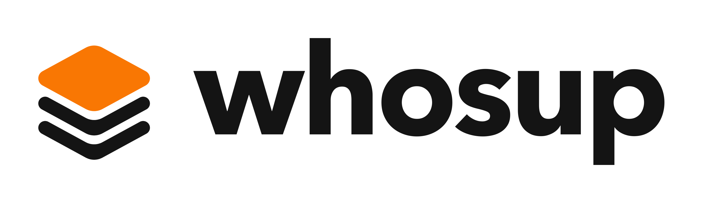
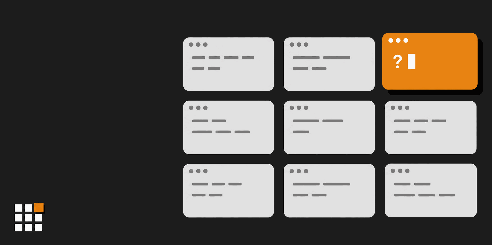
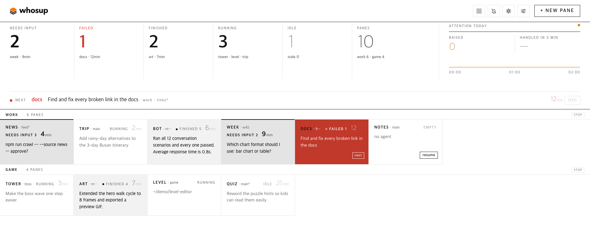
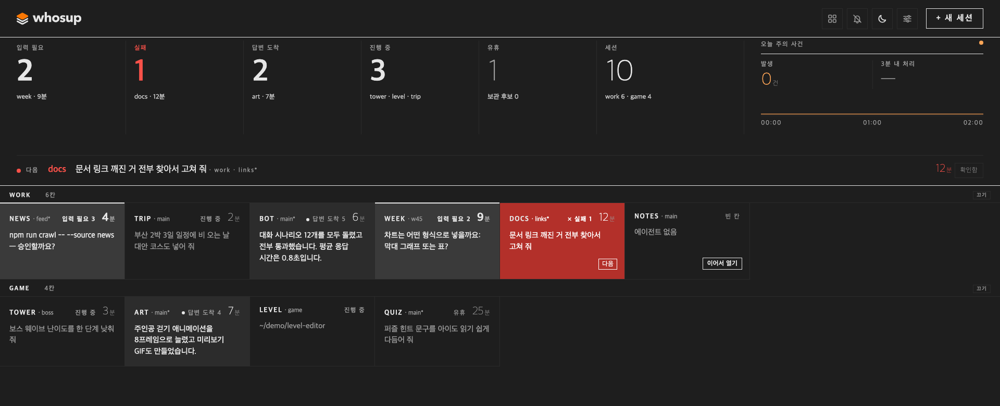

[English](README.md) | [한국어](README.ko.md) | 日本語 | [中文](README.zh.md) | [Español](README.es.md)

# whosup

<p align="center">
  <picture>
    <source media="(prefers-color-scheme: dark)" srcset="assets/logo-dark.png">
    
  </picture>
</p>

> **もうセッションを放置しない。** whosup は herdr のすべてのセッションを1枚のボードにまとめ、次に見るべきセッションを教えます。

[herdr](https://herdr.dev) の pane でコーディングエージェントを6個、10個、15個と走らせていると、動いているもの、1時間前に終わったもの、気づかないまま権限確認で止まっているものが混ざります。whosup は、実行中のすべてのデスクのすべてのセッションをブラウザの1ページにまとめます。入力待ち、いま終わったもの、まだ実行中のもの、静かになったもの。セッションをクリックすると herdr がそのセッションへ移動します。

whosup は herdr の pane ひとつひとつを*セッション*、herdr のセッション(または Herdr アプリのスペース)を*デスク*と呼びます。

<p align="center">
  
</p>

[クイックスタート](#クイックスタート) • [なぜwhosupなのか](#なぜwhosupなのか) • [画面の見方](#画面の見方) • [仕組み](#仕組み) • [機能](#機能) • [設定](#設定) • [環境別の設定](#環境別の設定) • [動作要件](#動作要件)

---

## クイックスタート

### 1. 1 行を実行します

いま何を使っていても、ここから始めます。次の 1 行をターミナルに貼り付けて Enter を押してください(macOS・Linux)。

```bash
curl -fsSL https://raw.githubusercontent.com/fivetaku/whosup/main/install.sh | sh
```

インストーラーはこのコンピューターを調べて、3 つの道のどれか 1 つに進みます。

| このコンピューターにあるもの | インストーラーがすること |
|---|---|
| herdr 0.9.0 以降 | whosup を herdr プラグインとしてインストールします。herdr を起動するたびにボードも起動します。 |
| herdr はなく herdr-core がある: Herdr デスクトップアプリ、または自分の herdr-core を起動する別のデスクトップアプリ(Ovis デスクトップアプリなど) | herdr なしで whosup だけをインストールします([単独インストール](#単独インストール))。ボードはすぐに起動し、ログインするたびにまた起動します。 |
| どちらもなく、Herdr アプリも Ovis アプリもない | セッションをどこで使うかを尋ね、選んだものを先にインストールし(管理者権限なし)、それに合わせて whosup をインストールします。 |

**セッションを動かす環境がまだ 1 つもない場合**、インストーラーは番号で 2 回まで尋ねます。まず *Desktop app* か *Terminal* か、アプリなら *Herdr* か *Ovis* かです。最初の質問の *Desktop app* の下の説明行に、このコンピューターにインストールできるアプリの名前(Herdr または Ovis、1 つだけならその 1 つ)が出るので、最初の質問から見えます。Enter だけなら `*` の付いたものに決まります: Desktop app、次に Herdr。そのあと、選んだものと whosup を一緒にインストールします。

| 選んだもの | インストールするもの | インストールできる場所 |
|---|---|---|
| Desktop app → Herdr(Enter、Enter) | Herdr アプリをそのアプリのインストーラーで入れ、whosup を[単独インストール](#単独インストール)します | Apple シリコンの Mac、x86_64・arm64 の Linux |
| Desktop app → Ovis | Ovis アプリをリリースのファイル(約 175MB)で受け取り、そのリリースのチェックサム(macOS では署名も)と合うか確かめてから置き、whosup を単独インストールします。macOS では `~/Applications` に置きます | macOS 13 以降(Apple シリコン・Intel)。x86_64・arm64 の Linux は、そのアプリが使うデスクトップ用ライブラリと FUSE がすでにあるときだけ |
| Terminal | herdr を `~/.local/bin` に入れ、whosup を herdr プラグインとしてインストールします | macOS、Linux |

このコンピューターにインストールできない選択肢は出さず(理由を 1 行で伝えます)、選択肢が 1 つしか残らない質問は尋ねません。Herdr アプリをインストールできないコンピューターではアプリは Ovis になり、どちらのアプリもインストールできなければ herdr をインストールします。尋ねられずに決めるには、`sh` の前に `WHOSUP_ENV=herdr-app`、`ovis-app`、`herdr` のどれかを付けます([インストーラーのオプション](#インストーラーのオプション)を参照)。選んだものをインストールできなかったときは、何ができなかったかと自分で入手する場所を伝え、whosup はインストールしません。すでに何かがあるコンピューターでは、これは尋ねません。上の表の最初の 2 行がこれまでどおり当てはまります。

Node 22.13 以降が必要です。PATH の前のほうに古い Node があっても構いません。インストーラーが PATH とよくあるインストール場所(Homebrew、nvm、fnm)を順に調べ、22.13 以降の最初の Node を使います。1 つもなければ何もインストールせず、何をすればよいかを 1 行で伝えます。ほかのインストーラー(herdr、アプリ)の出力は、成功すれば 1 行にまとめ、失敗すればすべて見せます。最後にインストールの要約を出します。どの道に進んだか、ボードのアドレス、次にすることが 1 回ずつ書かれています。ボードは `http://127.0.0.1:4790` で起動し、4790 が使用中なら次の空きポートで起動します。SSH 接続中や `OPEN_BROWSER=0` のときはブラウザが開かないので、そのアドレスを自分で開いてください。

ターミナルからインストールすると、このコンピューターで選択肢が 2 つ以上ある項目だけを質問します。セッションを開く場所や、新しいセッションで実行するコマンドなどです。質問ごとに、それが何を決めるのかを 1 行で示します。Enter だけなら `*` の付いた値(自動検出の値)をそのまま使います。番号を入力するとその値に決まります。質問にすべて答えれば(Enter も答えです)、ボードは同じことをもう尋ねません。その前に終わった場合(時間切れ・Ctrl-C)は、ボードを初めて開いたときに 1 回だけ尋ねます(first-run setup)。

### 2. その後は、いま使っているものによって変わります

**herdr を使っている人。** whosup は herdr プラグインになります。

- herdr が動いていれば、インストールが終わるとすぐにボードが起動し、ブラウザが開きます。
- herdr が止まっていれば、要約が入力するものを伝えます: `herdr`。ボードも一緒に起動します。herdr のあるフォルダーが PATH になければ、要約はそのコマンドをフルパスで書くので、そのまま入力すれば動きます。
- 1 行のインストールの代わりに、プラグインを直接インストールしてもかまいません。結果は同じです。

  ```bash
  herdr plugin install fivetaku/whosup --yes
  ```

以降は herdr を起動するたびにボードも起動します。手動で起動するには、herdr の中のターミナルで次を実行します(herdr の外のターミナルでは、`herdr` の直後に `--session <デスク名>` を付けます)。

```bash
herdr plugin action invoke fivetaku.whosup.start
```

**Herdr デスクトップアプリか Ovis デスクトップアプリだけを使っている人(herdr なし)。** whosup だけを単独でインストールします。ほかには何もインストールしません。

- ボードがすぐに起動してブラウザが開きます。ログインするたびにまた起動します。
- ターミナルアプリは質問しません。前面に出す herdr デスクのターミナルウィンドウがないからです。
- *Herdr app sessions open in* は、Herdr アプリ自身のコアがあるときだけ質問します。
- 自分のコアを起動するアプリ(Ovis デスクトップアプリなど)のセッションもボードに出ます。インストールがそのことを 1 行で伝えます。例: `Sessions of <app> show on the board too.` アプリが動いているあいだは、ボードから新しいセッションを開く・閉じる・もう一度開くことができます。セッションをクリックすると、アプリが `ovis://` リンクを知っていれば(そのリンクのある Ovis のバージョン — まだ出ていません)アプリのウィンドウでそのセッションを表示し、そうでなければブラウザのタブで開きます。そのようなアプリには、どのセッションを表示するかを外から伝える手段がないためです。[自分のコアを起動するアプリ](#自分のコアを起動するアプリ)を参照してください。
- アプリが動いていなくてもかまいません。このコンピューターでそのアプリを使ったことがあれば、インストーラーは同じ道に進みます。アプリを起動すると、そのセッションがボードに出ます。
- 以降は `whosup` コマンドを使います: `whosup start`、`whosup stop`、`whosup update` など。[単独インストール](#単独インストール)を参照してください。

**何もない人。** インストーラーが何を使うかを尋ね(上の表)、それをインストールしてから whosup をインストールします。

- *Desktop app*(Herdr アプリ、または Ovis アプリ): whosup を単独でインストールし、ボードが起動します。アプリは一度開かないと、そのセッションがボードに出ません。ブラウザを開くインストールではインストーラーがアプリも開き、そうでなければ要約がアプリを開くよう伝えます。アプリの最初の画面を済ませてから、ボードで新しいセッションを開いてください。
- *Terminal*(herdr): whosup は herdr プラグインになります。要約が herdr を起動するよう伝え、起動するとボードも一緒に起動します。`~/.local/bin` が PATH になければ、要約はそのコマンドをフルパスで書くので、いまのターミナルでそのまま入力でき、これから開くターミナルのためにそのフォルダーを PATH に入れる 1 行も出します。
- インストーラーが入れたアプリを whosup は削除しません。`whosup uninstall` がそのこととアプリの場所を 1 行で伝えます。

**エージェントにインストールさせる人。** エージェントに同じ 1 行を実行させれば十分です。

- 質問するターミナルがないので、何も質問しません。ボードを初めて開いたときに 1 回だけ尋ねます。
- セッションを動かす環境が 1 つもないコンピューターでは、尋ねずに既定のものをインストールします: Herdr アプリ(Herdr アプリをインストールできなければ Ovis アプリ、どちらもできなければ herdr)。別のものにするには `WHOSUP_ENV` で決めます。
- 要約はコマンドの出力に残るので、エージェントがボードのアドレスと次にすることを伝えられます。
- ターミナルから実行したスクリプトには、これまでどおり質問します。質問を省くには `WHOSUP_NO_SETUP=1` を付けます: `curl -fsSL https://raw.githubusercontent.com/fivetaku/whosup/main/install.sh | WHOSUP_NO_SETUP=1 sh`

1 行をもう一度実行しても道は変わりません。herdr プラグインとしてインストール済みならそのままにし(更新のしかたは要約が伝えます)、単独インストールがあればその場で新しい版に入れ替えます。

最初のセッションを開くまでに知っておくこと:

- **macOS の権限。** ふつうは権限のダイアログは出ません。最小化したウィンドウを戻すときと画面分割を使うときだけ、アクセシビリティとオートメーションの権限が必要です。権限をオンにしたあとは、whosup を起動し直すと反映されます。[機能](#機能)の表の *ジャンプ* を参照してください。
- **macOS とフォルダー。** 新しいセッションのフォルダーにデスクトップ・書類・ダウンロードの中のフォルダーを選ぶと、macOS がそのアプリにフォルダーへのアクセスを許可するか尋ねます。許可するか、別のフォルダーを選んでください。
- **Claude Code の「このフォルダを信頼しますか」という質問**は、カーソルが "No, exit" にある状態で出ます。下に移動して "Yes, I trust this folder" を選んでから Enter を押してください。Claude Code の画面なので、whosup は変えられません。
- **herdr と Herdr アプリは、初めて起動したときに英語のようこそ画面**を出します。それぞれのプログラムの画面なので、Enter を押して進めてください。
- **ハングルの文字の間が空いて見える**のは、一部のターミナルアプリ(macOS 標準のターミナルなど)のフォントの描き方によるものです。whosup が出す文字に余分な空白はありません。

### 3. デスクは好きなだけ追加(herdr)

```bash
herdr --session work      # 名前もターミナルも自由
```

実行中の herdr のセッション(whosup ではデスク)は自動でボードに表示されます。管理するリストはありません。

### Windows の場合

1 行のインストーラーと単独インストールは Windows では動きません。Windows では herdr プラグインとしてインストールします。

```powershell
herdr plugin install fivetaku/whosup --yes
```

Windows ではインストール時に何も質問せず(herdr がインストール手順を見えないコンソールで実行するため)、ボードを初めて開いたときに first-run setup が尋ねます。アクション名の先頭に `win-` が付きます(`win-start`、`win-doctor`、…)。[Windows](#windows) を参照してください。

---

## なぜwhosupなのか

- **セッションを見回らなくて済みます。** 上部のバンドに、入力待ち・失敗・完了・実行中のセッション数が出ます。**next** 行は最初に見るべきセッションを1つ示し、そのエージェントが尋ねている質問も引用します。
- **1クリックで目的のセッションへ。** セッションをクリックすると、どのデスクのどのタブにあっても herdr がそのセッションにフォーカスします。macOS ではターミナルアプリも前面に出せます。
- **再起動しても会話は失われません。** 再起動後、herdr はセッションを復元しますがエージェントは復元しません。空のセッションには **resume** ボタンが出て、そのフォルダの最新の Claude Code の会話を探し、セッション内で `AGENT_CMD --resume <id>` を実行します。resume が読むのは Claude Code の会話履歴だけで、ほかのエージェントは新しい会話として始まります。続ける会話がない空のセッションには、代わりに **start agent** ボタンが出ます。
- **色には意味があります。** 基本は白黒、次に見るべき1つだけオレンジ、失敗は赤。点滅し続けるものはありません。
- **別のウィンドウにいても知らせます。** タブのタイトルに待っているセッション数が `(3) whosup` のように出て、ファビコンのオレンジのマスが点きます。いま手を挙げたセッションにはオレンジの枠が一度だけ走ります。ヘッダーの並び替えボタンで **by desk**(デスク順)と **neglected first**(放置順)を切り替えます。放置順では長く待っているセッションが各デスクの先頭に集まります。ヘッダーの **alerts** をオンにするとデスクトップ通知が届き、クリックでそのセッションへ移動します。
- **待っているセッションを見失いません。** あなたを待つセッションは対応するまでボードに残ります。日付が変わっても、再起動しても、herdr が一時的に応答しなくても同じです。**seen** は30分だけ先送りし、その後も待っていればまた上がってきます。閉じたセッションは7日間、**stash**(保管)したセッションは戻すまで **recently closed** 行に残り、そこから再開・復元できます。保管したセッションが再び動き出すと自動で戻ります。いつも見るセッションはピンで最上段に固定できます。
- **分からないときは分からないと言います。** herdr に届かないと、ヘッダーに *disconnected · last collect HH:MM* が出て、タブのタイトルは `(!) whosup`、ファビコンは灰色になります。古い画面を黙って見せ続けることはしません。
- **ライト、ダーク、言語。** モード(auto / light / dark)はヘッダーのボタンで、言語(既定は English、ほかに 한국어)は first-run setup と **settings** の EN / 한 ボタンで切り替えます。日本語表示はないため、この README のボタン名は英語表示に合わせています。配色は実際の IDE テーマを参考にし、文字のコントラストは WCAG AA を保っています。

---

## 画面の見方

<p align="center">
  <br>
  
</p>

| 領域 | 意味 |
|---|---|
| **状態バンド** | 入力待ち・失敗・完了・実行中・アイドルのセッション数と全セッション数、今日の要対応イベント数と、そのうち3分以内に対応した割合。数字をクリックするとその状態だけに絞り込みます。 |
| **next 行** | 最初に見るべきセッション1つとその理由(保留中の質問、失敗、届いた回答)。エージェントが動いているセッションが 1 つもないときは、代わりに次にすること(next step: 新しいセッションを開く)を示します。 |
| **デスク** | デスクごとに1行、セッションは herdr の pane 順。セッションの見出し: ラベル · git ブランチ(ブランチがなければデスク名) · 状態。共通の順番で先頭から9つの待っているセッションには 1〜9 の番号が付く(例 `needs input 3`、3 を押すとそのセッションへ) · 待ち時間(実行中・アイドルのセッションは最後のリクエストからの経過時間) · 失敗の種類(例 usage limit)と *unreachable* のタグ。その下に文脈の1行。 |
| **セッションの1行** | エージェントが尋ねている質問(権限ボックス、フォルダ信頼の確認、A か B か)、最後の一文、またはあなたの最後のリクエスト。状態に応じて一番必要なもの1つ。 |
| **resume** | 再起動後の空のセッションで、そのフォルダの最新の会話を再開します。続ける会話がなければボタンは **start agent** になり、新しい会話で始めます。 |
| **+ new session** | デスクとフォルダを選ぶと(一覧でフォルダに入ると、そのフォルダが選ばれます)、whosup がそこにタブを開き、エージェントを起動してフォーカスします。 |

---

## 仕組み

```
herdr sessions (main, side, …)
   └─ pane list + agent list, every 3 s  ──►  whosup collector  ──►  SQLite (node:sqlite)
                                                                       │
browser  ◄──  http://127.0.0.1:4790  ◄──  board server  ◄─────────────┘
   │
   └─ click  ──►  pane.focus over herdr's socket  ──►  the pane
```

Node プロセス1つだけで、ビルドは不要です。herdr の startup フックは一度だけ実行されるコマンドで、herdr の起動時に whosup をバックグラウンドのサーバーとして起動して終わります。その後サーバーは単独で動き続け、herdr が監視したり止めたりはしません。止めるには `stop` アクションを使います。セッションの状態は herdr のエージェント検出(working / blocked / done / idle)から、質問文はセッションの画面から、最後のリクエストは Claude Code の会話履歴(`~/.claude/projects` または `CLAUDE_PROJECTS_DIR`)から読みます。ほかのエージェントのセッションには最後のリクエストが表示されず、resume は新しい会話として始まります。 コレクターは herdr のイベントも受け取ります。セッションの状態が変わると次の 3 秒ごとの収集を待たずにすぐ収集し、開いているボードのタブにすぐ知らせます。イベントを受け取れない場合も 3 秒ごとの収集はそのまま動きます。

**信頼モデル。** サーバーは 127.0.0.1 だけで待ち受け、ログインはありません。ほかのサイトから来たブラウザの変更リクエストは拒否しますが(変更はボード自身のアドレスから JSON で送られたものだけ受け付けます)、同じコンピューターで動くプログラムなら誰でも API を使えます。resume や new session のときに whosup がセッションに入力するコマンド `AGENT_CMD` などの設定も変えられます。ポートをほかの人に公開しないでください。サーバーは `Host` ヘッダーが `127.0.0.1`、`localhost`、`[::1]` 以外のリクエストに 403 `local only` を返します。そのため公開ホスト名を転送するトンネル(Tailscale Serve、cloudflared、ngrok)ではボードをまったく開けません。自分の別のマシンから見るときは `ssh -L 4790:127.0.0.1:4790 <host>` のように localhost のホストを保つポート転送を使って `http://localhost:4790` を開き、サーバーは `WHOSUP_READONLY=1` で起動します。読み取り専用が止めるのは変更で、閲覧ではありません。ホーム以下のフォルダ一覧は返しませんが、ボードに出るものはすべて見えます。セッションのツールチップのフォルダパス、最後のリクエスト、質問の原文がそうで、`GET /api/settings` も `agent_cmd` を返します。

---

## 機能

| 機能 | 説明 |
|---|---|
| 自動検出 | 実行中のすべてのデスクとセッションを設定なしで表示 |
| 要対応の状態 | needs input · failed · finished · running · idle · empty |
| 質問の抽出 | 権限ボックス、フォルダ信頼の確認、「A か B か」の質問を原文のまま表示 |
| ジャンプ | クリック → `pane.focus`。macOS ではそのデスクを表示しているターミナルのウィンドウが前面に出ます。ターミナルアプリは自動で見つけ、そのデスクを表示するウィンドウがなければ新しいウィンドウを開きます(Ghostty、Terminal)。macOS の権限: そのアプリのウィンドウが画面に見えているあいだは、クリックに権限は要らず、システムのダイアログも出ません。画面に見えるウィンドウがないとき(最小化・非表示)は、まずそのアプリを開き直します。これも権限が要らず、最小化したウィンドウが戻ります(権限がないとどのウィンドウが最小化されているか分からないので、同じアプリの別のウィンドウが画面に見えているときは、最小化したウィンドウはそのままです)。それでもウィンドウが出ないときと画面分割でだけ、アクセシビリティとオートメーション(System Events)の権限を使い、macOS がそのときに尋ねることがあります。権限がない、または拒否した場合は、ボードが案内の行を出します(赤い *disconnected* の表示とは別です)。押すと、何ができないか、オンにする場所(システム設定 → プライバシーとセキュリティ → アクセシビリティ、またはオートメーション → System Events。対象は whosup を起動したアプリで、案内にその名前が出ます)、オンにしたあと whosup を起動し直す必要があることが出ます。両方の権限をすでに与えている人には、何も変わりません |
| セッションを開く場所 | **settings** → *Sessions open in*: terminal window(既定)、web terminal、both から選びます。選んだ値はサーバーに保存され、すべてのブラウザの既定値になります。*only in this browser* をオンにすると、そのブラウザだけに適用されます。web terminal は herdr 用のウェブターミナルでそのセッションを新しいタブに開きます。アドレス(*Web terminal address*、そのブラウザだけに保存)の `{session}`(デスク名)と `{pane}`(herdr の pane id)が置き換えられ、デスクごとに別のアドレスも指定できます(ウェブターミナルは通常デスクごとに別のサーバー・別のポートで動きます)。Herdr アプリのデスクは、そのデスクにアドレスを指定したときだけウェブで開きます。タブはデスクごとに使い回すため、開いたボードとつながったまま開きます。信頼できるウェブターミナルのアドレスだけを指定してください。別のデバイスからボードを使うときに選んでください。読み取り専用モードでは使えません(読み取り専用はクリックをすべて止めます) |
| Herdr アプリのターミナル | このマシンで herdr-core(Herdr デスクトップアプリのターミナル)が動いていれば、そのターミナルもセッションになります。アプリのスペース 1 つがデスク 1 つで、状態と質問文はコアが報告するとおりです。クリックすると Herdr アプリのそのセッションに移動し、アプリが前面に出ます。アプリが開いていなければ、ターミナルウィンドウでそのターミナルを開きます(`hc attach`)。**settings** の *Herdr app sessions open in* を terminal window にすると(`core_target`)、アプリが開いていても常にターミナルウィンドウで `hc attach` で開きます。閉じる、再開、新しいセッション、デスクのオン・オフは herdr のデスクと同じです。設定は不要で、動いていないコアを whosup が起動することはありません。コアが報告しないフォルダー信頼の確認は画面から読み取り、入力待ちとして表示します。それ以外の状態を画面から推測することはありません |
| ほかのアプリのセッション | 自分の herdr-core を起動するデスクトップアプリ(Ovis デスクトップアプリなど)は自動検出が見つけ、そのセッションもボードに出ます。アプリが動いているあいだは、ボードから新しいセッション・閉じる・再開ができます。インストールされたアプリが `ovis://` リンクを知っていれば(そのリンクのある Ovis のバージョン — まだ出ていません)、クリックするとそのリンクでアプリのウィンドウにそのセッションを表示します。そうでなければ、そのセッションをブラウザのタブで開き、アプリのウィンドウはそのままにします。どのセッションを表示するかを外からアプリに伝える手段がないためです。[自分のコアを起動するアプリ](#自分のコアを起動するアプリ)を参照 |
| first-run setup | ボードを初めて開くと(インストール時にターミナルですでに済ませた場合は出ません)、検出した環境(セッションを動かす場所が 1 つでも見つかれば、見つからなかった項目は出しません。**settings** にはすべて出ます)と、項目ごとに検出した選択肢が出ます。いま使われる値があらかじめ選ばれています。*Sessions open in*: terminal window、web terminal、both。デスクに対応するウェブターミナル(ovis など)を検出したときだけ出ます(そうでなければ terminal window しか選べないためです。first-run setup は選択肢が 1 つしかない項目を出さず、**settings** には出ます)。*Terminal app*: 検出したアプリ(いま herdr を表示しているアプリ、インストール済みのアプリ)と auto。動いている herdr のデスクがあるときだけ出ます。*Herdr app sessions open in*: Herdr app か terminal window。Herdr アプリ(`herdr-app` コマンドかそのコア)を検出したときだけ出ます。自分のコアを起動するアプリごとに `Sessions of <app> show on the board too. A click opens the session in a browser tab.` の 1 行が出ます(**settings** の検出した環境にも)。*Command to run in a new session*: 検出したエージェント(claude、codex)。**start with these** を押すと、自分で選んだ行だけがサーバーの設定に人が決めた値として保存され、その後は自動検出が変えません。触らなかった行は保存せず、自動検出に従い続けます。すでに設定や環境変数で決めた項目は、触らなければそのままです。上の EN / 한 ボタンでボードの言語を切り替えられます。出るのは一度だけです。✕ や Esc で閉じても済んだものとして記録し(保存する値はありません)、**settings** の **open first-run setup again** でもう一度見られます。確認するまではボードが 5 秒に 1 回まで検出し直すので、whosup より後に起動したウェブターミナルも選択肢に出ます |
| resume | そのセッション自身の会話、なければほかのセッションで動いていない、そのフォルダの最新の会話 → `AGENT_CMD --resume`。押す前にどの会話かボードに表示。Claude Code の会話のみ対応、ほかのエージェントは新しく始まる |
| new session | デスクとフォルダを選び、エージェントのコマンドを実行 |
| デスク(任意) | モニターごとのデスクとセッションを `desks.json` に宣言。`desks-apply` アクションが足りないものだけを作成(何度実行しても同じ結果) |
| 言語 | 既定は English、한국어は first-run setup と **settings** の EN / 한 ボタンか `?lang=ko` で選択。選んだ言語はブラウザごとに保存 |
| テーマ | auto / light / dark(ヘッダーのボタン、`?theme=`)、IDE の配色を調べて作ったパレット |
| 読み取り専用モード | `WHOSUP_READONLY=1` で操作ボタンと **+ new session** を隠し、クリック・Enter・1〜9・`n`・通知のクリック・設定の変更を止め(設定には言語の選択だけが出る)、フォルダ一覧も表示しない。止めるのは変更で、閲覧ではない — 信頼モデルを参照 |
| seen = 先送り | 待っているセッションの **seen** は30分だけ隠し、**unsee** ですぐ戻す |
| ピン固定 | 固定したセッションは並び順に関係なく、全デスクの上の固定行に表示 |
| stash と recently closed | アイドルのセッションを保管。閉じたセッションは7日間、保管したセッションは戻すまで **recently closed** に残る。保管したセッションが再び動くと自動で戻る |
| ひとつの順番 | next 行・Enter・1〜9・通知・放置順がすべて同じ順番: 失敗 → 入力待ち → 完了、待ち時間の長い順 |
| キーボード | `n`(韓国語配列なら `ㅜ`)で new session · Tab でセッションを移動し、Enter か Space でフォーカス中のセッションを開く · フォーカス中のセッションがなければ Enter で次のセッションへ移動、パネルが開いていれば保存・作成 · 1〜9 で番号の付いたセッションへ移動 · Esc でパネルを閉じる。入力欄に入力している間は `n` と 1〜9 を無視 |
| 再通知 | 待ったままのセッションは15分ごとに最大4回再通知、対応すると通知を閉じる |
| macOS 通知(任意) | タブを閉じていてもサーバーが macOS 通知を送る — 既定はオフ |
| 画面分割(任意、macOS) | セッションをクリックするとボードを画面の左に、ターミナルを残りに配置(`split_pct`)。既定はオフ、アクセシビリティとオートメーションの権限が必要(*ジャンプ* を参照) |
| 正直な状態表示 | ヘッダーに最終収集時刻、収集が止まると *disconnected*、herdr に確認できないデスクのセッションは残したまま *unreachable* と表示 |
| 設定 | ヘッダーの **settings**: 先送り時間・再通知の間隔と回数・閉じたとみなす基準・切断警告・recently closed の保持日数・放置の目安日数・macOS 通知・unreachable の判定時間・画面分割・エージェントのコマンド・セッションを開く場所(サーバーに保存。*only in this browser* でそのブラウザだけ)・ターミナルアプリ(検出したアプリの一覧から選ぶ)・Herdr アプリのセッションを開く場所・**re-detect**(再起動なしで実行環境を確認し直す。人が決めた値は変わらない)・**open first-run setup again**。読み取り専用モードでは言語の選択だけを表示 |

### プラグインアクション

| アクション | 内容 |
|---|---|
| `fivetaku.whosup.start` | ボードを起動(herdr 起動時と、herdr が動いていればインストール直後にも実行) |
| `fivetaku.whosup.stop` | 停止 |
| `fivetaku.whosup.status` | URL(ポート)と PID |
| `fivetaku.whosup.open` | ブラウザでボードを開く |
| `fivetaku.whosup.desks-apply` | `desks.json` からデスクとセッションを作成 |
| `fivetaku.whosup.desks-status` | 宣言したセッションと実際のセッションを比較 |
| `fivetaku.whosup.autoconf` | このマシンを確認し直し、自動検出の値を更新して表示([値の出所と自動検出](#値の出所と自動検出)を参照) |
| `fivetaku.whosup.win-*` | Windows 用の同じアクション(`win-start`・`win-stop`・`win-status`・`win-open`・`win-desks-apply`・`win-desks-status`・`win-autoconf`)と `win-doctor` |

---

## 設定

プラグインの設定フォルダ(`herdr plugin config-dir fivetaku.whosup`。herdr の外で動かすときは `~/.config/whosup`)の `.env` に `KEY=value` の行を書きます。このファイルは `start` がサーバーを起動するときにだけ読まれるので、変更したら `stop` アクションを実行してから `start` を実行します。ここに書いた値は自動検出より優先され、設定(ヘッダーの **settings**)は両方より優先されます([値の出所と自動検出](#値の出所と自動検出)を参照)。`desks-apply` アクションは `.env` を読まず、エージェントのコマンドを `desks.json` の `agent_cmd` から取ります。

| キー | 既定値 | 意味 |
|---|---|---|
| `PORT` | 4790 | 使用中なら次の空きポートを使用 |
| `OPEN_BROWSER` | 1 | ボードの起動時(herdr 起動時、インストール直後)にタブを一度だけ開く |
| `AGENT_CMD` | claude | resume と new session で使うコマンド。ラッパーを使うならここに。**settings** で変えた値が優先 |
| `FRONT_APP` | 自動 | ジャンプ時に前面に出す macOS のターミナルアプリ(例: `Ghostty`)。未設定なら自動検出が選び([規則表](#値の出所と自動検出)のレーン L4)、ウィンドウがなければ Terminal で新しいウィンドウを開きます。Windows では空欄 = 自動(Windows Terminal があればそれ、なければ PowerShell ウィンドウ)、`PowerShell`、`Windows Terminal`、または `off`(どんな値も受け付けます)。**settings** で変えると再起動なしで反映されます |
| `STALE_DAYS`(または `WHOSUP_STALE_DAYS`) | 3 | この日数動きがないセッションを保管候補として表示 |
| `WHOSUP_READONLY` | 0 | 1 で読み取り専用: 変更不可、フォルダ一覧も非表示 |
| `WHOSUP_SEEN_SNOOZE_MIN` · `WHOSUP_RENOTIFY_MIN` · `WHOSUP_RENOTIFY_MAX` · `WHOSUP_GONE_MISSES` · `WHOSUP_STALE_COLLECT_SEC` · `WHOSUP_CLOSED_KEEP_DAYS` · `WHOSUP_OS_NOTIFY` · `WHOSUP_UNREACHABLE_TTL_H` · `WHOSUP_SPLIT_PCT` | 30 · 15 · 4 · 3 · 30 · 7 · 0 · 24 · 0 | 初期値。ヘッダーの **settings** で変えた値がこのコンピューターで優先 |
| `WHOSUP_INTERVAL` | 3 | 収集間隔(秒) |
| `CLAUDE_PROJECTS_DIR` | `~/.claude/projects` | resume と最後のリクエストが Claude Code の会話を探すフォルダ |
| `HERDR_BIN_PATH`(または `HERDR_BIN`) | 自動 | herdr 実行ファイルのパス。未設定なら `/opt/homebrew/bin`、`/usr/local/bin`、`~/.local/bin`、`PATH` の順に探す |
| `WHOSUP_RUNTIMES` | auto | 読み取る対象: `auto`(herdr のデスクと herdr-core ターミナルのうち存在するものすべて)、`herdr`、`herdr-core` |
| `HC_SOCKET` · `HC_SESSION` | 自動 · `default` | herdr-core のコアを 1 つだけ読む: そのソケット、またはその名前(ソケットはそのコアの `core.lock` からだけ読み、`XDG_STATE_HOME` に従う)。どちらかを指定すると、`WHOSUP_CORES` と自動検出はほかのコアを足さない。コア名の規則(`WHOSUP_CORES` を参照)に合わない `HC_SESSION` は、指定していないものとして扱う |
| `WHOSUP_CORES` | 自動 | Herdr アプリのコア(`default`)のほかに読む herdr-core のコア: カンマ区切りのコア名、`all`(`core.lock` を残しソケットがあるコアすべて)、`none`(Herdr アプリのコアだけ)。未設定なら、自動検出が[自分のコアを起動するアプリ](#自分のコアを起動するアプリ)のコアを足す。コア名は英数字・`.`・`_`・`-` で 80 文字まで、`.` と `..` は受け付けない。2 つの名前が同じソケットを指すときは、そのコアを最初の名前で 1 回だけ読む |
| `WHOSUP_CLICK_TARGET` | terminal | セッションを開く場所(*Sessions open in*)の初期値: `terminal`、`web`、`both`。first-run setup か **settings** で選んだ値が優先され、すべてのブラウザの既定値になります。*only in this browser* をオンにしたブラウザだけ別の値を使います |
| `WHOSUP_CORE_TARGET` | app | Herdr アプリのセッションを開く場所(*Herdr app sessions open in*): `app`、`terminal`。`terminal` ならアプリが開いていても常にターミナルウィンドウで `hc attach` で開きます。first-run setup か **settings** で選んだ値が優先(設定名 `core_target`) |
| `HERDR_APP_BIN` · `HERDR_APP_NAME` · `HC_BIN` | `herdr-app` · `Herdr` · `hc` | Herdr アプリのコマンド(移動、新しいタブ、スペースを閉じる)、macOS で前面に出すアプリ名、herdr-core のターミナルをターミナルウィンドウで開くときのコマンド。アプリ名は `HERDR_APP_NAME` > 自動検出で見つけた名前 > `Herdr` の順。`HERDR_APP_NAME` は Herdr アプリにだけ使い、[ほかのアプリのコア](#自分のコアを起動するアプリ)には使わない |

### デスク(任意)

「モニターごとにデスクを1つ」のように配置を固定したいなら、一度書いておけば whosup が作ります。

```json
{ "agent_cmd": "claude",
  "desks": [
    { "session": "main", "note": "left monitor", "agent": true,
      "panes": [ { "label": "api", "cwd": "~/src/api" }, { "label": "web", "cwd": "~/src/web" } ] },
    { "session": "side", "panes": [ { "label": "notes", "cwd": "~/notes" } ] }
  ] }
```

これをプラグインの設定フォルダ(`herdr plugin config-dir fivetaku.whosup`。herdr の外で動かすときは `~/.config/whosup`)に `desks.json` として保存し、`herdr plugin action invoke fivetaku.whosup.desks-apply` を実行します。足りないものを追加するだけです。ターミナルはデスクごとに好きな場所で開いてください(`herdr --session main`)。

### エージェントの復元

herdr は再起動後にエージェントを自分で起動し直すこともできます(`[session] resume_agents_on_restore`)。ラッパー経由でエージェントを起動しているなら、これを `false` にして whosup の **resume** を使ってください。そうすればラッパーが使われます。

---

## 環境別の設定

### 単独インストール

このコンピューターに herdr がなく herdr-core(Herdr デスクトップアプリ、または自分のコアを起動する別のアプリ)があれば、[1 行のインストーラー](#クイックスタート)が whosup だけを単独でインストールします。コンピューターに何があってもこの道に進ませるには、`curl -fsSL https://raw.githubusercontent.com/fivetaku/whosup/main/install.sh | WHOSUP_INSTALL_MODE=standalone sh` を実行します。すでに herdr プラグインとしてインストールされていれば断ります。1 台のコンピューターでボードが 2 つ動かないようにするためです。

置かれる場所:

| 何 | どこ |
|---|---|
| プログラム | `~/.local/share/whosup/app`(`XDG_DATA_HOME` があれば `$XDG_DATA_HOME/whosup/app`) |
| インストールの記録(`install.json`) | プログラムの隣: `~/.local/share/whosup/install.json`。このインストールが使うフォルダーと Node が書かれているので、`whosup` コマンドとログイン時の自動起動はいつも同じものを使います。その Node がなくなったか、22.13 より古い版に変わっていた場合は、別の Node を探し直します |
| `whosup` コマンド | `~/.local/bin/whosup` |
| 設定(`.env`、`setup.json`) | `~/.config/whosup` |
| 状態(データベース、`auto.json`、ログ) | `~/.local/state/whosup`(`$XDG_STATE_HOME/whosup`)。以前にフォルダーから手動で whosup を動かしていたなら `~/.config/whosup` をそのまま使うので、履歴は続きます |

絶対パスでない `XDG_DATA_HOME`・`XDG_STATE_HOME` の値は無視します。

`~/.local/bin` が PATH になければ、要約はコマンドをフルパスで書き、そのことを伝えます。`~/.local/bin` に whosup という別のプログラムがすでにあれば触らず、代わりに使う長いコマンドを要約に書きます。

インストーラーは、すでにあるものを慎重に扱います。

- **プログラムの場所に別のフォルダーがあるとき。** whosup のインストーラーが置いたのではないフォルダーがプログラムの場所にすでにあれば、その中のものを実行も変更もしません。そのことを伝えて終わります。フォルダーを別の場所に移してから、インストーラーをもう一度実行してください。
- **インストールが 2 つ同時に動くとき。** 別の whosup のインストールがまだ進行中なら、あとから始めたほうはそのことを伝え、何も変えずに終わります。先に始めたインストールにどれだけ時間がかかっていても同じです(質問で待っていることがあります)。インストールや更新の進行中に `whosup uninstall` や `whosup autostart on`・`off` を実行した場合も、同じように伝えて終わります。
- **途中でやめたインストール**(Ctrl-C。first-run setup の質問で押した場合も含みます。またはターミナルを閉じた場合)は元に戻します。新しいインストールは、置いたものを片付けます。更新は以前の版に戻し、ボードが動いていたならもう一度起動します。そのボードを起動し直せなかった場合はインストーラーがそう伝えるので、`whosup start` で起動してください。どちらの場合も設定と履歴はそのままです。
- **終わらなかったインストールが残したもの**は、そこから起動したボードを止め、ログイン時の自動起動を外したあとでだけ片付けます。それができなければフォルダーをそのまま残し、インストーラーがすることを伝えてエラーで終わります。

`whosup` コマンド:

| コマンド | すること |
|---|---|
| `whosup start` | ボードを起動します |
| `whosup stop` | ボードを止めます。Linux では `whosup.service` ユーザーサービスも止めます。そのサービスを止められなければ、自分で打つコマンドを伝えてエラーで終わります |
| `whosup status` | ボードが動いているか、アドレス、ログイン時に自動で起動するか |
| `whosup open` | ブラウザでボードを開きます |
| `whosup setup` | first-run setup をターミナルでもう一度行います |
| `whosup update` | 新しい版に入れ替えます。設定と履歴はそのままで、動いていたボードはもう一度起動します |
| `whosup uninstall` | ボードを止め、ログイン時の自動起動を外し、プログラムと `whosup` コマンドを削除します。設定と履歴は残します。インストーラーが一緒に入れたアプリ(Herdr アプリ、Ovis アプリ)は削除せず、そのこととアプリの場所を 1 行で伝えます |
| `whosup uninstall --purge` | 上と同じで、設定と履歴も削除します。インストールの記録に書かれた設定フォルダーと状態フォルダーだけを削除し、ほかのフォルダーは削除しません。プログラムがすべて削除できたときだけ削除します |
| `whosup autostart on` · `off` · `status` | ログイン時の自動起動をオン・オフにするか、いまの状態を見ます |
| `whosup help` | この一覧を表示します |

**ログイン時の自動起動。** 新しく単独インストールすると、ログインするたびにボードが起動するよう登録します。macOS は LaunchAgent(`~/Library/LaunchAgents/dev.whosup.board.plist`)、Linux は `systemd --user` サービス(`~/.config/systemd/user/whosup.service`)です。ログイン時の起動ではブラウザのタブを開きません。オフにするには:

```bash
whosup autostart off
```

もう一度オンにするには `whosup autostart on` です。更新しても選んだ状態はそのままです。`systemd --user` のない Linux では、ログイン時に自動では起動しません。要約がそう伝えるので、`whosup start` で起動します。

macOS でログイン時の自動起動を登録したものの、いますぐには読み込めなかった場合は、次のログインから起動します。インストールの要約、`whosup autostart on`、`whosup status` がそう伝えます。`whosup autostart off` がログイン項目のファイルを削除できなければ、残ったファイルを伝えてエラーで終わります。サービスマネージャー(macOS は launchd、Linux は systemd)にログイン項目がまだ残っている場合は、オフになったとは言わず、自分で打つコマンドを伝えてエラーで終わります。

**更新と削除。** `whosup update` はインストーラーをもう一度ダウンロードし、単独インストールの道で実行します。1 行のインストーラーをもう一度実行しても同じです。新しい版のインストールに失敗するか、動いていたボードが新しい版で起動しないか、更新を途中でやめると、古い版に戻します。`whosup uninstall` は `--purge` を付けなければ `~/.config/whosup` と状態フォルダーを残し、削除したものと残したものを表示します。削除できなかったものがあればそれも表示し、エラー(終了コード 1)で終わるので、残ったものは自分で削除できます。ログイン時の自動起動を外せなかった場合や、Linux でユーザーサービスを止められなかった場合は、そこで止まり、プログラムを削除しません。プログラムの場所にインストーラーが置いたのではないフォルダーがあれば、そのままにします。

### インストーラーのオプション

1 行の `sh` の前に付けます。例: `curl -fsSL https://raw.githubusercontent.com/fivetaku/whosup/main/install.sh | WHOSUP_NO_LOGIN_START=1 sh`。`.env` ではなく、インストールコマンドの環境から読みます。

| 変数 | すること |
|---|---|
| `WHOSUP_INSTALL_MODE=plugin` または `standalone` | コンピューターに何があってもその道に進みます |
| `WHOSUP_ENV=herdr-app`、`ovis-app` または `herdr` | セッションを動かす環境が 1 つもないコンピューターで、尋ねずにそれをインストールします。このコンピューターにインストールできない値なら、理由を伝えて何もインストールしません。すでに何かがある場合や `WHOSUP_INSTALL_MODE` を付けた場合は使わず、そのことを 1 行で伝えます |
| `WHOSUP_ENV_TIMEOUT=<秒>` | herdr のインストーラー、およびアプリのインストーラーとダウンロード 1 つ 1 つを、この時間が過ぎたら止めます(既定は 900) |
| `WHOSUP_REF=<ブランチ・タグ・コミット>` | 既定のブランチの代わりにその版をインストールします |
| `WHOSUP_NO_SETUP=1` | 何も質問しません。何をインストールするかも尋ねず、既定のものをインストールします。ボードを初めて開いたときに尋ねます |
| `WHOSUP_NO_AUTOSTART=1` | インストール直後にボードを起動しません |
| `WHOSUP_NO_LOGIN_START=1` | 単独インストール: ログイン時の自動起動を登録しません |
| `CI` | 上の 3 つをすべて行いません。質問も、起動も、ログイン時の自動起動の登録もしません |
| `WHOSUP_LANG=ko` または `en` | インストーラーが出す文と質問の言語(指定がなければ、ロケールが韓国語なら韓国語、それ以外は英語) |

スイッチは、空・`0`・`false`・`no`・`off` ならオフ、それ以外の値ならオンです。

### 自分のコアを起動するアプリ

デスクトップアプリの中には、Herdr アプリとは別に自分の herdr-core を起動するものがあります。Ovis デスクトップアプリがそうです。whosup はこのようなアプリを自分で見つけ(自動検出、レーン L7)、そのセッションを専用のデスクとしてボードに出します。設定は不要です。

- **アプリが動いているあいだは、ボードから新しいセッション・閉じる・再開ができます。** whosup がそのアプリのローカルサーバー(`127.0.0.1`)に頼んで行います。トークンは読みも使いもしません。新しいセッションは選んだデスクのタブとして、またはそのアプリの新しいデスクとして開き、whosup がそこにエージェントのコマンドを入力します。デスクのオン・オフは、これらのセッションでは使えません。
- **`ovis://` リンクを知っているアプリなら、クリックするとアプリのウィンドウでそのセッションを表示します。** `ovis://open` リンクのある Ovis のバージョンが必要です(まだ出ておらず、公開済みの 0.5.3 にはありません)。whosup はインストールされたアプリを自分で確かめ(macOS はそのアプリの `Info.plist`、Linux は `x-scheme-handler/ovis` のハンドラー、Windows は `HKCU\Software\Classes\ovis`)、OS の開くコマンド(`open`、`xdg-open`、`start`)で `ovis://open?pane=<セッション>&view=terminal` を開きます。クリックしたときも、ボードから開いたばかりの新しいセッションでも、アプリのウィンドウが前面に出てそのセッションが選ばれます。リンクを開けなかったときは、代わりにそのセッションのブラウザのタブを開きます。どちらで開いたかは応答に書かれます(`opened`: `app_link` または `browser`)。
- **そうでなければ、クリックするとそのセッションをブラウザのタブで開き、アプリのウィンドウはそのままにします。** どのセッションを表示するかを外からアプリに伝える手段がないので、whosup は、そのアプリのローカルサーバーにあるそのセッションのアドレス(`http://127.0.0.1:<ポート>/?pane=…`)を代わりに開き、アプリのウィンドウは前面に出しません(前面に出すと、別のセッションを表示したまま、開いたばかりのタブを覆ってしまいます)。このタブが開くのは、*Sessions open in* を自分で決めていないあいだです。自分で決めた場合(settings、first-run setup、`WHOSUP_CLICK_TARGET`)は、クリックはその値に従います。terminal window を選んだ場合はアプリのウィンドウが前面に出るので、その中でセッションを自分で選んでください。
- **アプリが止まっていれば** whosup は起動しません。アプリのコアが動いているあいだは、そのセッションはボードにそのまま残ります。見ることはでき、クリックするとボードがアプリが動いていないと伝え、どのウィンドウにも触れません。新しいセッションと再開は、先にアプリを起動するよう伝えます。閉じることはそれでもできます(コアでそのターミナルを終了します)。アプリを起動してから、もう一度クリックしてください。コアも止まっている場合は、そのセッションに *unreachable* と表示され、**settings** の unreachable の判定時間(既定は 24 時間)が過ぎると **recently closed** に移ります。アプリが止まったままボードを起動し直すと、ボードはアプリ名が分かりません。アプリをもう一度起動するまで、そのセッションはコア名で表示され、クリックするとターミナルウィンドウで開きます(`hc attach`)。
- **トークンやログインを求めるサーバー**は、ボードから操作せず、回り道もしません。そのセッションは見ることと移動だけができます。
- **macOS 以外では**アプリ名が分からないので、アプリのウィンドウを前面に出しません。代わりにターミナルウィンドウでそのセッションを開きます(`hc attach`)。macOS でも *Herdr app sessions open in* を terminal window にすると、そのように開きます。伝えられるアプリ名がないので、そのコアが止まっているときは、ボードはそのセッションのコアが動いていないと伝えます。
- **もう読んでいないコア:** 読むコアを自分で決めている場合(`WHOSUP_CORES`、`HC_SOCKET`、`HC_SESSION`)は、その設定が優先です。そこに含まれないコアは、開いているセッションが残っていても読まず、そのセッションはまもなく **recently closed** に移ります。その前にそのようなセッションをクリックすると、何も開かず、ボードがそのコアをいまは確認できないと伝えます。
- **ウェブターミナル:** そのアプリのウェブターミナルがログインなしで `127.0.0.1` から開けるなら、そのデスクのアドレスが埋まります。*Sessions open in* で web terminal を選ぶと、そのアドレスを使います。

見つけ方: whosup は `127.0.0.1` にだけ問い合わせます。ポート 7317〜7330 と、ovis のブリッジ登録簿(`~/.config/ovis/bridges`、古い名前の `~/.config/herdr-web-ui/bridges`)に書かれたポートを見ます。登録簿からは項目ごとにポートとプロセス番号だけを取り出して使います。トークンは取り出さず、どこにも保持せず、書き残しません。項目は、そのプロセスが生きていて、macOS と Linux ではそのプロセスが実際にそのポートで待ち受けているときだけ使います(確認できないときは、これまでどおり使います)。ovis として答え、herdr-core を表示していると言うサーバーだけを数えます。コア名はそのサーバーが伝えたものを使います。herdr のデスクを表示している ovis サーバーは、これまでどおりそのデスクのウェブターミナルとして使います。

ボードが動いているあいだは、10 秒ごとに登録簿を見直し、アプリのサーバーがそこに現れたり、なくなったり、ポートが変わったりすると検出し直します。起動したばかりのアプリのサーバーは、まだコア名を伝えないことがあります。その場合、ボードは 5 秒ごとに、最長で約 1 分間、問い合わせ直します。

既知の制限:

- ボードが動いているあいだに見張るのは登録簿だけです。ボードを起動したあとに起動したアプリが 1 分ほどたっても出ないとき(そのアプリのサーバーが登録簿にない場合など)は、**settings** の **re-detect** を押してください。
- トークンをかけた ovis サーバーのコアは自動では読みません。そのポートは「要確認」と表示されます。`WHOSUP_CORES` にコア名を書けば読みます。
- アプリ名は macOS でだけ見つけます。
- `herdr-app` が扱うコアが 2 つ以上あるまれな構成では、セッションをクリックしてもアプリの中のそのセッションには移動しません。`herdr-app` は、そのセッションがどのコアのものかを区別できないためです。代わりに、そのセッションのコアにつながるターミナルウィンドウで開きます(`hc attach`)。

### Herdr デスクトップアプリ

whosup は Herdr デスクトップアプリのターミナルを、アプリのコアである herdr-core を通して読みます。次がそろっていれば設定は不要です。

- **このコンピューターで herdr-core が動いていること。** コアはソケットのパスを `<state>/herdr-core/<session>/core.lock` に書きます(`<state>` は `XDG_STATE_HOME`、なければ `~/.local/state`、Windows では `%LOCALAPPDATA%` も見ます。`<session>` は `HC_SESSION`、なければ `default`)。`HC_SOCKET` を指定するとそちらが優先です。`core.lock` のソケットが先で、自動検出が以前に見たソケットは `core.lock` かそのソケットがないときだけ使い、`HC_SESSION` で名前を指定したコアには使いません。ソケットがある間はコアが動いているとみなします。whosup はコアを起動しません。
- **`herdr-app` が `PATH` にあること**(または `HERDR_APP_BIN`)。移動・新しいタブ・スペースを閉じる操作はこのコマンドを使います。なくてもセッションは読めます。
- **`hc` が `PATH` にあること**(または `HC_BIN`)。アプリのウィンドウが開いていないとき、ターミナルウィンドウでそのターミナルを開きます。

自動検出(レーン L6)が毎回の起動時にソケットと `herdr-app` を確認します。インストール時の first-run setup も、何を質問するか決めるために同じものを確認します。Herdr アプリのセッションをクリックすると、アプリでそのターミナルを表示してアプリ(`HERDR_APP_NAME`、既定 `Herdr`)を前面に出します。アプリのウィンドウがなければ、ターミナルウィンドウで `hc attach <terminal>` を開きます。*Herdr app sessions open in* を terminal window にすると(`core_target`、環境変数 `WHOSUP_CORE_TARGET=terminal`)、アプリが開いていても常にターミナルウィンドウで `hc attach` で開きます。`node scripts/doctor.mjs` は、このコア(`default`、または `HC_SESSION`)が動いているかをそのコアのソケットだけで判断します。[ほかのアプリのコア](#自分のコアを起動するアプリ)は数えません。

ターミナルがボードに出ないときの確認点:

- `WHOSUP_RUNTIMES` が `auto`(既定)か、`herdr-core` を含むこと。`herdr` だけだとアプリは対象外です。
- whosup に `HC_SOCKET`・`HC_SESSION`・`XDG_STATE_HOME` を渡しているなら、アプリが使うコアと同じ場所を指すこと。
- `node scripts/doctor.mjs` は core の行(ソケット、または *not running*)、探した状態フォルダ、`herdr-app` が見つかったかを表示します。`autoconf` アクションはレーン L6 とその根拠を表示します([値の出所と自動検出](#値の出所と自動検出)を参照)。
- Windows で herdr-core が named pipe で待ち受けるかは、まだ確認していません。

### ovis: 別の端末やスマホからセッションを開く

[ovis](https://github.com/devswha/ovis) は herdr 用の Web クライアントです(チャット、ライブターミナル、スマホアプリ)。whosup は動いている ovis を見つけてアドレスを埋めるだけで、ovis を起動・停止しません。

```bash
herdr plugin install devswha/ovis --yes          # ovis の INSTALL.md より
herdr plugin action invoke devswha.ovis.start
```

- herdr プラグインとして入れた ovis は herdr と一緒に `http://127.0.0.1:7317` で起動し、自分を起動した herdr のセッション(whosup ではデスク)のソケットに従います。
- ovis サーバー1つが見るのはデスク1つです。別のデスクも見るには、`PORT` と `HERDR_SOCKET=~/.config/herdr/sessions/<名前>/herdr.sock` を指定した ovis サーバーを別のポートでもう1つ起動します(ovis の INSTALL.md の Configuration)。whosup はポート 7317〜7330 と、ovis のブリッジ登録簿に書かれたポートを見ます([自分のコアを起動するアプリ](#自分のコアを起動するアプリ)を参照)。
- whosup は毎回の起動時にこれらのポートを確認します(レーン L7)。インストール時の first-run setup も、何を質問するか決めるために同じポートを確認します。`GET /api/health?scope=bridge` が ovis 固有のフィールドで答えたときだけ ovis とみなします。デスクはそのポートで待ち受けるプロセスの `HERDR_SOCKET`(なければ `HERDR_SESSION`)から求めます(macOS は `ps`、Linux は `/proc`)。herdr が一覧に出すデスクごとに、アドレス `http://127.0.0.1:<port>/?pane={pane}` を埋めます。サーバーの `HERDR_SOCKET` が分かっていて、herdr が同じ名前のデスクを別のソケットで表示している(名前だけ同じ別の herdr)ときは何も埋めず、そのポートを「要確認」と表示します。
- デスクが分からないとき(Windows、herdr の一覧にないデスク、1つのデスクに2つのサーバー)は何も埋めず、そのポートを *desk needs checking* として表示します。その場合は **settings** でアドレスを自分で設定します。
- ovis があってもクリックの既定はターミナルウィンドウです。ボードを初めて開くと first-run setup が出て(インストール時にターミナルですでに済ませた場合は出ません)、検出した環境と、項目ごとに検出した選択肢を見せます(いま使われる値があらかじめ選ばれています)。*Sessions open in* は terminal window で、デスクに対応するウェブターミナル(ovis など)を検出したときだけ web terminal と both も出ます。first-run setup を確認するまではボードが 5 秒に 1 回まで検出し直すので、whosup より後に起動した ovis も選択肢に出ます。**start with these** を押すと、選んだ値はサーバーの設定に保存され(`click_target`)、すべてのブラウザの既定値になります。**settings** → *Sessions open in* で変えた値も同じくサーバーに保存され、*only in this browser* をオンにするとそのブラウザだけに適用されます。アドレス(*Web terminal address*)はそのブラウザだけに保存されます。

埋められるアドレスは `127.0.0.1` なので、ovis が動くコンピューターで開きます。別の端末からはそのポートも転送するか(`ssh -L 4790:127.0.0.1:4790 -L 7317:127.0.0.1:7317 <host>`)、**settings** でその端末から届くアドレスに置き換えます。スマホでは ovis 自身のアプリとリレーを使います(ovis の README を参照)。ボードからセッションを開くには、ボードが読み取り専用でない必要があります。

### Windows

whosup は Windows でも動きます(Node と PowerShell、`sh` なし)。Windows では herdr プラグインとしてだけインストールします。1 行のインストーラーと単独インストール(`whosup` コマンド、ログイン時の自動起動)は macOS・Linux 専用です。プラグインには herdr が `node` で実行する Windows 専用の項目があるので、インストールと起動の手順は同じで、アクション名の先頭に `win-` が付きます。

```powershell
herdr plugin install fivetaku/whosup --yes
herdr plugin action invoke fivetaku.whosup.win-start
herdr plugin action invoke fivetaku.whosup.win-doctor    # この PC を読むだけの点検
herdr plugin action invoke fivetaku.whosup.win-autoconf  # 自動検出した内容
```

手動で起動するなら whosup のフォルダで、**デスクトップセッション**から実行します(SSH 経由ではウィンドウが見えません)。

```powershell
node scripts\doctor.mjs                 # Node・herdr・pipe・PowerShell・Windows Terminal・デスクトップセッションを点検
node scripts\launch.mjs start           # start アクションと同じ(status・stop・open もあり)
# または前面で直接。設定は PowerShell の変数で渡します(VAR=値 は sh の書き方なのでここでは使えません)。
$env:FRONT_APP='Windows Terminal'; node bin\whosup.mjs
```

- 自動検出は毎回の起動前に動きます。インストール時(`launch.mjs install`)は Node を確認するだけです。検出も質問もせず、何も書き込みません。検出を手動で動かすには `launch.mjs preflight` を使います。`wt.exe` が `PATH` にあれば **Windows Terminal** を選び、なければクリック時に PowerShell ウィンドウを開きます。
- SSH 経由で起動した場合や Windows のセッション 0 の場合(サービス。`SESSIONNAME` を見て、なければプロセスのセッション番号を見ます — デスクトップのログオンタスクは `SESSIONNAME` がなくてもデスクトップとみなします)はリモートとみなします。デスクトップには何も表示されないので、ブラウザを開かずウィンドウも前面に出しません(*Terminal app* = off)。ウィンドウを使うならデスクトップセッションから起動します。
- セッションをクリックすると、そのデスクを表示しているターミナルウィンドウを前面に出し、なければそのデスクにつないだ PowerShell ウィンドウを新しく開きます。設定の *Terminal app* で **auto**、**PowerShell**、**Windows Terminal**、**off** から選べます(`FRONT_APP` でも可)。
- `node bin\whosup.mjs` は `.env` を読みません。`launch.mjs` とプラグインのアクションは読みます(`KEY=value` の行だけ。何も実行しません)。
- Windows 用の Node 22.13 以上([nodejs.org](https://nodejs.org)、または nvm-windows・Volta・fnm)が `PATH` に、herdr が `PATH`(または `HERDR_BIN_PATH`)に必要です。
- Windows の実機ではまだ確認していないこと: Herdr デスクトップアプリ(herdr-core)が Windows で named pipe で待ち受けるか、herdr が起動フックの終了後も whosup を動かし続けるか。`win-doctor` が両方を表示します。インストール直後にボードが自動で起動するかも、実機ではまだ確認していません。起動しない場合は `win-start` アクションを実行してください。Windows ではインストール時に何も質問しません。herdr がインストール手順を見えないコンソールで実行するためですが、これは herdr のソースから読み取ったもので、実機では確認していません。Windows では ovis のポートは見つかりますが、各ポートが見るデスクは分からないので *desk needs checking* と表示します。

### 値の出所と自動検出

各設定は次の順で最初に見つかった値を使います: **設定 > 環境変数(`.env` を含む) > 自動検出 > 既定値。** 設定や環境変数で人が決めた値を自動検出が変えることはなく、自動検出は `.env` や設定の値を書きません。first-run setup で **start with these** を押すと、自分で選んだ行だけが設定に人が決めた値として保存され、その後は自動検出が変えません。触らなかった行は保存せず、自動検出に従い続けます。✕ や Esc で閉じても済んだものとして記録します(保存する値はありません)。

- **設定**: このコンピューターの whosup のデータベースに保存され、すぐに反映されます。欄を空にすると次の層の値に戻ります。*Sessions open in* で選んだ値もここに保存され、すべてのブラウザの既定値になります(*only in this browser* をオンにしたブラウザを除く)。インストール時の first-run setup で番号で選んだ値もここに保存されます(下記参照)。
- **環境変数 / `.env`**: プラグインの設定フォルダ(`herdr plugin config-dir fivetaku.whosup`。herdr の外では `~/.config/whosup`)の `.env` に書く `KEY=value` の行。`start` がサーバーを起動するときにだけ読むので、編集したら `stop`、続けて `start` を実行します。
- **自動検出**: 毎回の起動前に確認し直し、状態フォルダ(herdr のプラグイン状態フォルダ。herdr の外では `~/.config/whosup`)の `auto.json` に書きます。インストール時には何も書きません。そのときの検出は first-run setup が何を質問するかを決めるためだけに使います。サーバーは起動時、このファイルが直前に(同じプラットフォームで 2 分以内に)書かれたものなら読み、そうでなければ(`bin/whosup.mjs` を直接起動した場合など)検出し直して書き直します。検出に失敗すると自動値なしで起動します。**settings** の **re-detect** は再起動なしで実行環境を確認し直します(`POST /api/autoconf/refresh`)。人が決めた値は変わりません。first-run setup を確認するまでは、ボードが 5 秒に 1 回まで検出し直すので、whosup より後に起動したウェブターミナルも選択肢に出ます。

**インストール時の first-run setup。** ターミナルからインストールすると、first-run setup の質問をそのターミナルで先に尋ねます。尋ねるのは初回のインストールだけで、更新や再インストールでは何も尋ねず、動いているボードにも触れません。ボードが止まっていて herdr が動いていれば起動し、herdr が止まっていれば `herdr` と入力するよう案内します。Enter で進めた項目は自動検出のままです。番号で選んだ値はプラグインの設定フォルダの `setup.json` に書かれ、ボードのサーバーがこのファイルを読んで(起動時と動作中に)人が決めた値として保存します。番号を 1 つでも選んだか、質問にすべて答えたら(Enter だけでも — そのとき `setup.json` には値を固定せず first-run setup を終えたという印だけが書かれ、その項目は自動検出に従い続けます)、その後はボードが first-run setup を自分から出すことはありません。1つの質問に 120 秒入力がなければ、その質問と残りの質問はすべて自動検出の値を使います。番号を 1 つも選ばず、質問にすべて答えてもいない場合(尋ねることがなかった、ターミナルがなかった、入力がまったくなかった、時間切れになった)は何も保存せず、ボードを初めて開いたときに、そのとき検出したもので 1 回だけ first-run setup を出します(あとから起動したウェブターミナルも選択肢に出ます)。質問の途中で Ctrl-C を押すと、インストールそのものが取り消されます。同じシグナルが `herdr plugin install` も終了させるので、何もインストールされず、それまでに番号で選んだものも含めて何も保存されず、画面にもそれ以上何も出ません(インストールコマンドがそのシグナルで終了しなかった場合は質問だけを飛ばします。初回のインストールならボードを初めて開いたときに尋ね、尋ね直すインストールなら設定を今のままにします)。インストールをターミナルのバックグラウンド(`… &`)で実行した場合と、Windows(herdr がインストール手順を見えないコンソールで実行します)では質問しません。もう一度尋ねさせるには、`WHOSUP_SETUP=1` を付けて更新・再インストールするか、whosup のフォルダで `node scripts/setup.mjs` を実行します(ここで Ctrl-C を押すと、何も保存せずに終了します)。`WHOSUP_SETUP=1` は Windows では効きません(Windows のインストールは質問しません)。Windows では `node scripts\setup.mjs` を手動で実行するか、**settings** の **open first-run setup again** を使います。もう一度尋ねるとき、Enter はその項目を今の設定のままにします(以前に自分で決めた値は残ります)。ボードが動いている間に `node scripts/setup.mjs` で選んだ値は、再起動なしで反映されます。更新・再インストール中に選んだ値は、ボードを再起動すると反映されます(動いているボードが古いバージョンかもしれないためです)。`WHOSUP_NO_SETUP=1` は質問を省き、`WHOSUP_NO_AUTOSTART=1` はインストール後にボードを起動しません。`CI` があるときはどちらも行いません。これらのスイッチは、空・`0`・`false`・`no`・`off` ならオフ、それ以外の値ならオンです。`WHOSUP_SETUP_TIMEOUT_S` は 120 秒を変え、`WHOSUP_LANG=ko|en` は質問の言語を決めます(指定がなければ、ロケールが韓国語なら韓国語、それ以外は英語)。これらの変数は `.env` ではなく、インストールコマンドの環境から読みます。

何を検出したかは `autoconf` アクション(Windows は `win-autoconf`)か、whosup のフォルダで `node scripts/autoconf.mjs` を実行すると見られます(`--json` で JSON)。レーンごとに値と根拠を表示し、環境変数が勝つ値には印を付けます。動いているボードは `GET /api/autoconf` に答え、`GET /api/settings` の `origins` に設定ごとの出所があります。`auto.json` の `summary` には検出した選択肢 `options` も入ります: `{ terminal_apps: [{ name, showing, opens_new }], agents: [] }`。`summary.cores` は読んでいる[自分のコアを起動するアプリ](#自分のコアを起動するアプリ)のコアの一覧です: `[{ name, app, web }]`。`summary.herdr_core` は Herdr アプリのコアの `{ running, view_only }` です。最上位の `cores` には、ボードがそのコアごとに使う値があります: `{ name, app?, url?, focus }`。`focus: false` は、ウィンドウの中でどのセッションを見せるかを外から指定できないアプリという意味です。`url` があれば(そのアプリのローカルサーバーがこのコンピューターからの要求をログインなしで受ける)、新しいセッション・閉じる・再開をそのサーバーで行い、なければアプリが止まっているものとして閉じることだけができます。`focus: true` か、Herdr アプリのコアで `focus` がなければ Herdr アプリと同じようにすべてできます。

| レーン | 何を確認 | 何に決める | どこで変える |
|---|---|---|---|
| L1 | OS | 報告のみ: herdr は macOS・Linux では `sh` の項目を、Windows では `node` の項目を実行。Windows では OS 通知の項目を出さない | — |
| L2 | Node 22.13 以上と `node:sqlite` | 古ければ案内を出してインストールが止まる | Node を更新 |
| L3 | デスクトップセッションか: SSH(`SSH_CONNECTION`・`SSH_TTY`)、セッション 0 の Windows(`SESSIONNAME` なし・セッション番号 0)、`DISPLAY`・`WAYLAND_DISPLAY` のない Linux | リモートならブラウザを開かない(`OPEN_BROWSER` 0)。ウィンドウを前面に出す機能もオフ(macOS・Windows、`FRONT_APP` の値 `off`) | `OPEN_BROWSER`、`FRONT_APP`、*Terminal app* |
| L4 | ターミナルアプリ。macOS: 今 herdr を表示しているアプリ、なければいまコマンドを入力しているターミナル(`TERM_PROGRAM`、または `TERM`)、それもなければインストール済みの Ghostty・iTerm・WezTerm・kitty。Windows: `PATH` の `wt.exe`。Linux: 確認しない | macOS: そのデスクを表示するウィンドウがないときに新しいウィンドウを開くアプリ(クリック時はそのデスクを表示しているアプリを前面に出し、設定では *auto* と表示)。Windows: 使うターミナル。見つからなければクリック時に herdr を表示しているアプリ、それもなければ Terminal(macOS)、PowerShell ウィンドウ(Windows) | *Terminal app*、`FRONT_APP` |
| L5 | herdr: 実行ファイル、バージョン、実行中のデスク | 報告のみ。herdr があれば herdr のデスクを読む | `HERDR_BIN_PATH`、`WHOSUP_RUNTIMES` |
| L6 | Herdr デスクトップアプリ: herdr-core のソケット(`default` のコア、または `HC_SESSION`)、`herdr-app` コマンド | 報告のみ。コアが動いている間そのターミナルを読む | `WHOSUP_RUNTIMES`、`HC_SOCKET`、`HERDR_APP_*` |
| L7 | 127.0.0.1:7317〜7330 と ovis のブリッジ登録簿に書かれたポートの ovis、各サーバーが表示するデスクか herdr-core のコア | デスクごとの Web アドレス。クリックはターミナルウィンドウのまま。[自分のコアを起動するアプリ](#自分のコアを起動するアプリ)のコアも読む | first-run setup、*Sessions open in* とデスクごとのアドレス、`WHOSUP_CORES` |
| L8 | `PATH` の `claude`、なければ `codex`。Claude Code の会話フォルダ | resume と新しいセッションに使うエージェントのコマンド、resume が会話を見つけられるか | **settings** のエージェントのコマンド、`AGENT_CMD` |
| L9 | macOS のアクセシビリティ権限(クリックしたセッションにその権限が必要なときに分かる: 最小化したウィンドウを戻す、画面分割) | 権限がなければ画面分割を使えないと表示。そのときボードが案内の行を出し、オートメーションの権限を拒否したときは別の案内を出す | システム設定 → プライバシーとセキュリティ → アクセシビリティ(オートメーションの権限はオートメーション)。オンにしたあと whosup を起動し直す |
| L10 | `PORT`(4790)から空いているポート | 報告のみ。whosup が自分で次の空きポートに移る | `PORT` |

---

## 動作要件

- [herdr](https://herdr.dev) 0.9.0 以降、または herdr-core(Herdr デスクトップアプリ、または自分のコアを起動する別のアプリ)。どちらか一方だけでも使え、両方あれば両方読みます。herdr-core だけなら[単独インストール](#単独インストール)を使います。どちらもなければ、1 行のインストーラーがどれか 1 つを入れます(Herdr アプリ、Ovis アプリ、herdr のうち)
- Node.js 22.13 以降(`node:sqlite` をフラグなしで使用)。bun もビルドも不要。なければインストーラーは何もインストールせず、Node を入れるか上げてからもう一度実行するよう 1 行で伝えます
- curl(macOS と Linux で `start`・`status`・`open` アクションが稼働確認に使用。Windows は Node 自身の `fetch` を使用)
- macOS、Linux、または Windows 10/11(PowerShell 5.1 以上、デスクトップセッションで実行。[Windows](#windows) を参照)。1 行のインストーラーと単独インストールは macOS・Linux 専用

---

## whosup ではないもの

ターミナルのミラーリング、チャット、スマホからの入力は [ovis](https://github.com/devswha/ovis)。カンバンで動かすエージェントは herdr-board。whosup は見ることとジャンプすることだけを行います。

## ライセンス

MIT — [LICENSE](LICENSE) を参照。

---

<div align="center">

**一度見て、呼んでいるセッションへジャンプ。**

</div>
