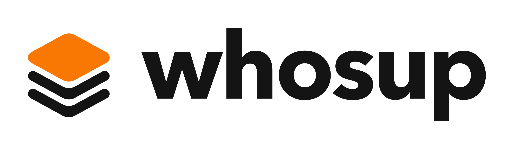
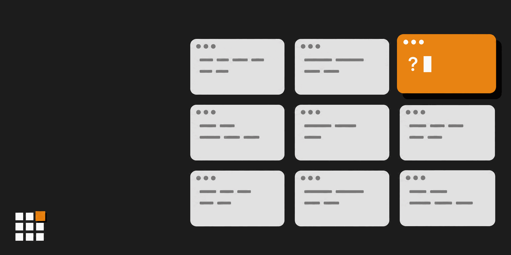
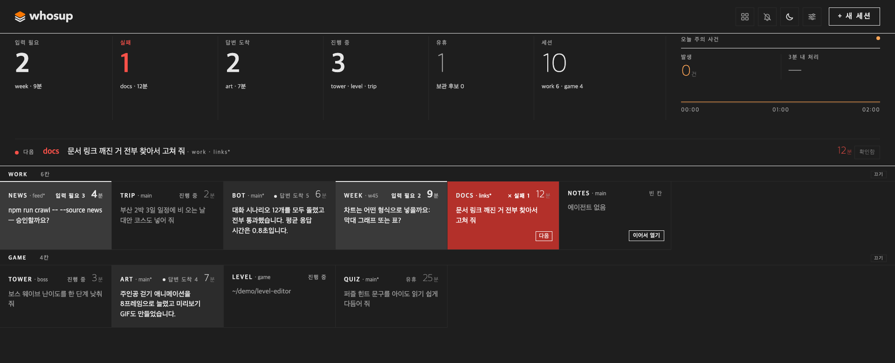
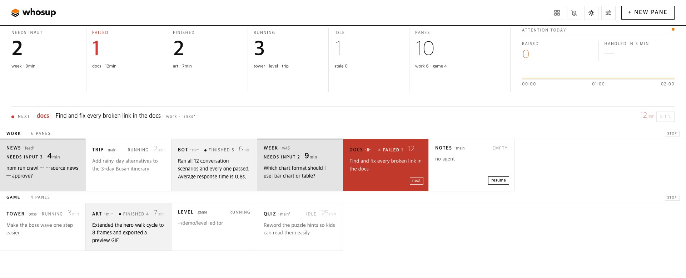

[English](README.md) | 한국어 | [日本語](README.ja.md) | [中文](README.zh.md) | [Español](README.es.md)

# whosup (후즈업)

<p align="center">
  <picture>
    <source media="(prefers-color-scheme: dark)" srcset="assets/logo-dark.png">
    
  </picture>
</p>

> **더 이상 세션 방치하지 마세요.** herdr의 모든 세션을 한눈에 보는 세션 관리 플러그인, whosup.

[herdr](https://herdr.dev) 칸에 코딩 에이전트를 여섯, 열, 열다섯 개 띄워 놓고 일하다 보면 어떤 칸은 돌고 있고, 어떤 칸은 한 시간 전에 끝났고, 어떤 칸은 내가 못 본 권한 질문에서 멈춰 있습니다. whosup은 실행 중인 모든 herdr 세션의 모든 칸을 브라우저 한 페이지에 모읍니다. 입력이 필요한 칸, 방금 끝난 칸, 아직 도는 칸, 조용해진 칸. 칸을 누르면 herdr가 그 칸으로 이동합니다.

<p align="center">
  
</p>

[빠른 시작](#빠른-시작) • [왜 whosup인가](#왜-whosup인가) • [화면 구성](#화면-구성) • [동작 원리](#동작-원리) • [기능](#기능) • [설정](#설정) • [환경별 설정](#환경별-설정) • [요구 사항](#요구-사항)

---

## 빠른 시작

### 1. herdr 플러그인 설치

```bash
herdr plugin install fivetaku/whosup --yes
```

### 2. 시작 (또는 herdr 재시작)

```bash
herdr plugin action invoke fivetaku.whosup.start
```

`http://127.0.0.1:4790`에 상황판이 뜨고 브라우저가 한 번 열립니다. 이후로는 herdr가 켜질 때 같이 켜집니다.

### 3. herdr 세션은 원할 때 더 열면 됩니다

```bash
herdr --session work      # 이름 자유, 터미널 자유
```

실행 중인 세션은 모두 상황판에 저절로 나타납니다. 따로 등록할 목록이 없습니다.

### 윈도우에서

같은 플러그인이 윈도우에서도 돕니다. 액션 이름 앞에 `win-`이 붙습니다(`win-start`, `win-doctor`, …). [윈도우](#윈도우)를 보세요.

---

## 왜 whosup인가

- **칸을 돌아다니며 확인하지 않아도 됩니다.** 상단 띠가 입력 필요·실패·답변 도착·진행 중 칸 수를 알려 주고, "다음" 줄이 가장 먼저 볼 칸 하나와 그 칸이 묻고 있는 질문을 보여 줍니다.
- **한 번 누르면 그 칸입니다.** 칸을 누르면 herdr가 어느 세션 어느 탭이든 그 칸으로 포커스를 옮깁니다. macOS에서는 터미널 앱도 앞으로 가져올 수 있습니다.
- **재부팅해도 대화가 끊기지 않습니다.** herdr는 재부팅 뒤 칸은 복원하지만 에이전트는 비어 있습니다. 빈 칸에는 **이어서 열기** 버튼이 붙어, 그 폴더의 최근 Claude Code 대화를 찾아 `AGENT_CMD --resume <id>`를 실행합니다. 이어서 열기는 Claude Code 대화 기록만 읽습니다. 다른 에이전트는 새 대화로 시작합니다.
- **색에 뜻이 있습니다.** 기본은 흑백, 다음에 볼 한 칸만 오렌지, 실패만 빨강. 계속 깜빡이는 것은 없습니다.
- **다른 창에 있어도 알려 줍니다.** 탭 제목에 기다리는 칸 수가 `(3) whosup`처럼 뜨고, 파비콘의 오렌지 칸이 켜집니다. 방금 손을 든 칸에는 오렌지 테두리가 한 번 지나갑니다. 헤더의 정렬 버튼은 **자리순**과 **방치순**을 오갑니다. 방치순이면 오래 기다린 칸이 데스크마다 앞으로 모입니다. 헤더의 **알림**을 켜면 데스크톱 알림이 오고, 누르면 그 칸으로 바로 갑니다.
- **기다리는 칸을 잃지 않습니다.** 나를 기다리는 칸은 처리할 때까지 판에 남습니다. 자정을 넘겨도, 재시작해도, herdr가 잠깐 응답하지 않아도 그대로입니다. **확인함**은 30분만 미루고, 그 뒤에도 기다리고 있으면 다시 올라옵니다. 닫힌 칸은 7일 동안, **보관**한 칸은 되돌릴 때까지 **최근 닫힘** 줄에 남고, 거기서 이어서 열거나 되돌릴 수 있습니다. 보관한 칸이 다시 움직이면 저절로 돌아옵니다. 늘 보는 칸은 맨 위 고정 줄에 핀으로 꽂아 둡니다.
- **모르면 모른다고 합니다.** herdr에 닿지 못하면 헤더에 *연결 끊김 · 마지막 수집 HH:MM*이 뜨고, 탭 제목은 `(!) whosup`, 파비콘은 회색이 됩니다. 조용히 낡은 화면을 보여 주지 않습니다.
- **라이트·다크·언어.** 모드(자동 / 라이트 / 다크)는 헤더 버튼으로, 언어(English / 한국어)는 **설정** 패널에서 바꿉니다. 팔레트는 실제 IDE 테마 값을 따르고 글자 대비는 WCAG AA를 지킵니다.

---

## 화면 구성

<p align="center">
  <br>
  
</p>

| 영역 | 뜻 |
|---|---|
| **상태 띠** | 입력 필요 · 실패 · 답변 도착 · 진행 중 · 유휴 칸 수와 전체 칸 수(세션), 오늘 주의 사건 수와 3분 내 처리율. 숫자를 누르면 그 상태만 봅니다. |
| **다음 줄** | 가장 먼저 볼 칸 하나와 이유. 기다리는 질문, 실패, 또는 도착한 답변. |
| **데스크** | herdr 세션마다 한 줄(데스크), 칸 순서대로 한 칸씩. 칸 머리: 라벨 · git 브랜치(브랜치가 없으면 세션 이름) · 상태. 공통 순번에서 앞의 기다리는 칸 아홉 개에는 1~9 번호가 붙음(예 `입력 필요 3`, 3을 누르면 그 칸으로) · 기다린 시간(진행 중·유휴 칸은 마지막 요청 뒤 지난 시간) · 실패 종류(예 사용량 한도)와 *확인 불가* 꼬리표. 그 아래 한 줄 맥락. |
| **칸의 한 줄** | 에이전트가 묻는 질문(권한 상자, 폴더 신뢰 확인, A/B 선택), 마지막 문장, 또는 내가 마지막으로 한 요청. 상태에 따라 가장 필요한 것 하나. |
| **이어서 열기** | 재부팅 뒤 빈 칸에서 그 폴더의 최근 대화를 이어 엽니다. |
| **+ 새 세션** | 세션과 폴더를 고르면 거기에 탭을 만들고 에이전트를 띄운 뒤 포커스를 옮깁니다. |

---

## 동작 원리

```
herdr 세션 (main, side, …)
   └─ 3초마다 pane list + agent list  ──►  whosup 수집기  ──►  SQLite (node:sqlite)
                                                                   │
브라우저  ◄──  http://127.0.0.1:4790  ◄──  보드 서버  ◄─────────────┘
   │
   └─ 클릭  ──►  herdr 소켓으로 pane.focus  ──►  그 칸
```

Node 프로세스 하나, 빌드 없음. herdr의 startup 훅은 한 번 실행되는 명령입니다. herdr가 켜질 때 whosup을 백그라운드 서버로 띄우고 끝납니다. 그 뒤 서버는 혼자 계속 돌고, herdr가 관리하거나 꺼 주지 않습니다. 끄려면 `stop` 액션을 씁니다. 칸 상태는 herdr의 에이전트 감지(working / blocked / done / idle)에서, 질문 원문은 칸 화면에서, 마지막 요청은 Claude Code 대화 기록(`~/.claude/projects` 또는 `CLAUDE_PROJECTS_DIR`)에서 읽습니다. 다른 에이전트가 도는 칸에는 마지막 요청이 나오지 않고, 이어서 열기는 새 대화로 시작합니다. 수집기는 herdr의 이벤트도 듣습니다. 칸 상태가 바뀌면 다음 3초 수집을 기다리지 않고 바로 수집하고, 열려 있는 상황판 탭에 곧바로 알립니다. 이벤트를 받을 수 없어도 3초 수집은 그대로 돕니다.

**신뢰 모델.** 서버는 127.0.0.1에만 열리고 로그인이 없습니다. 다른 사이트에서 온 브라우저의 변경 요청은 거절하지만(변경은 상황판 자신의 주소에서 JSON으로 보낸 것만 받습니다), 같은 컴퓨터에서 도는 프로그램은 누구나 API를 쓸 수 있습니다. 이어서 열기·새 세션 때 whosup이 칸에 입력하는 명령인 `AGENT_CMD` 같은 설정도 바꿀 수 있습니다. 포트를 다른 사람에게 열지 마세요. 서버는 `Host` 헤더가 `127.0.0.1`, `localhost`, `[::1]`이 아닌 요청에 403 `local only`로 답합니다. 그래서 공개 호스트 이름을 넘기는 터널(Tailscale Serve, cloudflared, ngrok)로는 상황판을 아예 열 수 없습니다. 내 다른 기기에서 보려면 `ssh -L 4790:127.0.0.1:4790 <host>`처럼 localhost 호스트를 유지하는 포트 포워딩을 쓰고 `http://localhost:4790`을 연 뒤, 서버는 `WHOSUP_READONLY=1`로 띄웁니다. 읽기 전용은 변경을 막을 뿐 보기를 막지 않습니다. 홈 아래 폴더 목록은 내주지 않지만 상황판에 나오는 것은 다 보입니다. 칸 툴팁의 폴더 경로, 마지막 요청, 질문 원문이 그렇고, `GET /api/settings`는 여전히 `agent_cmd`를 돌려줍니다.

---

## 기능

| 기능 | 설명 |
|---|---|
| 자동 감지 | 실행 중인 모든 herdr 세션과 칸, 설정 없음 |
| 주의 상태 | 입력 필요 · 실패 · 답변 도착 · 진행 중 · 유휴 · 빈 칸 |
| 질문 추출 | 권한 상자, 폴더 신뢰 확인, "A 또는 B?" 질문을 원문 그대로 |
| 이동 | 클릭 → `pane.focus`, macOS에서는 그 세션을 보여 주는 터미널 창이 앞으로 옵니다. 터미널 앱은 자동으로 찾고, 그 세션을 보여 주는 창이 없으면 새 창을 엽니다(Ghostty, Terminal) |
| 칸을 누르면 열 곳 | **설정** → *칸을 누르면 열 곳*: 터미널 창(기본), 웹 주소, 둘 다 중에서 고르고 브라우저마다 따로 저장됩니다. 웹 주소는 herdr용 웹 터미널에서 그 칸을 새 탭으로 엽니다. 주소의 `{session}`, `{pane}` 자리가 채워지고 herdr 세션마다 주소를 따로 적을 수 있습니다(웹 터미널은 보통 세션마다 서버가 따로 뜨고 포트가 다릅니다). Herdr 앱 줄은 그 줄에 적어 둔 주소가 있을 때만 웹으로 엽니다. 줄마다 탭 하나를 다시 쓰므로 그 탭은 연 보드와 연결된 채로 열립니다. 믿는 웹 터미널의 주소만 적으세요. 다른 기기에서 상황판을 쓸 때 고르세요. 읽기 전용 모드에서는 쓸 수 없습니다(읽기 전용은 칸 누르기를 모두 막습니다) |
| Herdr 앱 터미널 | 이 컴퓨터에서 herdr-core(Herdr 데스크톱 앱의 터미널)가 돌고 있으면 그 터미널도 칸으로 나옵니다. 앱의 공간마다 한 줄이고, 상태와 질문 문구는 코어가 알려 주는 그대로입니다. 칸을 누르면 Herdr 앱의 그 칸으로 가고 앱이 앞으로 옵니다. 앱이 열려 있지 않으면 터미널 창에서 그 터미널을 엽니다(`hc attach`). 닫기, 이어서 열기, 새 칸, 줄 끄고 켜기는 herdr 세션과 같습니다. 설정할 것이 없고, 꺼져 있는 코어를 whosup이 켜지 않습니다. 코어가 알리지 않는 폴더 신뢰 화면은 화면에서 읽어 입력 필요로 보여 줍니다. 그 밖의 상태는 화면으로 추측하지 않습니다 |
| 이어서 열기 | 그 칸의 대화, 없으면 다른 칸에서 살아 있지 않은 폴더 최근 대화 → `AGENT_CMD --resume`. 누르기 전에 어느 대화인지 보임. Claude Code 대화만 지원, 다른 에이전트는 새로 시작 |
| 새 세션 | 세션·폴더 선택, 에이전트 명령 실행 |
| 데스크(선택) | 모니터별 세션·칸을 `desks.json`에 선언, `desks-apply` 액션이 없는 것만 만듦 |
| 언어 | 기본은 English, 한국어는 **설정** 패널이나 `?lang=ko`로 선택 |
| 테마 | 자동 / 라이트 / 다크 (헤더 버튼, `?theme=`), IDE 팔레트 조사 기반 |
| 읽기 전용 | `WHOSUP_READONLY=1`이면 조작 버튼과 **+ 새 세션**을 숨기고 클릭·Enter·1~9·`n`·알림 클릭·설정 변경을 막으며(설정 패널에는 언어 선택만 나옴) 폴더 목록도 보여 주지 않음. 변경만 막고 보기는 막지 않음 — 신뢰 모델 참고 |
| 확인함 = 미루기 | 기다리는 칸의 **확인함**은 30분 동안만 숨기고, **확인 취소**로 바로 되돌림 |
| 고정 | 핀 고정한 칸은 정렬과 무관하게 모든 데스크 위 고정 줄에 |
| 보관·최근 닫힘 | 유휴 칸을 보관하고, 닫힌 칸은 7일, 보관한 칸은 되돌릴 때까지 **최근 닫힘**에 남음. 보관한 칸이 다시 움직이면 저절로 돌아옴 |
| 순번 하나 | 다음 줄·Enter·1~9·알림·방치순이 같은 순서를 씀: 실패 → 입력 필요 → 답변 도착, 오래 기다린 순 |
| 키보드 | `n`(한글 자판이면 `ㅜ`)은 새 세션 · Tab으로 칸을 옮기고 Enter나 Space로 포커스한 칸을 엶 · 포커스한 칸이 없으면 Enter는 다음 칸으로 이동, 패널이 열려 있으면 저장·열기 · 1~9는 번호 붙은 칸으로 이동 · Esc는 패널 닫기. 입력 칸에 글을 쓰는 동안 `n`과 1~9는 무시 |
| 재알림 | 처리 안 된 칸은 15분마다 최대 4회 다시 알림, 처리되면 알림을 닫음 |
| macOS 알림(선택) | 탭이 닫혀 있어도 서버가 macOS 알림을 보냄 — 기본 끔 |
| 화면 나눠 쓰기(선택, macOS) | 칸을 누르면 보드를 화면 왼쪽에, 터미널을 나머지에 붙임(`split_pct`). 기본 끔, 손쉬운 사용 권한 필요 |
| 정직한 상태 | 헤더에 마지막 수집 시각, 수집이 멈추면 *연결 끊김*, 조회 못 한 세션의 칸은 남기고 *확인 불가* 표시 |
| 설정 패널 | 헤더 **설정**: 미루기·재알림 간격과 횟수·닫힘 판정·끊김 경고·보관 기간·보관 후보 기준·macOS 알림·확인 불가 판정 시간·화면 나눠 쓰기·실행 명령·칸을 누르면 열 곳(이 브라우저만)·터미널 앱. 읽기 전용이면 언어 선택만 나옴 |

### 플러그인 액션

| 액션 | 하는 일 |
|---|---|
| `fivetaku.whosup.start` | 상황판 시작 (herdr 시작 때도 실행) |
| `fivetaku.whosup.stop` | 정지 |
| `fivetaku.whosup.status` | URL(포트), PID |
| `fivetaku.whosup.open` | 브라우저로 열기 |
| `fivetaku.whosup.desks-apply` | `desks.json`대로 세션·칸 생성 |
| `fivetaku.whosup.desks-status` | 선언 vs 실제 칸 비교 |
| `fivetaku.whosup.autoconf` | 이 컴퓨터를 다시 확인해 자동 감지 값을 갱신하고 보여 줌([값의 출처와 자동 세팅](#값의-출처와-자동-세팅) 참고) |
| `fivetaku.whosup.win-*` | 윈도우용 같은 액션(`win-start`·`win-stop`·`win-status`·`win-open`·`win-desks-apply`·`win-desks-status`·`win-autoconf`)과 `win-doctor` |

---

## 설정

플러그인 설정 폴더(`herdr plugin config-dir fivetaku.whosup`, herdr 밖에서 돌리면 `~/.config/whosup`)의 `.env`에 `KEY=value` 줄을 넣습니다. 이 파일은 `start`가 서버를 띄울 때만 읽으므로, 바꾼 뒤에는 `stop` 액션을 실행하고 다시 `start`를 실행합니다. 여기 적은 값은 자동 세팅보다 먼저이고, 설정 패널은 둘보다 먼저입니다([값의 출처와 자동 세팅](#값의-출처와-자동-세팅) 참고). `desks-apply` 액션은 `.env`를 읽지 않고, 에이전트 명령을 `desks.json`의 `agent_cmd`에서 가져옵니다.

| 키 | 기본값 | 뜻 |
|---|---|---|
| `PORT` | 4790 | 사용 중이면 다음 빈 포트 |
| `OPEN_BROWSER` | 1 | herdr 시작 때 탭 한 번 열기 |
| `AGENT_CMD` | claude | 이어서 열기·새 세션이 쓰는 명령. 래퍼를 쓰면 여기에. **설정** 패널에서 바꾼 값이 우선 |
| `FRONT_APP` | 자동 | 이동 때 앞으로 가져올 macOS 터미널 앱, 예 `Ghostty`. 비워 두면 자동 세팅이 고르고([규칙표](#값의-출처와-자동-세팅)의 레인 L4), 떠 있는 창이 없으면 Terminal로 새 창을 엽니다. 윈도우에서는 비우면 자동(Windows Terminal이 있으면 그것, 없으면 PowerShell 창), `PowerShell`, `Windows Terminal`, 또는 `off`(아무 값이나 받음). **설정** 패널에서 바꾸면 재시작 없이 적용됩니다 |
| `STALE_DAYS`(또는 `WHOSUP_STALE_DAYS`) | 3 | 이 일 수 동안 조용하면 보관 후보 |
| `WHOSUP_READONLY` | 0 | 1이면 읽기 전용: 변경 불가, 폴더 목록 안 보임 |
| `WHOSUP_SEEN_SNOOZE_MIN` · `WHOSUP_RENOTIFY_MIN` · `WHOSUP_RENOTIFY_MAX` · `WHOSUP_GONE_MISSES` · `WHOSUP_STALE_COLLECT_SEC` · `WHOSUP_CLOSED_KEEP_DAYS` · `WHOSUP_OS_NOTIFY` · `WHOSUP_UNREACHABLE_TTL_H` · `WHOSUP_SPLIT_PCT` | 30 · 15 · 4 · 3 · 30 · 7 · 0 · 24 · 0 | 시작값. 헤더 **설정** 패널에서 바꾼 값이 이 컴퓨터에서 우선 |
| `WHOSUP_INTERVAL` | 3 | 수집 간격(초) |
| `CLAUDE_PROJECTS_DIR` | `~/.claude/projects` | 이어서 열기·마지막 요청이 Claude Code 대화를 찾는 폴더 |
| `HERDR_BIN_PATH`(또는 `HERDR_BIN`) | 자동 | herdr 실행 파일 경로. 없으면 `/opt/homebrew/bin`, `/usr/local/bin`, `~/.local/bin`, `PATH` 순으로 찾음 |
| `WHOSUP_RUNTIMES` | auto | 읽을 대상: `auto`(herdr 세션과 herdr-core 터미널 중 있는 것 전부), `herdr`, `herdr-core` |
| `HC_SOCKET` | 자동 | herdr-core 소켓. 없으면 코어의 `core.lock`에서 읽음(`HC_SESSION`, `XDG_STATE_HOME`을 따름) |
| `WHOSUP_CLICK_TARGET` | terminal | 아직 고르지 않은 브라우저에서 칸을 누르면 열 곳: `terminal`, `web`, `both`. 첫 실행 카드가 정하고, **설정**의 *칸을 누르면 열 곳*이 브라우저마다 덮어씀 |
| `HERDR_APP_BIN` · `HERDR_APP_NAME` · `HC_BIN` | `herdr-app` · `Herdr` · `hc` | Herdr 앱 명령(이동, 새 탭, 공간 닫기), macOS에서 앞으로 올릴 앱 이름, herdr-core 터미널을 터미널 창에서 열 때 쓰는 명령 |

### 데스크(선택)

모니터마다 세션 하나처럼 고정 배치를 쓰고 싶으면 한 번 적어 두고 whosup이 만들게 합니다.

```json
{ "agent_cmd": "claude",
  "desks": [
    { "session": "main", "note": "왼쪽 모니터", "agent": true,
      "panes": [ { "label": "api", "cwd": "~/src/api" }, { "label": "web", "cwd": "~/src/web" } ] },
    { "session": "side", "panes": [ { "label": "notes", "cwd": "~/notes" } ] }
  ] }
```

위 내용을 플러그인 설정 폴더(`herdr plugin config-dir fivetaku.whosup`, herdr 밖에서 돌리면 `~/.config/whosup`)에 `desks.json`으로 저장하고 `herdr plugin action invoke fivetaku.whosup.desks-apply`를 실행합니다. 없는 것만 추가합니다. 세션마다 터미널은 원하는 자리에 열면 됩니다(`herdr --session main`).

### 에이전트 복원

herdr는 재부팅 뒤 에이전트를 스스로 다시 띄울 수 있습니다(`[session] resume_agents_on_restore`). 에이전트를 래퍼로 띄운다면 이 값을 `false`로 두고 whosup의 **이어서 열기**를 쓰세요. 그래야 래퍼가 쓰입니다.

---

## 환경별 설정

### Herdr 데스크톱 앱

whosup은 Herdr 데스크톱 앱의 터미널을 앱의 코어인 herdr-core를 통해 읽습니다. 아래가 갖춰져 있으면 따로 설정할 것이 없습니다.

- **이 컴퓨터에서 herdr-core가 돌고 있어야 합니다.** 코어는 소켓 경로를 `<state>/herdr-core/<session>/core.lock`에 적습니다(`<state>`는 `XDG_STATE_HOME`, 없으면 `~/.local/state`, 윈도우는 `%LOCALAPPDATA%`도 봄. `<session>`은 `HC_SESSION`, 없으면 `default`). `HC_SOCKET`을 주면 그 값이 먼저입니다. 소켓이 있는 동안 코어가 돌고 있다고 봅니다. whosup은 코어를 켜지 않습니다.
- **`herdr-app`이 `PATH`에 있어야 합니다**(또는 `HERDR_APP_BIN`). 이동·새 탭·공간 닫기가 이 명령을 씁니다. 없어도 카드는 읽습니다.
- **`hc`가 `PATH`에 있어야 합니다**(또는 `HC_BIN`). 앱 창이 열려 있지 않을 때 터미널 창에서 그 터미널을 엽니다.

자동 세팅(레인 L6)이 설치 때와 시작할 때마다 소켓과 `herdr-app`을 확인합니다. Herdr 앱 카드를 누르면 앱에서 그 터미널을 보여 주고 앱(`HERDR_APP_NAME`, 기본 `Herdr`)을 앞으로 올립니다. 앱 창이 없으면 터미널 창에서 `hc attach <terminal>`을 엽니다.

터미널이 보드에 나오지 않으면 확인할 것:

- `WHOSUP_RUNTIMES`가 `auto`(기본)이거나 `herdr-core`를 포함해야 합니다. `herdr`만 적으면 앱은 빠집니다.
- whosup에 `HC_SOCKET`·`HC_SESSION`·`XDG_STATE_HOME`을 줬다면 앱이 쓰는 코어와 같은 곳을 가리켜야 합니다.
- `node scripts/doctor.mjs`는 core 줄(소켓, 또는 *not running*), 찾아본 상태 폴더, `herdr-app`을 찾았는지를 보여 줍니다. `autoconf` 액션은 레인 L6과 그 근거를 보여 줍니다([값의 출처와 자동 세팅](#값의-출처와-자동-세팅) 참고).
- 윈도우에서 herdr-core가 named pipe로 듣는지는 아직 확인하지 못했습니다.

### ovis: 다른 기기·폰에서 칸 열기

[ovis](https://github.com/devswha/ovis)는 herdr용 웹 클라이언트입니다(채팅, 실시간 터미널, 폰 앱). whosup은 떠 있는 ovis를 찾아 주소를 채워 줄 뿐, ovis를 켜거나 끄지 않습니다.

```bash
herdr plugin install devswha/ovis --yes          # ovis INSTALL.md 기준
herdr plugin action invoke devswha.ovis.start
```

- herdr 플러그인으로 설치한 ovis는 herdr와 함께 `http://127.0.0.1:7317`에 뜨고, 자기를 띄운 herdr 세션의 소켓을 따라갑니다.
- ovis 서버 하나는 herdr 세션 하나를 봅니다. 다른 세션도 보려면 `PORT`와 `HERDR_SOCKET=~/.config/herdr/sessions/<이름>/herdr.sock`을 준 ovis 서버를 다른 포트로 하나 더 띄웁니다(ovis INSTALL.md의 Configuration). whosup은 7317~7330 포트를 봅니다.
- whosup은 설치 때와 시작할 때마다 이 포트들을 확인합니다(레인 L7). `GET /api/health?scope=bridge`가 ovis 고유 필드로 답할 때만 ovis로 봅니다. 세션은 그 포트를 듣는 프로세스의 `HERDR_SOCKET`(없으면 `HERDR_SESSION`)으로 알아냅니다(macOS는 `ps`, 리눅스는 `/proc`). herdr가 보여 주는 세션마다 `http://127.0.0.1:<port>/?pane={pane}` 주소를 채웁니다.
- 세션을 알 수 없으면(윈도우, herdr 목록에 없는 세션, 한 세션에 서버 둘) 아무것도 채우지 않고 그 포트를 "확인 필요"로 표시합니다. 그때는 **설정**에서 주소를 직접 적습니다.
- ovis가 있어도 클릭 기본은 터미널 창입니다. 보드를 처음 열면 감지한 환경을 보여 주는 카드가 뜨고, 세션과 맞춘 ovis가 있으면 칸을 누를 때 어디로 열지(터미널 창 / ovis / 둘 다) 묻습니다. 카드에서 고른 값은 서버에 저장되어(`click_target`) 모든 브라우저의 기본값이 됩니다. **설정** → *칸을 누르면 열 곳*은 그 브라우저에서만 선택과 주소를 바꾸고, 브라우저에 저장한 값이 있으면 그 값을 씁니다.

채워지는 주소는 `127.0.0.1`이라 ovis가 도는 컴퓨터에서 열립니다. 다른 기기에서는 그 포트도 함께 넘기거나(`ssh -L 4790:127.0.0.1:4790 -L 7317:127.0.0.1:7317 <host>`) **설정**에서 그 기기가 닿는 주소로 바꿉니다. 폰에서는 ovis 자체 앱과 릴레이를 씁니다(ovis README 참고). 보드에서 칸을 열려면 보드가 읽기 전용이 아니어야 합니다.

### 윈도우

whosup은 윈도우에서도 돕니다(Node와 PowerShell, `sh` 없음). 플러그인에 herdr가 `node`로 실행하는 윈도우 전용 항목이 있어서 설치·시작 방법은 같고, 액션 이름 앞에 `win-`이 붙습니다.

```powershell
herdr plugin install fivetaku/whosup --yes
herdr plugin action invoke fivetaku.whosup.win-start
herdr plugin action invoke fivetaku.whosup.win-doctor    # 이 PC를 읽기만 하는 점검
herdr plugin action invoke fivetaku.whosup.win-autoconf  # 자동 세팅이 감지한 것
```

손으로 띄우려면 whosup 폴더에서, **바탕화면 세션**에서 실행합니다(SSH로 띄우면 창이 보이지 않습니다).

```powershell
node scripts\doctor.mjs                 # Node·herdr·pipe·PowerShell·Windows Terminal·바탕화면 세션 점검
node scripts\launch.mjs start           # start 액션과 같음(status·stop·open도 있음)
# 또는 앞에서 바로. 설정은 PowerShell 변수로 넣습니다(VAR=값 꼴은 sh 문법이라 여기서는 안 됩니다).
$env:FRONT_APP='Windows Terminal'; node bin\whosup.mjs
```

- 자동 세팅은 설치 때(`launch.mjs preflight`)와 시작하기 전마다 돕니다. `wt.exe`가 `PATH`에 있으면 **Windows Terminal**을 고르고, 없으면 칸을 누를 때 PowerShell 창을 엽니다.
- SSH로 띄웠거나 윈도우 세션 0이면(서비스. `SESSIONNAME`을 보고, 없으면 프로세스의 세션 번호를 본다 — 바탕화면의 로그온 예약 작업은 `SESSIONNAME`이 없어도 바탕화면으로 본다) 원격으로 봅니다. 바탕화면에 아무것도 보이지 않으므로 브라우저를 열지 않고 창도 올리지 않습니다(*터미널 앱* = 끔). 창을 쓰려면 바탕화면 세션에서 띄웁니다.
- 칸을 누르면 그 세션을 보여 주는 터미널 창을 앞으로 올리고, 없으면 그 세션에 붙은 PowerShell 창을 새로 엽니다. 설정 패널의 *터미널 앱*에서 **자동**, **PowerShell**, **Windows Terminal**, **끔** 가운데 고를 수 있습니다(`FRONT_APP`도 됩니다).
- `node bin\whosup.mjs`는 `.env`를 읽지 않습니다. `launch.mjs`와 플러그인 액션은 읽습니다(`KEY=value` 줄만, 아무것도 실행하지 않음).
- Node 22.13 이상(윈도우용 [nodejs.org](https://nodejs.org), 또는 nvm-windows·Volta·fnm)이 `PATH`에, herdr가 `PATH`(또는 `HERDR_BIN_PATH`)에 있어야 합니다.
- 아직 윈도우 실기기에서 확인하지 못한 것: Herdr 데스크톱 앱(herdr-core)이 윈도우에서 named pipe로 듣는지, herdr가 시작 훅이 끝난 뒤에도 whosup을 살려 두는지. `win-doctor`가 둘 다 보여 줍니다. 윈도우에서는 ovis 포트는 찾지만 각 포트가 보는 세션은 알 수 없어 "확인 필요"로 표시합니다.

### 값의 출처와 자동 세팅

설정마다 이 순서로 처음 찾은 값을 씁니다: **설정 패널 > 환경변수(`.env` 포함) > 자동 감지 > 기본값.** 패널이나 환경변수로 사람이 정한 값은 자동 세팅이 절대 바꾸지 않고, 자동 세팅은 `.env`나 패널 값을 쓰지 않습니다.

- **설정 패널**: 이 컴퓨터의 whosup 데이터베이스에 저장되고 바로 적용됩니다. 칸을 비우면 다음 층의 값으로 돌아갑니다.
- **환경변수 / `.env`**: 플러그인 설정 폴더(`herdr plugin config-dir fivetaku.whosup`, herdr 밖에서는 `~/.config/whosup`)의 `.env`에 넣는 `KEY=value` 줄. `start`가 서버를 띄울 때만 읽으므로 고친 뒤에는 `stop`, 그다음 `start`를 실행합니다.
- **자동 감지**: 설치 때(build 훅)와 시작하기 전마다 다시 확인해 상태 폴더(herdr 플러그인 상태 폴더, herdr 밖에서는 `~/.config/whosup`)의 `auto.json`에 씁니다. 서버는 시작할 때 이 파일이 방금(같은 플랫폼, 2분 안) 쓰인 것이면 읽고, 아니면(`bin/whosup.mjs`를 직접 띄운 경우 등) 다시 감지해 새로 씁니다. 감지가 실패하면 자동 값 없이 시작합니다.

무엇을 감지했는지 보려면 `autoconf` 액션(윈도우는 `win-autoconf`)이나 whosup 폴더에서 `node scripts/autoconf.mjs`를 실행합니다(`--json`이면 JSON). 레인마다 값과 근거를 보여 주고, 환경변수가 이기는 값에는 표시를 붙입니다. 떠 있는 보드는 `GET /api/autoconf`에 답하고, `GET /api/settings`의 `origins`에 설정마다 출처가 있습니다.

| 레인 | 무엇을 확인 | 무엇으로 정함 | 어디서 바꿈 |
|---|---|---|---|
| L1 | 운영체제 | 보고만: herdr가 macOS·리눅스에서는 `sh` 항목을, 윈도우에서는 `node` 항목을 실행. 윈도우에서는 OS 알림 항목을 내지 않음 | — |
| L2 | Node 22.13 이상과 `node:sqlite` | 더 낮으면 설치가 안내와 함께 멈춤 | Node 업그레이드 |
| L3 | 바탕화면 세션 여부: SSH(`SSH_CONNECTION`·`SSH_TTY`), 세션 0인 윈도우(`SESSIONNAME` 없음·세션 번호 0), `DISPLAY`·`WAYLAND_DISPLAY` 없는 리눅스 | 원격이면 브라우저를 열지 않음(`OPEN_BROWSER` 0). 창 올리기도 끔(macOS·윈도우, `FRONT_APP` 값 `off`) | `OPEN_BROWSER`, `FRONT_APP`, *터미널 앱* |
| L4 | 터미널 앱. macOS: 지금 herdr를 보여 주는 앱, 없으면 설치된 Ghostty·iTerm·WezTerm·kitty. 윈도우: `PATH`의 `wt.exe`. 리눅스: 확인 안 함 | macOS: 그 세션을 보여 주는 창이 없을 때 새 창을 열 앱(누를 때는 그 세션을 보여 주는 앱을 올리고, 패널에는 *자동*으로 보임). 윈도우: 쓸 터미널. 못 찾으면 누를 때 herdr를 보여 주는 앱, 없으면 Terminal(macOS), PowerShell 창(윈도우) | *터미널 앱*, `FRONT_APP` |
| L5 | herdr: 실행 파일, 버전, 실행 중 세션 | 보고만. herdr가 있으면 herdr 세션을 읽음 | `HERDR_BIN_PATH`, `WHOSUP_RUNTIMES` |
| L6 | Herdr 데스크톱 앱: herdr-core 소켓, `herdr-app` 명령 | 보고만. 코어가 도는 동안 그 터미널을 읽음 | `WHOSUP_RUNTIMES`, `HC_SOCKET`, `HERDR_APP_*` |
| L7 | 127.0.0.1:7317~7330의 ovis와 서버마다 보는 herdr 세션 | 세션별 웹 주소. 클릭은 그대로 터미널 창 | 첫 실행 카드, *칸을 누르면 열 곳*과 세션별 주소 |
| L8 | `PATH`의 `claude`, 없으면 `codex`. Claude Code 대화 폴더 | 이어서 열기·새 세션에 쓸 에이전트 명령, 이어서 열기가 대화를 찾을 수 있는지 | **설정**의 실행 명령, `AGENT_CMD` |
| L9 | macOS 손쉬운 사용 권한(칸을 눌러 창을 올릴 때 확인) | 권한이 없으면 화면 나눠 쓰기를 쓸 수 없다고 표시 | 시스템 설정 → 개인정보 보호 및 보안 → 손쉬운 사용 |
| L10 | `PORT`(4790)부터 빈 포트 | 보고만. whosup이 스스로 다음 빈 포트로 감 | `PORT` |

---

## 요구 사항

- [herdr](https://herdr.dev) 0.9.0 이상. Herdr 데스크톱 앱의 터미널(herdr-core)도 돌고 있으면 함께 읽습니다. 둘 중 하나만 있어도 됩니다
- Node.js 22.13 이상(`node:sqlite`를 플래그 없이 씀). bun 없음, 빌드 없음
- curl(macOS·Linux에서 `start`·`status`·`open` 액션이 상태 확인에 씀. 윈도우는 Node의 `fetch`를 씀)
- macOS, Linux, 또는 Windows 10/11(PowerShell 5.1 이상, 바탕화면 세션에서 실행 — [윈도우](#윈도우) 참고)

---

## whosup이 아닌 것

터미널 미러링·채팅·폰에서 타이핑: [ovis](https://github.com/devswha/ovis). 칸반으로 에이전트 구동: herdr-board. whosup은 보고 이동하는 것만 합니다.

## 라이선스

MIT — [LICENSE](LICENSE) 참고.

---

<div align="center">

**한 번 보고, 나를 부르는 칸으로.**

</div>
