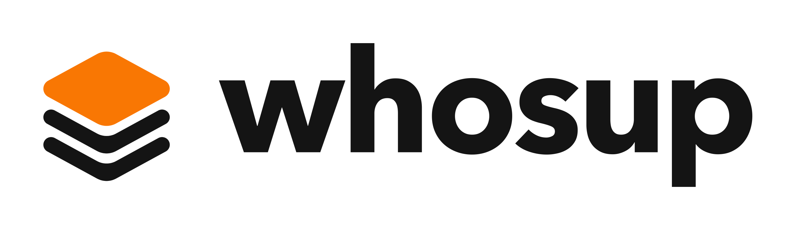
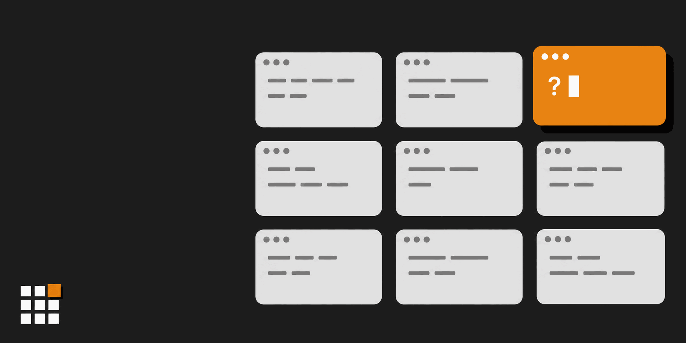
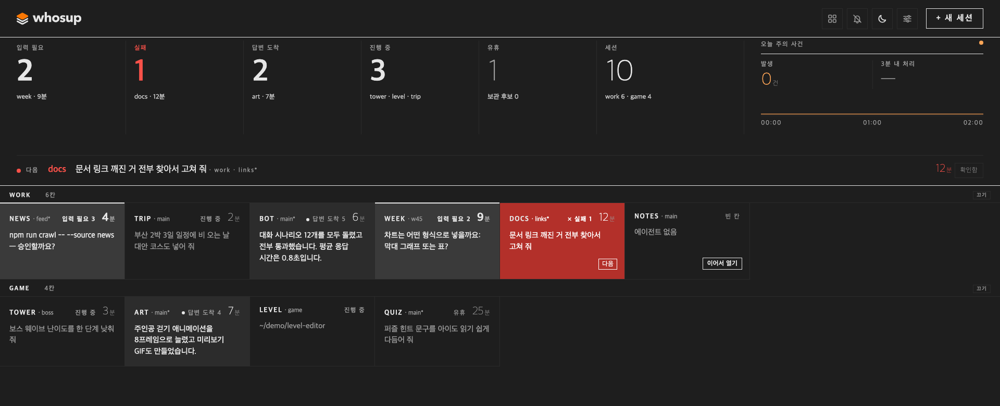
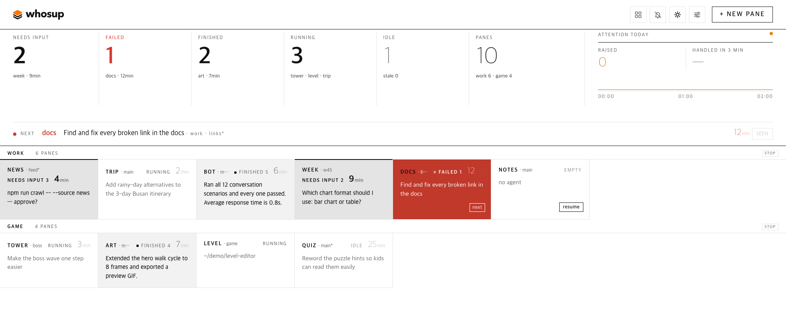

[English](README.md) | 한국어 | [日本語](README.ja.md) | [中文](README.zh.md) | [Español](README.es.md)

# whosup (후즈업)

<p align="center">
  <picture>
    <source media="(prefers-color-scheme: dark)" srcset="assets/logo-dark.png">
    
  </picture>
</p>

> **더 이상 세션 방치하지 마세요.** herdr의 모든 세션을 한눈에 보는 세션 관리 플러그인, whosup.

[herdr](https://herdr.dev) pane에 코딩 에이전트를 여섯, 열, 열다섯 개 띄워 놓고 일하다 보면 어떤 세션은 돌고 있고, 어떤 세션은 한 시간 전에 끝났고, 어떤 세션은 내가 못 본 권한 질문에서 멈춰 있습니다. whosup은 실행 중인 모든 데스크의 모든 세션을 브라우저 한 페이지에 모읍니다. 입력이 필요한 세션, 방금 끝난 세션, 아직 도는 세션, 조용해진 세션. 세션을 누르면 herdr가 그 세션으로 이동합니다.

whosup은 herdr의 pane 하나를 *세션*, herdr 세션 하나(또는 Herdr 앱 공간 하나)를 *데스크*라고 부릅니다.

<p align="center">
  
</p>

[빠른 시작](#빠른-시작) • [왜 whosup인가](#왜-whosup인가) • [화면 구성](#화면-구성) • [동작 원리](#동작-원리) • [기능](#기능) • [설정](#설정) • [환경별 설정](#환경별-설정) • [요구 사항](#요구-사항)

---

## 빠른 시작

### 1. 한 줄을 실행합니다

지금 무엇을 쓰고 있든 여기서 시작합니다. 아래 한 줄을 터미널에 붙여 넣고 Enter를 누르세요(macOS·Linux).

```bash
curl -fsSL https://raw.githubusercontent.com/fivetaku/whosup/main/install.sh | sh
```

설치기는 이 컴퓨터를 살펴보고 세 길 가운데 하나로 갑니다.

| 이 컴퓨터에 있는 것 | 설치기가 하는 일 |
|---|---|
| herdr 0.9.0 이상 | whosup을 herdr 플러그인으로 설치합니다. herdr를 켤 때마다 보드가 같이 뜹니다. |
| herdr는 없고 herdr-core가 있음: Herdr 데스크톱 앱, 또는 자기 herdr-core를 띄우는 다른 데스크톱 앱(오비스 데스크톱 앱 등) | herdr 없이 whosup만 설치합니다([단독 설치](#단독-설치-herdr-없이)). 보드가 바로 뜨고, 로그인할 때마다 다시 뜹니다. |
| 둘 다 없고 Herdr 앱·오비스 앱도 없음 | 세션을 어디에서 쓸지 묻고, 고른 것을 먼저 설치한 뒤(관리자 권한 없이) 거기에 맞춰 whosup을 설치합니다. |

**세션을 띄울 환경이 아직 하나도 없으면** 설치기가 번호로 두 번까지 묻습니다. 먼저 *데스크톱 앱*인지 *터미널*인지, 앱이면 *Herdr*인지 *Ovis*인지 묻습니다. 첫 질문의 *데스크톱 앱* 아래 설명 줄에 이 컴퓨터에 설치할 수 있는 앱의 이름(Herdr 또는 Ovis, 하나뿐이면 그 하나)이 나와, 첫 질문에서부터 보입니다. Enter만 치면 `*` 표시한 것으로 정합니다: 데스크톱 앱, 그다음 Herdr. 그런 다음 고른 것과 whosup을 함께 설치합니다.

| 고른 것 | 설치하는 것 | 설치할 수 있는 곳 |
|---|---|---|
| 데스크톱 앱 → Herdr (Enter, Enter) | Herdr 앱을 그 앱의 설치기로 설치하고, whosup을 [단독 설치](#단독-설치-herdr-없이)합니다 | 애플 실리콘 맥, x86_64·arm64 리눅스 |
| 데스크톱 앱 → Ovis | 오비스 앱을 릴리스 파일(약 175MB)로 받아 그 릴리스의 체크섬과(macOS에서는 서명도) 맞는지 확인한 뒤 놓고, whosup을 단독 설치합니다. macOS에서는 `~/Applications`에 놓습니다 | macOS 13 이상(애플 실리콘·인텔), x86_64·arm64 리눅스는 그 앱이 쓰는 데스크톱 라이브러리와 FUSE가 이미 있을 때만 |
| 터미널 | herdr를 `~/.local/bin`에 설치하고, whosup을 herdr 플러그인으로 설치합니다 | macOS, Linux |

이 컴퓨터에 설치할 수 없는 선택지는 보여 주지 않고(이유를 한 줄로 알립니다), 선택지가 하나만 남은 질문은 묻지 않습니다. Herdr 앱을 설치할 수 없는 컴퓨터에서는 앱이 Ovis가 되고, 두 앱 모두 설치할 수 없으면 herdr를 설치합니다. 묻지 않고 정하려면 `sh` 앞에 `WHOSUP_ENV=herdr-app`, `ovis-app`, `herdr` 중 하나를 붙입니다([설치기 옵션](#설치기-옵션) 참고). 고른 것을 설치하지 못하면 무엇이 안 됐는지와 직접 받는 곳을 알리고, whosup은 설치하지 않습니다. 이미 무엇인가 있는 컴퓨터에서는 이것을 묻지 않습니다. 위 표의 앞 두 줄이 전과 같이 적용됩니다.

Node 22.13 이상이 필요합니다. PATH 앞쪽에 낡은 Node가 있어도 괜찮습니다. 설치기가 PATH와 흔한 설치 위치(Homebrew, nvm, fnm)를 차례로 살펴 22.13 이상인 첫 Node를 씁니다. 하나도 없으면 아무것도 설치하지 않고 무엇을 하면 되는지 한 줄로 알려 줍니다. 다른 설치기(herdr, 앱)가 찍는 출력은 성공하면 한 줄로 접고 실패하면 전부 보여 줍니다. 끝에는 설치 요약을 찍습니다. 어느 길로 갔는지, 보드 주소, 다음에 할 일이 한 번씩 나옵니다. 보드는 `http://127.0.0.1:4790`에 뜨고, 4790이 사용 중이면 다음 빈 포트에 뜹니다. SSH로 접속했거나 `OPEN_BROWSER=0`이면 브라우저가 열리지 않으니 그 주소를 직접 여세요.

터미널에서 설치하면 이 컴퓨터에서 고를 것이 둘 이상인 항목만 묻습니다. 세션을 여는 곳이나 새 세션에서 실행할 명령 같은 것입니다. 질문마다 그것이 무엇을 정하는지 한 줄로 알려 줍니다. Enter만 치면 `*` 표시한 값(자동 감지 값)을 그대로 씁니다. 번호를 치면 그 값으로 정합니다. 질문에 모두 답하면(Enter도 답입니다) 보드가 같은 것을 다시 묻지 않습니다. 그 전에 끝나면(시간 초과·Ctrl-C) 보드를 처음 열 때 한 번 묻습니다(첫 실행 안내).

### 2. 그다음은 지금 쓰는 것에 따라 다릅니다

**herdr를 쓰는 사람.** whosup이 herdr 플러그인이 됩니다.

- herdr가 켜져 있으면 설치가 끝나자마자 보드가 뜨고 브라우저가 열립니다.
- herdr가 꺼져 있으면 설치 요약이 칠 것을 알려 줍니다: `herdr`. 보드가 같이 뜹니다. herdr가 있는 폴더가 PATH에 없으면 요약이 그 명령을 전체 경로로 적어 주므로 그대로 치면 됩니다.
- 한 줄 설치 대신 플러그인을 직접 설치해도 됩니다. 결과는 같습니다.

  ```bash
  herdr plugin install fivetaku/whosup --yes
  ```

이후로는 herdr를 켤 때마다 보드가 같이 켜집니다. 손으로 띄우려면 herdr 안의 터미널에서 아래를 실행합니다(herdr 밖의 터미널에서는 `herdr` 바로 뒤에 `--session <데스크 이름>`을 붙입니다).

```bash
herdr plugin action invoke fivetaku.whosup.start
```

**Herdr 데스크톱 앱이나 오비스 데스크톱 앱만 쓰는 사람(herdr 없음).** whosup만 단독으로 설치합니다. 다른 것은 설치하지 않습니다.

- 보드가 바로 뜨고 브라우저가 열립니다. 로그인할 때마다 다시 뜹니다.
- 터미널 앱은 묻지 않습니다. 앞으로 올릴 herdr 데스크의 터미널 창이 없기 때문입니다.
- *Herdr 앱 세션을 여는 곳*은 Herdr 앱 자신의 코어가 있을 때만 묻습니다.
- 자기 코어를 띄우는 앱(오비스 데스크톱 앱 등)의 세션도 보드에 보입니다. 설치가 그 사실을 한 줄로 알려 줍니다. 예: `<앱>의 세션도 보드에 보입니다.` 앱이 켜져 있는 동안 보드에서 새 세션을 열고, 닫고, 다시 열 수 있습니다. 세션을 누르면 그 앱이 `ovis://` 링크를 알 때(그 링크가 있는 오비스 버전 — 아직 나오지 않음)는 앱 창에서 그 세션을 보여 주고, 아니면 브라우저 탭으로 엽니다. 그런 앱에는 어느 세션을 보일지 밖에서 알려 줄 수 없기 때문입니다. [자기 코어를 띄우는 앱](#자기-코어를-띄우는-앱)을 보세요.
- 앱이 켜져 있지 않아도 됩니다. 이 컴퓨터에서 그 앱을 쓴 적이 있으면 설치기는 같은 길로 갑니다. 앱을 켜면 그 세션이 보드에 보입니다.
- 그 뒤로는 `whosup` 명령을 씁니다: `whosup start`, `whosup stop`, `whosup update` 등. [단독 설치](#단독-설치-herdr-없이)를 보세요.

**아무것도 없는 사람.** 설치기가 무엇을 쓸지 묻고(위 표), 그것을 설치한 뒤 whosup을 설치합니다.

- *데스크톱 앱*(Herdr 앱 또는 오비스 앱): whosup을 단독으로 설치하고 보드가 뜹니다. 앱은 한 번 열어야 그 세션이 보드에 보입니다. 브라우저를 열어 주는 설치에서는 설치기가 앱도 열어 주고, 아니면 설치 요약이 앱을 열라고 알려 줍니다. 앱의 첫 화면을 마친 뒤 보드에서 새 세션을 여세요.
- *터미널*(herdr): whosup이 herdr 플러그인이 됩니다. 설치 요약이 herdr를 켜라고 알려 주고, 켜면 보드가 같이 뜹니다. `~/.local/bin`이 PATH에 없으면 요약이 그 명령을 전체 경로로 적어 주므로 지금 터미널에서 그대로 치면 되고, 새로 여는 터미널부터 쓸 수 있게 그 폴더를 PATH에 넣는 한 줄도 찍어 줍니다.
- 설치기가 깔아 준 앱은 whosup이 지우지 않습니다. `whosup uninstall`이 그 사실과 앱의 위치를 한 줄로 알려 줍니다.

**에이전트에게 설치를 시키는 사람.** 에이전트에게 같은 한 줄을 실행하라고 하면 됩니다.

- 물어볼 터미널이 없으니 아무것도 묻지 않습니다. 보드를 처음 열 때 한 번 묻습니다.
- 세션을 띄울 환경이 하나도 없는 컴퓨터에서는 묻지 않고 기본값을 설치합니다: Herdr 앱(Herdr 앱을 설치할 수 없으면 오비스 앱, 둘 다 안 되면 herdr). 다른 것을 쓰려면 `WHOSUP_ENV`로 정합니다.
- 설치 요약이 명령 출력에 남으므로 에이전트가 보드 주소와 다음 할 일을 전해 줄 수 있습니다.
- 터미널에서 돌린 스크립트는 여전히 묻습니다. 질문을 건너뛰려면 `WHOSUP_NO_SETUP=1`을 붙입니다: `curl -fsSL https://raw.githubusercontent.com/fivetaku/whosup/main/install.sh | WHOSUP_NO_SETUP=1 sh`

한 줄을 다시 실행해도 길이 바뀌지 않습니다. herdr 플러그인으로 설치돼 있으면 그대로 두고(업데이트하는 법을 요약이 알려 줍니다), 단독 설치가 있으면 그 자리에서 새 버전으로 바꿉니다.

첫 세션을 열기까지 알아 둘 것:

- **macOS 권한.** 보통은 권한 창이 뜨지 않습니다. 최소화한 창을 펼칠 때와 화면 나눠 쓰기를 쓸 때만 손쉬운 사용·자동화 권한이 필요하고, 권한을 켠 뒤에는 whosup을 다시 켜야 반영됩니다. [기능](#기능) 표의 *이동*을 보세요.
- **macOS와 폴더.** 새 세션의 폴더로 데스크톱·문서·다운로드 안의 폴더를 고르면 macOS가 그 앱이 폴더에 접근해도 되는지 묻습니다. 허용하거나 다른 폴더를 고르세요.
- **Claude Code의 폴더 신뢰 질문**은 커서가 "No, exit"에 놓인 채로 뜹니다. 아래로 내려 "Yes, I trust this folder"를 고른 뒤 Enter를 누르세요. Claude Code의 화면이라 whosup이 바꿀 수 없습니다.
- **herdr와 Herdr 앱은 처음 켤 때 영어 환영 화면**을 보여 줍니다. 그 프로그램들의 화면이니 Enter를 눌러 넘어가면 됩니다.
- **한글 글자 사이가 벌어져 보이는 것**은 일부 터미널 앱(macOS 기본 터미널 등)이 글꼴을 그리는 방식 때문입니다. whosup이 찍는 글에는 여분의 공백이 없습니다.

### 3. 데스크는 원할 때 더 열면 됩니다(herdr)

```bash
herdr --session work      # 이름 자유, 터미널 자유
```

실행 중인 데스크는 모두 보드에 저절로 나타납니다. 따로 등록할 목록이 없습니다.

### 윈도우에서

한 줄 설치기와 단독 설치는 윈도우에서 돌지 않습니다. 윈도우에서는 herdr 플러그인으로 설치합니다.

```powershell
herdr plugin install fivetaku/whosup --yes
```

윈도우에서는 설치 때 묻지 않고(herdr가 설치 단계를 보이지 않는 콘솔에서 돌립니다), 보드를 처음 열 때 첫 실행 안내가 묻습니다. 액션 이름 앞에 `win-`이 붙습니다(`win-start`, `win-doctor`, …). [윈도우](#윈도우)를 보세요.

---

## 왜 whosup인가

- **세션을 돌아다니며 확인하지 않아도 됩니다.** 상단 띠가 입력 필요·실패·답변 도착·진행 중 세션 수를 알려 주고, "다음" 줄이 가장 먼저 볼 세션 하나와 그 세션이 묻고 있는 질문을 보여 줍니다.
- **한 번 누르면 그 세션입니다.** 세션을 누르면 herdr가 어느 데스크 어느 탭이든 그 세션으로 포커스를 옮깁니다. macOS에서는 터미널 앱도 앞으로 가져올 수 있습니다.
- **재부팅해도 대화가 끊기지 않습니다.** herdr는 재부팅 뒤 세션은 복원하지만 에이전트는 비어 있습니다. 빈 세션에는 **이어서 열기** 버튼이 붙어, 그 폴더의 최근 Claude Code 대화를 찾아 `AGENT_CMD --resume <id>`를 실행합니다. 이어서 열기는 Claude Code 대화 기록만 읽습니다. 다른 에이전트는 새 대화로 시작합니다. 이어 갈 대화가 없는 빈 세션에는 그 자리에 **에이전트 시작** 버튼이 나옵니다.
- **색에 뜻이 있습니다.** 기본은 흑백, 다음에 볼 한 세션만 오렌지, 실패만 빨강. 계속 깜빡이는 것은 없습니다.
- **다른 창에 있어도 알려 줍니다.** 탭 제목에 기다리는 세션 수가 `(3) whosup`처럼 뜨고, 파비콘의 오렌지 네모가 켜집니다. 방금 손을 든 세션에는 오렌지 테두리가 한 번 지나갑니다. 헤더의 정렬 버튼은 **자리순**과 **방치순**을 오갑니다. 방치순이면 오래 기다린 세션이 데스크마다 앞으로 모입니다. 헤더의 **알림**을 켜면 데스크톱 알림이 오고, 누르면 그 세션으로 바로 갑니다.
- **기다리는 세션을 잃지 않습니다.** 나를 기다리는 세션은 처리할 때까지 판에 남습니다. 자정을 넘겨도, 재시작해도, herdr가 잠깐 응답하지 않아도 그대로입니다. **확인함**은 30분만 미루고, 그 뒤에도 기다리고 있으면 다시 올라옵니다. 닫힌 세션은 7일 동안, **보관**한 세션은 되돌릴 때까지 **최근 닫힘** 줄에 남고, 거기서 이어서 열거나 되돌릴 수 있습니다. 보관한 세션이 다시 움직이면 저절로 돌아옵니다. 늘 보는 세션은 맨 위 고정 줄에 핀으로 꽂아 둡니다.
- **모르면 모른다고 합니다.** herdr에 닿지 못하면 헤더에 *연결 끊김 · 마지막 수집 HH:MM*이 뜨고, 탭 제목은 `(!) whosup`, 파비콘은 회색이 됩니다. 조용히 낡은 화면을 보여 주지 않습니다.
- **라이트·다크·언어.** 모드(자동 / 라이트 / 다크)는 헤더 버튼으로, 언어(기본 English, 한국어)는 첫 실행 안내와 **설정**의 EN / 한 단추로 바꿉니다. 팔레트는 실제 IDE 테마 값을 따르고 글자 대비는 WCAG AA를 지킵니다.

---

## 화면 구성

<p align="center">
  <br>
  
</p>

| 영역 | 뜻 |
|---|---|
| **상태 띠** | 입력 필요 · 실패 · 답변 도착 · 진행 중 · 유휴 세션 수와 전체 세션 수, 오늘 주의 사건 수와 3분 내 처리율. 숫자를 누르면 그 상태만 봅니다. |
| **다음 줄** | 가장 먼저 볼 세션 하나와 이유. 기다리는 질문, 실패, 또는 도착한 답변. 에이전트가 도는 세션이 하나도 없으면 다음에 할 일을 대신 보여 줍니다: 새 세션을 여세요. |
| **데스크** | 데스크마다 한 줄, 세션 순서대로 하나씩. 세션 머리: 라벨 · git 브랜치(브랜치가 없으면 데스크 이름) · 상태. 공통 순번에서 앞의 기다리는 세션 아홉 개에는 1~9 번호가 붙음(예 `입력 필요 3`, 3을 누르면 그 세션으로) · 기다린 시간(진행 중·유휴 세션은 마지막 요청 뒤 지난 시간) · 실패 종류(예 사용량 한도)와 *확인 불가* 꼬리표. 그 아래 한 줄 맥락. |
| **세션의 한 줄** | 에이전트가 묻는 질문(권한 상자, 폴더 신뢰 확인, A/B 선택), 마지막 문장, 또는 내가 마지막으로 한 요청. 상태에 따라 가장 필요한 것 하나. |
| **이어서 열기** | 재부팅 뒤 빈 세션에서 그 폴더의 최근 대화를 이어 엽니다. 이어 갈 대화가 없으면 버튼 이름이 **에이전트 시작**이고 새 대화로 시작합니다. |
| **+ 새 세션** | 데스크와 폴더를 고르면(목록에서 폴더에 들어가면 그 폴더가 골라집니다) 거기에 탭을 만들고 에이전트를 띄운 뒤 포커스를 옮깁니다. |

---

## 동작 원리

```
herdr 세션 = 데스크 (main, side, …)
   └─ 3초마다 pane list + agent list  ──►  whosup 수집기  ──►  SQLite (node:sqlite)
                                                                   │
브라우저  ◄──  http://127.0.0.1:4790  ◄──  보드 서버  ◄─────────────┘
   │
   └─ 클릭  ──►  herdr 소켓으로 pane.focus  ──►  그 세션
```

Node 프로세스 하나, 빌드 없음. herdr의 startup 훅은 한 번 실행되는 명령입니다. herdr가 켜질 때 whosup을 백그라운드 서버로 띄우고 끝납니다. 그 뒤 서버는 혼자 계속 돌고, herdr가 관리하거나 꺼 주지 않습니다. 끄려면 `stop` 액션을 씁니다. 세션 상태는 herdr의 에이전트 감지(working / blocked / done / idle)에서, 질문 원문은 세션 화면에서, 마지막 요청은 Claude Code 대화 기록(`~/.claude/projects` 또는 `CLAUDE_PROJECTS_DIR`)에서 읽습니다. 다른 에이전트가 도는 세션에는 마지막 요청이 나오지 않고, 이어서 열기는 새 대화로 시작합니다. 수집기는 herdr의 이벤트도 듣습니다. 세션 상태가 바뀌면 다음 3초 수집을 기다리지 않고 바로 수집하고, 열려 있는 상황판 탭에 곧바로 알립니다. 이벤트를 받을 수 없어도 3초 수집은 그대로 돕니다.

**신뢰 모델.** 서버는 127.0.0.1에만 열리고 로그인이 없습니다. 다른 사이트에서 온 브라우저의 변경 요청은 거절하지만(변경은 상황판 자신의 주소에서 JSON으로 보낸 것만 받습니다), 같은 컴퓨터에서 도는 프로그램은 누구나 API를 쓸 수 있습니다. 이어서 열기·새 세션 때 whosup이 세션에 입력하는 명령인 `AGENT_CMD` 같은 설정도 바꿀 수 있습니다. 포트를 다른 사람에게 열지 마세요. 서버는 `Host` 헤더가 `127.0.0.1`, `localhost`, `[::1]`이 아닌 요청에 403 `local only`로 답합니다. 그래서 공개 호스트 이름을 넘기는 터널(Tailscale Serve, cloudflared, ngrok)로는 상황판을 아예 열 수 없습니다. 내 다른 기기에서 보려면 `ssh -L 4790:127.0.0.1:4790 <host>`처럼 localhost 호스트를 유지하는 포트 포워딩을 쓰고 `http://localhost:4790`을 연 뒤, 서버는 `WHOSUP_READONLY=1`로 띄웁니다. 읽기 전용은 변경을 막을 뿐 보기를 막지 않습니다. 홈 아래 폴더 목록은 내주지 않지만 상황판에 나오는 것은 다 보입니다. 세션 툴팁의 폴더 경로, 마지막 요청, 질문 원문이 그렇고, `GET /api/settings`는 여전히 `agent_cmd`를 돌려줍니다.

---

## 기능

| 기능 | 설명 |
|---|---|
| 자동 감지 | 실행 중인 모든 데스크와 세션, 설정 없음 |
| 주의 상태 | 입력 필요 · 실패 · 답변 도착 · 진행 중 · 유휴 · 빈 세션 |
| 질문 추출 | 권한 상자, 폴더 신뢰 확인, "A 또는 B?" 질문을 원문 그대로 |
| 이동 | 클릭 → `pane.focus`, macOS에서는 그 데스크를 보여 주는 터미널 창이 앞으로 옵니다. 터미널 앱은 자동으로 찾고, 그 데스크를 보여 주는 창이 없으면 새 창을 엽니다(Ghostty, Terminal). macOS 권한: 그 앱의 창이 화면에 보이는 동안에는 누를 때 권한이 필요 없고 시스템 창도 뜨지 않습니다. 화면에 보이는 창이 없으면(최소화·숨김) 먼저 그 앱을 다시 엽니다. 이것도 권한이 필요 없고, 최소화한 창이 펼쳐집니다(권한이 없으면 어느 창이 최소화됐는지 알 수 없어서, 같은 앱의 다른 창이 화면에 보이면 최소화한 창은 그대로 있습니다). 그래도 창이 나오지 않을 때와 화면 나눠 쓰기에서만 손쉬운 사용·자동화(System Events) 권한을 쓰고, macOS가 그때 물을 수 있습니다. 권한이 없거나 거부했으면 보드가 안내 줄을 띄웁니다(빨간 *연결 끊김* 표시와 다릅니다). 누르면 무엇이 안 되는지, 켜는 곳(시스템 설정 → 개인정보 보호 및 보안 → 손쉬운 사용, 또는 자동화 → System Events. 대상은 whosup을 띄운 앱이고 안내에 그 이름이 나옵니다), 켠 뒤 whosup을 다시 켜야 한다는 것이 보입니다. 두 권한을 이미 준 사람에게는 달라지는 것이 없습니다 |
| 세션을 여는 곳 | **설정** → *세션을 여는 곳*: 터미널 창(기본), 웹 터미널, 둘 다 중에서 고르면 서버에 저장되어 모든 브라우저의 기본값이 됩니다. *이 브라우저에서만 다르게*를 켜면 그 브라우저에만 적용됩니다. 웹 터미널은 herdr용 웹 터미널에서 그 세션을 새 탭으로 엽니다. 주소의 `{session}`, `{pane}` 자리가 채워지고 데스크마다 주소를 따로 적을 수 있습니다(웹 터미널은 보통 데스크마다 서버가 따로 뜨고 포트가 다릅니다). 웹 터미널 주소는 브라우저마다 따로 저장됩니다. Herdr 앱 데스크는 그 데스크에 적어 둔 주소가 있을 때만 웹 터미널로 엽니다. 데스크마다 탭 하나를 다시 쓰므로 그 탭은 연 보드와 연결된 채로 열립니다. 믿는 웹 터미널의 주소만 적으세요. 다른 기기에서 상황판을 쓸 때 고르세요. 읽기 전용 모드에서는 쓸 수 없습니다(읽기 전용은 세션 누르기를 모두 막습니다) |
| Herdr 앱 터미널 | 이 컴퓨터에서 herdr-core(Herdr 데스크톱 앱의 터미널)가 돌고 있으면 그 터미널도 세션으로 나옵니다. 앱의 공간마다 데스크 하나이고, 상태와 질문 문구는 코어가 알려 주는 그대로입니다. 세션을 누르면 Herdr 앱의 그 세션으로 가고 앱이 앞으로 옵니다. 앱이 열려 있지 않으면 터미널 창에서 그 터미널을 엽니다(`hc attach`). **설정**의 *Herdr 앱 세션을 여는 곳*을 터미널 창으로 바꾸면(`WHOSUP_CORE_TARGET=terminal`) 앱이 열려 있어도 늘 터미널 창에서 엽니다. 닫기, 이어서 열기, 새 세션, 데스크 끄고 켜기는 herdr 데스크와 같습니다. 설정할 것이 없고, 꺼져 있는 코어를 whosup이 켜지 않습니다. 코어가 알리지 않는 폴더 신뢰 화면은 화면에서 읽어 입력 필요로 보여 줍니다. 그 밖의 상태는 화면으로 추측하지 않습니다 |
| 다른 앱의 세션 | 자기 herdr-core를 띄우는 데스크톱 앱(오비스 데스크톱 앱 등)은 자동 감지가 찾고, 그 세션도 보드에 보입니다. 앱이 켜져 있는 동안에는 보드에서 새 세션·닫기·이어서 열기가 됩니다. 깔린 앱이 `ovis://` 링크를 알면(그 링크가 있는 오비스 버전 — 아직 나오지 않음) 누르면 그 링크로 앱 창에서 그 세션을 보여 줍니다. 아니면 그 세션을 브라우저 탭으로 열고 앱 창은 그대로 둡니다. 어느 세션을 보일지 앱에 밖에서 알려 줄 수 없기 때문입니다. [자기 코어를 띄우는 앱](#자기-코어를-띄우는-앱) 참고 |
| 이어서 열기 | 그 세션의 대화, 없으면 다른 세션에서 살아 있지 않은 폴더 최근 대화 → `AGENT_CMD --resume`. 누르기 전에 어느 대화인지 보임. Claude Code 대화만 지원, 다른 에이전트는 새로 시작 |
| 새 세션 | 데스크·폴더 선택, 에이전트 명령 실행 |
| 데스크(선택) | 모니터별 데스크·세션을 `desks.json`에 선언, `desks-apply` 액션이 없는 것만 만듦 |
| 언어 | 기본은 English, 한국어는 첫 실행 안내와 **설정**의 EN / 한 단추나 `?lang=ko`로 선택. 고른 언어는 브라우저마다 따로 저장 |
| 테마 | 자동 / 라이트 / 다크 (헤더 버튼, `?theme=`), IDE 팔레트 조사 기반 |
| 읽기 전용 | `WHOSUP_READONLY=1`이면 조작 버튼과 **+ 새 세션**을 숨기고 클릭·Enter·1~9·`n`·알림 클릭·설정 변경을 막으며(설정에는 언어 선택만 나옴) 폴더 목록도 보여 주지 않음. 변경만 막고 보기는 막지 않음 — 신뢰 모델 참고 |
| 확인함 = 미루기 | 기다리는 세션의 **확인함**은 30분 동안만 숨기고, **확인 취소**로 바로 되돌림 |
| 고정 | 핀 고정한 세션은 정렬과 무관하게 모든 데스크 위 고정 줄에 |
| 보관·최근 닫힘 | 유휴 세션을 보관하고, 닫힌 세션은 7일, 보관한 세션은 되돌릴 때까지 **최근 닫힘**에 남음. 보관한 세션이 다시 움직이면 저절로 돌아옴 |
| 순번 하나 | 다음 줄·Enter·1~9·알림·방치순이 같은 순서를 씀: 실패 → 입력 필요 → 답변 도착, 오래 기다린 순 |
| 키보드 | `n`(한글 자판이면 `ㅜ`)은 새 세션 · Tab으로 세션을 옮기고 Enter나 Space로 포커스한 세션을 엶 · 포커스한 세션이 없으면 Enter는 다음 세션으로 이동, 패널이 열려 있으면 저장·열기 · 1~9는 번호 붙은 세션으로 이동 · Esc는 패널 닫기. 입력란에 글을 쓰는 동안 `n`과 1~9는 무시 |
| 재알림 | 처리 안 된 세션은 15분마다 최대 4회 다시 알림, 처리되면 알림을 닫음 |
| macOS 알림(선택) | 탭이 닫혀 있어도 서버가 macOS 알림을 보냄 — 기본 끔 |
| 화면 나눠 쓰기(선택, macOS) | 세션을 누르면 보드를 화면 왼쪽에, 터미널을 나머지에 붙임(`split_pct`). 기본 끔, 손쉬운 사용·자동화 권한 필요(*이동* 참고) |
| 정직한 상태 | 헤더에 마지막 수집 시각, 수집이 멈추면 *연결 끊김*, 조회 못 한 데스크의 세션은 남기고 *확인 불가* 표시 |
| 첫 실행 안내 | 보드를 처음 열면(설치 때 터미널에서 이미 마쳤으면 뜨지 않음) 감지한 환경(세션을 띄울 곳을 하나라도 찾았으면 찾지 못한 '없음' 항목은 싣지 않음. **설정**에는 다 나옴)과 함께 세션을 여는 곳(데스크와 맞춘 웹 터미널을 감지했을 때만. 아니면 터미널 창 하나뿐이라 고를 것이 없음 — 첫 실행 안내는 선택지가 하나뿐인 줄을 싣지 않고, **설정**에는 나옴)·터미널 앱(켜져 있는 herdr 데스크가 있을 때만)·Herdr 앱 세션을 여는 곳(Herdr 앱을 감지했을 때만)·세션을 열 때 실행할 명령마다 감지한 선택지를 보여 주고 지금 쓰일 값을 미리 골라 둠. **이대로 시작**을 누르면 직접 고른 줄만 사람이 정한 값으로 저장되어 그 뒤로 자동 감지가 바꾸지 않고, 손대지 않은 줄은 저장하지 않아 자동 감지를 계속 따라감. 위쪽의 EN / 한 단추로 보드 언어를 바꿈. 한 번만 뜸: ✕나 Esc로 닫아도 마친 것으로 적고(저장하는 값 없음) **설정**에서 다시 볼 수 있음 — [값의 출처와 자동 감지](#값의-출처와-자동-감지) 참고 |
| 설정 | 헤더 **설정**: 미루기·재알림 간격과 횟수·닫힘 판정·끊김 경고·보관 기간·보관 후보 기준·macOS 알림·확인 불가 판정 시간·화면 나눠 쓰기·실행 명령·세션을 여는 곳(모든 브라우저의 기본값, *이 브라우저에서만 다르게*를 켜면 그 브라우저만)·Herdr 앱 세션을 여는 곳·터미널 앱(감지한 앱 목록). **다시 감지** 단추는 재시작 없이 실행 환경을 다시 확인하고 사람이 정한 값은 바꾸지 않음. *첫 실행 안내 다시 보기*도 여기에 있음. 읽기 전용이면 언어 선택만 나옴 |

### 플러그인 액션

| 액션 | 하는 일 |
|---|---|
| `fivetaku.whosup.start` | 보드 시작 (herdr 시작 때, 그리고 herdr가 켜져 있으면 설치 직후에도 실행) |
| `fivetaku.whosup.stop` | 정지 |
| `fivetaku.whosup.status` | URL(포트), PID |
| `fivetaku.whosup.open` | 브라우저로 열기 |
| `fivetaku.whosup.desks-apply` | `desks.json`대로 데스크·세션 생성 |
| `fivetaku.whosup.desks-status` | 선언 vs 실제 세션 비교 |
| `fivetaku.whosup.autoconf` | 이 컴퓨터를 다시 확인해 자동 감지 값을 갱신하고 보여 줌([값의 출처와 자동 감지](#값의-출처와-자동-감지) 참고) |
| `fivetaku.whosup.win-*` | 윈도우용 같은 액션(`win-start`·`win-stop`·`win-status`·`win-open`·`win-desks-apply`·`win-desks-status`·`win-autoconf`)과 `win-doctor` |

---

## 설정

플러그인 설정 폴더(`herdr plugin config-dir fivetaku.whosup`, herdr 밖에서 돌리면 `~/.config/whosup`)의 `.env`에 `KEY=value` 줄을 넣습니다. 이 파일은 `start`가 서버를 띄울 때만 읽으므로, 바꾼 뒤에는 `stop` 액션을 실행하고 다시 `start`를 실행합니다. 여기 적은 값은 자동 감지보다 먼저이고, **설정**에서 정한 값은 둘보다 먼저입니다([값의 출처와 자동 감지](#값의-출처와-자동-감지) 참고). `desks-apply` 액션은 `.env`를 읽지 않고, 에이전트 명령을 `desks.json`의 `agent_cmd`에서 가져옵니다.

| 키 | 기본값 | 뜻 |
|---|---|---|
| `PORT` | 4790 | 사용 중이면 다음 빈 포트 |
| `OPEN_BROWSER` | 1 | 보드가 뜰 때(herdr 시작 때, 설치 직후) 탭 한 번 열기 |
| `AGENT_CMD` | claude | 이어서 열기·새 세션이 쓰는 명령. 래퍼를 쓰면 여기에. **설정**에서 바꾼 값이 우선 |
| `FRONT_APP` | 자동 | 이동 때 앞으로 가져올 macOS 터미널 앱, 예 `Ghostty`. 비워 두면 자동 감지가 고르고([규칙표](#값의-출처와-자동-감지)의 레인 L4), 떠 있는 창이 없으면 Terminal로 새 창을 엽니다. 윈도우에서는 비우면 자동(Windows Terminal이 있으면 그것, 없으면 PowerShell 창), `PowerShell`, `Windows Terminal`, 또는 `off`(아무 값이나 받음). **설정**에서 바꾸면 재시작 없이 적용됩니다 |
| `STALE_DAYS`(또는 `WHOSUP_STALE_DAYS`) | 3 | 이 일 수 동안 조용하면 보관 후보 |
| `WHOSUP_READONLY` | 0 | 1이면 읽기 전용: 변경 불가, 폴더 목록 안 보임 |
| `WHOSUP_SEEN_SNOOZE_MIN` · `WHOSUP_RENOTIFY_MIN` · `WHOSUP_RENOTIFY_MAX` · `WHOSUP_GONE_MISSES` · `WHOSUP_STALE_COLLECT_SEC` · `WHOSUP_CLOSED_KEEP_DAYS` · `WHOSUP_OS_NOTIFY` · `WHOSUP_UNREACHABLE_TTL_H` · `WHOSUP_SPLIT_PCT` | 30 · 15 · 4 · 3 · 30 · 7 · 0 · 24 · 0 | 시작값. 헤더 **설정**에서 바꾼 값이 이 컴퓨터에서 우선 |
| `WHOSUP_INTERVAL` | 3 | 수집 간격(초) |
| `CLAUDE_PROJECTS_DIR` | `~/.claude/projects` | 이어서 열기·마지막 요청이 Claude Code 대화를 찾는 폴더 |
| `HERDR_BIN_PATH`(또는 `HERDR_BIN`) | 자동 | herdr 실행 파일 경로. 없으면 `/opt/homebrew/bin`, `/usr/local/bin`, `~/.local/bin`, `PATH` 순으로 찾음 |
| `WHOSUP_RUNTIMES` | auto | 읽을 대상: `auto`(herdr 데스크와 herdr-core 터미널 중 있는 것 전부), `herdr`, `herdr-core` |
| `HC_SOCKET` · `HC_SESSION` | 자동 · `default` | herdr-core 코어 하나만 읽음: 그 소켓, 또는 그 이름(소켓은 그 코어의 `core.lock`에서만 읽고 `XDG_STATE_HOME`을 따름). 둘 중 하나라도 주면 `WHOSUP_CORES`와 자동 감지가 다른 코어를 더하지 않음. 코어 이름 규칙(`WHOSUP_CORES` 참고)에 맞지 않는 `HC_SESSION`은 주지 않은 것으로 봄 |
| `WHOSUP_CORES` | 자동 | Herdr 앱의 코어(`default`) 말고 더 읽을 herdr-core 코어: 쉼표로 나눈 코어 이름들, `all`(`core.lock`을 남겼고 소켓이 있는 코어 전부), `none`(Herdr 앱의 코어만). 비워 두면 자동 감지가 [자기 코어를 띄우는 앱](#자기-코어를-띄우는-앱)의 코어를 더함. 코어 이름은 글자·숫자·`.`·`_`·`-`로 80자까지, `.`과 `..`은 받지 않음. 두 이름이 같은 소켓을 가리키면 그 코어는 첫 이름으로 한 번만 읽음 |
| `WHOSUP_CLICK_TARGET` | terminal | 세션을 여는 곳: `terminal`, `web`, `both`. 첫 실행 안내나 **설정**의 *세션을 여는 곳*에서 고른 값이 먼저이고, *이 브라우저에서만 다르게*를 켠 브라우저는 그 브라우저에서 고른 값을 씀 |
| `WHOSUP_CORE_TARGET` | app | Herdr 앱 세션을 여는 곳: `app`, `terminal`. `terminal`이면 앱이 열려 있어도 늘 터미널 창에서 `hc attach`로 엶. 첫 실행 안내나 **설정**의 *Herdr 앱 세션을 여는 곳*에서 고른 값이 먼저 |
| `HERDR_APP_BIN` · `HERDR_APP_NAME` · `HC_BIN` | `herdr-app` · `Herdr` · `hc` | Herdr 앱 명령(이동, 새 탭, 공간 닫기), macOS에서 앞으로 올릴 앱 이름, herdr-core 터미널을 터미널 창에서 열 때 쓰는 명령. 앱 이름은 `HERDR_APP_NAME` > 자동 감지가 찾은 이름 > `Herdr` 순서. `HERDR_APP_NAME`은 Herdr 앱에만 쓰고 [다른 앱의 코어](#자기-코어를-띄우는-앱)에는 쓰지 않음 |

### 데스크(선택)

모니터마다 데스크 하나처럼 고정 배치를 쓰고 싶으면 한 번 적어 두고 whosup이 만들게 합니다.

```json
{ "agent_cmd": "claude",
  "desks": [
    { "session": "main", "note": "왼쪽 모니터", "agent": true,
      "panes": [ { "label": "api", "cwd": "~/src/api" }, { "label": "web", "cwd": "~/src/web" } ] },
    { "session": "side", "panes": [ { "label": "notes", "cwd": "~/notes" } ] }
  ] }
```

위 내용을 플러그인 설정 폴더(`herdr plugin config-dir fivetaku.whosup`, herdr 밖에서 돌리면 `~/.config/whosup`)에 `desks.json`으로 저장하고 `herdr plugin action invoke fivetaku.whosup.desks-apply`를 실행합니다. 없는 것만 추가합니다. 데스크마다 터미널은 원하는 자리에 열면 됩니다(`herdr --session main`).

### 에이전트 복원

herdr는 재부팅 뒤 에이전트를 스스로 다시 띄울 수 있습니다(`[session] resume_agents_on_restore`). 에이전트를 래퍼로 띄운다면 이 값을 `false`로 두고 whosup의 **이어서 열기**를 쓰세요. 그래야 래퍼가 쓰입니다.

---

## 환경별 설정

### 단독 설치 (herdr 없이)

이 컴퓨터에 herdr는 없고 herdr-core(Herdr 데스크톱 앱, 또는 자기 코어를 띄우는 다른 앱)가 있으면 [한 줄 설치기](#빠른-시작)가 whosup만 단독으로 설치합니다. 컴퓨터에 무엇이 있든 이 길로 가게 하려면 `curl -fsSL https://raw.githubusercontent.com/fivetaku/whosup/main/install.sh | WHOSUP_INSTALL_MODE=standalone sh`를 실행합니다. 이미 herdr 플러그인으로 설치돼 있으면 거절합니다. 한 컴퓨터에 보드가 둘 뜨지 않게 하려는 것입니다.

놓이는 곳:

| 무엇 | 어디 |
|---|---|
| 프로그램 | `~/.local/share/whosup/app`(`XDG_DATA_HOME`이 있으면 `$XDG_DATA_HOME/whosup/app`) |
| 설치 기록(`install.json`) | 프로그램 옆: `~/.local/share/whosup/install.json`. 이 설치가 쓰는 폴더와 Node가 적혀 있어서, `whosup` 명령과 로그인 자동 실행이 늘 같은 것을 씁니다. 그 Node가 없어졌거나 22.13보다 낮은 버전으로 바뀌었으면 다른 Node를 다시 찾습니다 |
| `whosup` 명령 | `~/.local/bin/whosup` |
| 설정(`.env`, `setup.json`) | `~/.config/whosup` |
| 상태(데이터베이스, `auto.json`, 기록) | `~/.local/state/whosup`(`$XDG_STATE_HOME/whosup`). 전에 폴더에서 손으로 whosup을 띄워 썼다면 `~/.config/whosup`을 그대로 써서 기록이 이어집니다 |

절대 경로가 아닌 `XDG_DATA_HOME`·`XDG_STATE_HOME` 값은 무시합니다.

`~/.local/bin`이 PATH에 없으면 설치 요약이 명령을 전체 경로로 적고 그 사실을 알려 줍니다. `~/.local/bin`에 whosup이라는 다른 프로그램이 이미 있으면 건드리지 않고, 대신 쓸 긴 명령을 요약에 적습니다.

설치기는 이미 있는 것을 조심해서 다룹니다.

- **프로그램 자리에 다른 폴더가 있을 때.** whosup 설치기가 만들지 않은 폴더가 프로그램 자리에 이미 있으면 그 안의 것을 실행하지도 바꾸지도 않습니다. 그 사실을 알리고 끝납니다. 폴더를 다른 곳으로 옮긴 뒤 설치기를 다시 실행하세요.
- **설치 둘이 동시에 돌 때.** 다른 whosup 설치가 아직 진행 중이면 나중 것은 그 사실을 알리고 아무것도 바꾸지 않은 채 끝납니다. 먼저 시작한 설치가 아무리 오래 걸려도 그렇습니다(질문에서 기다리는 중일 수 있습니다). 설치나 업데이트가 진행 중일 때 `whosup uninstall`과 `whosup autostart on`·`off`를 실행해도 똑같이 알리고 끝납니다.
- **중간에 그만둔 설치**(Ctrl-C, 첫 실행 안내의 질문에서 누른 것도 포함, 또는 터미널을 닫음)는 되돌립니다. 새 설치는 놓았던 것을 치웁니다. 업데이트는 전에 쓰던 버전으로 되돌리고, 보드가 켜져 있었으면 다시 켭니다. 그 보드를 다시 켜지 못했으면 설치기가 그렇게 알려 주므로 `whosup start`로 켜면 됩니다. 어느 쪽이든 설정과 기록은 그대로입니다.
- **끝내지 못한 설치가 남긴 것**은 거기서 켜진 보드를 끄고 로그인할 때 자동으로 켜기를 해제한 뒤에만 치웁니다. 그렇게 하지 못하면 폴더를 그대로 두고, 설치기가 할 일을 알린 뒤 오류로 끝납니다.

`whosup` 명령:

| 명령 | 하는 일 |
|---|---|
| `whosup start` | 보드를 켭니다 |
| `whosup stop` | 보드를 끕니다. Linux에서는 `whosup.service` 사용자 서비스도 멈춥니다. 그 서비스를 멈추지 못하면 직접 칠 명령을 알리고 오류로 끝납니다 |
| `whosup status` | 보드가 켜져 있는지, 주소, 로그인할 때 자동으로 켜는지 |
| `whosup open` | 브라우저에서 보드를 엽니다 |
| `whosup setup` | 첫 실행 안내를 터미널에서 다시 합니다 |
| `whosup update` | 새 버전으로 바꿉니다. 설정과 기록은 그대로이고, 켜져 있던 보드는 다시 켭니다 |
| `whosup uninstall` | 보드를 끄고, 로그인 자동 실행을 끄고, 프로그램과 `whosup` 명령을 지웁니다. 설정과 기록은 남깁니다. 설치기가 함께 깔아 준 앱(Herdr 앱, 오비스 앱)은 지우지 않고, 그 사실과 앱의 위치를 한 줄로 알립니다 |
| `whosup uninstall --purge` | 위와 같고, 설정과 기록도 지웁니다. 설치 기록에 적힌 설정·상태 폴더만 지우고 다른 폴더는 지우지 않습니다. 프로그램이 다 지워졌을 때만 지웁니다 |
| `whosup autostart on` · `off` · `status` | 로그인할 때 자동으로 켜기를 켜고 끄거나 지금 상태를 봅니다 |
| `whosup help` | 이 목록을 봅니다 |

**로그인할 때 자동으로 켜기.** 새로 단독 설치하면 로그인할 때마다 보드가 켜지게 등록합니다. macOS는 LaunchAgent(`~/Library/LaunchAgents/dev.whosup.board.plist`), Linux는 `systemd --user` 서비스(`~/.config/systemd/user/whosup.service`)입니다. 로그인할 때 켜질 때는 브라우저 탭을 열지 않습니다. 끄려면:

```bash
whosup autostart off
```

다시 켜려면 `whosup autostart on`입니다. 업데이트해도 고른 것이 그대로입니다. `systemd --user`가 없는 Linux에서는 로그인할 때 저절로 켜지지 않습니다. 설치 요약이 그렇게 알려 주고, `whosup start`로 켭니다.

macOS에서 로그인 자동 실행을 등록했지만 지금 바로 불러 두지 못했으면 다음 로그인부터 켜집니다. 설치 요약, `whosup autostart on`, `whosup status`가 그렇게 알려 줍니다. `whosup autostart off`가 로그인 항목 파일을 지우지 못하면 남은 파일을 알리고 오류로 끝납니다. 서비스 관리자(macOS는 launchd, Linux는 systemd)에 로그인 항목이 아직 살아 있으면 꺼졌다고 말하지 않고, 직접 칠 명령을 알린 뒤 오류로 끝납니다.

**업데이트와 제거.** `whosup update`는 설치기를 다시 내려받아 단독 설치 길로 돌립니다. 한 줄 설치기를 다시 실행해도 같습니다. 새 버전의 설치가 실패하거나, 켜져 있던 보드가 새 버전에서 켜지지 않거나, 업데이트를 중간에 그만두면 이전 버전으로 되돌립니다. `whosup uninstall`은 `--purge`를 붙이지 않으면 `~/.config/whosup`과 상태 폴더를 남기고, 지운 것과 남긴 것을 알려 줍니다. 지우지 못한 것이 있으면 그것도 알리고 오류(종료 코드 1)로 끝나므로, 남은 것은 직접 지우면 됩니다. 로그인 자동 실행을 끄지 못했거나 Linux에서 사용자 서비스를 멈추지 못했으면 거기서 멈추고 프로그램을 지우지 않습니다. 프로그램 자리에 설치기가 만들지 않은 폴더가 있으면 그대로 둡니다.

### 설치기 옵션

한 줄의 `sh` 앞에 붙입니다. 예: `curl -fsSL https://raw.githubusercontent.com/fivetaku/whosup/main/install.sh | WHOSUP_NO_LOGIN_START=1 sh`. `.env`가 아니라 설치 명령의 환경에서 읽습니다.

| 변수 | 하는 일 |
|---|---|
| `WHOSUP_INSTALL_MODE=plugin` 또는 `standalone` | 컴퓨터에 무엇이 있든 그 길로 갑니다 |
| `WHOSUP_ENV=herdr-app`, `ovis-app` 또는 `herdr` | 세션을 띄울 환경이 하나도 없는 컴퓨터에서 묻지 않고 그것을 설치합니다. 이 컴퓨터에 설치할 수 없는 값이면 이유를 알리고 아무것도 설치하지 않습니다. 이미 무엇인가 있거나 `WHOSUP_INSTALL_MODE`를 주었으면 쓰지 않고, 그 사실을 한 줄로 알립니다 |
| `WHOSUP_ENV_TIMEOUT=<초>` | herdr의 설치기, 그리고 앱의 설치기와 내려받기 하나하나를 이 시간이 지나면 멈춥니다(기본 900) |
| `WHOSUP_REF=<브랜치·태그·커밋>` | 기본 브랜치 대신 그 버전을 설치합니다 |
| `WHOSUP_NO_SETUP=1` | 아무것도 묻지 않습니다. 무엇을 설치할지도 묻지 않고 기본값을 설치합니다. 보드를 처음 열 때 묻습니다 |
| `WHOSUP_NO_AUTOSTART=1` | 설치 직후 보드를 켜지 않습니다 |
| `WHOSUP_NO_LOGIN_START=1` | 단독 설치: 로그인할 때 자동으로 켜지게 등록하지 않습니다 |
| `CI` | 위 셋을 모두 하지 않습니다. 묻지도, 켜지도, 로그인 자동 실행을 등록하지도 않습니다 |
| `WHOSUP_LANG=ko` 또는 `en` | 설치기가 찍고 묻는 말의 언어(없으면 로캘이 한국어일 때 한국어, 그 밖에는 영어) |

스위치는 빈 값·`0`·`false`·`no`·`off`면 꺼짐이고, 그 밖의 값이면 켜짐입니다.

### 자기 코어를 띄우는 앱

어떤 데스크톱 앱은 Herdr 앱과 별개로 자기 herdr-core를 띄웁니다. 오비스 데스크톱 앱이 그렇습니다. whosup은 이런 앱을 스스로 찾고(자동 감지, 레인 L7) 그 세션을 보드에 따로 데스크로 보여 줍니다. 설정할 것이 없습니다.

- **앱이 켜져 있는 동안에는 보드에서 새 세션·닫기·이어서 열기가 됩니다.** whosup이 그 앱의 로컬 서버(`127.0.0.1`)에 부탁해서 합니다. 토큰은 읽지도 쓰지도 않습니다. 새 세션은 고른 데스크의 탭으로, 또는 그 앱의 새 데스크로 열리고, whosup이 거기에 에이전트 명령을 입력합니다. 데스크 끄고 켜기는 이 세션들에서 쓸 수 없습니다.
- **`ovis://` 링크를 아는 앱이면 누를 때 앱 창에서 그 세션을 보여 줍니다.** `ovis://open` 링크가 있는 오비스 버전이 필요합니다(아직 나오지 않았고, 나와 있는 0.5.3에는 없습니다). whosup은 깔린 앱을 직접 확인하고(macOS는 그 앱의 `Info.plist`, Linux는 `x-scheme-handler/ovis` 처리기, Windows는 `HKCU\Software\Classes\ovis`) 운영체제의 여는 명령(`open`, `xdg-open`, `start`)으로 `ovis://open?pane=<세션>&view=terminal`을 엽니다. 세션을 누를 때와 보드에서 방금 연 새 세션에서, 앱 창이 앞으로 오고 그 세션이 골라집니다. 링크를 열지 못하면 그 세션의 브라우저 탭을 대신 엽니다. 어느 길로 열었는지는 답에 적힙니다(`opened`: `app_link` 또는 `browser`).
- **그렇지 않으면 누를 때 그 세션을 브라우저 탭으로 열고, 앱 창은 그대로 둡니다.** 어느 세션을 보일지 앱에 밖에서 알려 줄 수 없어서, whosup은 그 앱의 로컬 서버에 있는 그 세션의 주소(`http://127.0.0.1:<포트>/?pane=…`)를 대신 열고 앱 창은 앞으로 올리지 않습니다(올리면 다른 세션을 보인 채 방금 연 탭을 덮습니다). 이 탭은 *세션을 여는 곳*을 직접 정하지 않은 동안에 열립니다. 직접 정했으면(설정, 첫 실행 안내, `WHOSUP_CLICK_TARGET`) 누를 때 그 값을 따릅니다. 터미널 창을 골랐으면 앱 창이 앞으로 오고, 앱 창 안에서 세션을 직접 고르세요.
- **앱이 꺼져 있으면** whosup이 켜지 않습니다. 앱의 코어가 살아 있는 동안에는 그 세션이 보드에 그대로 남습니다. 볼 수는 있고, 누르면 보드가 앱이 꺼져 있다고 알리고 아무 창도 건드리지 않습니다. 새 세션과 이어서 열기는 앱을 먼저 켜라고 알립니다. 닫기는 그래도 됩니다(코어에서 그 터미널을 끝냅니다). 앱을 켠 뒤 다시 누르세요. 코어도 꺼졌으면 그 세션은 *확인 불가*로 표시되고, **설정**의 확인 불가 판정 시간(기본 24시간)이 지나면 **최근 닫힘**으로 옮겨집니다. 앱이 꺼진 채로 보드를 다시 켜면 보드가 앱 이름을 알지 못합니다. 앱을 다시 켤 때까지 그 세션은 코어 이름으로 보이고, 누르면 터미널 창에서 엽니다(`hc attach`).
- **토큰이나 로그인을 요구하는 서버**는 보드에서 조작하지 않고, 돌아가는 길도 쓰지 않습니다. 그 세션은 보기와 이동만 됩니다.
- **macOS 밖에서는** 앱 이름을 찾지 못해 앱 창을 올리지 않습니다. 대신 터미널 창에서 그 세션을 엽니다(`hc attach`). macOS에서도 *Herdr 앱 세션을 여는 곳*을 터미널 창으로 정하면 그렇게 엽니다. 알려 줄 앱 이름이 없으므로, 그 코어가 꺼져 있으면 보드는 그 세션의 코어가 꺼져 있다고 알립니다.
- **더는 읽지 않는 코어:** 읽을 코어를 직접 정했으면(`WHOSUP_CORES`, `HC_SOCKET`, `HC_SESSION`) 그 설정이 먼저입니다. 거기서 빠진 코어는 열린 세션이 남아 있어도 읽지 않고, 그 세션은 곧 **최근 닫힘**으로 옮겨집니다. 그 전에 그런 세션을 누르면 아무것도 열지 않고, 보드가 그 코어를 지금 확인할 수 없다고 알립니다.
- **웹 터미널:** 그 앱의 웹 터미널이 로그인 없이 `127.0.0.1`에서 열리면 그 데스크의 주소가 채워집니다. *세션을 여는 곳*을 웹 터미널로 고르면 그 주소를 씁니다.

찾는 방법: whosup은 `127.0.0.1`에만 묻습니다. 7317~7330 포트와 ovis 브리지 등록부(`~/.config/ovis/bridges`, 옛 이름 `~/.config/herdr-web-ui/bridges`)에 적힌 포트를 봅니다. 등록부에서는 항목마다 포트와 프로세스 번호만 꺼내 쓰고, 토큰은 꺼내 쓰지 않으며 어디에도 담아 두거나 남기지 않습니다. 항목은 그 프로세스가 살아 있고, macOS와 Linux에서는 그 프로세스가 실제로 그 포트를 듣고 있을 때만 씁니다(확인할 수 없으면 예전처럼 씁니다). ovis로 답하고 herdr-core를 보여 준다고 말하는 서버만 셉니다. 코어 이름은 그 서버가 알려 준 것을 씁니다. herdr 데스크를 보여 주는 ovis 서버는 예전처럼 그 데스크의 웹 터미널로 씁니다.

보드가 켜져 있는 동안에는 10초마다 등록부를 다시 보고, 앱의 서버가 거기에 새로 생기거나 없어지거나 포트가 바뀌면 다시 감지합니다. 방금 켠 앱의 서버는 코어 이름을 아직 알려 주지 않을 수 있습니다. 그때는 보드가 5초마다, 길게는 약 1분 동안 다시 묻습니다.

알려진 한계:

- 보드가 켜져 있는 동안에는 등록부만 지켜봅니다. 보드를 켠 뒤에 켠 앱이 1분쯤 지나도 보이지 않으면(예: 그 앱의 서버가 등록부에 없을 때) **설정**의 **다시 감지**를 누르세요.
- 토큰을 건 ovis 서버의 코어는 자동으로 읽지 않습니다. 그 포트는 "확인 필요"로 표시됩니다. `WHOSUP_CORES`에 코어 이름을 적으면 읽습니다.
- 앱 이름은 macOS에서만 찾습니다.
- `herdr-app`이 다루는 코어가 둘 이상인 드문 구성에서는, 세션을 눌러도 앱 안의 그 세션으로 보내지 않습니다. `herdr-app`이 그 세션이 어느 코어의 것인지 가리지 못하기 때문입니다. 대신 그 세션의 코어에 붙는 터미널 창에서 엽니다(`hc attach`).

### Herdr 데스크톱 앱

whosup은 Herdr 데스크톱 앱의 터미널을 앱의 코어인 herdr-core를 통해 읽습니다. 아래가 갖춰져 있으면 따로 설정할 것이 없습니다.

- **이 컴퓨터에서 herdr-core가 돌고 있어야 합니다.** 코어는 소켓 경로를 `<state>/herdr-core/<session>/core.lock`에 적습니다(`<state>`는 `XDG_STATE_HOME`, 없으면 `~/.local/state`, 윈도우는 `%LOCALAPPDATA%`도 봄. `<session>`은 `HC_SESSION`, 없으면 `default`). `HC_SOCKET`을 주면 그 값이 먼저입니다. `core.lock`의 소켓이 먼저이고, 자동 감지가 예전에 본 소켓은 `core.lock`이나 그 소켓이 없을 때만 쓰고, `HC_SESSION`으로 이름을 짚은 코어에는 쓰지 않습니다. 소켓이 있는 동안 코어가 돌고 있다고 봅니다. whosup은 코어를 켜지 않습니다.
- **`herdr-app`이 `PATH`에 있어야 합니다**(또는 `HERDR_APP_BIN`). 이동·새 탭·공간 닫기가 이 명령을 씁니다. 없어도 세션은 읽습니다.
- **`hc`가 `PATH`에 있어야 합니다**(또는 `HC_BIN`). 앱 창이 열려 있지 않을 때나 *Herdr 앱 세션을 여는 곳*이 터미널 창일 때 터미널 창에서 그 터미널을 엽니다.

자동 감지(레인 L6)가 시작할 때마다 소켓과 `herdr-app`을 확인합니다. 설치 때의 첫 실행 안내도 무엇을 물을지 정하려고 같은 것을 확인합니다. Herdr 앱 세션을 누르면 앱에서 그 터미널을 보여 주고 앱(`HERDR_APP_NAME`, 기본 `Herdr`)을 앞으로 올립니다. 앱 창이 없으면 터미널 창에서 `hc attach <terminal>`을 엽니다. *Herdr 앱 세션을 여는 곳*을 터미널 창으로 정하면(`WHOSUP_CORE_TARGET=terminal`) 앱이 열려 있어도 늘 터미널 창에서 `hc attach`로 엽니다. 이 항목은 Herdr 앱(`herdr-app` 명령이나 그 코어)을 감지했을 때만 첫 실행 안내와 **설정**에 나옵니다. `node scripts/doctor.mjs`는 이 코어(`default`, 또는 `HC_SESSION`)가 도는지를 그 코어의 소켓으로만 판단합니다. [다른 앱의 코어](#자기-코어를-띄우는-앱)는 세지 않습니다.

터미널이 보드에 나오지 않으면 확인할 것:

- `WHOSUP_RUNTIMES`가 `auto`(기본)이거나 `herdr-core`를 포함해야 합니다. `herdr`만 적으면 앱은 빠집니다.
- whosup에 `HC_SOCKET`·`HC_SESSION`·`XDG_STATE_HOME`을 줬다면 앱이 쓰는 코어와 같은 곳을 가리켜야 합니다.
- `node scripts/doctor.mjs`는 core 줄(소켓, 또는 *not running*), 찾아본 상태 폴더, `herdr-app`을 찾았는지를 보여 줍니다. `autoconf` 액션은 레인 L6과 그 근거를 보여 줍니다([값의 출처와 자동 감지](#값의-출처와-자동-감지) 참고).
- 윈도우에서 herdr-core가 named pipe로 듣는지는 아직 확인하지 못했습니다.

### ovis: 다른 기기·폰에서 세션 열기

[ovis](https://github.com/devswha/ovis)는 herdr용 웹 클라이언트입니다(채팅, 실시간 터미널, 폰 앱). whosup은 떠 있는 ovis를 찾아 주소를 채워 줄 뿐, ovis를 켜거나 끄지 않습니다.

```bash
herdr plugin install devswha/ovis --yes          # ovis INSTALL.md 기준
herdr plugin action invoke devswha.ovis.start
```

- herdr 플러그인으로 설치한 ovis는 herdr와 함께 `http://127.0.0.1:7317`에 뜨고, 자기를 띄운 herdr 세션(whosup에서는 데스크)의 소켓을 따라갑니다.
- ovis 서버 하나는 데스크 하나를 봅니다. 다른 데스크도 보려면 `PORT`와 `HERDR_SOCKET=~/.config/herdr/sessions/<이름>/herdr.sock`을 준 ovis 서버를 다른 포트로 하나 더 띄웁니다(ovis INSTALL.md의 Configuration). whosup은 7317~7330 포트와 ovis 브리지 등록부에 적힌 포트를 봅니다([자기 코어를 띄우는 앱](#자기-코어를-띄우는-앱) 참고).
- whosup은 시작할 때마다 이 포트들을 확인합니다(레인 L7). 설치 때의 첫 실행 안내도 무엇을 물을지 정하려고 같은 포트를 확인합니다. 첫 실행 안내를 확인하기 전에는 보드가 5초에 한 번까지 다시 감지하므로 whosup보다 늦게 뜬 ovis도 선택지로 나오고, 그 뒤에는 **설정**의 **다시 감지**로 재시작 없이 다시 확인합니다. `GET /api/health?scope=bridge`가 ovis 고유 필드로 답할 때만 ovis로 봅니다. 데스크는 그 포트를 듣는 프로세스의 `HERDR_SOCKET`(없으면 `HERDR_SESSION`)으로 알아냅니다(macOS는 `ps`, 리눅스는 `/proc`). herdr가 보여 주는 데스크마다 `http://127.0.0.1:<port>/?pane={pane}` 주소를 채웁니다. 서버의 `HERDR_SOCKET`을 아는데 herdr가 같은 이름의 데스크를 다른 소켓으로 보여 주면(이름만 같은 다른 herdr) 채우지 않고 그 포트를 "확인 필요"로 표시합니다.
- 데스크를 알 수 없으면(윈도우, herdr 목록에 없는 데스크, 한 데스크에 서버 둘) 아무것도 채우지 않고 그 포트를 "확인 필요"로 표시합니다. 그때는 **설정**에서 주소를 직접 적습니다.
- ovis가 있어도 클릭 기본은 터미널 창입니다. 보드를 처음 열면 감지한 환경과 항목마다 감지한 선택지를 보여 주는 첫 실행 안내가 뜨고(설치 때 터미널에서 이미 마쳤으면 뜨지 않습니다), 데스크와 맞춘 ovis가 있으면 *세션을 여는 곳*에 웹 터미널·둘 다가 더 나옵니다. 첫 실행 안내에서 고른 값은 서버에 저장되어(`click_target`) 모든 브라우저의 기본값이 됩니다. **설정** → *세션을 여는 곳*에서 바꾼 값도 서버에 저장되고, *이 브라우저에서만 다르게*를 켜면 그 브라우저에만 적용됩니다. 웹 터미널 주소는 브라우저마다 따로 저장됩니다.

채워지는 주소는 `127.0.0.1`이라 ovis가 도는 컴퓨터에서 열립니다. 다른 기기에서는 그 포트도 함께 넘기거나(`ssh -L 4790:127.0.0.1:4790 -L 7317:127.0.0.1:7317 <host>`) **설정**에서 그 기기가 닿는 주소로 바꿉니다. 폰에서는 ovis 자체 앱과 릴레이를 씁니다(ovis README 참고). 보드에서 세션을 열려면 보드가 읽기 전용이 아니어야 합니다.

### 윈도우

whosup은 윈도우에서도 돕니다(Node와 PowerShell, `sh` 없음). 윈도우에서는 herdr 플러그인으로만 설치합니다. 한 줄 설치기와 단독 설치(`whosup` 명령, 로그인 자동 실행)는 macOS·Linux 전용입니다. 플러그인에 herdr가 `node`로 실행하는 윈도우 전용 항목이 있어서 설치·시작 방법은 같고, 액션 이름 앞에 `win-`이 붙습니다.

```powershell
herdr plugin install fivetaku/whosup --yes
herdr plugin action invoke fivetaku.whosup.win-start
herdr plugin action invoke fivetaku.whosup.win-doctor    # 이 PC를 읽기만 하는 점검
herdr plugin action invoke fivetaku.whosup.win-autoconf  # 자동 감지한 것
```

손으로 띄우려면 whosup 폴더에서, **바탕화면 세션**에서 실행합니다(SSH로 띄우면 창이 보이지 않습니다).

```powershell
node scripts\doctor.mjs                 # Node·herdr·pipe·PowerShell·Windows Terminal·바탕화면 세션 점검
node scripts\launch.mjs start           # start 액션과 같음(status·stop·open도 있음)
# 또는 앞에서 바로. 설정은 PowerShell 변수로 넣습니다(VAR=값 꼴은 sh 문법이라 여기서는 안 됩니다).
$env:FRONT_APP='Windows Terminal'; node bin\whosup.mjs
```

- 자동 감지는 시작하기 전마다 돕니다. 설치 때(`launch.mjs install`)는 Node만 확인합니다. 감지하지도 묻지도 않고 아무것도 쓰지 않습니다. 감지를 손으로 돌리려면 `launch.mjs preflight`를 씁니다. `wt.exe`가 `PATH`에 있으면 **Windows Terminal**을 고르고, 없으면 세션을 누를 때 PowerShell 창을 엽니다.
- SSH로 띄웠거나 윈도우 세션 0이면(서비스. `SESSIONNAME`을 보고, 없으면 프로세스의 세션 번호를 본다 — 바탕화면의 로그온 예약 작업은 `SESSIONNAME`이 없어도 바탕화면으로 본다) 원격으로 봅니다. 바탕화면에 아무것도 보이지 않으므로 브라우저를 열지 않고 창도 올리지 않습니다(*터미널 앱* = 끔). 창을 쓰려면 바탕화면 세션에서 띄웁니다.
- 세션을 누르면 그 데스크를 보여 주는 터미널 창을 앞으로 올리고, 없으면 그 데스크에 붙은 PowerShell 창을 새로 엽니다. **설정**의 *터미널 앱*에서 **자동**, **PowerShell**, **Windows Terminal**, **끔** 가운데 고를 수 있습니다(`FRONT_APP`도 됩니다).
- `node bin\whosup.mjs`는 `.env`를 읽지 않습니다. `launch.mjs`와 플러그인 액션은 읽습니다(`KEY=value` 줄만, 아무것도 실행하지 않음).
- Node 22.13 이상(윈도우용 [nodejs.org](https://nodejs.org), 또는 nvm-windows·Volta·fnm)이 `PATH`에, herdr가 `PATH`(또는 `HERDR_BIN_PATH`)에 있어야 합니다.
- 아직 윈도우 실기기에서 확인하지 못한 것: Herdr 데스크톱 앱(herdr-core)이 윈도우에서 named pipe로 듣는지, herdr가 시작 훅이 끝난 뒤에도 whosup을 살려 두는지. `win-doctor`가 둘 다 보여 줍니다. 설치 직후 보드가 저절로 뜨는지도 실기기에서 확인하지 못했습니다. 뜨지 않으면 `win-start` 액션을 실행하세요. 윈도우에서는 설치 때 아무것도 묻지 않습니다. herdr가 설치 단계를 보이지 않는 콘솔에서 돌리기 때문인데, 이것은 herdr 소스에서 읽은 것이고 실기기에서 확인하지는 못했습니다. 윈도우에서는 ovis 포트는 찾지만 각 포트가 보는 데스크는 알 수 없어 "확인 필요"로 표시합니다.

### 값의 출처와 자동 감지

설정마다 이 순서로 처음 찾은 값을 씁니다: **설정 > 환경변수(`.env` 포함) > 자동 감지 > 기본값.** 설정이나 환경변수로 사람이 정한 값은 자동 감지가 절대 바꾸지 않고, 자동 감지는 `.env`나 설정 값을 쓰지 않습니다.

- **설정**: 이 컴퓨터의 whosup 데이터베이스에 저장되고 바로 적용됩니다. 입력란을 비우면 다음 층의 값으로 돌아갑니다. 설치 때의 첫 실행 안내에서 번호로 고른 값도 여기에 저장됩니다(아래 참고).
- **환경변수 / `.env`**: 플러그인 설정 폴더(`herdr plugin config-dir fivetaku.whosup`, herdr 밖에서는 `~/.config/whosup`)의 `.env`에 넣는 `KEY=value` 줄. `start`가 서버를 띄울 때만 읽으므로 고친 뒤에는 `stop`, 그다음 `start`를 실행합니다.
- **자동 감지**: 시작하기 전마다 다시 확인해 상태 폴더(herdr 플러그인 상태 폴더, herdr 밖에서는 `~/.config/whosup`)의 `auto.json`에 씁니다. 설치 때는 아무것도 쓰지 않습니다. 그때의 감지는 첫 실행 안내가 무엇을 물을지 정하는 데만 씁니다. 서버는 시작할 때 이 파일이 방금(같은 플랫폼, 2분 안) 쓰인 것이면 읽고, 아니면(`bin/whosup.mjs`를 직접 띄운 경우 등) 다시 감지해 새로 씁니다. 감지가 실패하면 자동 값 없이 시작합니다. 첫 실행 안내를 확인하기 전에는 보드가 5초에 한 번까지 다시 감지하므로, whosup보다 늦게 뜬 웹 터미널도 선택지로 나옵니다. **설정**의 **다시 감지**를 누르면 재시작 없이 실행 환경을 다시 확인합니다(`POST /api/autoconf/refresh`). 사람이 정한 값은 바뀌지 않습니다.

**첫 실행 안내.** 보드를 처음 열면 감지한 환경과 함께 항목마다 감지한 선택지를 보여 주고, 지금 쓰일 값을 미리 골라 둡니다. 설치 때 터미널에서 이미 마쳤으면 뜨지 않습니다(아래 "설치 때의 첫 실행 안내").

- *세션을 여는 곳*: 터미널 창. 데스크와 맞춘 웹 터미널(ovis 등)을 감지했을 때만 웹 터미널·둘 다가 더 나옵니다.
- *터미널 앱*: 감지한 앱들(지금 herdr를 띄운 앱, 설치된 앱)과 자동. 켜져 있는 herdr 데스크가 있을 때만 나옵니다.
- *Herdr 앱 세션을 여는 곳*: Herdr 앱, 터미널 창. Herdr 앱(`herdr-app` 명령이나 그 코어)을 감지했을 때만 나옵니다.
- 자기 코어를 띄우는 앱마다 `<앱>의 세션도 보드에 보입니다. 누르면 그 세션이 브라우저 탭으로 열립니다.` 한 줄이 나옵니다(**설정**의 감지한 환경에도).
- *세션을 열 때 실행할 명령*: 감지한 에이전트(claude, codex).

**이대로 시작**을 누르면 직접 고른 줄만 서버 설정에 사람이 정한 값으로 저장되고, 그 뒤로 자동 감지가 바꾸지 않습니다. 손대지 않은 줄은 저장하지 않으므로 자동 감지 결과를 계속 따라갑니다. 이미 설정·환경변수로 정한 항목은 손대지 않으면 그대로입니다. 안내 위쪽의 EN / 한 단추로 보드 언어를 바꿀 수 있습니다. 첫 실행 안내는 한 번만 뜹니다. ✕나 Esc로 닫아도 마친 것으로 적고(저장하는 값은 없습니다), **설정**의 *첫 실행 안내 다시 보기*로 다시 볼 수 있습니다.

**설치 때의 첫 실행 안내.** 터미널에서 설치하면 첫 실행 안내의 질문을 그 터미널에서 먼저 묻습니다. 처음 설치할 때만 묻고, 업데이트나 재설치 때는 묻지 않으며 실행 중인 보드도 건드리지 않습니다. 보드가 꺼져 있고 herdr가 켜져 있으면 띄우고, herdr가 꺼져 있으면 `herdr`를 치라고 알려 줍니다. Enter로 넘긴 항목은 자동 감지 값으로 남습니다. 번호로 고른 값은 플러그인 설정 폴더의 `setup.json`에 쓰이고, 보드 서버가 이 파일을 읽어(시작할 때와 실행 중에) 사람이 정한 값으로 저장합니다. 번호를 하나라도 골랐거나 질문에 모두 답했으면(Enter만 쳤어도 — 그때 `setup.json`에는 값 없이 첫 실행 안내를 마쳤다는 표시만 쓰여, 그 항목들은 계속 자동 감지를 따릅니다) 그 뒤로는 보드가 첫 실행 안내를 스스로 띄우지 않습니다. 질문 하나에 120초 동안 입력이 없으면 그 질문과 남은 질문은 모두 자동 감지 값을 씁니다. 번호를 하나도 고르지 않았고 질문에 모두 답하지도 않았으면(물을 것이 없었거나, 터미널이 없었거나, 입력이 전혀 없었거나, 시간이 다 됐으면) 아무것도 저장하지 않고, 보드를 처음 열 때 첫 실행 안내가 그때 감지한 것으로 한 번 묻습니다(나중에 뜬 웹 터미널도 선택지에 나옵니다). 질문 중에 Ctrl-C를 누르면 설치 자체가 취소됩니다. 같은 신호가 `herdr plugin install`도 끝내기 때문에 아무것도 설치되지 않고, 그때까지 번호로 고른 것을 포함해 아무것도 저장하지 않으며, 화면에 더 찍는 것도 없습니다(설치 명령이 그 신호에도 살아 있으면 질문만 건너뜁니다. 첫 설치면 보드를 처음 열 때 묻고, 다시 묻는 설치면 설정을 지금 그대로 둡니다). 설치를 터미널의 백그라운드(`… &`)에서 돌리거나 윈도우에서 설치하면(herdr가 설치 단계를 보이지 않는 콘솔에서 돌립니다) 묻지 않습니다. 다시 묻게 하려면 `WHOSUP_SETUP=1`을 붙여 업데이트·재설치하거나 whosup 폴더에서 `node scripts/setup.mjs`를 실행합니다(여기서 Ctrl-C를 누르면 저장 없이 그만둡니다). `WHOSUP_SETUP=1`은 윈도우에서는 통하지 않습니다(윈도우 설치는 묻지 않습니다). 윈도우에서는 `node scripts\setup.mjs`를 손으로 실행하거나 **설정**의 **첫 실행 안내 다시 보기**를 씁니다. 다시 물을 때 Enter는 그 항목을 지금 설정 그대로 둡니다(전에 직접 정한 값은 남습니다). 보드가 실행 중일 때 `node scripts/setup.mjs`로 고른 값은 재시작 없이 반영됩니다. 업데이트·재설치 중에 고른 값은 보드를 다시 시작하면 들어갑니다(실행 중인 보드가 옛 버전일 수 있습니다). `WHOSUP_NO_SETUP=1`은 질문을 건너뛰고, `WHOSUP_NO_AUTOSTART=1`은 설치 뒤 보드를 띄우지 않습니다. `CI`가 있으면 둘 다 하지 않습니다. 이 스위치들은 빈 값·`0`·`false`·`no`·`off`면 꺼짐이고, 그 밖의 값이면 켜짐입니다. `WHOSUP_SETUP_TIMEOUT_S`는 120초를 바꾸고, `WHOSUP_LANG=ko|en`은 질문의 언어를 정합니다(없으면 로캘이 한국어일 때 한국어, 그 밖에는 영어). 이 변수들은 `.env`가 아니라 설치 명령의 환경에서 읽습니다.

무엇을 감지했는지 보려면 `autoconf` 액션(윈도우는 `win-autoconf`)이나 whosup 폴더에서 `node scripts/autoconf.mjs`를 실행합니다(`--json`이면 JSON). 레인마다 값과 근거를 보여 주고, 환경변수가 이기는 값에는 표시를 붙입니다. 떠 있는 보드는 `GET /api/autoconf`에 답하고, `GET /api/settings`의 `origins`에 설정마다 출처가 있습니다. `auto.json`의 `summary.options`에는 첫 실행 안내와 설정이 보여 주는 감지한 선택지가 있습니다: `{ terminal_apps: [{ name, showing, opens_new }], agents: [] }`. `summary.cores`는 읽고 있는 [자기 코어를 띄우는 앱](#자기-코어를-띄우는-앱)의 코어 목록입니다: `[{ name, app, web }]`. `summary.herdr_core`는 Herdr 앱 코어의 `{ running, view_only }`입니다. 최상위 `cores`에는 보드가 그 코어마다 쓰는 값이 있습니다: `{ name, app?, url?, focus }`. `focus: false`면 앱 창 안에서 어느 세션을 보일지 밖에서 정해 줄 수 없는 앱입니다. `url`이 있으면(그 앱의 로컬 서버가 이 컴퓨터의 요청을 로그인 없이 받음) 새 세션·닫기·이어서 열기를 그 서버로 하고, 없으면 앱이 꺼진 것으로 보아 닫기만 됩니다. `focus: true`이거나 Herdr 앱 코어에 `focus`가 없으면 Herdr 앱처럼 다 됩니다.

| 레인 | 무엇을 확인 | 무엇으로 정함 | 어디서 바꿈 |
|---|---|---|---|
| L1 | 운영체제 | 보고만: herdr가 macOS·리눅스에서는 `sh` 항목을, 윈도우에서는 `node` 항목을 실행. 윈도우에서는 OS 알림 항목을 내지 않음 | — |
| L2 | Node 22.13 이상과 `node:sqlite` | 더 낮으면 설치가 안내와 함께 멈춤 | Node 업그레이드 |
| L3 | 바탕화면 세션 여부: SSH(`SSH_CONNECTION`·`SSH_TTY`), 세션 0인 윈도우(`SESSIONNAME` 없음·세션 번호 0), `DISPLAY`·`WAYLAND_DISPLAY` 없는 리눅스 | 원격이면 브라우저를 열지 않음(`OPEN_BROWSER` 0). 창 올리기도 끔(macOS·윈도우, `FRONT_APP` 값 `off`) | `OPEN_BROWSER`, `FRONT_APP`, *터미널 앱* |
| L4 | 터미널 앱. macOS: 지금 herdr를 보여 주는 앱, 없으면 지금 명령을 치고 있는 터미널(`TERM_PROGRAM`, 또는 `TERM`), 그것도 없으면 설치된 Ghostty·iTerm·WezTerm·kitty. 윈도우: `PATH`의 `wt.exe`. 리눅스: 확인 안 함 | macOS: 그 데스크를 보여 주는 창이 없을 때 새 창을 열 앱(누를 때는 그 데스크를 보여 주는 앱을 올리고, 설정에는 *자동*으로 보임). 윈도우: 쓸 터미널. 못 찾으면 누를 때 herdr를 보여 주는 앱, 없으면 Terminal(macOS), PowerShell 창(윈도우) | *터미널 앱*, `FRONT_APP` |
| L5 | herdr: 실행 파일, 버전, 실행 중 데스크 | 보고만. herdr가 있으면 herdr 데스크를 읽음 | `HERDR_BIN_PATH`, `WHOSUP_RUNTIMES` |
| L6 | Herdr 데스크톱 앱: herdr-core 소켓(`default` 코어, 또는 `HC_SESSION`), `herdr-app` 명령 | 보고만. 코어가 도는 동안 그 터미널을 읽음 | `WHOSUP_RUNTIMES`, `HC_SOCKET`, `HERDR_APP_*` |
| L7 | 127.0.0.1:7317~7330과 ovis 브리지 등록부에 적힌 포트의 ovis, 서버마다 보여 주는 데스크나 herdr-core 코어 | 데스크별 웹 터미널 주소. 클릭은 그대로 터미널 창. [자기 코어를 띄우는 앱](#자기-코어를-띄우는-앱)의 코어도 읽음 | 첫 실행 안내, *세션을 여는 곳*과 데스크별 주소, `WHOSUP_CORES` |
| L8 | `PATH`의 `claude`, 없으면 `codex`. Claude Code 대화 폴더 | 이어서 열기·새 세션에 쓸 에이전트 명령, 이어서 열기가 대화를 찾을 수 있는지 | **설정**의 실행 명령, `AGENT_CMD` |
| L9 | macOS 손쉬운 사용 권한(누른 세션에 그 권한이 필요할 때 확인: 최소화한 창 펼치기, 화면 나눠 쓰기) | 권한이 없으면 화면 나눠 쓰기를 쓸 수 없다고 표시. 그때 보드가 안내 줄을 띄우고, 자동화 권한을 거부했을 때는 다른 안내를 띄움 | 시스템 설정 → 개인정보 보호 및 보안 → 손쉬운 사용(자동화 권한은 자동화). 켠 뒤 whosup을 다시 켬 |
| L10 | `PORT`(4790)부터 빈 포트 | 보고만. whosup이 스스로 다음 빈 포트로 감 | `PORT` |

---

## 요구 사항

- [herdr](https://herdr.dev) 0.9.0 이상, 또는 herdr-core(Herdr 데스크톱 앱, 또는 자기 코어를 띄우는 다른 앱). 둘 중 하나만 있어도 되고, 둘 다 있으면 둘 다 읽습니다. herdr-core만 있으면 [단독 설치](#단독-설치-herdr-없이)를 씁니다. 둘 다 없으면 한 줄 설치기가 하나를 깔아 줍니다(Herdr 앱, 오비스 앱, herdr 중에서)
- Node.js 22.13 이상(`node:sqlite`를 플래그 없이 씀). bun 없음, 빌드 없음. 없으면 설치기가 아무것도 설치하지 않고 Node를 설치하거나 올린 뒤 다시 실행하라고 한 줄로 알려 줍니다
- curl(macOS·Linux에서 `start`·`status`·`open` 액션이 상태 확인에 씀. 윈도우는 Node의 `fetch`를 씀)
- macOS, Linux, 또는 Windows 10/11(PowerShell 5.1 이상, 바탕화면 세션에서 실행 — [윈도우](#윈도우) 참고). 한 줄 설치기와 단독 설치는 macOS·Linux 전용

---

## whosup이 아닌 것

터미널 미러링·채팅·폰에서 타이핑: [ovis](https://github.com/devswha/ovis). 칸반으로 에이전트 구동: herdr-board. whosup은 보고 이동하는 것만 합니다.

## 라이선스

MIT — [LICENSE](LICENSE) 참고.

---

<div align="center">

**한 번 보고, 나를 부르는 세션으로.**

</div>
