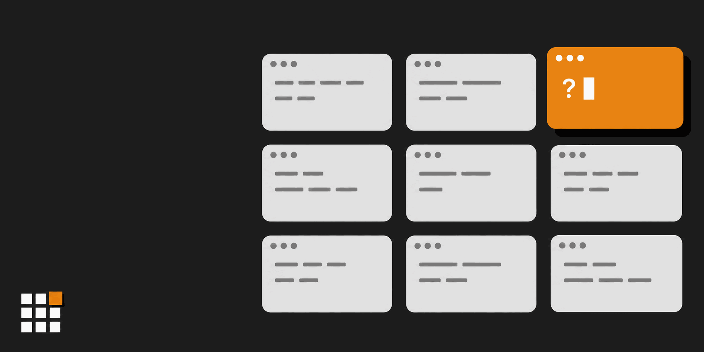
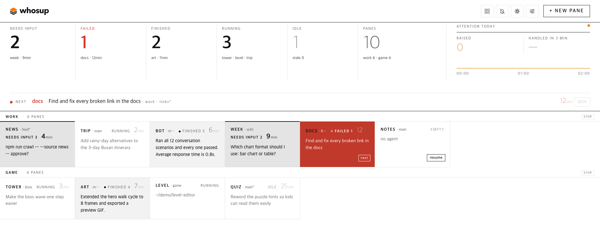
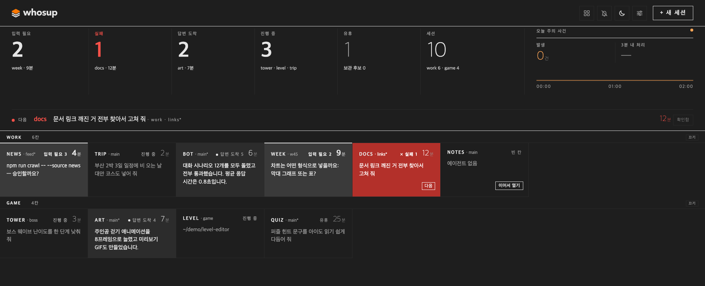

English | [한국어](README.ko.md) | [日本語](README.ja.md) | [中文](README.zh.md) | [Español](README.es.md)

# whosup

<p align="center">
  <picture>
    <source media="(prefers-color-scheme: dark)" srcset="assets/logo-dark.png">
    
  </picture>
</p>

> **Stop abandoning your agent sessions.** whosup puts every desk on one board and shows which session needs you next.

You run six, ten, fifteen coding agents in [herdr](https://herdr.dev) panes. Some are working, some finished an hour ago, one is sitting on a permission prompt you never saw. whosup calls each herdr pane a *session*, and each herdr session (or Herdr app space) a *desk*. It turns every session of every running desk into one browser page: what needs your input, what just finished, what is still running, what went quiet. Click a session and herdr jumps to it.

<p align="center">
  
</p>

[Quick Start](#quick-start) • [Why whosup?](#why-whosup) • [What you see](#what-you-see) • [How it works](#how-it-works) • [Features](#features) • [Settings](#settings) • [Setup](#setup) • [Requirements](#requirements)

---

## Quick Start

### 1. Run one line

Whatever you use today, start here. Paste this line into a terminal and press Enter (macOS and Linux):

```bash
curl -fsSL https://raw.githubusercontent.com/fivetaku/whosup/main/install.sh | sh
```

The installer looks at this computer and takes one of three paths:

| What this computer has | What the installer does |
|---|---|
| herdr 0.9.0 or newer | Installs whosup as a herdr plugin. The board starts whenever herdr starts. |
| No herdr, but herdr-core: the Herdr desktop app, or another desktop app that runs its own herdr-core (such as the Ovis desktop app) | Installs whosup on its own, without herdr (the [standalone install](#standalone-install-no-herdr)). The board starts now and every time you log in. |
| Neither, and no Herdr or Ovis app either | Asks what you want to run sessions in, installs that first (no admin rights needed), then installs whosup for it. |

**When nothing to run sessions in is here yet**, the installer asks up to two questions, by number: *Desktop app* or *Terminal*, and for an app, *Herdr* or *Ovis*. The line under *Desktop app* already names the apps this computer can install (Herdr or Ovis, or the only one it can), so they show from the first question. Enter takes the choice marked `*`: Desktop app, then Herdr. Then it installs what you picked and whosup with it:

| You pick | What is installed | Where it can be installed |
|---|---|---|
| Desktop app → Herdr (Enter, Enter) | The Herdr app, with its own installer, then whosup on its own ([standalone](#standalone-install-no-herdr)) | macOS on Apple silicon; Linux on x86_64 or arm64 |
| Desktop app → Ovis | The Ovis app from its release files (about 175 MB), checked against the release's checksum and, on macOS, its signature, then whosup on its own. On macOS it goes into `~/Applications` | macOS 13 or newer (Apple silicon or Intel); Linux on x86_64 or arm64, only where the app's desktop libraries and FUSE are already there |
| Terminal | herdr, into `~/.local/bin`, then whosup as a herdr plugin | macOS and Linux |

A choice this computer cannot install is not offered (one line says why), and a question with one choice left is not asked: where the Herdr app cannot be installed, the app is Ovis, and where neither app can, herdr is installed. To pick without being asked, put `WHOSUP_ENV=herdr-app`, `ovis-app` or `herdr` in front of `sh` (see [Installer options](#installer-options)). If what you picked cannot be installed, the installer says what failed and where to get it yourself, and installs nothing of whosup. When something is already on this computer nothing of this is asked: the first two rows apply as before.

It needs Node 22.13 or newer. An older Node earlier on your PATH does not get in the way: the installer looks through the PATH and the usual install places (Homebrew, nvm, fnm) and uses the first Node that is new enough. With none, nothing is installed and one line says what to do. What other installers print (herdr's, an app's) is folded into one line when they succeed and shown in full when they fail. At the end it prints a summary: which path it took, the board's address, and what to do next, said once. The board comes up at `http://127.0.0.1:4790`, or on the next free port when 4790 is taken. Over SSH, or with `OPEN_BROWSER=0`, no browser opens: open that address yourself.

Run from a terminal, the install asks only about what has more than one choice on this computer, for example where sessions open or which command a new session runs. Each question says in one line what it decides. Enter keeps the value marked `*` (the auto-detected one). A number sets your own. Once you have answered every question (Enter counts as an answer), the board does not ask them again. If the questions stop before that (no answer in time, Ctrl-C), the board asks once, the first time you open it (first-run setup).

### 2. What happens next depends on what you use

**You use herdr.** whosup becomes a herdr plugin.

- herdr is running: the board starts as soon as the install finishes, and your browser opens it.
- herdr is not running: the summary tells you what to type: `herdr`. The board starts with it. When the folder herdr is in is not on your PATH, the summary writes the command with its full path, so it runs as typed.
- You can also skip the one line and install the plugin yourself. It does the same thing:

  ```bash
  herdr plugin install fivetaku/whosup --yes
  ```

From then on the board starts whenever herdr starts. To start it by hand, run this in a terminal inside herdr (from a terminal outside herdr, add `--session <desk name>` right after `herdr`):

```bash
herdr plugin action invoke fivetaku.whosup.start
```

**You use only the Herdr desktop app or the Ovis desktop app (no herdr).** whosup is installed on its own; nothing else is installed.

- The board starts right away, your browser opens it, and it starts again every time you log in.
- The terminal app is not asked: there is no herdr desk whose terminal window could come forward.
- *Herdr app sessions open in* is asked only when the Herdr app's own core is here.
- The sessions of an app that runs its own core (such as the Ovis desktop app) show on the board too. The install says so in one line, for example `Sessions of <app> show on the board too.` While the app is running you can open new sessions, close them and start them again from the board; clicking a session shows it in the app window when the app knows the `ovis://` link (an Ovis version with that link, pending upstream), and otherwise opens it in a browser tab, because such an app cannot be told from outside which session to show. See [Apps that run their own core](#apps-that-run-their-own-core).
- The app does not have to be running. If it has run on this computer before, the installer still takes this path. Start the app and its sessions show on the board.
- From then on you use the `whosup` command: `whosup start`, `whosup stop`, `whosup update`, and more. See [Standalone install](#standalone-install-no-herdr).

**You have nothing yet.** The installer asks what you want to use (see the table above), installs it, then installs whosup.

- *Desktop app* (the Herdr app, or the Ovis app): whosup is installed on its own and the board starts. The app has to be opened once before its sessions show on the board: the installer opens it for you where it also opens the browser, and otherwise the summary tells you to open it. Go through the app's first screens, then open a new session from the board.
- *Terminal* (herdr): whosup becomes a herdr plugin. The summary tells you to start herdr; the board starts with it. If `~/.local/bin` is not on your PATH, the summary writes that command with its full path, so it runs as typed in this terminal, and prints the one line that adds the folder to your PATH for terminals you open from then on.
- whosup does not remove an app it installed for you. `whosup uninstall` says so in one line and where the app is.

**An agent installs it for you.** Ask your agent to run the same one line.

- With no terminal to ask in, nothing is asked. The board asks once, the first time you open it.
- On a computer with nothing to run sessions in, the default is installed without a question: the Herdr app (the Ovis app where the Herdr app cannot be installed, herdr where neither can). `WHOSUP_ENV` chooses another.
- The summary is in the command's output, so the agent can tell you the board's address and the next step.
- A script run from a terminal is still asked. Add `WHOSUP_NO_SETUP=1` to skip the questions: `curl -fsSL https://raw.githubusercontent.com/fivetaku/whosup/main/install.sh | WHOSUP_NO_SETUP=1 sh`

Running the one line again does not switch paths: a herdr plugin install is left as it is (the summary says how to update it), and a standalone install is updated in place.

On the way to your first session:

- **macOS permissions.** Normally no permission dialog appears. Only restoring a minimized window and split screen need the Accessibility and Automation permissions; after you turn one on, restart whosup. See *Jump* under [Features](#features).
- **macOS and your folders.** When you pick a folder inside Desktop, Documents or Downloads for a new session, macOS asks whether the app may access that folder. Allow it, or pick another folder.
- **Claude Code's "trust this folder?" prompt** starts with the cursor on "No, exit". Move down to "Yes, I trust this folder", then press Enter. That screen is Claude Code's; whosup cannot change it.
- **herdr and the Herdr app greet you in English** the first time they start. Those welcome screens are theirs; press Enter to continue.
- **Korean text with gaps between the letters** in some terminal apps (macOS's own Terminal, for one) comes from how the terminal draws the font. The text whosup prints has no extra spaces.

### 3. Open more desks whenever you like (herdr)

```bash
herdr --session work      # any name, any terminal
```

Every running desk shows up on the board by itself. No list to maintain.

### On Windows

The one-line installer and the standalone install do not run on Windows. Install the herdr plugin there:

```powershell
herdr plugin install fivetaku/whosup --yes
```

The install asks nothing on Windows (herdr runs the install step without a visible console), and first-run setup asks the first time you open the board. Actions carry a `win-` prefix (`win-start`, `win-doctor`, …). See [Windows](#windows).

---

## Why whosup?

- **You stop polling sessions.** The top band tells you how many sessions need input, failed, finished, or are running. The "next" line names the one to look at first and quotes the question it is asking.
- **One click, right session.** Click a session and herdr focuses it, in any tab of any desk. On macOS it can bring your terminal app forward too.
- **Restarts don't lose conversations.** After a reboot herdr restores the sessions but not the agents. Empty sessions get a **resume** button that finds the newest Claude Code conversation for that folder and runs `AGENT_CMD --resume <id>` in the session. Resume reads Claude Code's conversation history only; with any other agent the session starts a fresh conversation. An empty session with no conversation to continue shows **start agent** instead.
- **Colour means something.** Black and white everywhere, orange for the one thing to look at next, red for failures. Nothing blinks on a loop.
- **It tells you even when you look away.** The tab title shows how many sessions are waiting, e.g. `(3) whosup`, and the favicon lights its orange cell. A session that just raised its hand gets one short orange ring. The header's sort button switches between **by desk** and **neglected first**, which slides the longest-waiting sessions to the front of each desk. Turn on **alerts** in the header for a desktop notification; clicking it jumps to that session.
- **Nothing waiting gets lost.** A session that needs you stays on the board until you deal with it — past midnight, after a restart, through a herdr hiccup. **seen** only snoozes it for 30 minutes; if it still needs you, it comes back. Closed sessions stay in a **recently closed** row for 7 days and sessions you **stash** stay there until you restore them; from that row you can resume or restore them. A stashed session that starts working again comes back by itself. Pin the sessions you always watch to a row at the top.
- **It says when it doesn't know.** If whosup cannot reach herdr, the header shows *disconnected · last collect HH:MM*, the tab title turns into `(!) whosup`, and the favicon goes grey — instead of a calm board that is quietly out of date.
- **Light, dark, your language.** The header button cycles the mode (auto / light / dark); the EN / 한 buttons in first-run setup and in **settings** switch the language (English by default, 한국어). Palettes follow what real IDE themes use, with text contrast kept at WCAG AA.

---

## What you see

<p align="center">
  <br>
  
</p>

| Area | Meaning |
|---|---|
| **State band** | Counts for needs input · failed · finished · running · idle · sessions, plus today's attention events and how many were handled within 3 minutes. Click a number to filter. |
| **Next line** | The single session to look at first and why: the pending question, the failure, or the finished answer. When no session has an agent running, it shows the next step instead: open a new session. |
| **Desks** | One row per desk, its sessions in herdr's pane order. Session header: label · git branch (the desk name when there is no branch) · state, with a number 1–9 on the first nine waiting sessions in the shared order (e.g. `needs input 3`; press 3 to jump there) · time waiting (for running and idle sessions, time since your last request) · tags for the failure kind (e.g. usage limit) and *unreachable*. Below it, one line of context. |
| **Session line** | The question the agent is asking (permission box, trust prompt, A-or-B), its last sentence, or your last request, whichever matters for that state. |
| **resume** | On empty sessions after a restart: continue the newest conversation for that folder. With no conversation to continue, the button reads **start agent** and starts a fresh one. |
| **+ new session** | Pick a desk and a folder (going into a folder in the list picks it); whosup opens a tab there, starts your agent, and focuses it. |

---

## How it works

```
desks (herdr sessions: main, side, …)
   └─ pane list + agent list, every 3 s  ──►  whosup collector  ──►  SQLite (node:sqlite)
                                                                       │
browser  ◄──  http://127.0.0.1:4790  ◄──  board server  ◄─────────────┘
   │
   └─ click  ──►  pane.focus over herdr's socket  ──►  the herdr pane
```

One Node process, no build step. herdr's startup hook is a one-shot command: when herdr starts, it launches whosup as a background server and returns. The server then keeps running on its own — herdr does not supervise or stop it — so use the `stop` action to shut it down. Session state comes from herdr's agent detection (working / blocked / done / idle); the question text is read from the session screen; the last request comes from Claude Code's conversation history (`~/.claude/projects`, or `CLAUDE_PROJECTS_DIR`). Sessions running other agents show no last request, and resume starts them fresh. The collector also listens to herdr's events, so a session that changes state is collected right away instead of waiting for the next 3 s pass, and open board tabs are updated at once. Without the event stream the 3 s pass still runs.

**Trust model.** The server listens on 127.0.0.1 only and has no login. Browser requests from other sites that try to change something are refused (a change must come from the board's own address and be sent as JSON), but any program running on the same computer can use its API — including changing settings such as `AGENT_CMD`, the command whosup types into a session for resume and new sessions. Do not expose the port to other people. The server also answers 403 `local only` to any request whose `Host` header is not `127.0.0.1`, `localhost` or `[::1]`, so tunnels that forward a public hostname (Tailscale Serve, cloudflared, ngrok) cannot open the board at all. To watch from another machine of yours, use a port forward that keeps a localhost host, such as `ssh -L 4790:127.0.0.1:4790 <host>` and then `http://localhost:4790`, and run the server with `WHOSUP_READONLY=1`. Read-only blocks changes, not viewing: it does not list folders under your home, but everything on the board stays visible — session folder paths in the session tooltips, last request text, question text — and `GET /api/settings` still returns `agent_cmd`.

---

## Features

| Feature | Description |
|---|---|
| Auto-discovery | Every running desk and session, no configuration |
| Attention states | needs input · failed · finished · running · idle · empty |
| Question extraction | Permission boxes, trust-folder prompts, and "A or B?" questions are shown verbatim |
| Jump | Click → `pane.focus`, and on macOS the terminal window showing that desk comes forward. The terminal app is found automatically; when no window shows the desk, a new one opens (Ghostty and Terminal). macOS permissions: while the app has a window on screen, a click asks for none and no system dialog appears. When the app has no window on screen (minimized or hidden), whosup first reopens the app, which needs no permission either and brings a minimized window back (without the permissions whosup cannot tell which window is minimized, so when another window of the same app is on screen, a minimized one stays where it is). Only when that brings no window back, and for split screen, does whosup use the Accessibility and Automation (System Events) permissions, and macOS may ask then. When one is missing or was denied, the board shows a notice (not the red *disconnected* mark): press it to see what does not work, where to turn it on (System Settings → Privacy & Security → Accessibility, or Automation → System Events, under the app that started whosup, named in the notice) and that whosup has to be restarted afterwards. If you have already given both permissions, nothing changes for you |
| First-run setup | The first time the board opens (unless first-run setup was already finished in the terminal at install), it shows the detected environment (once something to run sessions in is found, items it found none of are left out there; **settings** lists them all) and, for each item, the choices that were detected, with the value in use picked: *Sessions open in* (terminal window, web terminal or both; only when a web terminal matched to a desk, such as ovis, is detected, since otherwise terminal window is the only choice — first-run setup leaves out any item with a single choice, while **settings** still shows it), *Terminal app* (the detected apps — the one showing herdr now and the installed ones — and auto; only when a herdr desk is running), *Herdr app sessions open in* (Herdr app or terminal window; only when the Herdr app is detected — its `herdr-app` command or its core) and *Command to run in a new session* (the detected agents: claude, codex). For each [app that runs its own core](#apps-that-run-their-own-core) it adds one line, `Sessions of <app> show on the board too. A click opens the session in a browser tab.`, also under the detected environment in **settings**. **start with these** saves only the rows you picked yourself, on the server, as values you set, which auto-detection does not change afterwards; a row you left alone is not saved and keeps following auto-detection. EN / 한 buttons at the top switch the board's language. Until you confirm, the board detects again at most once every 5 seconds, so a web terminal started after whosup still shows up as a choice. It shows once: closing it with ✕ or Esc counts as done too, with nothing saved. **open first-run setup again** in **settings** brings it back |
| Where a click goes | **settings** → *Sessions open in*: terminal window (default), web terminal, or both, saved on the server as the default for every browser; with *only in this browser* on, it applies to that browser only. Web terminal opens the session in a web terminal for herdr in a new tab, with `{session}` and `{pane}` filled in; each desk can have its own address (a web terminal usually runs one server per desk, on its own port), and a Herdr app desk opens in a web terminal only when it has an address of its own. The tab is reused per desk, so it stays linked to the board that opened it: set only the address of a web terminal you trust. Pick it when you use the board from another device. The board must not be read-only for this: read-only mode blocks every click |
| Herdr app sessions | When herdr-core (the terminals of the Herdr desktop app) is running on this machine, each of its terminals is a session too: one desk per space of the app, with the status and the question text the core reports. A click jumps to that session in the Herdr app and brings the app forward; when the app is not open the session opens in a terminal window (`hc attach`). With *Herdr app sessions open in* set to terminal window (`WHOSUP_CORE_TARGET=terminal`), it always opens in a terminal window, even when the app is open. Close, resume, new session and turning a desk off and on work as they do for herdr desks. Nothing to configure, and whosup never starts a core that is not running. An agent stopped at its trust-folder prompt, which the core does not report, is read from the screen and shown as needing input; no other state is guessed from the screen |
| Other apps' sessions | A desktop app that runs its own herdr-core (such as the Ovis desktop app) is found by auto-detect, and its sessions show on the board too. While the app is running, new session, close and resume work from the board. A click shows the session in the app window through its `ovis://` link when the installed app knows that link (an Ovis version with the link, pending upstream); otherwise it opens the session in a browser tab and leaves the app window where it is, because the app cannot be told from outside which session to show. See [Apps that run their own core](#apps-that-run-their-own-core) |
| Resume | The session's own conversation, else the newest one in its folder that is not live in another session → `AGENT_CMD --resume`; the board shows which one before you click. Claude Code conversations only; other agents start fresh |
| New session | Desk + folder picker, runs your agent command |
| Desks (optional) | Declare desks and sessions per monitor in `desks.json`; the `desks-apply` action creates what is missing, idempotently |
| i18n | English by default, 한국어 on request (the EN / 한 buttons in first-run setup and in **settings**, or `?lang=ko`). The choice is kept per browser |
| Theme | auto / light / dark (header button, `?theme=`), researched IDE palettes |
| Read-only mode | `WHOSUP_READONLY=1` hides the action buttons and **+ new session**, blocks clicks, Enter, 1–9, `n`, alert clicks and settings changes (settings shows only the language choice), and does not list folders. It blocks changes, not viewing — see the trust model |
| Seen = snooze | **seen** on any waiting session hides it for 30 min; **unsee** brings it back now |
| Pin | Pinned sessions sit in a row above every desk, in both sort modes |
| Stash & recently closed | Stash an idle session; closed sessions stay under **recently closed** for 7 days, stashed sessions until you restore them; a stashed session that starts working again comes back by itself |
| One order | The next line, Enter, keys 1–9, alerts and the neglected sort all use the same order: failed → needs input → finished, oldest first |
| Keyboard | `n` (or `ㅜ` with a Korean layout) opens new session · Tab moves between sessions and Enter or Space opens the focused one · with no session focused, Enter jumps to the next session, or saves/opens in an open panel · 1–9 jump to the numbered session · Esc closes the panel. `n` and 1–9 are ignored while you type in a field |
| Re-alerts | A session left waiting is alerted again every 15 min, up to 4 times; alerts close when the session is handled |
| macOS alerts (optional) | The server can send macOS notifications even with the tab closed — off by default |
| Split screen (optional, macOS) | Clicking a session puts the board on the left part of the screen and the terminal on the rest (`split_pct`) — off by default, needs the Accessibility and Automation permissions (see *Jump*) |
| Honest state | Last collect time in the header; *disconnected* when collects stop; sessions in an unreachable desk are kept and marked |
| Settings | **settings** in the header: snooze, re-alert interval and limit, closed-after, disconnect warning, keep days, stale days, macOS alerts, unreachable timeout, split screen, agent command, *Sessions open in* (the default for every browser, or *only in this browser*), *Terminal app* (the detected apps are listed), *Herdr app sessions open in*. **re-detect** checks the environment again without a restart (values you set do not change), and **open first-run setup again** shows first-run setup again. In read-only mode it shows only the language choice |

### Plugin actions

| Action | What it does |
|---|---|
| `fivetaku.whosup.start` | Start the board (also runs at herdr startup and, when herdr is running, right after an install) |
| `fivetaku.whosup.stop` | Stop it |
| `fivetaku.whosup.status` | URL (port) and PID |
| `fivetaku.whosup.open` | Open the board in the browser |
| `fivetaku.whosup.desks-apply` | Create desks/sessions from `desks.json` |
| `fivetaku.whosup.desks-status` | Declared vs existing sessions |
| `fivetaku.whosup.autoconf` | Check this machine again, update the auto-detected values and print them (see [Where each value comes from](#where-each-value-comes-from)) |
| `fivetaku.whosup.win-*` | The same actions on Windows (`win-start`, `win-stop`, `win-status`, `win-open`, `win-desks-apply`, `win-desks-status`, `win-autoconf`), plus `win-doctor` |

---

## Settings

Put `KEY=value` lines in `.env` inside the plugin config dir (`herdr plugin config-dir fivetaku.whosup`; `~/.config/whosup` when run outside herdr). The file is read only when `start` launches the server, so after a change run the `stop` action and then `start`. A value set here wins over auto-detection; a value set in settings wins over both (see [Where each value comes from](#where-each-value-comes-from)). The `desks-apply` action does not read `.env`; it takes the agent command from `agent_cmd` in `desks.json`.

| Key | Default | Meaning |
|---|---|---|
| `PORT` | 4790 | next free port is used if taken |
| `OPEN_BROWSER` | 1 | open the tab once when the board starts (at herdr startup, or right after an install) |
| `AGENT_CMD` | claude | command used by resume and new session — put your wrapper here; **settings** can override it |
| `FRONT_APP` | auto | macOS terminal app to bring forward on jump, e.g. `Ghostty`. When unset, auto-detection picks one (lane L4 in [the rules](#where-each-value-comes-from)), and Terminal opens a new window if there is none. On Windows: blank = auto (Windows Terminal if found, else a PowerShell window), `PowerShell`, `Windows Terminal`, or `off` (any value is accepted there). **settings** changes it without a restart |
| `STALE_DAYS` (or `WHOSUP_STALE_DAYS`) | 3 | quiet days before a session is an archive candidate |
| `WHOSUP_READONLY` | 0 | 1 = read-only view: no changes, no folder list |
| `WHOSUP_SEEN_SNOOZE_MIN` · `WHOSUP_RENOTIFY_MIN` · `WHOSUP_RENOTIFY_MAX` · `WHOSUP_GONE_MISSES` · `WHOSUP_STALE_COLLECT_SEC` · `WHOSUP_CLOSED_KEEP_DAYS` · `WHOSUP_OS_NOTIFY` · `WHOSUP_UNREACHABLE_TTL_H` · `WHOSUP_SPLIT_PCT` | 30 · 15 · 4 · 3 · 30 · 7 · 0 · 24 · 0 | starting values; **settings** in the header overrides them per computer |
| `WHOSUP_INTERVAL` | 3 | seconds between collects |
| `CLAUDE_PROJECTS_DIR` | `~/.claude/projects` | where resume and the last request look for Claude Code conversations |
| `HERDR_BIN_PATH` (or `HERDR_BIN`) | auto | path to the herdr binary; otherwise whosup tries `/opt/homebrew/bin`, `/usr/local/bin`, `~/.local/bin`, then `PATH` |
| `WHOSUP_RUNTIMES` | auto | what to read: `auto` (herdr desks and herdr-core terminals, whichever is there), `herdr`, or `herdr-core` |
| `HC_SOCKET` · `HC_SESSION` | auto · `default` | read this one herdr-core core only: its socket, or its name (the socket is then taken from that core's `core.lock` only, which follows `XDG_STATE_HOME`). With either set, `WHOSUP_CORES` and auto-detect add no other core. An `HC_SESSION` that does not fit the core-name rule (see `WHOSUP_CORES`) is ignored, as if it were not set |
| `WHOSUP_CORES` | auto | which other herdr-core cores to read, besides the Herdr app's core (`default`): core names separated by commas, `all` (every core that left a `core.lock` and has its socket), or `none` (the Herdr app's core only). When unset, auto-detect adds the cores of [apps that run their own core](#apps-that-run-their-own-core). A core name is letters, digits, `.`, `_` and `-`, up to 80 characters; `.` and `..` are refused. When two names point at the same socket, that core is read once, under the first name |
| `WHOSUP_CLICK_TARGET` | terminal | where sessions open, the default for every browser: `terminal`, `web` or `both`; first-run setup and *Sessions open in* in **settings** override it on the server, and *only in this browser* overrides that in one browser |
| `WHOSUP_CORE_TARGET` | app | where Herdr app sessions open: `app` or `terminal`. With `terminal` they always open in a terminal window with `hc attach`, even when the app is open; first-run setup and *Herdr app sessions open in* in **settings** override it |
| `HERDR_APP_BIN` · `HERDR_APP_NAME` · `HC_BIN` | `herdr-app` · `Herdr` · `hc` | the Herdr app command (jump, new tab, close a space), the app to bring forward on macOS, and the command used to open a herdr-core terminal in a terminal window. The app name is taken in this order: `HERDR_APP_NAME` > the name auto-detect found > `Herdr`. `HERDR_APP_NAME` is used for the Herdr app only, never for [another app's core](#apps-that-run-their-own-core) |

### Desks (optional)

If you like a fixed layout — say one desk per monitor — describe it once and let whosup create it:

```json
{ "agent_cmd": "claude",
  "desks": [
    { "session": "main", "note": "left monitor", "agent": true,
      "panes": [ { "label": "api", "cwd": "~/src/api" }, { "label": "web", "cwd": "~/src/web" } ] },
    { "session": "side", "panes": [ { "label": "notes", "cwd": "~/notes" } ] }
  ] }
```

Save it as `desks.json` in the plugin config dir (`herdr plugin config-dir fivetaku.whosup`; `~/.config/whosup` when run outside herdr) and run `herdr plugin action invoke fivetaku.whosup.desks-apply`. It only adds what is missing. Open a terminal per desk wherever you like (`herdr --session main`).

### Agent restore

herdr can restart agents itself after a reboot (`[session] resume_agents_on_restore`). If you launch agents through a wrapper, set that to `false` and use whosup's **resume** instead, so the wrapper is used.

---

## Setup

### Standalone install (no herdr)

When this computer has no herdr but has herdr-core (the Herdr desktop app, or another app that runs its own core), the [one-line installer](#quick-start) installs whosup on its own. To take this path whatever is on the computer, run `curl -fsSL https://raw.githubusercontent.com/fivetaku/whosup/main/install.sh | WHOSUP_INSTALL_MODE=standalone sh`. It is refused when whosup is already a herdr plugin here, so one computer does not run two boards.

Where things go:

| What | Where |
|---|---|
| The program | `~/.local/share/whosup/app` (`$XDG_DATA_HOME/whosup/app` when `XDG_DATA_HOME` is set) |
| The install record (`install.json`) | Next to the program: `~/.local/share/whosup/install.json`. It holds the folders and the Node this install uses, so the `whosup` command and start at login keep using the same ones. If that Node is gone, or is no longer 22.13 or newer, another one is looked for |
| The `whosup` command | `~/.local/bin/whosup` |
| Settings (`.env`, `setup.json`) | `~/.config/whosup` |
| State (database, `auto.json`, logs) | `~/.local/state/whosup` (`$XDG_STATE_HOME/whosup`). If you already ran whosup by hand from a folder, `~/.config/whosup` keeps being used, so your history stays |

An `XDG_DATA_HOME` or `XDG_STATE_HOME` that is not an absolute path is ignored.

If `~/.local/bin` is not on your PATH, the summary spells the command with its full path and says so. If another program named `whosup` is already in `~/.local/bin`, it is left alone and the summary gives the longer command to use instead.

The installer is careful with what is already there:

- **Another folder in the program's place.** If a folder that whosup's installer did not put there is already at the program's place, nothing in it is run or changed. The installer says so and ends. Move the folder away and run the installer again.
- **Two installs at once.** If another whosup install is still running, the second one says so and ends without changing anything, however long the first one takes (it may be waiting at a question). `whosup uninstall` and `whosup autostart on` or `off` do the same while an install or update is running.
- **An install you stop part-way** (Ctrl-C, also at a first-run setup question, or a closed terminal) is undone. A new install removes what it had put in place. An update puts the version that was here before back, and starts the board again if it was running; if that board could not be started again, the installer says so, and you start it with `whosup start`. Settings and history are kept either way.
- **What an unfinished install left behind** is removed only after the board started from it is stopped and start at login is turned off. If that cannot be done, the folder is left as it is, and the installer says what to do and ends with an error.

The `whosup` command:

| Command | What it does |
|---|---|
| `whosup start` | Start the board |
| `whosup stop` | Stop the board. On Linux this stops the `whosup.service` user service too; if that service does not stop, it prints the command to type and ends with an error |
| `whosup status` | Whether the board is running, its address, and whether it starts at login |
| `whosup open` | Open the board in your browser |
| `whosup setup` | Go through first-run setup again, in the terminal |
| `whosup update` | Replace it with the newest version. Settings and history are kept, and a board that was running is started again |
| `whosup uninstall` | Stop the board, turn off start at login, and remove the program and the `whosup` command. Settings and history are kept. An app the installer put in for you (the Herdr app, the Ovis app) is not removed: one line says so and where it is |
| `whosup uninstall --purge` | The same, and remove settings and history too: the settings and state folders written in the install record, no other folder. They are removed only when the program itself was fully removed |
| `whosup autostart on` · `off` · `status` | Turn start at login on or off, or show it |
| `whosup help` | Show this list |

**Start at login.** A new standalone install sets the board to start every time you log in: a LaunchAgent (`~/Library/LaunchAgents/dev.whosup.board.plist`) on macOS, a `systemd --user` service (`~/.config/systemd/user/whosup.service`) on Linux. Starting at login does not open a browser tab. To turn it off:

```bash
whosup autostart off
```

`whosup autostart on` turns it back on. An update keeps your choice. On Linux without `systemd --user`, the board does not start by itself at login; the summary says so, and you start it with `whosup start`.

On macOS, when start at login is set but could not be loaded right now, it begins at your next login. The install summary, `whosup autostart on` and `whosup status` say so. If `whosup autostart off` cannot remove the login item's file, it names the file that is left and ends with an error. If the service manager (launchd on macOS, systemd on Linux) still has the login item, it does not say that start at login is off: it prints the command to type and ends with an error.

**Update and remove.** `whosup update` downloads the installer again and runs it on the standalone path. Running the one-line installer again does the same. If the new version fails to install, a board that was running does not start in the new version, or you stop the update part-way, the old one is put back. `whosup uninstall` keeps `~/.config/whosup` and the state folder unless you add `--purge`, and it prints what it removed and what it kept. If something could not be removed, it lists that too and ends with an error (exit code 1), so you can remove it yourself. If start at login could not be turned off, or the user service on Linux could not be stopped, it stops there and leaves the program in place. A folder in the program's place that the installer did not put there is left as it is.

### Installer options

Put these in front of `sh` in the one line, for example `curl -fsSL https://raw.githubusercontent.com/fivetaku/whosup/main/install.sh | WHOSUP_NO_LOGIN_START=1 sh`. They are read from the environment of the install command, not from `.env`.

| Variable | What it does |
|---|---|
| `WHOSUP_INSTALL_MODE=plugin` or `standalone` | Take that path whatever is on this computer |
| `WHOSUP_ENV=herdr-app`, `ovis-app` or `herdr` | On a computer with nothing to run sessions in: install that one without asking. If this computer cannot install it, the reason is printed and nothing is installed. Not used when something is already here or `WHOSUP_INSTALL_MODE` is given; one line says so |
| `WHOSUP_ENV_TIMEOUT=<seconds>` | How long herdr's installer, or an app's installer and each of its downloads, may take before it is stopped (900 by default) |
| `WHOSUP_REF=<branch, tag or commit>` | Install that version instead of the default branch |
| `WHOSUP_NO_SETUP=1` | Ask nothing, the choice of what to install included (the default is installed); the board asks on first open |
| `WHOSUP_NO_AUTOSTART=1` | Do not start the board right after the install |
| `WHOSUP_NO_LOGIN_START=1` | Standalone install: do not set the board to start at login |
| `CI` | None of the three above: nothing is asked, started or set to start at login |
| `WHOSUP_LANG=ko` or `en` | Language of what the installer prints and asks (otherwise Korean for a Korean locale, English for any other) |

The switches are off when empty, `0`, `false`, `no` or `off`, and on with any other value.

### Apps that run their own core

Some desktop apps run their own herdr-core, separate from the Herdr app's. The Ovis desktop app is one. whosup finds such an app by itself (auto-detect, lane L7) and shows its sessions on the board, in a desk of their own. Nothing to configure.

- **New session, close and resume work from the board while the app is running.** whosup asks the app's own local server on `127.0.0.1` to do it; it reads and uses no token. A new session opens as a tab in the desk you pick, or as a new desk in that app, and whosup types your agent command into it. Turning the desk off and on is not available for these sessions.
- **With an app that knows the `ovis://` link, a click shows the session in the app window.** This needs an Ovis version with the `ovis://open` link (pending upstream; the released 0.5.3 does not have it). whosup checks the installed app itself (on macOS its `Info.plist`, on Linux the `x-scheme-handler/ovis` handler, on Windows `HKCU\Software\Classes\ovis`) and opens `ovis://open?pane=<session>&view=terminal` with the system opener (`open`, `xdg-open`, `start`): the app window comes forward with that session picked, for a click and for a session you just opened from the board. If the link cannot be opened, the session's browser tab opens instead. The answer says which way was used (`opened`: `app_link` or `browser`).
- **Otherwise a click opens the session in a browser tab; the app window stays where it is.** The app cannot be told from outside which session to show, so whosup opens that session's page on the app's local server (`http://127.0.0.1:<port>/?pane=…`) instead, and does not bring the app window forward (it would cover the tab, showing another session). The tab opens as long as you have not set *Sessions open in* yourself; once you have (in settings, in first-run setup or with `WHOSUP_CLICK_TARGET`), a click follows that choice: with terminal window, the app window comes forward and you pick the session inside it yourself.
- **The app is closed:** whosup does not start it. Its sessions stay on the board for as long as the app's core keeps running: you can still see them, and a click says the app is not running and touches no window. New session and resume say to start the app first; close still works, by ending that terminal in the core. Start the app, then click again. If the core is off too, the sessions are marked *unreachable* and move to **recently closed** after the unreachable timeout in **settings** (24 hours by default). If the board is restarted while the app is closed, it no longer knows the app's name: until the app runs again, the sessions show under the core's name and a click opens them in a terminal window (`hc attach`).
- **A server that asks for a token or a login** is not operated from the board, and whosup does not go around it: its sessions can only be seen and jumped to.
- **Outside macOS** the app's name cannot be found, and no app window is brought forward. A click opens the session in a terminal window (`hc attach`) instead. The same happens on macOS when *Herdr app sessions open in* is set to terminal window. With no app name to give, the board says the session's core is not running when that core is off.
- **A core that is no longer read:** if you chose the cores yourself (`WHOSUP_CORES`, `HC_SOCKET` or `HC_SESSION`), that choice comes first: a core left out of it is not read even while its sessions are open, and those sessions soon move to **recently closed**. A click on one before that opens nothing, and the board says the core cannot be checked right now.
- **Web terminal:** when that app's web terminal opens on `127.0.0.1` without a login, its address is filled in for that desk, so *Sessions open in* → web terminal can use it.

How it is found: whosup asks ovis servers on `127.0.0.1` only, on ports 7317–7330 and on the ports listed in the bridge registry (`~/.config/ovis/bridges`, and its old name `~/.config/herdr-web-ui/bridges`). From the registry it uses only each entry's port and process id. The token is not taken out, kept or written anywhere. An entry is used only when its process is still running and, on macOS and Linux, is the one listening on that port (when that cannot be checked, the entry is used as before). A server counts only when it answers as ovis and says it shows herdr-core; the core name is the one that server reports. An ovis server that shows a herdr desk instead is used as that desk's web terminal, as before.

While the board runs, it looks at the registry again every 10 seconds and detects again when an app's server appears there, goes away or changes its port. The server of an app that has just started may not name its core yet; the board then asks again every 5 seconds, for up to about a minute.

Known limits:

- While the board runs, only the registry is watched. If an app you started after the board does not show up after a minute or so (its server is not in the registry, for example), press **re-detect** in **settings**.
- The core of an ovis server protected by a token is not read automatically. Its port is listed as "check". You can name the core in `WHOSUP_CORES`.
- The app's name is found on macOS only.
- In the rare setup where `herdr-app` handles more than one core, a click does not jump to the session inside the app, because `herdr-app` cannot tell which core a session belongs to. The session opens in a terminal window attached to its own core (`hc attach`) instead.

### Herdr desktop app

whosup reads the sessions of the Herdr desktop app through herdr-core, the app's core. There is nothing to configure when these are in place:

- **herdr-core is running on this computer.** The core writes its socket path to `<state>/herdr-core/<session>/core.lock` (`<state>` is `XDG_STATE_HOME`, else `~/.local/state`, plus `%LOCALAPPDATA%` on Windows; `<session>` is `HC_SESSION`, else `default`); `HC_SOCKET` overrides that. The socket in `core.lock` comes first; a socket auto-detect saw earlier is used only when `core.lock` or its socket is missing, and never for a core you named with `HC_SESSION`. The core counts as running while its socket exists. whosup never starts a core.
- **`herdr-app` is on `PATH`** (or set `HERDR_APP_BIN`): jump, new tab and closing a space go through it. Without it the sessions are still read.
- **`hc` is on `PATH`** (or set `HC_BIN`): it opens a session in a terminal window when the app has no window open, or always when *Herdr app sessions open in* is set to terminal window.

Auto-detection (lane L6) checks the socket and `herdr-app` at every start; first-run setup at install checks them too, to decide what to ask. `node scripts/doctor.mjs` reports this core (`default`, or `HC_SESSION`) as running only by its own socket; [another app's core](#apps-that-run-their-own-core) does not count. A click on a Herdr app session shows it in the app and brings the app (`HERDR_APP_NAME`, default `Herdr`) forward; with no app window open, `hc attach <terminal>` opens in a terminal window. With *Herdr app sessions open in* set to terminal window (`WHOSUP_CORE_TARGET=terminal`), it always opens with `hc attach` in a terminal window, even when the app is open.

If its sessions do not show up:

- `WHOSUP_RUNTIMES` must be `auto` (the default) or include `herdr-core`; `herdr` alone leaves the app out.
- `HC_SOCKET`, `HC_SESSION` and `XDG_STATE_HOME`, if you set them for whosup, must point at the same core the app uses.
- `node scripts/doctor.mjs` prints the core line (its socket, or *not running*), the state folders it looked in, and whether `herdr-app` was found; the `autoconf` action prints lane L6 with its reason (see [Where each value comes from](#where-each-value-comes-from)).
- On Windows it is not checked yet whether herdr-core listens on a named pipe.

### ovis: open sessions from another device or a phone

[ovis](https://github.com/devswha/ovis) is a web client for herdr (chat, live terminal, phone app). whosup only finds a running ovis and fills in its address; it never starts or stops it.

```bash
herdr plugin install devswha/ovis --yes          # from ovis's INSTALL.md
herdr plugin action invoke devswha.ovis.start
```

- As a herdr plugin, ovis starts with herdr on `http://127.0.0.1:7317` and follows the socket of the herdr session (the desk) that started it.
- One ovis server shows one desk. For another desk, run another ovis server on its own port with `PORT` and `HERDR_SOCKET=~/.config/herdr/sessions/<name>/herdr.sock` set (see Configuration in ovis's INSTALL.md). whosup looks at ports 7317–7330, and at the ports in ovis's bridge registry (see [Apps that run their own core](#apps-that-run-their-own-core)).
- At every start whosup checks those ports (lane L7); first-run setup at install checks them too, to decide what to ask. A port counts as ovis only when `GET /api/health?scope=bridge` answers with ovis's own fields. The desk comes from `HERDR_SOCKET` (or `HERDR_SESSION`) of the process listening on that port, read with `ps` on macOS and `/proc` on Linux. For each desk herdr lists, the address `http://127.0.0.1:<port>/?pane={pane}` is filled in. When whosup knows the server's `HERDR_SOCKET` and herdr lists a desk of the same name on another socket (the same name in another herdr), nothing is filled in and the port is listed as "check".
- When the desk cannot be told (on Windows, a desk herdr does not list, two servers on one desk), nothing is filled in and the port is listed as "check". Set that address yourself in **settings**.
- A click still goes to the terminal window by default, with or without ovis. The first time the board opens (unless first-run setup was already finished in the terminal at install), first-run setup shows what was detected and the choices for each item; under *Sessions open in*, web terminal and both are offered next to terminal window only when an ovis server matches a desk. Until you confirm it, the board detects again at most once every 5 seconds, so an ovis that started after whosup still shows up as a choice. **start with these** saves your picks on the server (`click_target` among them), where they are the default for every browser; **settings** → *Sessions open in* changes that default as well, or, with *only in this browser* on, that browser only. The addresses are saved per browser.

The filled address is `127.0.0.1`, so it opens on the computer running ovis. From another device forward that port as well (`ssh -L 4790:127.0.0.1:4790 -L 7317:127.0.0.1:7317 <host>`), or replace the address in **settings** with one your device can reach. On a phone, ovis's own app and relay are the way in (see ovis's README). Opening sessions from the board needs a board that is not read-only.

### Windows

whosup runs on Windows too (Node and PowerShell, no `sh`), as a herdr plugin only: the one-line installer and the standalone install (`whosup` command, start at login) are macOS and Linux only. The plugin has Windows-only entries that herdr runs with `node`, so install and start the same way; the actions carry a `win-` prefix:

```powershell
herdr plugin install fivetaku/whosup --yes
herdr plugin action invoke fivetaku.whosup.win-start
herdr plugin action invoke fivetaku.whosup.win-doctor    # read-only check of this machine
herdr plugin action invoke fivetaku.whosup.win-autoconf  # what auto-detection found
```

To run it by hand instead (from the whosup folder, in your **desktop session** — not over SSH, where windows stay invisible):

```powershell
node scripts\doctor.mjs                 # what whosup can see: Node, herdr, pipes, PowerShell, Windows Terminal, desktop session
node scripts\launch.mjs start           # same as the start action (status · stop · open too)
# or in the foreground; settings go in as PowerShell variables (VAR=value is sh syntax and does not work here):
$env:FRONT_APP='Windows Terminal'; node bin\whosup.mjs
```

- Auto-detection runs before every start. At install (`launch.mjs install`) only Node is checked: nothing is detected, asked or written; `launch.mjs preflight` runs detection by hand. With `wt.exe` on `PATH` it picks **Windows Terminal**; otherwise clicks open a PowerShell window.
- Started over SSH, or in Windows session 0 (a service; checked by `SESSIONNAME`, then the process session number — a logon task on the desktop has no `SESSIONNAME` but still counts as desktop), whosup counts as remote: it opens no browser and raises no windows (*Terminal app* = off), because nothing would show on the desktop. Start it from the desktop session to get windows.
- Clicking a session brings its terminal window forward, or opens a PowerShell window attached to that desk when none shows it. Pick **auto**, **PowerShell**, **Windows Terminal** or **off** under *Terminal app* in **settings** (or set `FRONT_APP`).
- `node bin\whosup.mjs` does not read `.env`; `launch.mjs` and the plugin actions do (plain `KEY=value` lines, nothing is executed).
- Needs Node 22.13+ for Windows from [nodejs.org](https://nodejs.org) (or nvm-windows, Volta, fnm) on `PATH`, and herdr on `PATH` (or `HERDR_BIN_PATH`).
- Not checked on a Windows machine yet: whether the Herdr desktop app (herdr-core) listens on a named pipe there, and whether herdr keeps whosup running after its startup hook returns. `win-doctor` shows both. Also not checked there: whether the board comes up by itself right after an install; if it does not, run the `win-start` action. At install on Windows nothing is asked: herdr runs the install step without a visible console (read from herdr's source, not checked on a machine). ovis ports are found on Windows, but not the desk each one shows, so they are listed as "check".

### Where each value comes from

Every setting takes the first value it finds in this order: **settings > environment variable (`.env` included) > auto-detected > built-in default.** A value you set in settings or the environment is never changed by auto-detection, and auto-detection never writes `.env` or settings values.

- **Settings**: saved in whosup's database on this computer and used right away. Clearing a field falls back to the next layer. **start with these** in first-run setup saves only the rows you picked yourself as values you set, so auto-detection does not change them afterwards; a row you left alone is not saved and keeps following auto-detection, and an item already set in settings or the environment stays as it is unless you touch it. A number you type in first-run setup at install is saved the same way (see below).
- **Environment / `.env`**: `KEY=value` lines in `.env` in the plugin config dir (`herdr plugin config-dir fivetaku.whosup`; `~/.config/whosup` outside herdr). Read only when `start` launches the server, so after an edit run `stop`, then `start`.
- **Auto-detected**: checked again before every start and written to `auto.json` in the state folder (herdr's plugin state dir; `~/.config/whosup` outside herdr). Nothing is written at install: detection there only decides what first-run setup asks. The server reads the file when it starts if it was just written there (same platform, under 2 minutes old); otherwise, as when you run `bin/whosup.mjs` directly, it detects again and rewrites the file, and a failed check leaves no auto values. **re-detect** in **settings** checks again without a restart (`POST /api/autoconf/refresh`); values you set do not change. Until first-run setup is confirmed, the board also detects again at most once every 5 seconds, so a web terminal started after whosup still shows up as a choice.

**First-run setup at install.** Installing from a terminal asks first-run setup's questions right there, on a first install only: an update or reinstall asks nothing and leaves a running board alone (a board that is not running is started when herdr is running; when herdr is not running, the install says to type `herdr`). Enter leaves an item auto-detected; a number is written to `setup.json` in the plugin config dir, and the board server reads that file (when it starts and while it runs) and saves the number as a value you set. Once at least one number was chosen, or every question was answered (Enter only included: then `setup.json` holds just a mark that first-run setup is done, with no value fixed, so those items keep following auto-detect), the board does not show first-run setup by itself. A question left for 120 seconds keeps the auto-detected value, and so does every question after it. If no number was chosen and not every question was answered (nothing to ask, no terminal, no input at all, or the time ran out), nothing is saved and the board shows first-run setup once on first open, with what it detects then (a web terminal that started later is among the choices). Ctrl-C at a question cancels the install itself: the same signal ends `herdr plugin install`, so nothing is installed and nothing is saved, numbers already typed included, and nothing more is printed (if the install command survives the signal, only the questions are skipped: a first install then asks on first open, and an install that asks again leaves your settings as they are). Nothing is asked when the install runs in the background of the terminal (`… &`) or on Windows, where herdr runs the install step without a visible console. To be asked again, update or reinstall with `WHOSUP_SETUP=1`, or run `node scripts/setup.mjs` from the whosup folder (Ctrl-C there just stops it, with nothing saved). `WHOSUP_SETUP=1` does not work on Windows, where the install asks nothing: there, run `node scripts\setup.mjs` by hand, or use **open first-run setup again** in **settings**. Asked again, Enter leaves an item as it is set now (a value you set earlier stays). While a board is running, numbers chosen with `node scripts/setup.mjs` reach it without a restart; numbers chosen during an update or reinstall take effect when the board restarts, because the running board may be the old version. `WHOSUP_NO_SETUP=1` skips the questions and `WHOSUP_NO_AUTOSTART=1` skips starting the board after the install; with `CI` set, neither happens. These switches are off when empty, `0`, `false`, `no` or `off`, and on with any other value. `WHOSUP_SETUP_TIMEOUT_S` changes the 120 seconds, and `WHOSUP_LANG=ko|en` sets the language of the questions (otherwise Korean for a Korean locale, English for any other). These are read from the environment of the install command, not from `.env`.

To see what was detected, run the `autoconf` action (`win-autoconf` on Windows) or `node scripts/autoconf.mjs` from the whosup folder (`--json` for JSON). It prints every lane with its value and reason, and marks values where an environment variable wins. A running board answers `GET /api/autoconf`, and `GET /api/settings` gives the origin of each setting in `origins`. In `auto.json`, `summary.options` lists the detected choices: `{ terminal_apps: [{ name, showing, opens_new }], agents: [] }`. `summary.cores` lists the cores of [apps that run their own core](#apps-that-run-their-own-core) that are read: `[{ name, app, web }]`. `summary.herdr_core` is `{ running, view_only }` for the Herdr app's core. The top-level `cores` holds what the board uses for each of those cores: `{ name, app?, url?, focus }`. `focus: false` means the app cannot be told from outside which session to show in its window: with a `url` (the app's local server answers this computer without a login), new session, close and resume go through that server, and without one the app is taken as closed and only close works, as described there; `focus: true`, or no `focus` on the Herdr app's core, means everything works as for the Herdr app.

| Lane | What is checked | What it sets | Where you change it |
|---|---|---|---|
| L1 | Operating system | Reported: herdr runs the `sh` entries on macOS and Linux and the `node` entries on Windows; OS alerts are not offered on Windows | — |
| L2 | Node 22.13+ with `node:sqlite` | Install stops with a message when Node is older | Upgrade Node |
| L3 | Desktop session: SSH (`SSH_CONNECTION`, `SSH_TTY`), Windows session 0 (no `SESSIONNAME` and session number 0), Linux without `DISPLAY`/`WAYLAND_DISPLAY` | Remote: the browser is not opened (`OPEN_BROWSER` 0); window raising is off too (macOS and Windows, `FRONT_APP` value `off`) | `OPEN_BROWSER`, `FRONT_APP`, *Terminal app* |
| L4 | Terminal app. macOS: the app showing herdr now, else the terminal the command was typed in (`TERM_PROGRAM`, or `TERM`), else an installed Ghostty, iTerm, WezTerm or kitty. Windows: `wt.exe` on `PATH`. Linux: not checked | macOS: a new window opens in this app when no window shows the desk — a click still raises whichever app shows it, and settings shows *auto*. Windows: the terminal to use. Nothing found = the app showing herdr at click time, else Terminal (macOS), or a PowerShell window (Windows) | *Terminal app* (lists the detected apps), `FRONT_APP` |
| L5 | herdr: binary, version, running desks | Reported; herdr desks are read when herdr is found | `HERDR_BIN_PATH`, `WHOSUP_RUNTIMES` |
| L6 | Herdr desktop app: herdr-core socket (the `default` core, or `HC_SESSION`), `herdr-app` command | Reported; its sessions are read while the core runs | `WHOSUP_RUNTIMES`, `HC_SOCKET`, `HERDR_APP_*`; where they open: *Herdr app sessions open in*, `WHOSUP_CORE_TARGET` |
| L7 | ovis on 127.0.0.1:7317–7330 and on the ports in ovis's bridge registry; for each server, the desk or the herdr-core core it shows | A web terminal address per desk; the click stays on the terminal window. Cores of [apps that run their own core](#apps-that-run-their-own-core) are read too | First-run setup, *Sessions open in* and the per-desk addresses; `WHOSUP_CORES` |
| L8 | `claude`, else `codex` on `PATH`; the Claude Code conversation folder | The agent command for resume and new session; whether resume can find conversations | Agent command in **settings**, `AGENT_CMD` |
| L9 | macOS Accessibility permission (seen when a click needs it: restoring a minimized window, split screen) | Split screen marked unavailable when the permission is missing. The board shows a notice then, and a different one when the Automation permission was denied | System Settings → Privacy & Security → Accessibility (Automation for the other); then restart whosup |
| L10 | Free port from `PORT` (4790) | Reported; whosup moves to the next free port by itself | `PORT` |

---

## Requirements

- [herdr](https://herdr.dev) 0.9.0 or newer, or herdr-core (the Herdr desktop app, or another app that runs its own core). Either one is enough; with both, both are read. With only herdr-core, use the [standalone install](#standalone-install-no-herdr). With neither, the one-line installer installs one for you (the Herdr app, the Ovis app or herdr)
- Node.js 22.13 or newer (`node:sqlite` without a flag); no bun, no build. Without it the installer installs nothing and says, in one line, to install or update Node and run it again
- curl (the `start`, `status` and `open` actions use it for health checks on macOS and Linux; Windows uses Node's own `fetch`)
- macOS, Linux, or Windows 10/11 (PowerShell 5.1+, run in the desktop session; see [Windows](#windows)). The one-line installer and the standalone install are macOS and Linux only

---

## Not whosup

Terminal mirroring, chat, and typing from a phone: [ovis](https://github.com/devswha/ovis). Kanban-driven agents: herdr-board. whosup only looks and jumps.

## License

MIT — see [LICENSE](LICENSE).

---

<div align="center">

**Look once. Jump to the one that needs you.**

</div>
