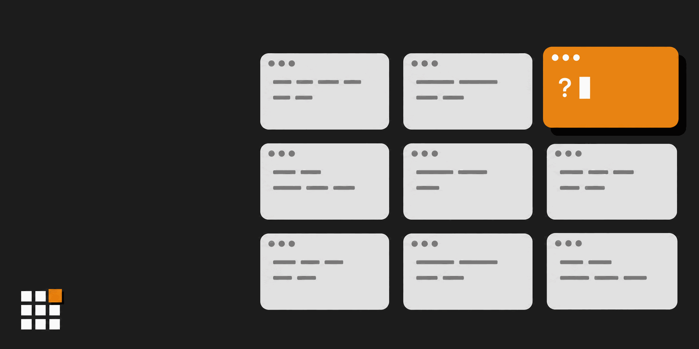
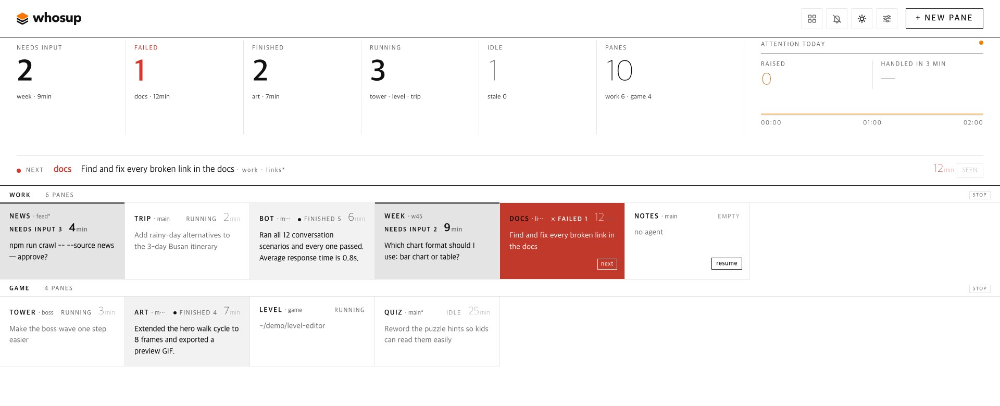
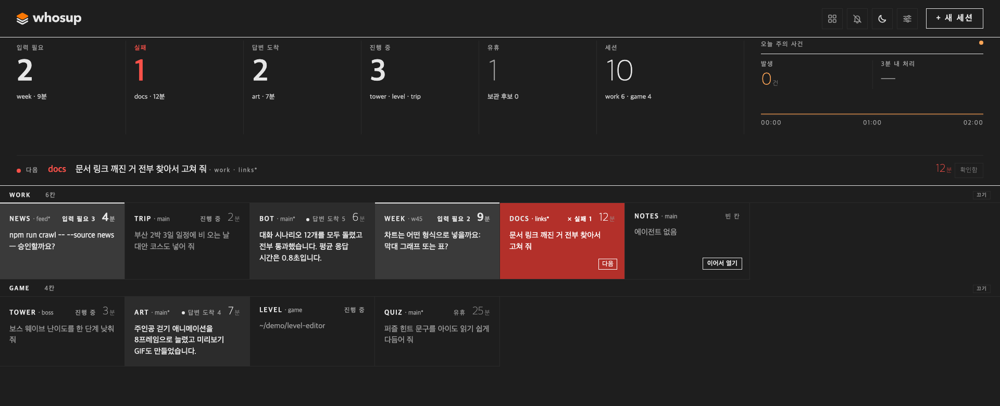

English | [한국어](README.ko.md) | [日本語](README.ja.md) | [中文](README.zh.md) | [Español](README.es.md)

# whosup

<p align="center">
  <picture>
    <source media="(prefers-color-scheme: dark)" srcset="assets/logo-dark.png">
    
  </picture>
</p>

> **Stop abandoning your agent sessions.** whosup puts every herdr session on one board and shows which pane needs you next.

You run six, ten, fifteen coding agents in [herdr](https://herdr.dev) panes. Some are working, some finished an hour ago, one is sitting on a permission prompt you never saw. whosup turns every pane of every running herdr session into one browser page: what needs your input, what just finished, what is still running, what went quiet. Click a cell and herdr jumps to that pane.

<p align="center">
  
</p>

[Quick Start](#quick-start) • [Why whosup?](#why-whosup) • [What you see](#what-you-see) • [How it works](#how-it-works) • [Features](#features) • [Settings](#settings) • [Requirements](#requirements)

---

## Quick Start

### 1. Install the herdr plugin

```bash
herdr plugin install fivetaku/whosup --yes
```

### 2. Start it (or just restart herdr)

```bash
herdr plugin action invoke fivetaku.whosup.start
```

The board comes up at `http://127.0.0.1:4790` and opens in your browser once. From then on it starts with herdr.

### 3. Open more herdr sessions whenever you like

```bash
herdr --session work      # any name, any terminal
```

Every running session shows up on the board by itself. No list to maintain.

---

## Why whosup?

- **You stop polling panes.** The top band tells you how many panes need input, failed, finished, or are running. The "next" line names the one to look at first and quotes the question it is asking.
- **One click, right pane.** Click a cell and herdr focuses that pane, in any tab of any session. On macOS it can bring your terminal app forward too.
- **Restarts don't lose conversations.** After a reboot herdr restores the panes but not the agents. Empty cells get a **resume** button that finds the newest Claude Code conversation for that folder and runs `AGENT_CMD --resume <id>` in the pane. Resume reads Claude Code's conversation history only; with any other agent the pane starts a fresh session.
- **Colour means something.** Black and white everywhere, orange for the one thing to look at next, red for failures. Nothing blinks on a loop.
- **It tells you even when you look away.** The tab title shows how many panes are waiting, e.g. `(3) whosup`, and the favicon lights its orange cell. A pane that just raised its hand gets one short orange ring. The header's sort button switches between **by desk** and **neglected first**, which slides the longest-waiting panes to the front of each desk. Turn on **alerts** in the header for a desktop notification; clicking it jumps to that pane.
- **Nothing waiting gets lost.** A pane that needs you stays on the board until you deal with it — past midnight, after a restart, through a herdr hiccup. **seen** only snoozes it for 30 minutes; if it still needs you, it comes back. Closed panes stay in a **recently closed** row for 7 days and panes you **stash** stay there until you restore them; from that row you can resume or restore them. A stashed pane that starts working again comes back by itself. Pin the panes you always watch to a row at the top.
- **It says when it doesn't know.** If whosup cannot reach herdr, the header shows *disconnected · last collect HH:MM*, the tab title turns into `(!) whosup`, and the favicon goes grey — instead of a calm board that is quietly out of date.
- **Light, dark, your language.** The header button cycles the mode (auto / light / dark); the **settings** panel switches the language (English / 한국어). Palettes follow what real IDE themes use, with text contrast kept at WCAG AA.

---

## What you see

<p align="center">
  <br>
  
</p>

| Area | Meaning |
|---|---|
| **State band** | Counts for needs input · failed · finished · running · idle · panes, plus today's attention events and how many were handled within 3 minutes. Click a number to filter. |
| **Next line** | The single pane to look at first and why: the pending question, the failure, or the finished answer. |
| **Desks** | One row (desk) per herdr session, one cell per pane in pane order. Cell header: label · git branch (the session name when there is no branch) · state, with a number 1–9 on the first nine waiting panes in the shared order (e.g. `needs input 3`; press 3 to jump there) · time waiting (for running and idle panes, time since your last request) · tags for the failure kind (e.g. usage limit) and *unreachable*. Below it, one line of context. |
| **Cell line** | The question the agent is asking (permission box, trust prompt, A-or-B), its last sentence, or your last request, whichever matters for that state. |
| **resume** | On empty panes after a restart: continue the newest conversation for that folder. |
| **+ new pane** | Pick a session and a folder; whosup opens a tab there, starts your agent, and focuses it. |

---

## How it works

```
herdr sessions (main, side, …)
   └─ pane list + agent list, every 3 s  ──►  whosup collector  ──►  SQLite (node:sqlite)
                                                                       │
browser  ◄──  http://127.0.0.1:4790  ◄──  board server  ◄─────────────┘
   │
   └─ click  ──►  pane.focus over herdr's socket  ──►  the pane
```

One Node process, no build step. herdr's startup hook is a one-shot command: when herdr starts, it launches whosup as a background server and returns. The server then keeps running on its own — herdr does not supervise or stop it — so use the `stop` action to shut it down. Pane state comes from herdr's agent detection (working / blocked / done / idle); the question text is read from the pane screen; the last request comes from Claude Code's conversation history (`~/.claude/projects`, or `CLAUDE_PROJECTS_DIR`). Panes running other agents show no last request, and resume starts them fresh. The collector also listens to herdr's events, so a pane that changes state is collected right away instead of waiting for the next 3 s pass, and open board tabs are updated at once. Without the event stream the 3 s pass still runs.

**Trust model.** The server listens on 127.0.0.1 only and has no login. Browser requests from other sites that try to change something are refused (a change must come from the board's own address and be sent as JSON), but any program running on the same computer can use its API — including changing settings such as `AGENT_CMD`, the command whosup types into a pane for resume and new panes. Do not expose the port to other people. The server also answers 403 `local only` to any request whose `Host` header is not `127.0.0.1`, `localhost` or `[::1]`, so tunnels that forward a public hostname (Tailscale Serve, cloudflared, ngrok) cannot open the board at all. To watch from another machine of yours, use a port forward that keeps a localhost host, such as `ssh -L 4790:127.0.0.1:4790 <host>` and then `http://localhost:4790`, and run the server with `WHOSUP_READONLY=1`. Read-only blocks changes, not viewing: it does not list folders under your home, but everything on the board stays visible — pane folder paths in the cell tooltips, last request text, question text — and `GET /api/settings` still returns `agent_cmd`.

---

## Features

| Feature | Description |
|---|---|
| Auto-discovery | Every running herdr session and pane, no configuration |
| Attention states | needs input · failed · finished · running · idle · empty |
| Question extraction | Permission boxes, trust-folder prompts, and "A or B?" questions are shown verbatim |
| Jump | Click → `pane.focus`, and on macOS the terminal window showing that session comes forward. The terminal app is found automatically; when no window shows the session, a new one opens (Ghostty and Terminal) |
| Where a click goes | **settings** → *Clicking a pane opens*: terminal window (default), web address, or both, saved per browser. Web address opens the pane in a web terminal for herdr in a new tab, with `{session}` and `{pane}` filled in; each herdr session can have its own address. Pick it when you use the board from another device |
| Resume | The pane's own conversation, else the newest one in its folder that is not live in another pane → `AGENT_CMD --resume`; the board shows which one before you click. Claude Code conversations only; other agents start fresh |
| New pane | Session + folder picker, runs your agent command |
| Desks (optional) | Declare sessions and panes per monitor in `desks.json`; the `desks-apply` action creates what is missing, idempotently |
| i18n | English by default, 한국어 on request (**settings** panel, `?lang=ko`) |
| Theme | auto / light / dark (header button, `?theme=`), researched IDE palettes |
| Read-only mode | `WHOSUP_READONLY=1` hides the action buttons and **+ new pane**, blocks clicks, Enter, 1–9, `n`, alert clicks and settings changes (the settings panel shows only the language choice), and does not list folders. It blocks changes, not viewing — see the trust model |
| Seen = snooze | **seen** on any waiting cell hides it for 30 min; **unsee** brings it back now |
| Pin | Pinned panes sit in a row above every desk, in both sort modes |
| Stash & recently closed | Stash an idle pane; closed panes stay under **recently closed** for 7 days, stashed panes until you restore them; a stashed pane that starts working again comes back by itself |
| One order | The next line, Enter, keys 1–9, alerts and the neglected sort all use the same order: failed → needs input → finished, oldest first |
| Keyboard | `n` (or `ㅜ` with a Korean layout) opens new pane · Tab moves between panes and Enter or Space opens the focused one · with no pane focused, Enter jumps to the next pane, or saves/opens in an open panel · 1–9 jump to the numbered pane · Esc closes the panel. `n` and 1–9 are ignored while you type in a field |
| Re-alerts | A pane left waiting is alerted again every 15 min, up to 4 times; alerts close when the pane is handled |
| macOS alerts (optional) | The server can send macOS notifications even with the tab closed — off by default |
| Split screen (optional, macOS) | Clicking a pane puts the board on the left part of the screen and the terminal on the rest (`split_pct`) — off by default, needs Accessibility permission |
| Honest state | Last collect time in the header; *disconnected* when collects stop; panes in an unreachable session are kept and marked |
| Settings panel | **settings** in the header: snooze, re-alert interval and limit, closed-after, disconnect warning, keep days, stale days, macOS alerts, unreachable timeout, split screen, agent command, where a click goes (this browser only), terminal app. In read-only mode it shows only the language choice |

### Plugin actions

| Action | What it does |
|---|---|
| `fivetaku.whosup.start` | Start the board (also runs at herdr startup) |
| `fivetaku.whosup.stop` | Stop it |
| `fivetaku.whosup.status` | URL (port) and PID |
| `fivetaku.whosup.open` | Open the board in the browser |
| `fivetaku.whosup.desks-apply` | Create sessions/panes from `desks.json` |
| `fivetaku.whosup.desks-status` | Declared vs existing panes |

---

## Settings

Put `KEY=value` lines in `.env` inside the plugin config dir (`herdr plugin config-dir fivetaku.whosup`; `~/.config/whosup` when run outside herdr). The file is read only when `start` launches the server, so after a change run the `stop` action and then `start`. The `desks-apply` action does not read `.env`; it takes the agent command from `agent_cmd` in `desks.json`.

| Key | Default | Meaning |
|---|---|---|
| `PORT` | 4790 | next free port is used if taken |
| `OPEN_BROWSER` | 1 | open the tab once when herdr starts |
| `AGENT_CMD` | claude | command used by resume and new pane — put your wrapper here; the **settings** panel can override it |
| `FRONT_APP` | auto | macOS terminal app to bring forward on jump, e.g. `Ghostty`. When unset, the app showing herdr is detected, and Terminal opens a new window if there is none. The **settings** panel changes it without a restart |
| `STALE_DAYS` (or `WHOSUP_STALE_DAYS`) | 3 | quiet days before a pane is an archive candidate |
| `WHOSUP_READONLY` | 0 | 1 = read-only view: no changes, no folder list |
| `WHOSUP_SEEN_SNOOZE_MIN` · `WHOSUP_RENOTIFY_MIN` · `WHOSUP_RENOTIFY_MAX` · `WHOSUP_GONE_MISSES` · `WHOSUP_STALE_COLLECT_SEC` · `WHOSUP_CLOSED_KEEP_DAYS` · `WHOSUP_OS_NOTIFY` · `WHOSUP_UNREACHABLE_TTL_H` · `WHOSUP_SPLIT_PCT` | 30 · 15 · 4 · 3 · 30 · 7 · 0 · 24 · 0 | starting values; the **settings** panel in the header overrides them per computer |
| `WHOSUP_INTERVAL` | 3 | seconds between collects |
| `CLAUDE_PROJECTS_DIR` | `~/.claude/projects` | where resume and the last request look for Claude Code conversations |
| `HERDR_BIN_PATH` (or `HERDR_BIN`) | auto | path to the herdr binary; otherwise whosup tries `/opt/homebrew/bin`, `/usr/local/bin`, `~/.local/bin`, then `PATH` |

### Desks (optional)

If you like a fixed layout — say one herdr session per monitor — describe it once and let whosup create it:

```json
{ "agent_cmd": "claude",
  "desks": [
    { "session": "main", "note": "left monitor", "agent": true,
      "panes": [ { "label": "api", "cwd": "~/src/api" }, { "label": "web", "cwd": "~/src/web" } ] },
    { "session": "side", "panes": [ { "label": "notes", "cwd": "~/notes" } ] }
  ] }
```

Save it as `desks.json` in the plugin config dir (`herdr plugin config-dir fivetaku.whosup`; `~/.config/whosup` when run outside herdr) and run `herdr plugin action invoke fivetaku.whosup.desks-apply`. It only adds what is missing. Open a terminal per session wherever you like (`herdr --session main`).

### Agent restore

herdr can restart agents itself after a reboot (`[session] resume_agents_on_restore`). If you launch agents through a wrapper, set that to `false` and use whosup's **resume** instead, so the wrapper is used.

---

## Requirements

- [herdr](https://herdr.dev) 0.9.0 or newer
- Node.js 22.13 or newer (`node:sqlite` without a flag); no bun, no build
- curl (the `start`, `status` and `open` actions use it for health checks)
- macOS or Linux

---

## Not whosup

Terminal mirroring, chat, and typing from a phone: [ovis](https://github.com/devswha/ovis). Kanban-driven agents: herdr-board. whosup only looks and jumps.

## License

MIT — see [LICENSE](LICENSE).

---

<div align="center">

**Look once. Jump to the one that needs you.**

</div>
