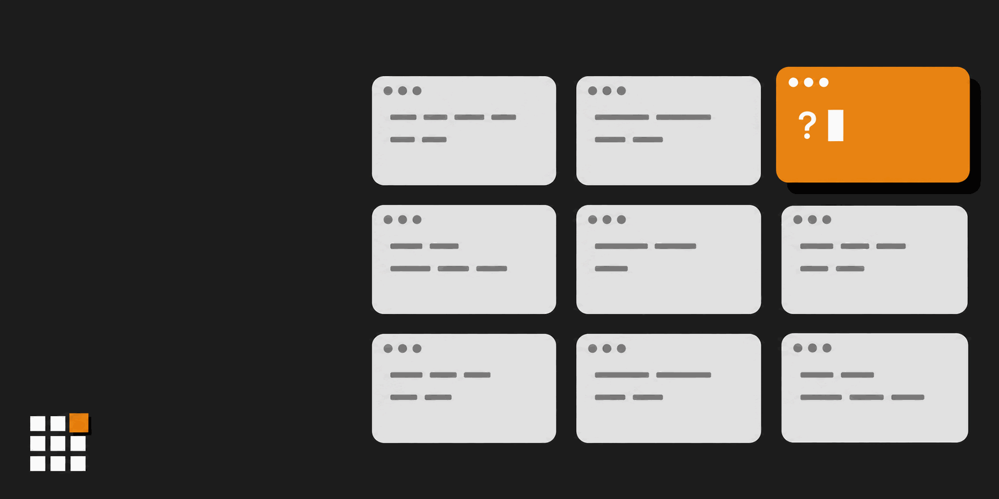
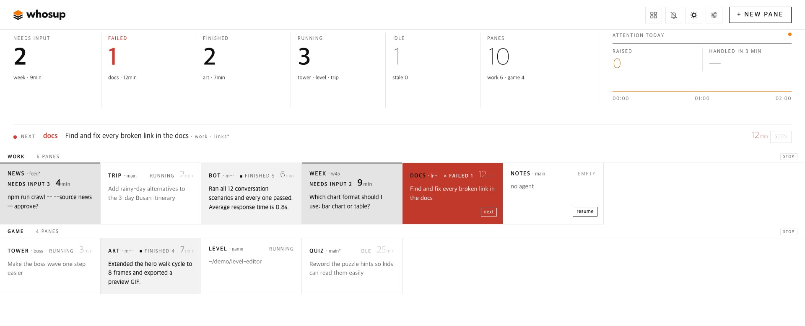
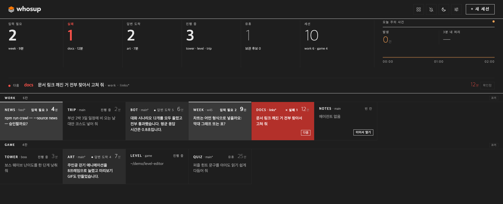

[English](README.md) | [한국어](README.ko.md) | [日本語](README.ja.md) | 中文 | [Español](README.es.md)

# whosup

<p align="center">
  <picture>
    <source media="(prefers-color-scheme: dark)" srcset="assets/logo-dark.png">
    
  </picture>
</p>

> **别再把会话晾在一边。** whosup 把所有 herdr 会话放进一块看板，告诉你下一个该看哪个窗格。

你在 [herdr](https://herdr.dev) 的窗格里同时跑着六个、十个、十五个编码代理。有的还在干活，有的一小时前就结束了，还有一个停在你根本没看到的权限确认上。whosup 会把所有运行中的 herdr 会话的每个窗格汇总到一个浏览器页面：谁需要你输入，谁刚刚完成，谁还在运行，谁已经安静下来。点一下格子，herdr 就会跳到对应的窗格。

<p align="center">
  
</p>

[快速开始](#快速开始) • [为什么选择 whosup？](#为什么选择-whosup) • [你会看到什么](#你会看到什么) • [工作原理](#工作原理) • [功能](#功能) • [设置](#设置) • [环境要求](#环境要求)

---

## 快速开始

### 1. 安装 herdr 插件

```bash
herdr plugin install fivetaku/whosup --yes
```

### 2. 启动（或者直接重启 herdr）

```bash
herdr plugin action invoke fivetaku.whosup.start
```

看板会在 `http://127.0.0.1:4790` 启动，并在浏览器中自动打开一次。此后它会随 herdr 一起启动。

### 3. 想开多少 herdr 会话都行

```bash
herdr --session work      # 名字随意，终端随意
```

所有运行中的会话都会自动出现在看板上，无需维护任何列表。

---

## 为什么选择 whosup？

- **不用再挨个窗格查看。** 顶部状态条会告诉你有多少窗格需要输入、已失败、已完成或正在运行。**next** 一行会指出最该先看的那个窗格，并引用它正在提出的问题。
- **一键直达对应窗格。** 点击格子，herdr 就会聚焦到那个窗格，不论它在哪个会话的哪个标签页。在 macOS 上还可以把你的终端应用切到最前面。
- **重启不会丢失对话。** 重启后 herdr 会恢复窗格，但不会恢复代理。空窗格的格子上会出现 **resume** 按钮，它会找到该文件夹下最新的一次 Claude Code 对话，并在窗格里运行 `AGENT_CMD --resume <id>`。resume 只读取 Claude Code 的对话记录；其他代理会开始一段新对话。
- **颜色有明确含义。** 整体黑白，橙色只标出下一个该看的，红色表示失败。没有持续闪烁。
- **切到别的窗口也会提醒。** 标签页标题会显示等待的窗格数，如 `(3) whosup`，网站图标的橙色格会亮起。刚举手的格子会闪过一次橙色边框。顶栏的排序按钮在 **by desk**（按 desk 顺序）和 **neglected first**（搁置久的优先）之间切换；后者会把等得最久的窗格移到每个 desk 的最前面。打开顶栏的 **alerts** 可收到桌面通知，点击即跳到该窗格。
- **等待中的窗格不会丢。** 需要你的窗格会一直留在看板上，直到你处理它——过了午夜、重启之后、herdr 短暂无响应时都一样。**seen** 只会推迟 30 分钟，之后仍在等待就会重新出现。关闭的窗格在 **recently closed** 行保留 7 天，你用 **stash** 收起的窗格则一直保留到你恢复它，都可以在那里继续打开或恢复。收起的窗格重新开始工作时会自动回来。常看的窗格可以用图钉固定在最上方。
- **不知道就说不知道。** 连不上 herdr 时，顶栏显示 *disconnected · last collect HH:MM*，标签页标题变成 `(!) whosup`，网站图标变灰，而不是安静地显示过期的看板。
- **浅色、深色、你的语言。** 顶栏按钮切换模式（auto / light / dark），**settings** 面板切换语言（English / 한국어）。界面没有中文，所以本 README 中的按钮名沿用英文界面。配色参考真实 IDE 主题，文字对比度保持在 WCAG AA 水平。

---

## 你会看到什么

<p align="center">
  <br>
  
</p>

| 区域 | 含义 |
|---|---|
| **状态条** | 需要输入 · 失败 · 完成 · 运行中 · 空闲的窗格数和窗格总数，以及今天的关注事件数和其中 3 分钟内处理完的比例。点击数字可以筛选。 |
| **next 一行** | 最该先看的那个窗格及原因：待回答的问题、失败信息或已完成的答复。 |
| **desk** | 每个 herdr 会话一行（desk），每个窗格一个格子，按窗格顺序排列。格子标题：标签 · git 分支（没有分支时显示会话名） · 状态；按统一顺序排在前面的 9 个等待中窗格带 1–9 编号（如 `needs input 3`，按 3 跳过去） · 已等待时间（运行中和空闲的窗格显示距你上次请求的时间） · 失败类型（如 usage limit）和 *unreachable* 标签。下面是一行上下文。 |
| **格子内的一行** | 代理正在提出的问题（权限框、文件夹信任确认、二选一），或它的最后一句话，或你的最后一次请求，取决于当前状态下哪个最重要。 |
| **resume** | 重启后的空窗格上：接着该文件夹下最新的一次对话继续。 |
| **+ new pane** | 选一个会话和一个文件夹；whosup 会在那里开一个标签页，启动你的代理，并聚焦过去。 |

---

## 工作原理

```
herdr sessions (main, side, …)
   └─ pane list + agent list, every 3 s  ──►  whosup collector  ──►  SQLite (node:sqlite)
                                                                       │
browser  ◄──  http://127.0.0.1:4790  ◄──  board server  ◄─────────────┘
   │
   └─ click  ──►  pane.focus over herdr's socket  ──►  the pane
```

只有一个 Node 进程，无需构建。herdr 的启动钩子是一次性命令：herdr 启动时，它把 whosup 作为后台服务器启动后就结束。之后服务器会自己一直运行，herdr 不会监管或停止它；要停止它，请使用 `stop` 操作。窗格状态来自 herdr 的代理检测（working / blocked / done / idle）；问题文本从窗格屏幕上读取；最后一次请求取自 Claude Code 的对话记录（`~/.claude/projects` 或 `CLAUDE_PROJECTS_DIR`）。运行其他代理的窗格不显示最后一次请求，resume 也会开始新对话。收集器还会监听 herdr 的事件：窗格状态一变就立即收集，不用等下一次 3 秒收集，并马上通知已打开的看板标签页。收不到事件时，3 秒收集照常运行。

**信任模型。** 服务器只监听 127.0.0.1，没有登录。来自其他网站、试图修改内容的浏览器请求会被拒绝（修改只接受从看板自身地址以 JSON 发送的请求），但同一台电脑上运行的任何程序都能调用它的 API，包括修改 `AGENT_CMD` 之类的设置——这是 whosup 在 resume 和 new pane 时输入到窗格里的命令。不要把端口暴露给其他人。对于 `Host` 头不是 `127.0.0.1`、`localhost` 或 `[::1]` 的请求，服务器一律返回 403 `local only`，所以转发公网主机名的隧道（Tailscale Serve、cloudflared、ngrok）根本打不开看板。要从你自己的另一台机器查看，请用保持 localhost 主机名的端口转发，例如 `ssh -L 4790:127.0.0.1:4790 <host>`，再打开 `http://localhost:4790`，并用 `WHOSUP_READONLY=1` 启动服务器。只读模式只阻止修改，不阻止查看：它不会列出主目录下的文件夹，但看板上的内容都看得到——格子提示中的窗格文件夹路径、最后一次请求、问题原文——而且 `GET /api/settings` 仍会返回 `agent_cmd`。

---

## 功能

| 功能 | 说明 |
|---|---|
| 自动发现 | 所有运行中的 herdr 会话和窗格，无需配置 |
| 关注状态 | needs input · failed · finished · running · idle · empty |
| 问题提取 | 权限框、文件夹信任确认和"A 还是 B？"类问题会原文显示 |
| 跳转 | 点击 → `pane.focus`，在 macOS 上显示该会话的终端窗口会切到前台。终端应用会自动找到；如果没有窗口显示该会话，就打开一个新窗口（Ghostty、Terminal） |
| 点击后打开的位置 | **settings** → *Clicking a pane opens*：terminal window（默认）、web address 或 both，按浏览器分别保存。web address 会在 herdr 的网页终端里用新标签页打开该窗格，地址中的 `{session}` 和 `{pane}` 会被替换，每个 herdr 会话可以单独填写地址。从其他设备使用看板时请选它 |
| resume | 窗格自己的对话，否则是该文件夹下没有在其他窗格运行的最新对话 → `AGENT_CMD --resume`；点击前看板会显示是哪一段。仅支持 Claude Code 对话，其他代理会重新开始 |
| new pane | 选择会话和文件夹，运行你的代理命令 |
| desk（可选） | 在 `desks.json` 中按显示器声明会话和窗格；`desks-apply` 操作只补齐缺失的部分，可重复执行 |
| 多语言 | 默认 English，한국어 在 **settings** 面板或用 `?lang=ko` 选择 |
| 主题 | auto / light / dark（顶栏按钮，`?theme=`），参考 IDE 配色调研而来 |
| 只读模式 | `WHOSUP_READONLY=1` 会隐藏操作按钮和 **+ new pane**，阻止点击、Enter、1–9、`n`、点击提醒和修改设置（设置面板只显示语言选择），也不列出文件夹。只阻止修改，不阻止查看——见信任模型 |
| seen = 推迟 | 等待中格子的 **seen** 只隐藏 30 分钟，**unsee** 立即恢复 |
| 固定 | 固定的窗格不受排序影响，放在所有 desk 上方的固定行 |
| stash 与 recently closed | 收起空闲窗格；关闭的窗格在 **recently closed** 保留 7 天，收起的窗格保留到你恢复为止；收起的窗格重新开始工作时会自动回来 |
| 同一顺序 | next 一行、Enter、1–9、提醒和搁置排序使用同一顺序：失败 → 需要输入 → 已完成，等待久的在前 |
| 键盘 | `n`（韩文键盘布局下为 `ㅜ`）打开 new pane · Tab 在窗格间移动，Enter 或 Space 打开获得焦点的窗格 · 没有窗格获得焦点时 Enter 跳到 next 窗格，面板打开时为保存或打开 · 1–9 跳到对应编号的窗格 · Esc 关闭面板。在输入框中输入时忽略 `n` 和 1–9 |
| 重复提醒 | 未处理的窗格每 15 分钟再提醒一次，最多 4 次；处理后关闭提醒 |
| macOS 提醒（可选） | 即使标签页关闭，服务器也可发送 macOS 通知——默认关闭 |
| 分屏（可选，macOS） | 点击格子时把看板放在屏幕左侧、终端占据其余部分（`split_pct`）。默认关闭，需要辅助功能权限 |
| 如实的状态 | 顶栏显示最后采集时间，采集停止时显示 *disconnected*，herdr 无法确认的会话中的窗格会保留并标记 *unreachable* |
| 设置面板 | 顶栏 **settings**：推迟时长、重复提醒间隔与次数、判定关闭的标准、断开警告、recently closed 保留天数、搁置标记天数、macOS 提醒、unreachable 判定时间、分屏、代理命令、点击后打开的位置（仅限当前浏览器）、终端应用。只读模式下只显示语言选择 |

### 插件操作

| 操作 | 作用 |
|---|---|
| `fivetaku.whosup.start` | 启动看板（herdr 启动时也会运行） |
| `fivetaku.whosup.stop` | 停止看板 |
| `fivetaku.whosup.status` | URL（端口）、PID |
| `fivetaku.whosup.open` | 在浏览器中打开看板 |
| `fivetaku.whosup.desks-apply` | 根据 `desks.json` 创建会话/窗格 |
| `fivetaku.whosup.desks-status` | 已声明与实际存在的窗格对比 |

---

## 设置

在插件配置目录（`herdr plugin config-dir fivetaku.whosup`；在 herdr 之外运行时为 `~/.config/whosup`）下的 `.env` 里写入 `KEY=value` 行。这个文件只在 `start` 启动服务器时读取，所以修改后要先运行 `stop` 操作，再运行 `start`。`desks-apply` 操作不读取 `.env`，代理命令取自 `desks.json` 里的 `agent_cmd`。

| 键 | 默认值 | 含义 |
|---|---|---|
| `PORT` | 4790 | 端口被占用时使用下一个空闲端口 |
| `OPEN_BROWSER` | 1 | herdr 启动时打开一次浏览器标签页 |
| `AGENT_CMD` | claude | resume 和 new pane 使用的命令，如果你有包装脚本，就填在这里；**settings** 面板中改的值优先 |
| `FRONT_APP` | 自动 | 跳转时要切到前台的 macOS 终端应用，例如 `Ghostty`。未设置时会找到正在显示 herdr 的应用；没有窗口时用 Terminal 打开新窗口。在 **settings** 面板里修改后无需重启即可生效 |
| `STALE_DAYS`（或 `WHOSUP_STALE_DAYS`） | 3 | 窗格多少天没有动静后标记为可收起 |
| `WHOSUP_READONLY` | 0 | 设为 1 即只读：不能修改，也不列出文件夹 |
| `WHOSUP_SEEN_SNOOZE_MIN` · `WHOSUP_RENOTIFY_MIN` · `WHOSUP_RENOTIFY_MAX` · `WHOSUP_GONE_MISSES` · `WHOSUP_STALE_COLLECT_SEC` · `WHOSUP_CLOSED_KEEP_DAYS` · `WHOSUP_OS_NOTIFY` · `WHOSUP_UNREACHABLE_TTL_H` · `WHOSUP_SPLIT_PCT` | 30 · 15 · 4 · 3 · 30 · 7 · 0 · 24 · 0 | 初始值；顶栏 **settings** 面板中改的值在这台电脑上优先 |
| `WHOSUP_INTERVAL` | 3 | 采集间隔（秒） |
| `CLAUDE_PROJECTS_DIR` | `~/.claude/projects` | resume 和最后一次请求查找 Claude Code 对话的目录 |
| `HERDR_BIN_PATH`（或 `HERDR_BIN`） | 自动 | herdr 可执行文件路径；未设置时依次查找 `/opt/homebrew/bin`、`/usr/local/bin`、`~/.local/bin`、`PATH` |

### desk（可选）

如果你喜欢固定的布局，比如每个显示器对应一个 herdr 会话，只需描述一次，剩下的交给 whosup 来创建：

```json
{ "agent_cmd": "claude",
  "desks": [
    { "session": "main", "note": "left monitor", "agent": true,
      "panes": [ { "label": "api", "cwd": "~/src/api" }, { "label": "web", "cwd": "~/src/web" } ] },
    { "session": "side", "panes": [ { "label": "notes", "cwd": "~/notes" } ] }
  ] }
```

把上面的内容保存为插件配置目录（`herdr plugin config-dir fivetaku.whosup`；在 herdr 之外运行时为 `~/.config/whosup`）下的 `desks.json`，然后运行 `herdr plugin action invoke fivetaku.whosup.desks-apply`。它只会补上缺失的部分。每个会话想在哪个终端里打开都行（`herdr --session main`）。

### 代理恢复

herdr 自己也可以在重启后重新启动代理（`[session] resume_agents_on_restore`）。如果你是通过包装脚本启动代理的，请把它设为 `false`，改用 whosup 的 **resume**，这样才会走你的包装脚本。

---

## 环境要求

- [herdr](https://herdr.dev) 0.9.0 或更高版本
- Node.js 22.13 或更高版本（无需标志即可使用 `node:sqlite`）；不需要 bun，也无需构建
- curl（`start`、`status` 和 `open` 操作用它做健康检查）
- macOS 或 Linux

---

## 不是 whosup 的范围

终端镜像、聊天，以及用手机输入：请看 [ovis](https://github.com/devswha/ovis)。看板驱动的代理：herdr-board。whosup 只负责看和跳转。

## 许可证

MIT —— 见 [LICENSE](LICENSE)。

---

<div align="center">

**看一眼，直接跳到需要你的那个。**

</div>
