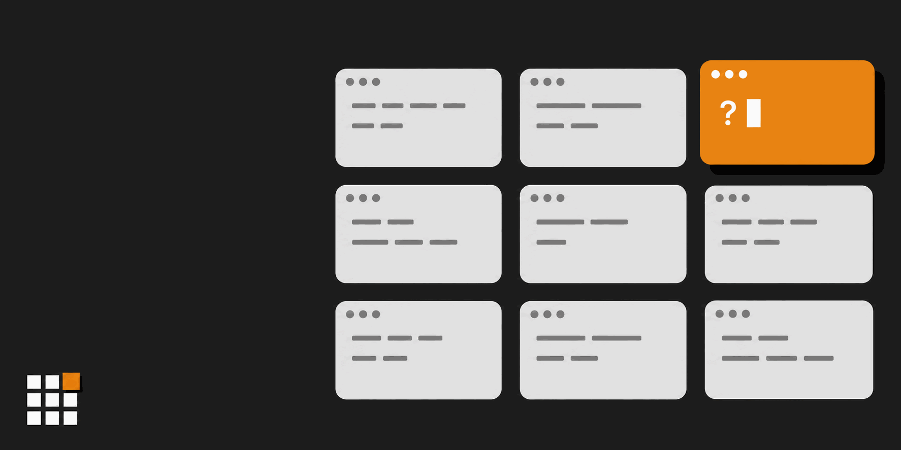
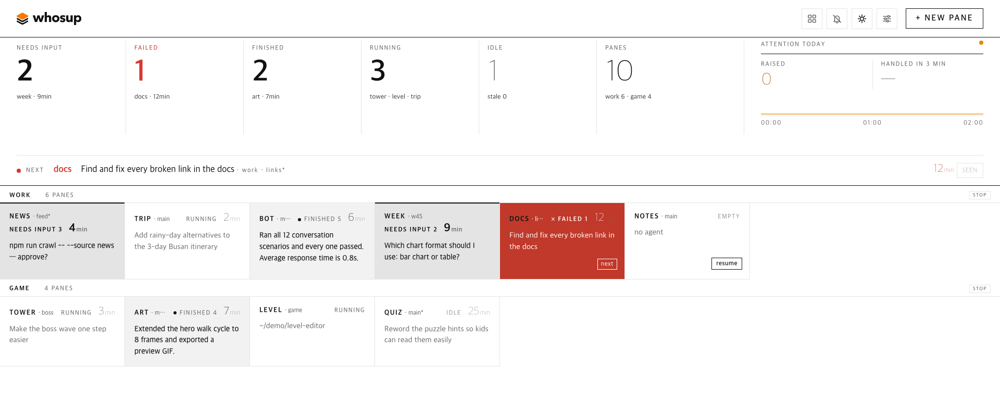
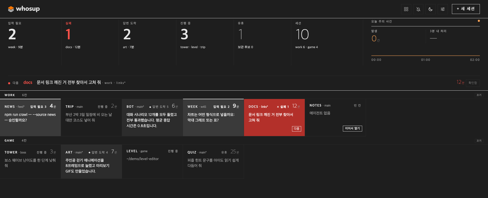

[English](README.md) | [한국어](README.ko.md) | [日本語](README.ja.md) | 中文 | [Español](README.es.md)

# whosup

<p align="center">
  <picture>
    <source media="(prefers-color-scheme: dark)" srcset="assets/logo-dark.png">
    
  </picture>
</p>

> **别再把会话晾在一边。** whosup 把 herdr 里的所有会话放进一块看板，告诉你下一个该看哪个会话。

你在 [herdr](https://herdr.dev) 的 pane 里同时跑着六个、十个、十五个编码代理。有的还在干活，有的一小时前就结束了，还有一个停在你根本没看到的权限确认上。whosup 把 herdr 的每个 pane 称为*会话*，把每个 herdr 会话（或 Herdr 应用的空间）称为 *desk*。whosup 会把所有运行中的 desk 的每个会话汇总到一个浏览器页面：谁需要你输入，谁刚刚完成，谁还在运行，谁已经安静下来。点一下会话，herdr 就会跳到那里。

<p align="center">
  
</p>

[快速开始](#快速开始) • [为什么选择 whosup？](#为什么选择-whosup) • [你会看到什么](#你会看到什么) • [工作原理](#工作原理) • [功能](#功能) • [设置](#设置) • [按环境设置](#按环境设置) • [环境要求](#环境要求)

---

## 快速开始

### 1. 运行一行命令

不管你现在用的是什么，都从这里开始。把下面这一行粘贴到终端里，按 Enter（macOS、Linux）。

```bash
curl -fsSL https://raw.githubusercontent.com/fivetaku/whosup/main/install.sh | sh
```

安装器会查看这台电脑，然后走三条路中的一条。

| 这台电脑上有什么 | 安装器做什么 |
|---|---|
| herdr 0.9.0 或更高版本 | 把 whosup 安装为 herdr 插件。每次启动 herdr 时看板也一起启动。 |
| 没有 herdr，但有 herdr-core：Herdr 桌面应用，或运行自己 herdr-core 的其他桌面应用（如 Ovis 桌面应用） | 不用 herdr，只安装 whosup（[独立安装](#独立安装)）。看板立即启动，之后每次登录都会再启动。 |
| 两者都没有，也没有 Herdr 应用和 Ovis 应用 | 先问你想在哪里用会话，把选中的那个先装上（无需管理员权限），再配合它安装 whosup。 |

**这台电脑上还没有任何可以运行会话的环境时**，安装器最多用编号问两次：先问 *Desktop app* 还是 *Terminal*，选应用的话再问 *Herdr* 还是 *Ovis*。第一个问题里 *Desktop app* 下面的说明行就写出这台电脑能安装的应用名（Herdr 或 Ovis，只有一个时就是那一个），所以从第一个问题起就能看到。直接按 Enter 就选标有 `*` 的那个：Desktop app，然后 Herdr。接着把你选的东西和 whosup 一起装好。

| 你选的 | 安装什么 | 能装在哪里 |
|---|---|---|
| Desktop app → Herdr（Enter、Enter） | 用 Herdr 应用自己的安装器安装它，再[独立安装](#独立安装) whosup | Apple 芯片的 Mac；x86_64 或 arm64 的 Linux |
| Desktop app → Ovis | 从发布文件（约 175MB）取得 Ovis 应用，核对该发布的校验和（macOS 上还核对签名）后放好，再独立安装 whosup。在 macOS 上放到 `~/Applications` | macOS 13 或更高版本（Apple 芯片或 Intel）；x86_64 或 arm64 的 Linux 上，只有该应用需要的桌面库和 FUSE 已经存在时才行 |
| Terminal | 把 herdr 装到 `~/.local/bin`，再把 whosup 安装为 herdr 插件 | macOS、Linux |

这台电脑装不了的选项不会显示（会用一行说明原因），只剩一个选项的问题不会问：装不了 Herdr 应用的电脑上，应用就是 Ovis；两个应用都装不了时，安装 herdr。想不被询问直接指定，在 `sh` 前面加上 `WHOSUP_ENV=herdr-app`、`ovis-app` 或 `herdr`（见[安装器选项](#安装器选项)）。如果选中的东西装不上，安装器会说明哪里没成功、去哪里自己获取，并且不安装 whosup。电脑上已经有东西时不会问这些：上表的前两行照旧。

需要 Node 22.13 或更高版本。PATH 靠前的位置有旧版 Node 也没关系：安装器会依次查看 PATH 和常见的安装位置（Homebrew、nvm、fnm），使用第一个够新的 Node。一个都没有的话什么都不安装，并用一行说明该怎么做。其他安装器（herdr 的、应用的）的输出，成功时折成一行，失败时全部显示。最后会输出安装摘要：走了哪条路、看板地址、下一步做什么，各说一次。看板在 `http://127.0.0.1:4790` 启动，4790 被占用时用下一个空闲端口。通过 SSH 连接或设置了 `OPEN_BROWSER=0` 时不会打开浏览器，请自己打开那个地址。

从终端安装时，只会询问这台电脑上有两个以上选项的项目，比如会话在哪里打开、新会话运行什么命令。每个问题都会用一行说明它决定什么。直接按 Enter 就沿用标有 `*` 的值（自动检测的值）；输入编号就设为那个值。所有问题都回答了（按 Enter 也算回答），看板就不会再问一遍。问题在那之前中断时（超时没有输入、Ctrl-C），第一次打开看板时会问一次（first-run setup）。

### 2. 接下来取决于你在用什么

**使用 herdr 的人。** whosup 会成为 herdr 插件。

- herdr 正在运行：安装一结束看板就启动，浏览器随之打开。
- herdr 没在运行：摘要会告诉你要输入什么：`herdr`。看板会随之启动。如果 herdr 所在的文件夹不在 PATH 中，摘要会把这条命令写成完整路径，照着输入就能运行。
- 也可以不用这一行，直接安装插件，结果相同：

  ```bash
  herdr plugin install fivetaku/whosup --yes
  ```

此后每次启动 herdr，看板都会一起启动。要手动启动，在 herdr 里的终端运行下面的命令（在 herdr 外的终端里，在 `herdr` 后面紧跟 `--session <desk 名称>`）：

```bash
herdr plugin action invoke fivetaku.whosup.start
```

**只用 Herdr 桌面应用或 Ovis 桌面应用的人（没有 herdr）。** 只单独安装 whosup，不装其他东西。

- 看板立即启动，浏览器随之打开；之后每次登录都会再启动。
- 不会问终端应用：没有可以切到前台的 herdr desk 终端窗口。
- 只有 Herdr 应用自己的核心存在时，才会问 *Herdr app sessions open in*。
- 运行自己核心的应用（如 Ovis 桌面应用）的会话也会显示在看板上。安装时会用一行告诉你，例如 `Sessions of <app> show on the board too.` 应用运行期间，可以在看板上新建会话、关闭和再次打开；点击会话时，如果应用认识 `ovis://` 链接（带这个链接的 Ovis 版本，尚未发布），就在应用窗口里显示它，否则在浏览器标签页里打开它，因为无法从外部告诉这样的应用要显示哪个会话。见 [运行自己核心的应用](#运行自己核心的应用)。
- 应用不必正在运行。只要这台电脑上用过那个应用，安装器就会走同一条路。启动应用后，它的会话就会出现在看板上。
- 之后使用 `whosup` 命令：`whosup start`、`whosup stop`、`whosup update` 等。见 [独立安装](#独立安装)。

**什么都没有的人。** 安装器会问你想用什么（见上表），把它装好，再安装 whosup。

- *Desktop app*（Herdr 应用或 Ovis 应用）：whosup 独立安装，看板随即启动。应用要打开过一次，它的会话才会出现在看板上：会打开浏览器的安装里，安装器也会替你打开应用；否则摘要会告诉你去打开它。走完应用的初始画面后，在看板上开一个新会话。
- *Terminal*（herdr）：whosup 成为 herdr 插件。摘要会告诉你启动 herdr，看板随之启动。如果 `~/.local/bin` 不在 PATH 中，摘要会把这条命令写成完整路径，在当前终端里照着输入就能运行，并输出把这个文件夹加入 PATH 的那一行，供以后新开的终端使用。
- 安装器替你装的应用，whosup 不会删除。`whosup uninstall` 会用一行说明这一点和应用的位置。

**让代理来安装的人。** 让你的代理运行同一行命令即可。

- 没有可以提问的终端，所以什么都不问。第一次打开看板时会问一次。
- 在没有任何可以运行会话的环境的电脑上，不询问就安装默认项：Herdr 应用（装不了 Herdr 应用时是 Ovis 应用，两个都装不了时是 herdr）。想换别的，用 `WHOSUP_ENV` 指定。
- 摘要留在命令的输出里，代理可以把看板地址和下一步转告你。
- 从终端运行的脚本仍然会被提问。要跳过提问，加上 `WHOSUP_NO_SETUP=1`：`curl -fsSL https://raw.githubusercontent.com/fivetaku/whosup/main/install.sh | WHOSUP_NO_SETUP=1 sh`

再次运行这一行不会换路：已经作为 herdr 插件安装时保持原样（摘要会说明如何更新），已有独立安装时就地换成新版本。

打开第一个会话之前，先知道这几件事：

- **macOS 权限。** 通常不会弹出权限窗口。只有恢复最小化的窗口和使用分屏时，才需要辅助功能和自动化权限；打开权限之后，要重启 whosup 才生效。见[功能](#功能)表里的 *跳转*。
- **macOS 与文件夹。** 为新会话选择桌面、文稿或下载里的文件夹时，macOS 会询问是否允许该应用访问这个文件夹。允许它，或者选别的文件夹。
- **Claude Code 的“是否信任此文件夹”提问**出现时，光标停在 "No, exit" 上。先向下移到 "Yes, I trust this folder"，再按 Enter。那是 Claude Code 的画面，whosup 改不了。
- **herdr 和 Herdr 应用第一次启动时会显示英文的欢迎画面。** 那是它们自己的画面，按 Enter 继续就行。
- **韩文字符之间看起来有空隙**，是某些终端应用（比如 macOS 自带的终端）绘制字体的方式造成的。whosup 输出的文字里没有多余的空格。

### 3. 想开多少 desk 都行（herdr）

```bash
herdr --session work      # 名字随意，终端随意
```

每个运行中的 desk 都会自动出现在看板上，不用维护任何列表。

### 在 Windows 上

一行安装器和独立安装不能在 Windows 上运行。在 Windows 上请安装 herdr 插件：

```powershell
herdr plugin install fivetaku/whosup --yes
```

在 Windows 上安装时什么都不问（herdr 在不可见的控制台里执行安装步骤），第一次打开看板时由 first-run setup 来问；操作名带 `win-` 前缀（`win-start`、`win-doctor` 等）。见 [Windows](#windows)。

---

## 为什么选择 whosup？

- **不用再挨个会话查看。** 顶部状态条会告诉你有多少会话需要输入、已失败、已完成或正在运行。**next** 一行会指出最该先看的那个会话，并引用它正在提出的问题。
- **一键直达对应会话。** 点击会话，herdr 就会聚焦过去，不论它在哪个 desk 的哪个标签页。在 macOS 上还可以把你的终端应用切到最前面。
- **重启不会丢失对话。** 重启后 herdr 会恢复会话，但不会恢复代理。空会话上会出现 **resume** 按钮，它会找到该文件夹下最新的一次 Claude Code 对话，并在该会话里运行 `AGENT_CMD --resume <id>`。resume 只读取 Claude Code 的对话记录；其他代理会开始一段新对话。没有可以继续的对话的空会话上，出现的是 **start agent** 按钮。
- **颜色有明确含义。** 整体黑白，橙色只标出下一个该看的，红色表示失败。没有持续闪烁。
- **切到别的窗口也会提醒。** 标签页标题会显示等待的会话数，如 `(3) whosup`，网站图标的橙色格会亮起。刚举手的会话会闪过一次橙色边框。顶栏的排序按钮在 **by desk**（按 desk 顺序）和 **neglected first**（搁置久的优先）之间切换；后者会把等得最久的会话移到每个 desk 的最前面。打开顶栏的 **alerts** 可收到桌面通知，点击即跳到该会话。
- **等待中的会话不会丢。** 需要你的会话会一直留在看板上，直到你处理它——过了午夜、重启之后、herdr 短暂无响应时都一样。**seen** 只会推迟 30 分钟，之后仍在等待就会重新出现。关闭的会话在 **recently closed** 行保留 7 天，你用 **stash** 收起的会话则一直保留到你恢复它，都可以在那里继续打开或恢复。收起的会话重新开始工作时会自动回来。常看的会话可以用图钉固定在最上方。
- **不知道就说不知道。** 连不上 herdr 时，顶栏显示 *disconnected · last collect HH:MM*，标签页标题变成 `(!) whosup`，网站图标变灰，而不是安静地显示过期的看板。
- **浅色、深色、你的语言。** 顶栏按钮切换模式（auto / light / dark），first-run setup 和 **settings** 里的 EN / 한 按钮切换语言（默认 English，另有 한국어）。界面没有中文，所以本 README 中的按钮名沿用英文界面。配色参考真实 IDE 主题，文字对比度保持在 WCAG AA 水平。

---

## 你会看到什么

<p align="center">
  <br>
  
</p>

| 区域 | 含义 |
|---|---|
| **状态条** | 需要输入 · 失败 · 完成 · 运行中 · 空闲的会话数和会话总数，以及今天的关注事件数和其中 3 分钟内处理完的比例。点击数字可以筛选。 |
| **next 一行** | 最该先看的那个会话及原因：待回答的问题、失败信息或已完成的答复。没有任何会话在运行代理时，这里改为显示下一步（next step）：开一个新会话。 |
| **desk** | 每个 desk 一行，会话按它们在 desk 中的顺序排列。会话标题：标签 · git 分支（没有分支时显示 desk 名） · 状态；按统一顺序排在前面的 9 个等待中会话带 1–9 编号（如 `needs input 3`，按 3 跳过去） · 已等待时间（运行中和空闲的会话显示距你上次请求的时间） · 失败类型（如 usage limit）和 *unreachable* 标签。下面是一行上下文。 |
| **会话内的一行** | 代理正在提出的问题（权限框、文件夹信任确认、二选一），或它的最后一句话，或你的最后一次请求，取决于当前状态下哪个最重要。 |
| **resume** | 重启后的空会话上：接着该文件夹下最新的一次对话继续。没有可以继续的对话时，按钮显示为 **start agent**，开始一段新对话。 |
| **+ new session** | 选一个 desk 和一个文件夹（在列表里进入某个文件夹，就选中了它）；whosup 会在那里开一个标签页，启动你的代理，并聚焦过去。 |

---

## 工作原理

```
herdr sessions (main, side, …)
   └─ pane list + agent list, every 3 s  ──►  whosup collector  ──►  SQLite (node:sqlite)
                                                                       │
browser  ◄──  http://127.0.0.1:4790  ◄──  board server  ◄─────────────┘
   │
   └─ click  ──►  pane.focus over herdr's socket  ──►  the pane
```

只有一个 Node 进程，无需构建。herdr 的启动钩子是一次性命令：herdr 启动时，它把 whosup 作为后台服务器启动后就结束。之后服务器会自己一直运行，herdr 不会监管或停止它；要停止它，请使用 `stop` 操作。会话状态来自 herdr 的代理检测（working / blocked / done / idle）；问题文本从会话屏幕上读取；最后一次请求取自 Claude Code 的对话记录（`~/.claude/projects` 或 `CLAUDE_PROJECTS_DIR`）。运行其他代理的会话不显示最后一次请求，resume 也会开始新对话。收集器还会监听 herdr 的事件：会话状态一变就立即收集，不用等下一次 3 秒收集，并马上通知已打开的看板标签页。收不到事件时，3 秒收集照常运行。

**信任模型。** 服务器只监听 127.0.0.1，没有登录。来自其他网站、试图修改内容的浏览器请求会被拒绝（修改只接受从看板自身地址以 JSON 发送的请求），但同一台电脑上运行的任何程序都能调用它的 API，包括修改 `AGENT_CMD` 之类的设置——这是 whosup 在 resume 和 new session 时输入到会话里的命令。不要把端口暴露给其他人。对于 `Host` 头不是 `127.0.0.1`、`localhost` 或 `[::1]` 的请求，服务器一律返回 403 `local only`，所以转发公网主机名的隧道（Tailscale Serve、cloudflared、ngrok）根本打不开看板。要从你自己的另一台机器查看，请用保持 localhost 主机名的端口转发，例如 `ssh -L 4790:127.0.0.1:4790 <host>`，再打开 `http://localhost:4790`，并用 `WHOSUP_READONLY=1` 启动服务器。只读模式只阻止修改，不阻止查看：它不会列出主目录下的文件夹，但看板上的内容都看得到——会话提示中的文件夹路径、最后一次请求、问题原文——而且 `GET /api/settings` 仍会返回 `agent_cmd`。

---

## 功能

| 功能 | 说明 |
|---|---|
| 自动发现 | 所有运行中的 desk 和会话，无需配置 |
| 关注状态 | needs input · failed · finished · running · idle · empty |
| 问题提取 | 权限框、文件夹信任确认和"A 还是 B？"类问题会原文显示 |
| 跳转 | 点击 → `pane.focus`，在 macOS 上显示该 desk 的终端窗口会切到前台。终端应用会自动找到；如果没有窗口显示该 desk，就打开一个新窗口（Ghostty、Terminal）。macOS 权限：只要那个应用有窗口显示在屏幕上，点击就不需要任何权限，也不会弹出系统窗口。屏幕上没有它的窗口（最小化或隐藏）时，先重新打开那个应用，这同样不需要权限，最小化的窗口会恢复（没有权限时无法知道哪个窗口被最小化了，所以同一个应用的另一个窗口显示在屏幕上时，最小化的窗口保持原样）。只有这样仍然没有窗口出现时，以及使用分屏时，才会用到辅助功能和自动化（System Events）权限，macOS 可能在那时询问。缺少权限或拒绝过时，看板会显示一行提示（和红色的 *disconnected* 标记不同）：点开可以看到哪些功能用不了、在哪里打开（系统设置 → 隐私与安全性 → 辅助功能，或 自动化 → System Events；对象是启动 whosup 的那个应用，提示里会写出它的名字），以及打开后需要重启 whosup。已经给过这两项权限的人，一切照旧 |
| 会话打开的位置 | **settings** → *Sessions open in*：terminal window（默认）、web terminal 或 both。选择保存在服务器上，作为所有浏览器的默认值；勾选 *only in this browser* 后只对当前浏览器生效。web terminal 会在 herdr 的网页终端里用新标签页打开该会话，地址中的 `{session}` 和 `{pane}` 会被替换，每个 desk 可以单独填写地址（网页终端通常每个 desk 各有一个服务器和端口）；你填写的地址只保存在当前浏览器里。Herdr 应用的 desk 只有在填写了自己的地址时才会在网页中打开。标签页按 desk 复用，因此会与打开它的看板保持关联：请只填写你信任的网页终端地址。从其他设备使用看板时请选它。只读模式下不可用（只读会拦住所有点击） |
| Herdr 应用的终端 | 本机上如果 herdr-core（Herdr 桌面应用的终端）正在运行，它的每个终端也会成为一个会话：应用的每个空间是一个 desk，状态和提问文字以核心报告的为准。点击会跳到 Herdr 应用里的那个会话并把应用带到前台；应用没有打开时，会在终端窗口中打开该会话（`hc attach`）。**settings** → *Herdr app sessions open in* 选 terminal window（或 `WHOSUP_CORE_TARGET=terminal`）时，即使应用开着也总是在终端窗口中用 `hc attach` 打开。关闭、继续、新会话以及整个 desk 的关闭和开启与 herdr 的 desk 相同。无需配置，whosup 也不会启动未运行的核心。核心不会报告的信任文件夹提示会从屏幕读取，并显示为等待输入；除此之外不会根据屏幕内容猜测状态 |
| 其他应用的会话 | 运行自己 herdr-core 的桌面应用（如 Ovis 桌面应用）会被自动检测找到，它的会话也会显示在看板上。应用运行期间，可以在看板上新建会话、关闭和继续。已安装的应用认识 `ovis://` 链接时（带这个链接的 Ovis 版本，尚未发布），点击会通过这个链接在应用窗口里显示那个会话；否则在浏览器标签页里打开那个会话，应用窗口保持原样，因为无法从外部告诉应用要显示哪个会话。见 [运行自己核心的应用](#运行自己核心的应用) |
| resume | 会话自己的对话，否则是该文件夹下没有在其他会话运行的最新对话 → `AGENT_CMD --resume`；点击前看板会显示是哪一段。仅支持 Claude Code 对话，其他代理会重新开始 |
| new session | 选择 desk 和文件夹，运行你的代理命令 |
| desk（可选） | 在 `desks.json` 中按显示器声明 desk 和会话；`desks-apply` 操作只补齐缺失的部分，可重复执行 |
| 多语言 | 默认 English，한국어 用 first-run setup 和 **settings** 里的 EN / 한 按钮或 `?lang=ko` 选择。选择按浏览器分别保存 |
| 主题 | auto / light / dark（顶栏按钮，`?theme=`），参考 IDE 配色调研而来 |
| 只读模式 | `WHOSUP_READONLY=1` 会隐藏操作按钮和 **+ new session**，阻止点击、Enter、1–9、`n`、点击提醒和修改设置（设置中只显示语言选择），也不列出文件夹。只阻止修改，不阻止查看——见信任模型 |
| seen = 推迟 | 等待中会话的 **seen** 只隐藏 30 分钟，**unsee** 立即恢复 |
| 固定 | 固定的会话不受排序影响，放在所有 desk 上方的固定行 |
| stash 与 recently closed | 收起空闲会话；关闭的会话在 **recently closed** 保留 7 天，收起的会话保留到你恢复为止；收起的会话重新开始工作时会自动回来 |
| 同一顺序 | next 一行、Enter、1–9、提醒和搁置排序使用同一顺序：失败 → 需要输入 → 已完成，等待久的在前 |
| 键盘 | `n`（韩文键盘布局下为 `ㅜ`）打开 new session · Tab 在会话间移动，Enter 或 Space 打开获得焦点的会话 · 没有会话获得焦点时 Enter 跳到 next 会话，面板打开时为保存或打开 · 1–9 跳到对应编号的会话 · Esc 关闭面板。在输入框中输入时忽略 `n` 和 1–9 |
| 重复提醒 | 未处理的会话每 15 分钟再提醒一次，最多 4 次；处理后关闭提醒 |
| macOS 提醒（可选） | 即使标签页关闭，服务器也可发送 macOS 通知——默认关闭 |
| 分屏（可选，macOS） | 点击会话时把看板放在屏幕左侧、终端占据其余部分（`split_pct`）。默认关闭，需要辅助功能和自动化权限（见 *跳转*） |
| 如实的状态 | 顶栏显示最后采集时间，采集停止时显示 *disconnected*，herdr 无法确认的 desk 中的会话会保留并标记 *unreachable* |
| first-run setup | 第一次打开看板时出现一次（安装时已在终端里完成过就不会出现）：显示检测到的环境（只要找到了一个能运行会话的地方，就不列出没找到的项；**settings** 里全部列出），并为每一项列出检测到的选项，预先选好当前会用的值。*Sessions open in*：terminal window、web terminal 或 both，只有检测到与 desk 对应的网页终端（ovis 等）时才出现（否则只能选 terminal window。first-run setup 不显示只有一个选项的项，**settings** 里仍然显示）；*Terminal app*：检测到的应用（当前显示 herdr 的应用、已安装的应用）和 auto，只有存在运行中的 herdr desk 时才出现；*Herdr app sessions open in*：Herdr app 或 terminal window，只有检测到 Herdr 应用（`herdr-app` 命令或它的核心）时才出现；每个运行自己核心的应用会多出一行 `Sessions of <app> show on the board too. A click opens the session in a browser tab.`（**settings** 的检测到的环境里也有）；*Command to run in a new session*：检测到的代理（claude、codex）。点击 **start with these** 后，只有你亲自选过的行会作为你设定的值保存到服务器的设置里，之后自动检测不会再改动；没动过的行不保存，继续跟随自动检测；已经在设置或环境变量里设定的项，不动就保持原样。顶部的 EN / 한 按钮切换看板语言。用 ✕ 或 Esc 关掉也算完成（不保存任何值），不会再自行弹出。确认之前，看板最多每 5 秒重新检测一次，所以比 whosup 晚启动的网页终端也会出现在选项里。可在 **settings** 里再次打开 |
| 设置 | 顶栏 **settings**：推迟时长、重复提醒间隔与次数、判定关闭的标准、断开警告、recently closed 保留天数、搁置标记天数、macOS 提醒、unreachable 判定时间、分屏、代理命令、会话打开的位置（保存在服务器上，可只对当前浏览器另设）、Herdr 应用会话打开的位置、终端应用（按钮列出检测到的应用）。**re-detect** 按钮无需重启即可重新检查运行环境，不会改动你设定的值；**open first-run setup again** 可再次打开 first-run setup。只读模式下只显示语言选择 |

### 插件操作

| 操作 | 作用 |
|---|---|
| `fivetaku.whosup.start` | 启动看板（herdr 启动时也会运行；herdr 正在运行时，安装刚结束也会运行） |
| `fivetaku.whosup.stop` | 停止看板 |
| `fivetaku.whosup.status` | URL（端口）、PID |
| `fivetaku.whosup.open` | 在浏览器中打开看板 |
| `fivetaku.whosup.desks-apply` | 根据 `desks.json` 创建 desk/会话 |
| `fivetaku.whosup.desks-status` | 已声明与实际存在的会话对比 |
| `fivetaku.whosup.autoconf` | 重新检查本机，更新自动检测的值并显示出来（见[值的来源与自动检测](#值的来源与自动检测)） |
| `fivetaku.whosup.win-*` | Windows 上的同名操作（`win-start`、`win-stop`、`win-status`、`win-open`、`win-desks-apply`、`win-desks-status`、`win-autoconf`），外加 `win-doctor` |

---

## 设置

在插件配置目录（`herdr plugin config-dir fivetaku.whosup`；在 herdr 之外运行时为 `~/.config/whosup`）下的 `.env` 里写入 `KEY=value` 行。这个文件只在 `start` 启动服务器时读取，所以修改后要先运行 `stop` 操作，再运行 `start`。这里写的值优先于自动检测，设置里的值又优先于两者（见[值的来源与自动检测](#值的来源与自动检测)）。`desks-apply` 操作不读取 `.env`，代理命令取自 `desks.json` 里的 `agent_cmd`。

| 键 | 默认值 | 含义 |
|---|---|---|
| `PORT` | 4790 | 端口被占用时使用下一个空闲端口 |
| `OPEN_BROWSER` | 1 | 看板启动时（herdr 启动时、安装刚结束时）打开一次浏览器标签页 |
| `AGENT_CMD` | claude | resume 和 new session 使用的命令，如果你有包装脚本，就填在这里；**settings** 中改的值优先 |
| `FRONT_APP` | 自动 | 跳转时要切到前台的 macOS 终端应用，例如 `Ghostty`。未设置时由自动检测选择（[规则表](#值的来源与自动检测)中的 L4 通道）；没有窗口时用 Terminal 打开新窗口。在 Windows 上：留空 = 自动（有 Windows Terminal 就用它，否则 PowerShell 窗口）、`PowerShell`、`Windows Terminal` 或 `off`（任何值都接受）。在 **settings** 里修改后无需重启即可生效 |
| `STALE_DAYS`（或 `WHOSUP_STALE_DAYS`） | 3 | 会话多少天没有动静后标记为可收起 |
| `WHOSUP_READONLY` | 0 | 设为 1 即只读：不能修改，也不列出文件夹 |
| `WHOSUP_SEEN_SNOOZE_MIN` · `WHOSUP_RENOTIFY_MIN` · `WHOSUP_RENOTIFY_MAX` · `WHOSUP_GONE_MISSES` · `WHOSUP_STALE_COLLECT_SEC` · `WHOSUP_CLOSED_KEEP_DAYS` · `WHOSUP_OS_NOTIFY` · `WHOSUP_UNREACHABLE_TTL_H` · `WHOSUP_SPLIT_PCT` | 30 · 15 · 4 · 3 · 30 · 7 · 0 · 24 · 0 | 初始值；顶栏 **settings** 中改的值在这台电脑上优先 |
| `WHOSUP_INTERVAL` | 3 | 采集间隔（秒） |
| `CLAUDE_PROJECTS_DIR` | `~/.claude/projects` | resume 和最后一次请求查找 Claude Code 对话的目录 |
| `HERDR_BIN_PATH`（或 `HERDR_BIN`） | 自动 | herdr 可执行文件路径；未设置时依次查找 `/opt/homebrew/bin`、`/usr/local/bin`、`~/.local/bin`、`PATH` |
| `WHOSUP_RUNTIMES` | auto | 读取对象：`auto`（herdr 的 desk 和 herdr-core 的终端，有哪个读哪个）、`herdr` 或 `herdr-core` |
| `HC_SOCKET` · `HC_SESSION` | 自动 · `default` | 只读取一个 herdr-core 核心：它的套接字，或它的名称（套接字只从该核心的 `core.lock` 读取，遵循 `XDG_STATE_HOME`）。设置了其中任何一个，`WHOSUP_CORES` 和自动检测都不会再添加其他核心。不符合核心名称规则（见 `WHOSUP_CORES`）的 `HC_SESSION` 会被忽略，视为没有设置 |
| `WHOSUP_CORES` | 自动 | 除 Herdr 应用的核心（`default`）之外还要读取的 herdr-core 核心：逗号分隔的核心名称、`all`（留下 `core.lock` 且套接字存在的所有核心）或 `none`（只读 Herdr 应用的核心）。未设置时，自动检测会添加[运行自己核心的应用](#运行自己核心的应用)的核心。核心名称由字母、数字、`.`、`_`、`-` 组成，最多 80 个字符，不接受 `.` 和 `..`。两个名称指向同一个套接字时，该核心只读取一次，用第一个名称 |
| `WHOSUP_CLICK_TARGET` | terminal | 会话打开的位置：`terminal`、`web` 或 `both`。在 first-run setup 或 **settings** 的 *Sessions open in* 里选的值优先，并保存在服务器上作为所有浏览器的默认值；勾选 *only in this browser* 后只在该浏览器里覆盖 |
| `WHOSUP_CORE_TARGET` | app | Herdr 应用会话打开的位置：`app` 或 `terminal`。`terminal` 时即使应用开着，也总是在终端窗口中用 `hc attach` 打开；在 first-run setup 或 **settings** 的 *Herdr app sessions open in* 里选的值优先 |
| `HERDR_APP_BIN` · `HERDR_APP_NAME` · `HC_BIN` | `herdr-app` · `Herdr` · `hc` | Herdr 应用的命令（跳转、新标签页、关闭空间）、macOS 上要带到前台的应用名，以及在终端窗口中打开 herdr-core 终端所用的命令。应用名按 `HERDR_APP_NAME` > 自动检测找到的名称 > `Herdr` 的顺序取用。`HERDR_APP_NAME` 只用于 Herdr 应用，不用于[其他应用的核心](#运行自己核心的应用) |

### desk（可选）

如果你喜欢固定的布局，比如每个显示器对应一个 desk，只需描述一次，剩下的交给 whosup 来创建：

```json
{ "agent_cmd": "claude",
  "desks": [
    { "session": "main", "note": "left monitor", "agent": true,
      "panes": [ { "label": "api", "cwd": "~/src/api" }, { "label": "web", "cwd": "~/src/web" } ] },
    { "session": "side", "panes": [ { "label": "notes", "cwd": "~/notes" } ] }
  ] }
```

把上面的内容保存为插件配置目录（`herdr plugin config-dir fivetaku.whosup`；在 herdr 之外运行时为 `~/.config/whosup`）下的 `desks.json`，然后运行 `herdr plugin action invoke fivetaku.whosup.desks-apply`。它只会补上缺失的部分。每个 desk 想在哪个终端里打开都行（`herdr --session main`）。

### 代理恢复

herdr 自己也可以在重启后重新启动代理（`[session] resume_agents_on_restore`）。如果你是通过包装脚本启动代理的，请把它设为 `false`，改用 whosup 的 **resume**，这样才会走你的包装脚本。

---

## 按环境设置

### 独立安装

这台电脑上没有 herdr、但有 herdr-core（Herdr 桌面应用，或运行自己核心的其他应用）时，[一行安装器](#快速开始)会单独安装 whosup。不管电脑上有什么都要走这条路时，运行 `curl -fsSL https://raw.githubusercontent.com/fivetaku/whosup/main/install.sh | WHOSUP_INSTALL_MODE=standalone sh`。如果已经作为 herdr 插件安装，会拒绝，以免一台电脑上跑两个看板。

放在哪里：

| 什么 | 哪里 |
|---|---|
| 程序 | `~/.local/share/whosup/app`（设置了 `XDG_DATA_HOME` 时为 `$XDG_DATA_HOME/whosup/app`） |
| 安装记录（`install.json`） | 在程序旁边：`~/.local/share/whosup/install.json`。里面记着这次安装使用的文件夹和 Node，所以 `whosup` 命令和登录时自动启动始终用同一套。如果那个 Node 已经不在，或者变成了低于 22.13 的版本，会重新查找别的 Node |
| `whosup` 命令 | `~/.local/bin/whosup` |
| 设置（`.env`、`setup.json`） | `~/.config/whosup` |
| 状态（数据库、`auto.json`、日志） | `~/.local/state/whosup`（`$XDG_STATE_HOME/whosup`）。如果以前从文件夹手动运行过 whosup，会继续使用 `~/.config/whosup`，历史记录得以延续 |

不是绝对路径的 `XDG_DATA_HOME`、`XDG_STATE_HOME` 值会被忽略。

`~/.local/bin` 不在 PATH 中时，摘要会用完整路径写出命令并说明这一点。`~/.local/bin` 里已有另一个名为 whosup 的程序时，不会动它，并在摘要里给出改用的长命令。

安装器会小心对待已经存在的东西：

- **程序的位置上有别的文件夹。** 如果程序的位置上已经有一个不是 whosup 安装器放的文件夹，安装器不会运行也不会改动里面的任何东西，说明情况后结束。把那个文件夹移走，再运行一次安装器。
- **两个安装同时进行。** 如果另一个 whosup 安装还在进行，后开始的那个会说明情况，什么都不改就结束。不管先开始的那个花多长时间都是这样（它可能正停在提问处等待）。安装或更新进行期间运行 `whosup uninstall` 和 `whosup autostart on`、`off`，也会同样说明情况后结束。
- **中途停下的安装**（Ctrl-C，包括在 first-run setup 的提问处按下，或者关掉终端）会被撤销。新安装会清掉已经放好的东西。更新会恢复之前的版本，看板原本在运行的话会重新启动。如果那个看板没能重新启动，安装器会说明这一点，用 `whosup start` 启动即可。两种情况下设置和历史都保持不变。
- **没完成的安装留下的东西**，只有在停掉从那里启动的看板、并取消登录时自动启动之后才会清掉。做不到时，文件夹原样保留，安装器会说明该怎么做，并以错误结束。

`whosup` 命令：

| 命令 | 作用 |
|---|---|
| `whosup start` | 启动看板 |
| `whosup stop` | 停止看板。在 Linux 上也会停止 `whosup.service` 用户服务；那个服务停不下来时，会给出需要自己输入的命令并以错误结束 |
| `whosup status` | 看板是否在运行、地址、登录时是否自动启动 |
| `whosup open` | 在浏览器中打开看板 |
| `whosup setup` | 在终端里重新做一遍 first-run setup |
| `whosup update` | 换成最新版本。设置和历史保持不变，原本在运行的看板会重新启动 |
| `whosup uninstall` | 停止看板，关闭登录时自动启动，删除程序和 `whosup` 命令。设置和历史保留。安装器一并装上的应用（Herdr 应用、Ovis 应用）不会删除，会用一行说明这一点和应用的位置 |
| `whosup uninstall --purge` | 同上，并且也删除设置和历史：只删除安装记录里写的设置文件夹和状态文件夹，不删别的文件夹。只有程序本身全部删除之后才会删 |
| `whosup autostart on` · `off` · `status` | 打开或关闭登录时自动启动，或查看当前状态 |
| `whosup help` | 显示这个列表 |

**登录时自动启动。** 新的独立安装会设置为每次登录时启动看板：macOS 上是 LaunchAgent（`~/Library/LaunchAgents/dev.whosup.board.plist`），Linux 上是 `systemd --user` 服务（`~/.config/systemd/user/whosup.service`）。登录时启动不会打开浏览器标签页。要关闭：

```bash
whosup autostart off
```

`whosup autostart on` 可以再打开。更新会保留你的选择。在没有 `systemd --user` 的 Linux 上，登录时不会自动启动；摘要会说明这一点，用 `whosup start` 启动即可。

在 macOS 上，如果登录时自动启动已经设置好、但现在没能加载，就从下次登录开始生效。安装摘要、`whosup autostart on` 和 `whosup status` 会说明这一点。`whosup autostart off` 删不掉登录项的文件时，会指出留下的文件并以错误结束。如果服务管理器（macOS 上是 launchd，Linux 上是 systemd）里登录项仍然存在，它不会说已经关闭，而是给出需要自己输入的命令并以错误结束。

**更新与删除。** `whosup update` 会重新下载安装器并按独立安装的路线运行；再次运行一行安装器也一样。新版本安装失败、原本在运行的看板在新版本里启动不了，或者你中途停下更新时，会恢复旧版本。`whosup uninstall` 不加 `--purge` 时会保留 `~/.config/whosup` 和状态目录，并列出删除了什么、保留了什么。有没能删除的东西时也会列出来，并以错误结束（退出码 1），剩下的可以自己删除。登录时自动启动没能关闭，或者在 Linux 上用户服务没能停止时，会停在那一步，不删除程序。程序的位置上如果有不是安装器放的文件夹，会原样保留。

### 安装器选项

放在这一行的 `sh` 前面，例如 `curl -fsSL https://raw.githubusercontent.com/fivetaku/whosup/main/install.sh | WHOSUP_NO_LOGIN_START=1 sh`。它们从安装命令的环境中读取，而不是从 `.env`。

| 变量 | 作用 |
|---|---|
| `WHOSUP_INSTALL_MODE=plugin` 或 `standalone` | 不管电脑上有什么，都走这条路 |
| `WHOSUP_ENV=herdr-app`、`ovis-app` 或 `herdr` | 在没有任何可以运行会话的环境的电脑上：不询问，直接安装它。这台电脑装不了这个值时，说明原因，什么都不安装。电脑上已经有东西或给了 `WHOSUP_INSTALL_MODE` 时不使用，并用一行说明 |
| `WHOSUP_ENV_TIMEOUT=<秒>` | herdr 的安装器，以及应用的安装器及其每一次下载，超过这个时间就停止（默认 900） |
| `WHOSUP_REF=<分支、标签或提交>` | 安装那个版本，而不是默认分支 |
| `WHOSUP_NO_SETUP=1` | 什么都不问，包括要安装什么（安装默认项）；第一次打开看板时再问 |
| `WHOSUP_NO_AUTOSTART=1` | 安装后不立即启动看板 |
| `WHOSUP_NO_LOGIN_START=1` | 独立安装：不设置登录时自动启动 |
| `CI` | 以上三项都不做：不提问、不启动、不设置登录时自动启动 |
| `WHOSUP_LANG=ko` 或 `en` | 安装器输出和提问所用的语言（未指定时，区域设置为韩语就用韩语，其他情况用英语） |

这些开关在值为空、`0`、`false`、`no` 或 `off` 时为关，其他任何值为开。

### 运行自己核心的应用

有些桌面应用会运行自己的 herdr-core，与 Herdr 应用的核心分开。Ovis 桌面应用就是其中之一。whosup 会自己找到这类应用（自动检测，L7 通道），把它的会话放在单独的 desk 里显示在看板上，无需配置。

- **应用运行期间，可以在看板上新建会话、关闭和继续。** whosup 请那个应用自己的本地服务器（`127.0.0.1`）来做，不读取也不使用令牌。新会话会作为你选的 desk 里的标签页打开，或作为那个应用里的新 desk 打开，whosup 再把代理命令输入进去。这些会话不支持 desk 的开关。
- **应用认识 `ovis://` 链接时，点击会在应用窗口里显示那个会话。** 这需要带 `ovis://open` 链接的 Ovis 版本（尚未发布，已发布的 0.5.3 没有）。whosup 会自己检查已安装的应用（macOS 看该应用的 `Info.plist`，Linux 看 `x-scheme-handler/ovis` 的处理程序，Windows 看 `HKCU\Software\Classes\ovis`），并用系统的打开命令（`open`、`xdg-open`、`start`）打开 `ovis://open?pane=<会话>&view=terminal`：点击会话时，以及在看板上刚新建的会话，应用窗口都会切到前台并选中那个会话。链接打不开时，改为打开该会话的浏览器标签页。用了哪种方式会写在返回结果里（`opened`：`app_link` 或 `browser`）。
- **否则，点击会在浏览器标签页里打开那个会话，应用窗口保持原样。** 无法从外部告诉应用要显示哪个会话，所以 whosup 改为打开该会话在应用本地服务器上的地址（`http://127.0.0.1:<端口>/?pane=…`），并且不把应用窗口切到前台（切到前台会让显示着别的会话的窗口盖住刚打开的标签页）。只要你没有亲自设定过 *Sessions open in*，就会打开这个标签页；设定过之后（在 settings、first-run setup 里，或用 `WHOSUP_CLICK_TARGET`），点击就按你的选择来。选了 terminal window 时，应用窗口会切到前台，请在窗口里自己选会话。
- **应用没在运行时**，whosup 不会启动它。只要应用的核心还在运行，它的会话就留在看板上：可以查看，点击时看板会提示应用没在运行，不碰任何窗口。新会话和继续会提示先启动应用；关闭仍然可用（在核心里结束那个终端）。启动应用后再点一次。如果核心也停了，这些会话会标为 *unreachable*，过了 **settings** 里的 unreachable 判定时间（默认 24 小时）后移到 **recently closed**。如果在应用关闭期间重启了看板，看板就不知道应用名了：在应用再次运行之前，这些会话以核心名称显示，点击会在终端窗口中打开（`hc attach`）。
- **要求令牌或登录的服务器**，看板不去操作，也不绕过它：它的会话只能查看和跳转。
- **在 macOS 以外**找不到应用名，不会把应用窗口切到前台，而是在终端窗口中打开该会话（`hc attach`）。在 macOS 上，把 *Herdr app sessions open in* 设为 terminal window 时也是这样。因为没有应用名可以提示，那个核心没在运行时，看板会提示该会话的核心没在运行。
- **不再读取的核心：** 如果你自己指定了要读取的核心（`WHOSUP_CORES`、`HC_SOCKET` 或 `HC_SESSION`），以你的设置为准：不在其中的核心即使还有打开的会话也不会读取，这些会话很快会移到 **recently closed**。在那之前点击这样的会话，什么都不会打开，看板会提示现在无法确认那个核心。
- **网页终端：** 如果那个应用的网页终端在 `127.0.0.1` 上无需登录就能打开，会为那个 desk 填入它的地址；*Sessions open in* 选 web terminal 时就会使用它。

查找方式：whosup 只询问 `127.0.0.1`，查看 7317–7330 端口，以及 ovis 桥接登记目录（`~/.config/ovis/bridges`，旧名称 `~/.config/herdr-web-ui/bridges`）里记录的端口。从登记目录中只取用每一项的端口和进程号；令牌不会被取出，也不会在任何地方保存或留下。只有进程仍在运行的项才会使用，在 macOS 和 Linux 上还要求那个进程确实在监听该端口（无法确认时照旧使用）。只有以 ovis 身份应答、并说明自己显示的是 herdr-core 的服务器才算数；核心名称使用该服务器报告的名称。显示 herdr desk 的 ovis 服务器仍像以前一样作为那个 desk 的网页终端。

看板运行期间，每 10 秒重新查看一次登记目录；应用的服务器在其中出现、消失或端口变化时，会重新检测。刚启动的应用，其服务器可能还没有报告核心名称；这时看板会每 5 秒再问一次，最长约 1 分钟。

已知限制：

- 看板运行期间只盯着登记目录。在看板启动之后才启动的应用，如果过了 1 分钟左右还没有出现（比如它的服务器不在登记目录里），请在 **settings** 里按 **re-detect**。
- 设置了令牌的 ovis 服务器的核心不会自动读取，它的端口会标为“需要确认”。在 `WHOSUP_CORES` 里写上核心名称就会读取。
- 应用名只在 macOS 上查找。
- 在 `herdr-app` 处理不止一个核心的少见配置下，点击不会跳到应用里的那个会话，因为 `herdr-app` 分不清一个会话属于哪个核心。这时会在连到该会话所属核心的终端窗口中打开它（`hc attach`）。

### Herdr 桌面应用

whosup 通过 Herdr 桌面应用的核心 herdr-core 读取应用里的终端。满足下面几点就无需任何配置：

- **herdr-core 正在本机运行。** 核心会把套接字路径写入 `<state>/herdr-core/<session>/core.lock`（`<state>` 为 `XDG_STATE_HOME`，否则为 `~/.local/state`，在 Windows 上还会查看 `%LOCALAPPDATA%`；`<session>` 为 `HC_SESSION`，否则为 `default`）；设置了 `HC_SOCKET` 时以它为准。`core.lock` 里的套接字优先；自动检测以前看到的套接字只在 `core.lock` 或其套接字不存在时才使用，并且不用于你用 `HC_SESSION` 指定名称的核心。套接字存在期间就视为核心在运行。whosup 不会启动核心。
- **`herdr-app` 在 `PATH` 中**（或设置 `HERDR_APP_BIN`）。跳转、新建标签页和关闭空间都通过它完成。没有它也能读取会话。
- **`hc` 在 `PATH` 中**（或设置 `HC_BIN`）。应用没有打开窗口时，或 *Herdr app sessions open in* 选了 terminal window 时，用它在终端窗口中打开该会话。

自动检测（L6 通道）会在每次启动时检查套接字和 `herdr-app`；安装时的 first-run setup 也会检查它们，用来决定问什么。点击 Herdr 应用的会话，会在应用中显示该会话并把应用（`HERDR_APP_NAME`，默认 `Herdr`）切到前台；应用没有窗口时，会在终端窗口中打开 `hc attach <terminal>`。*Herdr app sessions open in* 选 terminal window（`WHOSUP_CORE_TARGET=terminal`）时，即使应用开着也总是在终端窗口中用 `hc attach` 打开。`node scripts/doctor.mjs` 只凭这个核心（`default` 或 `HC_SESSION`）自己的套接字判断它是否在运行，[其他应用的核心](#运行自己核心的应用)不算。

应用的会话没有出现在看板上时，请检查：

- `WHOSUP_RUNTIMES` 必须是 `auto`（默认）或包含 `herdr-core`；只写 `herdr` 会排除应用。
- 如果给 whosup 设置了 `HC_SOCKET`、`HC_SESSION`、`XDG_STATE_HOME`，它们必须指向应用所用的同一个核心。
- `node scripts/doctor.mjs` 会显示 core 行（套接字，或 *not running*）、查找过的状态目录，以及是否找到 `herdr-app`；`autoconf` 操作会显示 L6 通道及其依据（见[值的来源与自动检测](#值的来源与自动检测)）。
- 在 Windows 上 herdr-core 是否通过 named pipe 监听，尚未确认。

### ovis：在其他设备或手机上打开会话

[ovis](https://github.com/devswha/ovis) 是 herdr 的 Web 客户端（聊天、实时终端、手机应用）。whosup 只负责找到正在运行的 ovis 并填好地址，不会启动或停止它。

```bash
herdr plugin install devswha/ovis --yes          # 依据 ovis 的 INSTALL.md
herdr plugin action invoke devswha.ovis.start
```

- 作为 herdr 插件安装的 ovis 会随 herdr 一起在 `http://127.0.0.1:7317` 启动，并跟随启动它的那个 desk 的套接字。
- 一个 ovis 服务器只对应一个 desk。要查看其他 desk，就在另一个端口再启动一个 ovis 服务器，并设置 `PORT` 和 `HERDR_SOCKET=~/.config/herdr/sessions/<名称>/herdr.sock`（见 ovis INSTALL.md 的 Configuration）。whosup 会查看 7317–7330 端口，以及 ovis 桥接登记目录里记录的端口（见 [运行自己核心的应用](#运行自己核心的应用)）。
- whosup 在每次启动时检查这些端口（L7 通道）；安装时的 first-run setup 也会检查它们，用来决定问什么。只有当 `GET /api/health?scope=bridge` 用 ovis 自有的字段应答时才视为 ovis。desk 取自监听该端口的进程的 `HERDR_SOCKET`（没有则取 `HERDR_SESSION`），macOS 用 `ps` 读取，Linux 用 `/proc`。对 herdr 列出的每个 desk，填入地址 `http://127.0.0.1:<port>/?pane={pane}`。如果知道服务器的 `HERDR_SOCKET`，而 herdr 用另一个套接字显示同名的 desk（名字相同的另一个 herdr），就什么都不填，并把那个端口标为“需要确认”。
- 无法判断 desk 时（Windows、herdr 列表中没有的 desk、同一 desk 有两个服务器），不填任何地址，并把该端口标为“需确认”。这时请在 **settings** 里自己填写地址。
- 无论有没有 ovis，点击默认都会打开终端窗口。第一次打开看板时会出现 first-run setup（安装时已在终端里完成过就不会出现），汇总检测到的环境，并为每一项列出检测到的选项；只有检测到与 desk 对应的 ovis 时，*Sessions open in* 才会在 terminal window 之外多出 web terminal 和 both。确认之前，看板最多每 5 秒重新检测一次，所以比 whosup 晚启动的 ovis 也会出现在选项里；之后可用 **settings** 的 **re-detect** 重新检查，无需重启。点击 **start with these** 后，选择保存在服务器上（`click_target`），作为所有浏览器的默认值；**settings** → *Sessions open in* 改的也是这个默认值，勾选 *only in this browser* 后只在当前浏览器里生效，浏览器里有自己保存的值时就用它。你自己填写的地址只保存在当前浏览器里。

填入的地址是 `127.0.0.1`，所以会在运行 ovis 的电脑上打开。从其他设备访问时，把那个端口也转发过去（`ssh -L 4790:127.0.0.1:4790 -L 7317:127.0.0.1:7317 <host>`），或在 **settings** 里换成该设备能访问到的地址。在手机上请使用 ovis 自己的应用和中继（见 ovis 的 README）。要从看板打开会话，看板不能是只读模式。

### Windows

whosup 也能在 Windows 上运行（Node 和 PowerShell，无需 `sh`），但只能作为 herdr 插件安装：一行安装器和独立安装（`whosup` 命令、登录时自动启动）仅限 macOS 和 Linux。插件里有 herdr 用 `node` 运行的 Windows 专用条目，所以安装和启动方式相同，操作名带 `win-` 前缀：

```powershell
herdr plugin install fivetaku/whosup --yes
herdr plugin action invoke fivetaku.whosup.win-start
herdr plugin action invoke fivetaku.whosup.win-doctor    # 只读检查本机
herdr plugin action invoke fivetaku.whosup.win-autoconf  # 自动检测到的内容
```

如果想手动运行（在 whosup 目录下，于 **桌面会话** 中运行——不要通过 SSH，那样窗口不可见）：

```powershell
node scripts\doctor.mjs                 # whosup 能看到什么：Node、herdr、pipe、PowerShell、Windows Terminal、桌面会话
node scripts\launch.mjs start           # 与 start 操作相同（也有 status · stop · open）
# 或在前台直接运行；设置用 PowerShell 变量传入（VAR=值 是 sh 语法，这里不可用）：
$env:FRONT_APP='Windows Terminal'; node bin\whosup.mjs
```

- 自动检测在每次启动前运行。安装时（`launch.mjs install`）只检查 Node：不检测、不提问，也不写入任何内容；手动运行检测用 `launch.mjs preflight`。`PATH` 中有 `wt.exe` 时选择 **Windows Terminal**，否则点击时打开 PowerShell 窗口。
- 通过 SSH 启动，或处于 Windows 会话 0（服务；先看 `SESSIONNAME`，没有时看进程的会话编号——桌面上的登录计划任务没有 `SESSIONNAME` 也算桌面）时，whosup 视为远程：桌面上什么也不会显示，所以既不打开浏览器，也不把窗口切到前台（*Terminal app* = off）。要用窗口，请从桌面会话启动。
- 点击会话会把显示其 desk 的终端窗口切到前台；没有这样的窗口时，会新开一个连接到该 desk 的 PowerShell 窗口。可在设置的 *Terminal app* 中选择 **auto**、**PowerShell**、**Windows Terminal** 或 **off**（也可设置 `FRONT_APP`）。
- `node bin\whosup.mjs` 不读取 `.env`；`launch.mjs` 和插件操作会读取（只有 `KEY=value` 行，不执行任何内容）。
- 需要 Windows 版 Node 22.13+（[nodejs.org](https://nodejs.org)，或 nvm-windows、Volta、fnm）在 `PATH` 中，herdr 在 `PATH` 中（或设置 `HERDR_BIN_PATH`）。
- 尚未在 Windows 真机上确认：Herdr 桌面应用（herdr-core）在 Windows 上是否通过 named pipe 监听，以及启动钩子返回后 herdr 是否让 whosup 继续运行。`win-doctor` 会显示这两点。安装刚结束时看板是否会自动启动，也尚未在真机上确认；没有启动时请运行 `win-start` 操作。在 Windows 上安装时什么都不问：herdr 在不可见的控制台里执行安装步骤（这是从 herdr 源码读到的，尚未在真机上确认）。在 Windows 上能找到 ovis 端口，但无法得知每个端口对应的 desk，所以标为“需确认”。

### 值的来源与自动检测

每项设置按以下顺序取第一个找到的值：**设置 > 环境变量（含 `.env`）> 自动检测 > 内置默认值。** 你在设置或环境变量里设的值，自动检测永远不会改动；自动检测也不会写入 `.env` 或设置里的值。

- **设置**：保存在本机 whosup 的数据库中，立即生效。清空某一栏，就回到下一层的值。在 first-run setup 里点 **start with these** 保存的选择也属于这一层：只保存你亲自选过的行，没动过的行不保存，继续跟随自动检测。安装时在 first-run setup 里用编号选的值也保存在这里（见下文）。
- **环境变量 / `.env`**：写在插件配置目录（`herdr plugin config-dir fivetaku.whosup`；在 herdr 之外为 `~/.config/whosup`）下 `.env` 里的 `KEY=value` 行。只在 `start` 启动服务器时读取，所以编辑后先运行 `stop`，再运行 `start`。
- **自动检测**：每次启动前重新检查，写入状态目录（herdr 的插件状态目录；在 herdr 之外为 `~/.config/whosup`）下的 `auto.json`。安装时不写入任何内容：那时的检测只用来决定 first-run setup 问什么。服务器启动时，如果这个文件是刚写入的（同一平台、2 分钟内）就读取；否则（例如直接运行 `bin/whosup.mjs`）会重新检测并重写，检测失败时不带自动值启动。**settings** 的 **re-detect** 按钮（`POST /api/autoconf/refresh`）无需重启即可重新检查运行环境，不会改动你设定的值。在确认 first-run setup 之前，看板最多每 5 秒重新检测一次，所以在 whosup 之后启动的网页终端也会出现在选项里。

**安装时的 first-run setup。** 从终端安装时，first-run setup 的问题会先在那个终端里问。只在首次安装时问；更新或重新安装时什么都不问，也不动正在运行的看板。看板没在运行而 herdr 在运行时，会把它启动；herdr 没在运行时，会提示你输入 `herdr`。按 Enter 跳过的项目保持自动检测；用编号选的值写入插件配置目录下的 `setup.json`，看板服务器读取这个文件（启动时和运行期间），把它保存为你设定的值。只要用编号选过至少一项，或者所有问题都回答了（只按 Enter 也算——这时 `setup.json` 里只写入 first-run setup 已完成的标记，不固定任何值，那些项目继续跟随自动检测），此后看板就不会自行弹出 first-run setup。某个问题 120 秒没有输入时，这个问题和剩下的问题都使用自动检测的值。一个编号都没选、也没有回答完所有问题时（没有可问的问题、没有终端、完全没有输入，或超时），不保存任何内容，第一次打开看板时按那时检测到的情况弹出一次 first-run setup（后来启动的网页终端也会出现在选项里）。提问过程中按 Ctrl-C 会取消整个安装：同一个信号也会结束 `herdr plugin install`，所以什么都不会安装，也什么都不保存，包括已经用编号选的值，屏幕上也不会再输出任何内容（如果安装命令在这个信号下仍在运行，则只跳过提问：首次安装会在第一次打开看板时再问，重新提问的安装则保持当前设置）。在终端后台（`… &`）运行安装时，以及在 Windows 上（herdr 在不可见的控制台里执行安装步骤），什么都不问。想再被问一次，可以带上 `WHOSUP_SETUP=1` 更新或重新安装，或在 whosup 目录下运行 `node scripts/setup.mjs`（在这里按 Ctrl-C 只是停止，不保存任何内容）。`WHOSUP_SETUP=1` 在 Windows 上不起作用（Windows 上的安装不提问）：在 Windows 上请手动运行 `node scripts\setup.mjs`，或使用 **settings** 里的 **open first-run setup again**。再次被问时，按 Enter 会让该项保持当前设置（之前自己设定的值会保留）。看板运行期间用 `node scripts/setup.mjs` 选的值无需重启即可生效；更新或重新安装时选的值要在看板重启后才生效（正在运行的看板可能还是旧版本）。`WHOSUP_NO_SETUP=1` 跳过提问，`WHOSUP_NO_AUTOSTART=1` 安装后不启动看板；设置了 `CI` 时两者都不做。这些开关在值为空、`0`、`false`、`no` 或 `off` 时为关，其他任何值为开。`WHOSUP_SETUP_TIMEOUT_S` 修改这 120 秒，`WHOSUP_LANG=ko|en` 指定提问的语言（未指定时，区域设置为韩语就用韩语，其他情况用英语）。这些变量从安装命令的环境中读取，而不是从 `.env`。

要查看检测结果，运行 `autoconf` 操作（Windows 上为 `win-autoconf`），或在 whosup 目录下运行 `node scripts/autoconf.mjs`（加 `--json` 输出 JSON）。它会列出每个通道的值和依据，并标出由环境变量胜出的值。运行中的看板会应答 `GET /api/autoconf`，`GET /api/settings` 的 `origins` 给出每项设置的来源。`auto.json` 的 `summary` 里有 `options`，列出检测到的选项：`{ terminal_apps: [{ name, showing, opens_new }], agents: [] }`。`summary.cores` 列出正在读取的[运行自己核心的应用](#运行自己核心的应用)的核心：`[{ name, app, web }]`。`summary.herdr_core` 是 Herdr 应用核心的 `{ running, view_only }`。顶层的 `cores` 里是看板为每个核心使用的值：`{ name, app?, url?, focus }`。`focus: false` 表示无法从外部指定那个应用在窗口里显示哪个会话：有 `url` 时（应用的本地服务器无需登录就接受本机请求），新会话、关闭和继续通过那个服务器完成；没有时视为应用已关闭，只能关闭；`focus: true`，或 Herdr 应用的核心上没有 `focus`，表示一切都像 Herdr 应用一样可用。

| 通道 | 检查什么 | 设为什么 | 在哪里修改 |
|---|---|---|---|
| L1 | 操作系统 | 仅报告：herdr 在 macOS 和 Linux 上运行 `sh` 条目，在 Windows 上运行 `node` 条目；Windows 上不提供系统通知选项 | — |
| L2 | Node 22.13+ 与 `node:sqlite` | 版本更低时安装会给出提示并停止 | 升级 Node |
| L3 | 是否为桌面会话：SSH（`SSH_CONNECTION`、`SSH_TTY`）、会话 0 的 Windows（无 `SESSIONNAME` 且会话编号为 0）、没有 `DISPLAY`/`WAYLAND_DISPLAY` 的 Linux | 远程时不打开浏览器（`OPEN_BROWSER` 0）；还会关闭把窗口切到前台（macOS 和 Windows，`FRONT_APP` 值为 `off`） | `OPEN_BROWSER`、`FRONT_APP`、*Terminal app* |
| L4 | 终端应用。macOS：当前显示 herdr 的应用，否则为正在输入命令的那个终端（`TERM_PROGRAM`，或 `TERM`），再否则为已安装的 Ghostty、iTerm、WezTerm 或 kitty。Windows：`PATH` 中的 `wt.exe`。Linux：不检查 | macOS：没有窗口显示该 desk 时用来打开新窗口的应用（点击时仍切到正在显示该 desk 的应用，设置中显示为 *auto*）。Windows：使用的终端。找不到时用点击时显示 herdr 的应用，再没有则用 Terminal（macOS）或 PowerShell 窗口（Windows） | *Terminal app*、`FRONT_APP` |
| L5 | herdr：可执行文件、版本、运行中的 desk | 仅报告；找到 herdr 时读取 herdr 的 desk | `HERDR_BIN_PATH`、`WHOSUP_RUNTIMES` |
| L6 | Herdr 桌面应用：herdr-core 套接字（`default` 核心或 `HC_SESSION`）、`herdr-app` 命令 | 仅报告；核心运行期间读取它的终端 | `WHOSUP_RUNTIMES`、`HC_SOCKET`、`HERDR_APP_*` |
| L7 | 127.0.0.1:7317–7330 以及 ovis 桥接登记目录里记录的端口上的 ovis，以及每个服务器显示的 desk 或 herdr-core 核心 | 每个 desk 的网页终端地址；点击仍打开终端窗口。也读取[运行自己核心的应用](#运行自己核心的应用)的核心 | first-run setup、*Sessions open in* 及每个 desk 的地址、`WHOSUP_CORES` |
| L8 | `PATH` 中的 `claude`，否则 `codex`；Claude Code 的对话目录 | 恢复和新建会话所用的代理命令；恢复能否找到对话 | **settings** 中的代理命令、`AGENT_CMD` |
| L9 | macOS 辅助功能权限（点击的会话需要它时才知道：恢复最小化的窗口、分屏） | 缺少权限时标记分屏不可用。这时看板显示一行提示；自动化权限被拒绝时显示另一条提示 | 系统设置 → 隐私与安全性 → 辅助功能（自动化权限在 自动化）；打开后重启 whosup |
| L10 | 从 `PORT`（4790）起的空闲端口 | 仅报告；whosup 会自己换到下一个空闲端口 | `PORT` |

---

## 环境要求

- [herdr](https://herdr.dev) 0.9.0 或更高版本，或 herdr-core（Herdr 桌面应用，或运行自己核心的其他应用）。有其一即可，两者都有就都读取。只有 herdr-core 时请用[独立安装](#独立安装)。两者都没有时，一行安装器会替你装上其中一个（Herdr 应用、Ovis 应用或 herdr）
- Node.js 22.13 或更高版本（无需标志即可使用 `node:sqlite`）；不需要 bun，也无需构建。没有它时安装器什么都不安装，并用一行提示先安装或升级 Node 再重新运行
- curl（在 macOS 和 Linux 上 `start`、`status` 和 `open` 操作用它做健康检查；Windows 用 Node 自带的 `fetch`）
- macOS、Linux 或 Windows 10/11（PowerShell 5.1+，在桌面会话中运行；见 [Windows](#windows)）。一行安装器和独立安装仅限 macOS 和 Linux

---

## 不是 whosup 的范围

终端镜像、聊天，以及用手机输入：请看 [ovis](https://github.com/devswha/ovis)。看板驱动的代理：herdr-board。whosup 只负责看和跳转。

## 许可证

MIT —— 见 [LICENSE](LICENSE)。

---

<div align="center">

**看一眼，直接跳到需要你的那个。**

</div>
